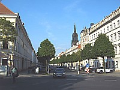
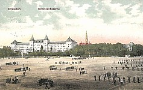

* * *

* * *

Zur Dresdner Neustadt gehören der heute meist als Innere Neustadt bezeichnete
rechtselbische Stadtkern, die westlich davon gelegene Leipziger Vorstadt mit dem [Hechtviertel](../neustadt/leipziger_vorstadt/hechtviertel/), die Äußere Neustadt, bestehend aus Antonstadt und Radeberger Vorstadt
sowie das ehemalige Militärgelände der Albertstadt.

Ausgangspunkt der Besiedlung der rechts der Elbe gelegenen Gebiete war die 1350 erstmals erwähnte Stadt Altendresden, die seit 1549
zu Dresden gehört. Nach dem Stadtbrand 1685 wurde dieser Teil auf völlig verändertem Grundriss planmäßig wiederaufgebaut und trägt seither den
Namen Neustadt. Bis zur Abtragung der Festungsanlagen blieb die Bebauung im wesentlichen auf das Gebiet zwischen Neustädter Markt und Albertplatz beschränkt.

Erst nach 1817 konnte sich die Neustadt über den mittelalterlichen Kern hinaus
ausdehnen. Die wenigen hier bestehenden Gebäude “auf dem Sande” wurden 1835 als Antonstadt nach Dresden eingemeindet. In der zweiten Hälfte des 19. Jahrhunderts kamen das 1546 beim Festungsbau entstandene [Neudorf](../neustadt/leipziger_vorstadt/neudorf/) sowie die wegen Brandgefahr ausgelagerten Scheunenhöfe an der Lößnitzstraße als Leipziger Vorstadt hinzu. Durch
den Bau der Eisenbahn begünstigt und per Ortsgesetz 1878 bestätigt, entwickelten sich diese Gebiete zum Industrie- und Gewerbestandort, ergänzt um die Wohnviertel der
Arbeiter. Im östlichen Teil der Neustadt dominieren hingegen bis heute Villen, die als “Preußisches Viertel” bzw. Radeberger Vorstadt bezeichnet werden.

Im Norden entstand nach der Reichsgründung zwischen 1873 und 1877 die
Albertstadt, die bis 1945 als größte deutsche Militärstadt einen eigenen Gutsbezirk bildete und erst dann nach Dresden eingemeindet wurde. Die hier befindlichen
Militärbauten wurden, erzwungen durch den Versailler Vertrag, nach dem Ersten Weltkrieg teilweise entmilitarisiert und gewerblich genutzt und gehören heute zum [Industriegelände](../neustadt/albertstadt/industriegelande/). Dennoch blieb das Militär bis in jüngste Vergangenheit wichtigstes
Element dieses Stadtteils. Heute werden die ehemaligen Kasernen meist als Büro- und Verwaltungsgebäude genutzt. Außerdem haben einige öffentliche Einrichtungen
in der Albertstadt ihren Sitz, ebenso wie die Heeresoffiziersschule der Bundeswehr.

* * *

 \[ [Nord](../nord/)\] \[ [Nordwest](../nordwest/)\] \[ [Neustadt](../neustadt/)\] \[ [Nordost](../nordost/)\] \[ [West](../west/)\] \[ [Zentrum](../zentrum/)\] \[ [Südwest](../sudwest/)\] \[ [Süd](../sud/)\] \[ [Südost](../sudost/)\] \[ [Ost](../ost/)\] \[ [Register](../register/)\] \[ [Kontakt](../kontakt/)\] \[ [Impressum](../impressum/)\]
