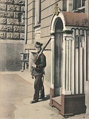Die Albertstadt wurde ab 1873 auf dem bis dahin unbebauten Gelände der Hellerterrassen im Norden der Stadt planmäßig angelegt und als Garnison der sächsischen Armee ausgebaut. Bis 1945 bildete die Militärstadt mit ihren Kasernen, wirtschaftlichen und militärischen Einrichtungen einen selbstständigen Gutsbezirk und wurde erst nach Ende des Zweiten Weltkrieges nach Dresden eingemeindet. Namensgeber des Stadtteils war der ab 1873 regierende sächsische König Albert, der zugleich als Oberbefehlshaber aller sächsischen Truppen fungierte. Für die Anlage der Albertstadt wurden Teile des Fischhäuser und Neudorfer Staatsforstreviers sowie Flurstücke der Stadt Dresden und der Gemeinden Loschwitz, Klotzsche, Rähnitz und Wilschdorf einbezogen. 1883 wurde das Areal offiziell zum selbständigen Gutsbezirk erklärt.

Als eigentlicher Gründungstag der Albertstadt gilt jedoch der 7. Februar 1873, als die sächsische Ständeversammlung die Pläne des Kriegsministeriums billigte. Mit einer politisch und wirtschaftlich selbstständigen Militärstadt sollten kurze Entscheidungswege erreicht und unerwünschter politischer Einfluss von den Militärangehörigen ferngehalten werden. Gleichzeitig gelang es jedoch, moderne Erkenntnisse der militärischen Ausbildung und der Militärhygiene umzusetzen und so die Lebensbedingungen der Soldaten spürbar zu verbessern. Zuvor waren die meisten Militärangehörigen in beengten Unterkünften in der Alt- und Neustadt, zum Teil sogar in Privathäusern untergebracht. Außerdem hemmte die enge Verflechtung zwischen militärisch genutzten und zivilen Objekten die weitere städtebauliche Entwicklung Dresdens.

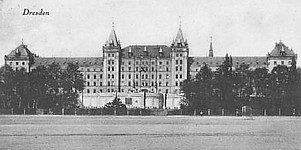Ältestes Gebäude der Albertstadt war die bereits 1871 von französischen Kriegsgefangenen errichtete Schützenkaserne am [Alaunplatz](../../neustadt/albertstadt/strassen_albertstadt/alaunplatz/) _(Foto)_, die 1945 einem Luftangriff zum Opfer fiel. 1875 kaufte der sächsische Staat für 60.000 Reichsmark dem Privatier Carl Friedrich Basold weitere 1.500 Hektar Land ab, so dass mit der Umsetzung der großzügigen Planungen begonnen werden konnte. Der folgende Bauabschnitt wurde vom sächsischen Kriegsminister Georg Friedrich von Fabrice geleitet. Unter Mitwirkung der Architekten Hermann Nicolai und Gustav Rumpel sowie der Königlich-Sächsischen Militärbaudirektion entstanden die Kasernen und Nebengebäude der um 1890 20.000 Mann zählenden Dresdner Garnison. Hauptachse der Albertstadt war die heutige [Stauffenbergallee](../../neustadt/albertstadt/strassen_albertstadt/stauffenbergallee/), die auf 3 km Länge als Heer- und Paradestraße ausgebaut wurde. Hier befanden sich die großen Kasernen der sächsischen Infanterieregimenter, das Hauptwachgebäude, die [Garnisonskirche](../../neustadt/albertstadt/strassen_albertstadt/stauffenbergallee/garnisonskirche/) und weitere Militäreinrichtungen.

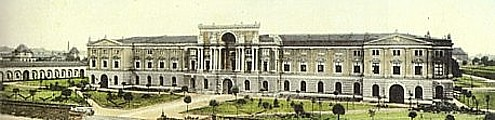

Zweiter wichtiger Komplex war das [Arsenal](../../neustadt/albertstadt/strassen_albertstadt/stauffenbergallee/militarmuseum/) an der Kreuzung der neuen Heerstraße mit der Königsbrücker Straße. Andas Arsenalhauptgebäude, welches heute als Militärhistorisches Museum dient _(Foto)_, schlossen sich die umfangreichen Militärwerkstätten an. Dieses Zentrum der Rüstungsindustrie vereinigte Lager- und Magazingebäude, Werkstätten zur Fabrikation militärischer Geräte und ein Pulverlaboratorium zur Munitionsherstellung. Die bis 1918 mehrfach erweiterten Anlagen mussten nach dem Ersten Weltkrieg aufgrund der Bestimmungen des Versailler Vertrages aufgegeben werden. In den Hallen und Werkstattgebäuden siedelten sich daraufhin verschiedene zivile Unternehmen an, so dass dieser Teil der Albertstadt heute allgemein als [Industriegelände](../../neustadt/albertstadt/industriegelande/) bekannt ist.

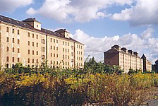Auf den Flächen zwischen [Königsbrücker Straße](../../neustadt/aussere_neustadt/antonstadt/konigsbrucker_strasse/) und Eisenbahn befand sich der
Provianthof zur Versorgung der Dresdner Garnison mit der Heeresbäckerei, Wäscherei und Speichergebäuden _(Foto)_ sowie das Militärfestungsgefängnis. Nach dem Tod Fabrices 1891 setzte sein Nachfolger Carl Paul von der Planitz den Ausbau der Albertstadt fort. U.a. entstanden 1897 das Sächsische Kriegsarchiv an der [Marienallee](../../neustadt/albertstadt/strassen_albertstadt/marienallee/), nach der Jahrhundertwende weitere Kasernenbauten an der König-Georg-Allee und der Tannenstraße sowie 1910 das Sächsische Soldatenheim.

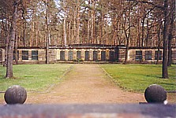Bis 1920 war die Albertstadt Sitz der Kadettenanstalt, einer traditionsreichen Ausbildungsstätte der sächsischen Armee. Als Nachfolgeeinrichtung wurde 1926 eine Infanterieschule der Reichswehr eingerichtet. Zu den bedeutenden Militärs, die zeitweise in der Albertstadt lernten und dienten, gehören die durch ihre Beteiligung an der Bewegung des 20. Juli 1944 bekannten Offiziere Claus Graf Schenck von Stauffenberg, Ludwig Beck, Friedrich Olbricht, Hans Oster und Erwin von Witzleben, an die heute zum Teil Straßennamen erinnern. Einige Gräber bekannter Militärs befinden sich auf dem [Nordfriedhof](../../neustadt/albertstadt/nordfriedhof/) _(Foto)_, der als Garnisonsfriedhof zusammen mit der Albertstadt angelegt wurde.

Das nach dem Ersten Weltkrieg zum Großteil entmilitarisierte Gebiet sollte ursprünglich als Stadtteil nach Dresden eingemeindet werden. 1921 bildete sich aus diesem Grund ein Einwohnerausschuss, der eine demokratische Gemeindeverwaltung für die Albertstadt installieren wollte. Alle Versuche scheiterten jedoch am Widerstand des Gesamtministeriums. Während bis 1924 alle selbstständigen Gutsbezirke in Sachsen aufgelöst wurden, behielt die Albertstadt ihren Sonderstatus wegen “wesentlicher öffentlicher Belange”. Nach 1933 rückte die militärische Nutzung wieder stärker in den Vordergrund. 1935 übernahm die Heeresstandortverwaltung Dresden die gesamten Verwaltungsaufgaben des Gutsbezirkes, der ab 1938 offiiziell Heeresgutsbezirk Albertstadt genannt wurde. Mit Kriegsbeginn wurden die im Industriegelände ansässigen Firmen in die Rüstungswirtschaft des Deutschen Reiches einbezogen.

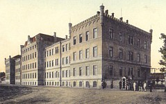1945 blieb die Albertstadt trotz ihrer militärischen Bedeutung weitgehend unzerstört. Bereits am 1. Juli gab Oberbürgermeister Friedrichs die Eingemeindung des Gebietes nach Dresden bekannt und beschlagnahmte sämtliche Gebäude und Grundstücke zugunsten der Stadt. Dieser Beschluss musste Ende 1945 rückgängig gemacht werden, da auch das Land Sachsen seine Ansprüche geltend machte. Die Verwaltung der Albertstadt blieb jedoch bei der Stadt Dresden. Die Kasernen und sonstigen militärischen Einrichtungen wurden meist von der Sowjetarmee, später auch von der NVA genutzt _(Foto: ehem. Artilleriekaserne)_. Für die hier verstorbenen sowjetischen Militärangehörigen entstand 1945 der [Sowjetische Garnisonsfriedhof](../../neustadt/albertstadt/nordfriedhof/sowjet__garnisonsfriedhof/) in der Dresdner Heide.

Mit Auflösung der NVA und dem Abzug der letzten GUS-Truppen 1994 rückte die frühere Militärstadt wieder stärker ins Blickfeld der Öffentlichkeit. 1993 fand ein städtebaulicher Wettweberb zur künftigen Gestaltung der Albertstadt statt, den das Dresdner Architektenbüro Zumpe & Partner gewann. Wenig später begann die Rekonstruktion vieler Gebäude, die heute u. a. vom Regierungspräsidium, als Landesfunkhaus des MDR und für andere Verwaltungszwecke genutzt werden. Bereits zuvor nutzten das [Stadtarchiv](../../neustadt/aussere_neustadt/antonstadt/konigsbrucker_strasse/stadtarchiv/) und die Sächsische Landesbibliothek ehemalige Militärgebäude. Die militärische Tradition des Stadtteils wird seit 1998 von der Heeresoffiziersschule der Bundeswehr und vom [Militärhistorischen Museum](../../neustadt/albertstadt/strassen_albertstadt/stauffenbergallee/militarmuseum/) fortgesetzt. Außerdem entstanden einige Neubauten für verschiedene öffentliche Einrichtungen.

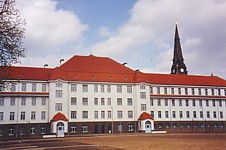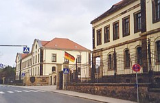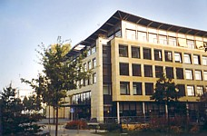

**_Fotos:_** _Fachgerichtszentrum an der Hans-Oster-/Tannenstraße (links) -_

_Heeresoffiziersschule (Mitte) - Neubau der Landesärztekammer an der Schützenhöhe (rechts)_

Video: Historische Aufnahmen aus der Albertstadt

Kraftwerk Albertstadt:

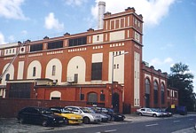Um eine weitgehende Unabhängigkeit der Militärstadt zu sichern, entstand 1901 auf dem Gelände der Artilleriewerkstätten eine “Electrische Zentrale” (heute Hermann-Mende-Straße 2), kurz darauf das Wasserwerk Charlottenstraße. Am 1. 10. 1902 nahm das neue Kraftwerk seinen Betrieb auf. Dieses erhielt neben einer Dampfkesselanlage 1909 auch ein Dieselaggregat, um eine Notstromversorgung im Havariefall absichern zu können. Eine Erweiterung erfolgte 1916/18, vor allem um den Energiebedarf der zahlreichen neuen Rüstungsfabriken abzusichern. Ab 1922 wurde das Werk von der Industriegelände-Gesellschaft Dresden-Albertstadt betrieben.

1945 ließ die Rote Armee einen Großteil der technischen Anlagen demontieren, was zu einer zeitweisen Stilllegung des Werkes führte. 1949 wurde es als Kraftwerk Nord in den Verband der Dresdner Kommunal-Wirtschaftsunternehmen (KWU) eingegliedert. Unter Regie des Nachfolgers VEB Energieversorgung Dresden erfolgten in den 1960er und 1980er Jahren Erweiterungen, um das gesamte Industriegelände kontinuierlich versorgen zu können. Nach 1990 wurde das Kraftwerk modernisiert und auf Heizöl- bzw. Erdgasfeuerung umgestellt. Das 1996 äußerlich denkmalgerecht wiederhergestellte Kraftwerk dient heute vorrangig der Fernwärmeerzeugung.

Wasserwerk Albertstadt:

Das Wasserwerk an der Charlottenstraße entstand 1901/03 zur Versorgung der Albertstadt und ist drittältestes in Dresden. Der Klinkerbau entstand auf dem Areal einer im Dreißigjährigen Krieg aufgeschütteten Schwedenschanze und beherbergt die technischen Anlagen, die stündlich bis zu 300 Kubikmeter Grundwasser liefern können. 1908 und 1915 erfolgten Erweiterungen des Werkes durch einen weiteren Hochbehälter und einen zweiten Brunnen. Nach 1990 wurde das Wasserwerk vom öffentlichen Netz genommen und versorgt heute ausschließlich das Chipwerk Infineon mit Brauchwasser. Gebäude und Ausstattung stehen unter Denkmalschutz.

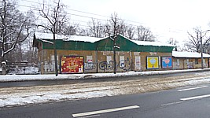Postamt Albertstadt:

Zur postalischen Versorgung der Albertstadt entstand 1890/91 an der Königsbrücker Straße 90 ein eigenes Militärpostamt. Die Einweihung erfolgte am 9. August 1891. Bis 1945 blieb die Albertstadt auch postalisch selbstständig. Danach wurde der Stadtteil nach Dresden eingemeindet und das Postamt als Dresden N 15 bezeichnet. Das Gebäude an der Westseite des heutigen Olbrichtplatzes ist noch heute erhalten.

Proschhübel:

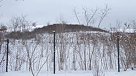Der Proschhübel ist ein unterhalb der Hellerterasse gelegener kleiner Hübel mit einer Höhe von 164,4 Meter ü. NN. Ursprünglich war diese Erhebung vollständig bewaldet, wurde jedoch im Zusammenhang mit der militärischen Nutzung des Gebietes seit Ende des 19. Jahrhunderts fast vollständig abgeholzt. Oberhalb des Proschhübels befanden sich die zu Übungszwecken genutzten Hellerterassen, unterhalb entstanden nach 1873 mehrere große Kasernenbauten zwischen [König-Georg-Allee](../../neustadt/albertstadt/strassen_albertstadt/stauffenbergallee/) und [Fabricestraße](../../neustadt/albertstadt/strassen_albertstadt/). Letztere trug zwischen 1946 und 2011 den Namen Proschhübelstraße.

Nach dem Zweiten Weltkrieg dienten Teile des Proschhübels als Sandgrube und Mülldeponie. Am westlichen Ende entstand in der Nachkriegszeit einer der Dresdner Trümmerberge zur Ablagerung der Überreste der zerstörten Stadt. Mit Aufgabe der Militäranlagen erfolgte nach 1990 eine teilweise Renaturierung des Gebietes und Einbeziehung in den Grünzug "Carolapark". Dafür entstanden hier einige Wanderwege und ein Aussichtspunkt, von dem sich ein weiter Blick ins Elbtal bietet. Im Winter nutzen vor allem Kinder den Proschhübel als Rodelberg.

[_Weiterführende Literatur und Quellen_](../../impressum/quellenverzeichnis/)

 \[ [Home](../../index.html)\] \[ [Nord](../../nord/)\] \[ [Nordwest](../../nordwest/)\] \[ [Neustadt](../../neustadt/)\] \[ [Nordost](../../nordost/)\] \[ [West](../../west/)\] \[ [Zentrum](../../zentrum/)\] \[ [Südwest](../../sudwest/)\] \[ [Süd](../../sud/)\]
 \[ [Südost](../../sudost/)\] \[ [Ost](../../ost/)\] \[ [Register](../../Register/register.html)\] \[ [Kontakt](../../Kontakt/kontakt.html)\] \[ [Impressum](../../impressum/)\]
