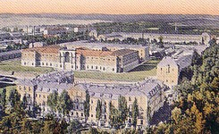
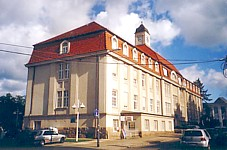
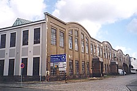
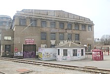
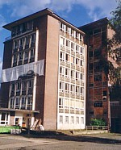
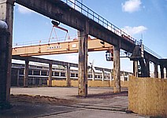
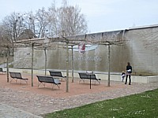

**Clubs im Industriegelände (Auswahl):**

[**Washroom**](http://www.washroom.de) [**Strasse E**](http://www.strasse-e.de) [**Tante Ju**](http://www.liveclub-dresden.de)

Arsenal und Artilleriewerkstätten

Die Geschichte des Industriegeländes begann 1873 zusammen mit der Anlage der Albertstadt. Um dem Militärbezirk eine weitgehende wirtschaftliche Unabhängigkeit zu garantieren, entstanden neben Kasernen, Schießständen und militärischen Anlagen auch eine Reihe von Versorgungseinrichtungen. Dazu gehörte der [Provianthof](../../../neustadt/aussere_neustadt/antonstadt/konigsbrucker_strasse/) an der Königsbrücker Straße, der vorrangig der Lagerung und Verarbeitung von Lebensmitteln und persönlichen Bedarfsgegenständen der Soldaten diente. Auf der gegenüberliegenden Straßenseite wurde zwischen Königsbrücker Straße und Prießnitzgrund das Arsenal mit den Artilleriewerkstätten angelegt _(Foto)_. Während das eigentliche [Arsenal](../../../neustadt/albertstadt/strassen_albertstadt/stauffenbergallee/militarmuseum/) hauptsächlich als Lager für Geschütze und Handfeuerwaffen genutzt wurde, baute man die angeschlossenen Werkstätten zur Produktion von Geschützteilen und Munition aus. Die Munitionsdepots befanden sich aus Sicherheitsgründen außerhalb des Geländes im Prießnitzgrund. Am 1. Mai 1877 wurden die “Vereinigten Artillerie-Werkstätten und Depots” eröffnet.

**_Foto:_** _Haupteingang zum Arsenal und Nebengebäude_

Auf dem Gelände der Artilleriewerkstätten befanden sich Werkstätten, wie Schmiede, Formerei, Gießerei und Stellmacherei sowie die Munitionsfabrik _(Foto)_ an der Planitzstraße (heute Meschwitzstraße). Der Komplex wurde mehrfach erweitert, so 1887/89, 1892/94 und 1900. Zur Versorgung der Betriebe mit Elektroenergie entstand 1901 das Kraftwerk Albertstadt. Außerdem wurden Gleisanlagen für eine [Anschlussbahn](../../../neustadt/albertstadt/industriegelande/industriebahn_albertstadt/) und neue Straßen angelegt. Die Artilleriewerkstätten entwickelten sich bis zum Ersten Weltkrieg zum wichtigsten Rüstungsbetrieb der sächsischen Armee. Verwaltungsmäßig unterstanden sie ab 1899 der Zeugmeisterei (ab 1912 Feldzeugmeisterei) und wurden als oberste Dienststelle für die Herstellung von Waffen und militärischem Gerät von einem Feldzeugmeister verwaltet.

Obwohl bereits im Vorfeld des Krieges eine deutliche Zunahme der Produktion von Rüstungsgütern zu verzeichnen war, traten schon bald Engpässe auf. Vor allem der materialintensive Stellungskrieg erforderte ständigen Nachschub. Nur durch eine strenge Bewirtschaftung der Rohstoffreserven und einem Ausbau der Produktionsstätten konnte dem begegnet werden. Auch in den Dresdner Werkstätten baute man neue Produktionshallen, Magazingebäude und weitere Einrichtungen. 1914/15 wurde ein Verwaltungsgebäude an der Königsbrücker Straße errichtet _(Foto)_. 1916 entstand eine große Munitionsfabrik im Norden des Areals, die mit weiteren Gleisanschlüssen und einer Drahtseilbahn mit den Munitionsdepots im Prießnitzgrund verbunden wurde. Infolge der langen Arbeitszeiten und mangelnder Ausbildung der Rüstungsarbeiter, unter ihnen viele Frauen, ereigneten sich immer wieder Unfälle und Brände. Das schwerste Unglück am 28. Dezember 1916 vernichtete einen Großteil der Munitionsfertigungsstätten. Erst nach zwei Tagen gelang es, den Brand unter Kontrolle zu bringen. Der Funkenregen explodierender Geschosse war über ganz Dresden zu sehen. 17 Arbeiter kamen beim Dresdner Arsenalbrand ums Leben, weitere wurden zum Teil schwer verletzt.

Wichtige Wirtschaftsbetriebe bis 1918:

**Arsenalhauptgebäude**

1877 als Aufbewahrungsort für Geschütze und Handfeuerwaffen errichtet, heute Militärhistorisches Museum der Bundeswehr

**Montierungsdepot**

Bekleidungs- und Ausrüstungslager der Armee mit Schneiderwerkstätten

**Administrationsgebäude**

Garnisons- und Artilleriewerkstättenverwaltung mit Depot und Baudirektion der Albertstadt

**Wagenschuppen**

Abstellplatz für Kriegsfahrzeuge mit großem Artilleriehof und Haupteingang zum Arsenalgelände

**Artilleriewerkstätten**

Produktionsstätte für Geschützteile und Kriegsfahrzeuge sowie militärischem Gerät, mehrfach erweitert (1901 Zünderwerkstatt, 1902 Speisesaal und Gießerei, 1904/1907
Geschossdreherei, 1910-12 Verwaltungsgebäude, 1912-14 Sattlerei, 1915 Holzbearbeitungswerkstatt).

**Feuerwerkslaboratorium**

Produktion von Artillerie- und Infanteriemunition mit 7 Pulvermagazinen am Prießnitzgrund

**Geschossfabrik**

1889 zur Herstellung von Artilleriegeschossen errichtet

**Kraftwerk**

1901 als “Elektrische Zentrale” zur Versorgung der Albertstadt mit Elektroenergie erbaut und im Oktober 1902 in Betrieb genommen, 1916 erweitert

**Munitionswerkstätten**

während des Ersten Weltkrieges zur Herstellung von Infanteriemunition errichtet, Gebäudekomplex mit mehreren Produktionsstätten und Magazinen und zeitweise über 3.500
Beschäftigten, 1916 durch Explosion zum Teil zerstört

**Munitionsanstalt Nord**

1915/16 am Nordrand der Artilleriewerkstätten erbaut, bestehend aus mehreren Haupt- und Nebengebäuden und 26 Pulvermagazinen, Drahtseilbahn zum Transport der Granaten

**Verladeschuppen**

1917 als Behelfsladestelle zur Verladung von Rüstungsgütern eingerichtet

**Großschmiede mit Geschosspreßwerk**

1915/16 als Kernstück der Artilleriewerkstatt Nord zur Herstellung von Lafetten, MG-Wagen und anderen Großteilen sowie Geschosshülsen erbaut. Hier befand sich auch die
Übergabestelle zwischen Industriebahn und Reichsbahn. Nach dem Ersten Weltkrieg von verschiedenen Firmen genutzt

Die Umwandlung zum Industriegelände nach 1918

Mit der Niederlage Deutschlands im Ersten Weltkrieg begann die von den Siegermächten erzwungene Demilitarisierung des Landes. Auch die Artilleriewerkstätten der Albertstadt mit ihren bedeutenden Rüstungsbetrieben mussten gemäß den Bestimmungen des Versailler Vertrages geschlossen werden. Über die Einhaltung wachte die Interalliierte Militär-Kontrollkommission. Diese verlangte den Abriss aller Versuchsschießstände und Munitionsfabriken sowie jener Betriebe und Anlagen, die für eine zivile Nutzung nicht in Frage kamen. Die deutschen Behörden versuchten zwar zunächst, die Festlegungen zu umgehen, mussten jedoch schließlich der Beseitigung zustimmen. In der Albertstadt wurden deshalb die
ehemaligen Pulvermagazine und zugehörige Anlagen bis 1922 abgetragen. Die übrigen Gebäude und Anlagen übernahm zunächst das Reichsschatzministerium mit dem Ziel, diese wirtschaftlich zu verwerten.

Am 1. Januar 1922 wurde die Industriegelände Gesellschaft Dresden-Albertstadt m.b.H. gegründet, die sich zu 100 % im Besitz des Deutschen Reiches befand. Der Gesellschaft oblag die Verwaltung und Vermietung aller Gebäude und Lagerflächen der ehemaligen Artilleriewerkstätten. Einige Bauten wurden an staatliche Behörden abgegeben. So nutzte zunächst die Landespolizei einen Teil der Pulvermagazine als Lagerräume. Der überwiegende Teil des Geländes wurde jedoch an private Unternehmen vermietet, die sich zur Mietergesellschaft Albertstadt zusammenschlossen. Die Unternehmen, die sich hier niederließen, übernahmen nicht nur einen Großteil der vorhandenen Maschinen und Einrichtungen sondern waren auch verpflichtet, einen Teil der früheren Rüstungsarbeiter weiterzubeschäftigen. Bis zur Weltwirtschaftskrise entwickelte sich dieser Teil der Albertstadt zu einer bedeutenden und vielseitigen Industrieansiedlung und wird seitdem als Industriegelände bezeichnet. Das Bild (links) zeigt einen Blick in die Produktion der in der früheren Munitionsfabrik untergebrachten Firma "Radio-Mende". Erst der wirtschaftliche Niedergang gegen Ende der 1920er Jahre führte zu Produktionseinschränkungen und Schließungen einiger Werke.

Mit Machtübernahme der Nazis änderte sich das, vor allem durch die wieder aufgenommene Rüstungsproduktion. Nach Auflösung der Mietergesellschaft Albertstadt 1933 versuchten die zuständigen Ministerien, das Areal schrittweise wieder verstärkt militärisch zu nutzen. Zunächst war man jedoch an die bestehenden Mietverträge gebunden und auch an der wirtschaftlichen Leistung der ansässigen Firmen interessiert. Als neue Nutzer des Geländes zogen 1935 eine SA-Motorsturmstaffel und die Landespolizei ein. 1936 errichtete die NSDAP-Ortsgruppe Albertstadt einen Schießstand im Prießnitzgrund. Bereits ein Jahr zuvor war die Verwaltung des Areals von der Heeresstandortverwaltung Dresden übernommen worden. Kompetenzstreitigkeiten zwischen den verschiedenen Behörden verzögerten eine komplette Eingliederung in die Wehrmacht jedoch zunächst. Erst nachdem die frühere Verwaltungsgesellschaft aufgelöst worden war, unterstand das gesamte Industriegelände ab 1941 wieder der Militärverwaltung.

_Briefkopf der VASANTA Maschinenfabrik AG von 1935_

Trotz dieser Entwicklung blieben die meisten Firmen in ihren Gebäuden bestehen. Spätestens mit Beginn des Zweiten
Weltkrieges wurde die Produktion vollständig auf Kriegswirtschaft umgestellt. U.a. fertigte man hier Funkgeräte,
Steuerungen für Torpedos, Turbinen für U-Boote und andere Zubehörteile für militärisches Gerät an. Ab 1944 wurden
jegliche Erweiterungsbauten im Industriegelände verboten und eine Auslagerung kriegswichtiger Betriebe vorbereitet, da
man einen Angriff auf das den Allliierten gut bekannte und wichtige Industriegebiet befürchtete. Allerdings blieb dieser aus. Auch beim Bombenangriff von 1945 blieb die Albertstadt von größeren Zerstörungen verschont.

Wichtige Unternehmen 1919-1945:e

**Kreiswerkstätten für Schwerbeschädigte GmbH**

bezog im April 1919 als erstes Unternehmen das frühere Militärgelände. Die Firma beschäftigte vor allem Kriegsversehrte in kleinen Handwerksbetrieben und einer Druckerei.
Die vorhandene Technik wurde von den ehem. Artilleriewerkstätten übernommen.

**Ernemann AG**

richtete 1919 in drei Gebäuden einen Zweigbetrieb ein, der bis 1925 bestand (Herstellung optischer Geräte)

**Essenzen- u. Lackfabrik Louis Naumann AG**

war bereits vor dem Ersten Weltkrieg wichtiger Lieferant der Armee (Konservenfabrik Dresden-Plauen), 1923 in eine AG umgewandelt und auf die Herstellung von Lacken und
Farben umgestellt.

**Hauptwerkstatt der**

**KVG Sachsen**

seit 1919 Kraftverkehrsunternehmen des Freistaates Sachsen, Inbetriebnahme der Werkstatt am 1. April 1920

**Sächsische Maschinenfabrik vorm. Richard Hartmann AG**

1920 bis 1928 größter Mieter des Industriegeländes mit ca. 3.500 Beschäftigten, unter ihnen viele ehem. Rüstungsarbeiter. Die ehemaligen Produktionsräume wurden nach 1928
von der ACI und den Günther-Werken übernommen.

**Sächsische Acetylenwerke AG**

seit November 1922 im Industriegelände ansässig

**H. Mende & Co. OHG (Radio-Mende)**

1923 gegründete Fabrik zur Herstellung von elektrischen Apparaten. Schwerpunkt war die Fertigung von Rundfunkgeräten. Radio-Mende gehörte später zu den wichtigsten
Rüstungsunternehmen des Industriegeländes (Funkgeräte, elektrische Zünder) und war eng mit dem NS-Regime verbunden.

**AG für Cartonnagen-Industrie**

nutzte u.a. das Verwaltungsgebäude Königsbrücker Straße und ab Mitte 1928 die Schmiedehalle des ehem. Geschosspresswerkes. Später in die Rüstungsindustrie einbezogen
(Herstellung von Geschosshülsen)

**Turbinenfabrik**

**Brückner & Co.**

übernahm 1924 die bankrotte Turbinenfabrik Kaiser, bis Kriegsende mehrfach erweitert

**Klauber & Simon (Infesto-Werk)**

1883 als Metallwarenfabrik gegründet, ab 1925 im Industriegelände ansässig, Hersteller von Kolbenringen

**Günther-Werke,**

**NL Dresden**

ab 1928 Dresdner Niederlassung der Auerbacher Günther-Werke (Cement-Jalousien-Fabrik)

**Großdruckerei**

**Johannes Päßler**

1928 in Konkurs gegangen

**Schmalzeder Erben**

Zweigbetrieb des Zieh- und Stanzwerkes Dresden-Reick (Metalldrückerei)

**Gawadi Wetterschutz GmbH**

Herstellung von Schutzbekleidung

**Gläser Karosseriewerk, Werk III**

Herstellung von Autokarossen

nringen,

Das Industriegelände nach 1945

Mit Eingemeindung der Albertstadt am 1. 6. 1945 kam auch das Industriegelände
zu Dresden. Bereits am 25. Juni verfügte Oberbürgermeister Friedrichs die Beschlagnahme aller Gebäude und Grundstücke zugunsten der Stadt Dresden.
Dieser Beschluss musste jedoch im November 1945 rückgängig gemacht werden, da das Land Sachsen Ansprüche geltend machte. Obwohl in den Betrieben kaum
Kriegsschäden zu verzeichnen waren, kam es doch zu einem weitgehenden Ausfall der Produktion. Grund waren Demontagen seitens der sowjetischen Besatzungsmacht, die in vielen Unternehmen fast alle Maschinen, Anlagen und
Rohstoffe abtransportieren ließ. Besonders betroffen waren die die Großbetriebe Radio-Mende, das Infesto-Werk und die Turbinenfabrik Brückner, Kanis & Co., deren Hochdruck-Prüffeld-Anlage das
Interesse der Besatzer geweckt hatte. Andere Unternehmen mussten für die Rote Armee arbeiten und ihre Produkte oftmals ohne Bezahlung abliefern.

Erst gegen Ende 1945 entspannte sich die Lage etwas, da man erkannt hatte, dass die
Reparationsforderungen unmöglich ohne entsprechende Maschinen erfüllt werden konnten. Ein Teil der Ausrüstungen wurde deshalb zurückgegeben bzw. durch Anlagen anderer Firmen
ersetzt. Die früheren Besitzer erhielten ihr Eigentum jedoch nicht zurück. 1946 begann die offizielle Enteignung der Unternehmen, die eine führende Rolle in der Rüstungswirtschaft gespielt
hatten oder auch nur von staatlichem Interesse waren. Neben den per Volksentscheid in Staatsbesitz überführten Firmen blieben andere Betriebe ohne Rechtsgrundlage beschlagnahmt
und wurden so ebenfalls faktisch enteignet. Bis 1950 war dieser Prozess weitgehend abgeschlossen. Im April 1951 wurde das gesamte Industriegelände der Grundstücksverwaltung
des Rates der Stadt Dresden unterstellt und verlor damit seinen Sonderstatus.  Bis 1989 arbeiteten hier zahlreiche wichtige volkseigene Betriebe. Bedeutendster war der VEB
Strömungsmaschinenbau, in dem u.a. Triebwerke für den Flugzeug- und Eisenbahnbau hergestellt wurden. Für diesen
entstand 1956/57 der noch heute vorhandene sechsgeschossige markante Büroturm an der Königsbrücker Straße 96 _(Foto)_.

Nach 1990 begann auch im Industriegelände das “Firmensterben”. Viele Betriebe
schlossen mangels Rentabilität bzw. wurden nach Privatisierung von westdeutschen Unternehmen übernommen. Während einige Firmen ihre Gebäude beispielhaft
sanierten und heute unter modernsten Bedingungen produzieren, stehen noch zahlreiche Werkshallen und Nebengebäude leer. Mitte der 1990er Jahre begann für
einige dieser Hallen eine kulturelle Nutzung durch verschiedene Vereine und für Partys und Konzerte. Schrittweise soll das gesamte Industriegelände revitalisiert werden,
wobei die denkmalgeschützten Gebäude in die Neugestaltung einbezogen werden.

Zu diesen Vorhaben gehört das Projekt “Zeitenströmung”, welches die Einrichtung eines Werkstattkomplexes speziell für Oldtimer-Fahrzeuge vorsieht. Mit der Umsetzung
wurde 2005 begonnen. Gegenwärtig befinden sich hier einige auf die Reparatur historischer Fahrzeuge spezialisierte Werkstätten. Hinzu kommen 42 gläserne Garagen,
Restaurants, ein Veranstaltungskomplex sowie ein im Stil der 1950er Jahre eingerichtetes Hotel im früheren Verwaltungsgebäude. Die Straßen des Areals sind
passend zum Thema nach bekannten Automarken bzw. Pionieren des Automobilbaus benannt. 2008 entstand als Mittelpunkt des Areals der “Niagaraplatz” mit Ruhebänken und einem 15 Meter hohen künstlichen Wasserfall _(Foto)_.

Wichtige Unternehmen nach 1945:

**Vasanta Maschinenfabrik AG**

1945 zu 80 % demontiert, 1946 als “Kriegsinteressenbetrieb” beschlagnahmt, ab 1947 im Landesbesitz

**Infesto-Werk**

1945 zu 70 % demontiert, 1946 beschlagnahmt und als VEB weitergeführt, ab 1952 Teil des Kombinates IFA Nutzkraftwagen,1990 privatisiert. Heute Teil der Federal Mogul
Powertrain Systems Group (Herstellung von Kolbenringen)

**Zahnradfabrik**

**Kurt Münnich**

1945 vollständig demontiert

**Wayß & Freytag AG**

1945 zum Großteil demontiert, 1946 enteignet (Bauunternehmen)

**Elsner Maschinenfabrik**

1945 zu 40 % demontiert, 1946 enteignet und in Landesbesitz überführt

**Turbinenfabrik**

**Brückner & Co.**.

1945 vollständig demontiert, 1946 beschlagnahmt, Teile des Unternehmens (Prüffeldanlage) blieben unter Militärverwaltung der SMAD, später bis 1990 VEB
Strömungsmaschinenbau, seit 2005 Oldtimerzentrum “Zeitenströmung”

**Radio Mende & Co.**

1945 vollständig demontiert, 1946 in Staatsbesitz überführt (VEB Funkwerk Dresden), heute Probebühne

**VEB Solidor Heiligenstadt**

**\- Betriebsteil Dresden -**

nach 1945 in einer ehemaligen Produktionshalle von Radio Mende untergebracht, Hersteller von Kurzwaren (Reißverschlüsse, Druckknöpfe, Verschlüsse) für die
Bekleidungsindustrie, 1990 geschlossen, später Umbau als Veranstaltungszentrum “Eventwerk” und Diskothek “Washroom”.

**Celluloidfabrik**

**Continental AG**

1945 vollständig demontiert

**Daimler Benz AG,**

**NL Dresden**

1946 enteignet, trotz Protestes der Muttergesellschaft in Landesbesitz überführt

**AG für Cartonnagen-Industrie**

1946 enteignet, 1947 zum VEB umgewandelt

**Industrie Gas AG (Acetylenwerk)**

1946 enteignet

* * *

 \[ [Home](../../../index.html)\] \[ [Nord](../../../nord/)\] \[ [Nordwest](../../../nordwest/)\] \[ [Neustadt](../../../neustadt/)\] \[ [Nordost](../../../nordost/)\] \[ [West](../../../west/)\] \[ [Zentrum](../../../zentrum/)\] \[ [Südwest](../../../sudwest/)\] \[ [Süd](../../../sud/)\] \[ [Südost](../../../sudost/)\] \[ [Ost](../../../ost/)\] \[ [Register](../../../Register/register.html)\] \[ [Kontakt](../../../Kontakt/kontakt.html)\] \[ [Impressum](../../../impressum/)\]
