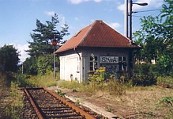
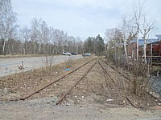

Die Industriebahn Albertstadt entstand als sogenannte Zeugmeistereibahn im
Auftrag des Kriegsministeriums und wurde am 24. September 1901 in Betrieb genommen. Ausgangspunkt war die Strecke [Dresden - Görlitz](../../../../nord/klotzsche/dresden_-_gorlitz/), von der die
Industriebahn nördlich der Straßenbrücke am heutigen Haltepunkt Industriegelände abzweigt. Anschlussgleise führten zu den Pulvermagazinen sowie zum Arsenal mit
den angeschlossenen Artilleriewerkstätten. Hinzu kamen verschiedene Zweigverbindungen, u. a. zum 1902 in Betrieb genommenen Kraftwerk der Albertstadt. Hauptsächlich diente die knapp 1,6 km lange Zeugmeistereibahn dem
Transport von Artilleriegerät, Munition und militärischen Ausrüstungsgegenständen sowie für die Belieferung der hier ansässigen Unternehmen mit Rohstoffen.

An bahntechnischen Anlagen entstanden eine Drehscheibe, ein Lokschuppen und ein Unterkunftsgebäude für das
Bahnpersonal. Letzteres diente später als Stellwerk des Industriebahnhofes. Betrieben wurde die Industriebahn durch
zwei Speicherdampflokomotiven (Baujahr 1901 und 1914), die noch bis 1975 im Einsatz waren. Vorteil dieser Fahrzeuge
war, dass sie mit Heißdampf betankt werden konnten, was eine eigene Feuerungsanlage überflüssig machte. Vor allem Sicherheitsaspekte (auf dem Gelände gab es eine Munitionsfabrik) sprachen für diese Variante.

Nach dem Ersten Weltkrieg schrieb der Versailler Vertrag eine drastische Reduzierung
der deutschen Truppenstärke und der militärisch nutzbaren Anlagen vor. In diesem Zusammenhang wurden auch die ehemaligen Artilleriewerkstätten einer zivilen Nutzung zugeführt und entwickelten sich zum [Industriegelände](../../../../neustadt/albertstadt/industriegelande/). Firmen unterschiedlicher Branchen siedelten sich nun hier an. Diese Entwicklung machte auch Veränderungen
am Gleisnetz erforderlich. So wurden die Gleise zu den ehemaligen Pulvermagazinen beseitigt, ebenso eine 700-mm-Feldbahn auf dem Gelände des früheren
Munitionsdepots. Noch heute lassen sich in diesem Areal einige Gleisreste auffinden.

Die Industriebahn blieb auch nach 1945 in Betrieb und transportierte Güter und Rohstoffe für die nun volkseigenen
Unternehmen im Industriegelände. Ab 1953 oblag die Betriebsführung den Dresdner Verkehrsbetrieben. Nach 1990 ging
das Verkehrsaufkommen deutlich zurück, so dass der Betrieb der Bahn eingeschränkt werden musste und 1992 endete. Einige Fahrzeuge befinden sich heute in den Eisenbahnmuseen von Löbau, Chemnitz und Schwarzenberg. Die
Gleisanlagen mit insgesamt 15 km Länge sind jedoch noch teilweise erhalten.

* * *

 \[ [Home](../../../../index.html)\] \[ [Nord](../../../../nord/)\] \[ [Nordwest](../../../../nordwest/)\] \[ [Neustadt](../../../../neustadt/)\] \[ [Nordost](../../../../nordost/)\] \[ [West](../../../../west/)\] \[ [Zentrum](../../../../zentrum/)\] \[ [Südwest](../../../../sudwest/)\] \[ [Süd](../../../../sud/)\] \[ [Südost](../../../../sudost/)\] \[ [Ost](../../../../ost/)\] \[ [Register](../../../../Register/register.html)\] \[ [Kontakt](../../../../Kontakt/kontakt.html)\] \[ [Impressum](../../../../impressum/)\]
