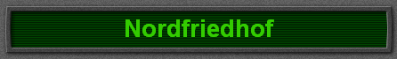
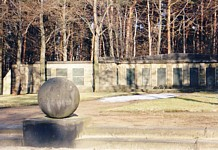
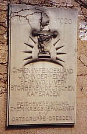
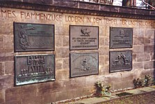
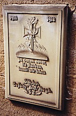
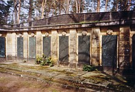
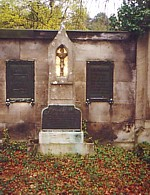

* * *

Der Nordfriedhof wurde auf Anregung des sächsischen Kriegsministers Paul von
der Planitz als Garnisonsfriedhof der Albertstadt angelegt und am 1. Oktober 1901 eröffnet. Die erste Beisetzung erfolgte am 12. Dezember des gleichen Jahres. 1902 folgte die Einweihung der nach Plänen des Sächsischen
Heeresbauamtes gestalteten Friedhofskapelle. Lorbeerkranz und Palmenzweige am Giebelfeld symbolisieren Krieg und Frieden und weisen so auf den militärischen Charakter der Anlage hin.

Das ca. 4,3 Hektar große Areal am Kannenhenkelweg in der Dresdner Heide diente zunächst fast ausschließlich der Beisetzung von verstorbenen Militärangehörigen. Aus dieser Zeit sind noch einige
Grabstätten hoher Offiziere und Generäle der sächsischen Armee erhalten, die zum Teil aus bekannten Adelsfamilien stammen. Während des Ersten Weltkriegs wurde der Friedhof erweitert und nun auch für Bestattungen von
Zivilpersonen genutzt. Zwischen 1917 und 1920 entstand ein Ehrenhain, der an die im Ersten Weltkrieg gefallenen
Soldaten der sächsischen Regimenter erinnert. Die bronzenen Gedenktafeln stammen vom Bildhauer Emil Hartmann _(Foto)_.

**_Fotos:_** _Gedenktafeln für die Gefallenen des Ersten Weltkrieges im Ehrenhain des Nordfriedhofs_

Am 17. September 1922 wurde außerdem ein Denkmal eingeweiht, welches früheren Angehörige der Brigade “Graf
von Pfeil” stifteten. Nach einem Modell des Bildhauers Lange entstand eine Bronzegruppe mit zwei Soldaten, von denen
einer im Todeskampf niedersinkt. Die künstlerisch anspruchsvolle Plastik wurde 1947 aufgrund einer Weisung der SMAD entfernt und eingeschmolzen. Der Sockel des Denkmals fand für das noch bestehende Mahnmal der Opfer des
13\. Februar 1945 Verwendung.

1940 erfolgte die dritte und letzte Erweiterung des Garnisonsfriedhofes. Hier fanden auch 437 beim Luftangriff ums Leben gekommene Soldaten und Feuerwehrleute ihre letzte Ruhestätte. In weiteren Gräbern wurden
Zwangsarbeiter und 127 erschossene Wehrdienstverweigerer beigesetzt. Seit 1946 wird der Friedhof offiziell Nordfriedhof genannt. Unweit des deutschen Garnisonsfriedhofs entstand 1945 ein [Sowjetischer Garnisonsfriedhof](../../../neustadt/albertstadt/nordfriedhof/sowjet__garnisonsfriedhof/) für
verstorbene Militärangehörige der Roten Armee. Beide Friedhöfe stehen seit 1987 unter Denkmalschutz.

Zu den bedeutenden Militärs, die auf dem Garnisonsfriedhof begraben liegen, gehören der frühere sächsische Kriegsminister Karl Paul Edler von der Planitz _(Foto)_, der letzte
Oberbefehlshaber der sächsischen Armee Carl Adolph von Carlowitz und der preußische General Georg Maercker. Außerdem finden sich hier die Gräber des früheren Präsidenten
der sächsischen Landessynode Woldemar Graf Vitzthum von Eckstädt und des Regierungsbaurates Emil Hartmann, der auch das Denkmal für die Opfer des Ersten
Weltkrieges schuf. Gedenksteine bzw. -tafeln erinnern an die Generäle Hans Oster und Friedrich Olbricht, die im Zusammenhang mit dem Hitler-Attentat 1944 erschossen wurden.

Bedeutende Grabstätten und Gräber bekannter Persönlichkeiten

**_Grabstätte_**

**_Todesjahr_**

Karl Paul Edler von der Planitz, General, sächsischer Kriegsminister

1902

Otto Ernst Hüttig, Zahlmeister der deutschen Schutztruppe in Deutsch-Ostafrika

1913

Georg Maercker, preußischer Generalmajor, Präsident des Kolonialkriegerbundes

1924

Hans Carl Adolph von Carlowitz, General, letzter Oberbefehlshaber der sächs. Armee

1928

Woldemar Graf Vitzthum von Eckstädt, General, ab 1938 Präsident der evangel. Landessynode

1936

Emil Hartmann, Bildhauer, Schöpfer der Gedenkstätte für die Gefallenen des Ersten Weltkriegs

1939

Hans Karl von Kirchbach, Oberstleutnant

1946

Curt Fischer, Professor am Kadettencorps und Oberstudiendirektor der Landesschule

1949

Ingetraut Ludolphi, Kirchenhistorikerin

2014

Familiengrab Klotzsche, Besitzer der Gaststätte “Drachenschänke”

* * *

 \[ [Nord](../../../nord/)\] \[ [Nordwest](../../../nordwest/)\] \[ [Neustadt](../../../neustadt/)\] \[ [Nordost](../../../nordost/)\]
 \[ [West](../../../west/)\] \[ [Zentrum](../../../zentrum/)\] \[ [Südwest](../../../sudwest/)\] \[ [Süd](../../../sud/)\] \[ [Südost](../../../sudost/)\] \[ [Ost](../../../ost/)\] \[ [Register](../../../Register/register.html)\] \[ [Kontakt](../../../Kontakt/kontakt.html)\] \[ [Impressum](../../../impressum/)\]
