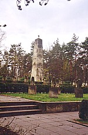
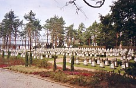

* * *

Der Sowjetische Garnisonsfriedhof wurde 1945 am Rand der Dresdner Heide angelegt.
Hier fanden in der Nachkriegszeit auf einer Fläche von ca. 2,58 Hektar Angehörige der in Dresden stationierten sowjetischen Streitkräfte und deren Familienmitglieder, aber auch
ehemalige Zwangsarbeiter der Nazis ihre letzte Ruhe. Die meisten waren zuvor im nahegelegenen Lazarett in Behandlung und verstarben an den Folgen von
Kriegsverletzungen, aber auch durch Seuchen und mangelnde Versorgung. Die Grabstätten sind einheitlich gestaltet und als Einzelreihen- und Gemeinschaftsgräber angelegt.

1947 wurde ein 16 Meter hoher Sandsteinobelisk mit Stern und Sowjetwappen aufgestellt, der von Friedrich Press geschaffen wurde _(Foto)_. Das Denkmal zeigt neben Panzersoldaten
das Relief eines Mädchens und die Silhouette eines russischen Dorfes und trägt übersetzt die Inschrift: “Ewige Ehre den im Kampf für die Freiheit und Unabhängigkeit der sowjetischen
Heimat gefallenen Helden. 1941 - 1945”. Ein zweites Mahnmal stammt von 1957 und stellt einen Arbeiter mit gesenkter Fahne dar. Schöpfer der Bronzeplastik war der Bildhauer Friedrich Rogge. Dieses
Denkmal war ein Geschenk der Stadt Dresden zum 40. Jahrestag der Oktoberrevolution.

Der Friedhof kam nach Abzug der GUS-Truppen 1994 unter Verwaltung des
Freistaates Sachsen. Die gesamte Anlage steht unter Denkmalschutz und besteht heute aus ca. 1000 Gräbern, darunter ca. 50 Frauen und 80 Kinder.
Die letzte Beisetzung erfolgte im September 1987. Weitere Grabstellen sind leer, da die hier liegenden Toten in die Heimat überführt worden sind. 1998
begann eine umfassende Sanierung der Friedhofsanlage. Der Friedhof wird heute nicht mehr genutzt und vom benachbarten Nordfriedhof betreut.

* * *

 \[ [Nord](../../../../nord/)\] \[ [Nordwest](../../../../nordwest/)\] \[ [Neustadt](../../../../neustadt/)\] \[ [Nordost](../../../../nordost/)\] \[ [West](../../../../west/)\] \[ [Zentrum](../../../../zentrum/)\] \[ [Südwest](../../../../sudwest/)\]
 \[ [Süd](../../../../sud/)\] \[ [Südost](../../../../sudost/)\] \[ [Ost](../../../../ost/)\] \[ [Register](../../../../Register/register.html)\] \[ [Kontakt](../../../../Kontakt/kontakt.html)\] \[ [Impressum](../../../../impressum/)\]
