* * *

Der Albert-Fromme-Weg wurde nach 1990 auf ehemaligem Militärgelände zwischen Stauffenbergallee und Fabricestraße angelegt. Der Name erinnert an den früheren Chefarzt der Chirurgischen Klinik Albert Fromme (1881-1966), der 1921 nach Dresden kam. Nach 1945 war er Direktor des Krankenhauses Friedrichstadt und später an der Gründung der Medizinischen Akademie beteiligt. Die hier befindlichen Wohnhäuser gehören zum sogenannten Carolapark, benannt nach der Gemahlin König Alberts.

Die Straße Am Kohlenplatz befindet sich im nördlichen Teil des Industriegeländes. Sie ihre Bezeichnung am 17. Juli 1961 mit örtlichem Bezug.

Die Straße Am Lagerplatz im südlichen Bereich des Industriegelände wurde am 17. Juli 1961 benannt. Damals erhielten die zuvor unbenannten Straßen des Gewerbegebietes eigene Namen zur besseren Orientierung. Hier befindet sich seit 2019 in der Nr. 8 das Bildungszentrum der Handwerkskammer Dresden mit Unterrichtsräumen und Werkstätten für die Lehrbereiche Gebäudetechnik, Metallbau und Schweißtechnik. Die Grundsteinlegung erfolgte am 12. Juni 2017.

Die parallel zur Bahnstrecke [Dresden - Görlitz](../../../nord/klotzsche/dresden_-_gorlitz/) verlaufende Straße An der Eisenbahn wurde am 17. Juli 1961 benannt und gehört zu den damals erstmals benannten Erschließungsstraßen des Industriegeländes. In der Nähe zweigte einst die nach 1990 stillgelegte [Industriebahn Albertstadt](../../../neustadt/albertstadt/industriegelande/industriebahn_albertstadt/) ab, die an dieser Straße ein Anschlussgleis bediente. An der Eisenbahn Nr. 7 hatte zu DDR-Zeiten die Kreiserfassungsstelle für Eier, Geflügel und Honig des VEB Getreidewirtschaft Dresden ihren Sitz.

Die Straße An der Schleife im nördlichen Teil des Industriegelände wurde gemeinsam mit ihren benachbarten Straßen am 17. Juli 1961 benannt. Die Namensgebung erfolgte wegen ihres bogenförmigen Verlaufs. Der südliche Teil war bis 1998 die Sandgrubenstraße, wurde dann jedoch in die Straße An der Schleife einbezogen.

Die von der Marienallee zu den früheren Grenadierkasernen führende Straße erhielt 1879 zu Ehren des regierenden deutschen Kaisers zunächst den Namen Kaiser-Wilhelm-Allee. Ursprünglich sie Teil eines alten Heideweges. Nach dem Ersten Weltkrieg wurde wie bei vielen Straßennamen der Titel weggelassen und die Straße nur noch Wilhelmallee genannt. Bereits am 27. September 1945 erhielt sie jedoch den neuen, bis heute verwendeten Namen Arno-Holz-Allee. Der Schriftsteller Arno Holz (1863-1929) gehörte zu den Vertretern einer neuen naturalistischen Literaturströmung und verfasste Ende des 19. Jahrhunderts mehrere sozialkritische Dramen und Prosastücke.

Die Charlotte-Bühler-Straße gehört zu den Erschließungsstraßen des Industriegeländes und wurde ursprünglich wie auch die benachbarten Straßen nur mit einem Buchstaben bezeichnet (Straße B). Im März 1997 erhielt sie ihren heutigen Namen nach der Psychologin Charlotte Bühler (1893-1974), die zeitweise an der Technischen Hochschule in Dresden lehrte. Später war sie u.a. in Wien und in Los Angeles als Professorin tätig. Zu ihren wichtigsten Werken gehört das Buch “Der menschliche Lebenslauf als psychologisches Problem”, ein Standardwerk der praktischen und experimentellen Psychologie.

Die frühere Straße 10 auf dem Gelände der ehemaligen Artilleriewerkstätten erhielt im März 1997 nach einem Dresdner Unternehmer den Namen Clemens-Müller-Straße. Clemens Müller (1828-1902) gründete 1855 die erste deutsche [Nähmaschinenfabrik](../../../neustadt/leipziger_vorstadt/grossenhainer_strasse/nahmaschinenwerk/) und führte diese zu Weltruf. 1883 verlegte er seinen Betrieb auf ein Gelände an der Großenhainer Straße. Verdienste erwarb er sich auch wegen seines für die damalige Zeit beispielhaften Engagements auf sozialem Gebiet.

Die Elisabeth-Boer-Straße wurde im Zuge der Umgestaltung des Areals der ehemaligen Heeresbäckerei angelegt und 1999 nach der früheren Leiterin des Stadtarchivs benannt. Elisabeth Karoline Boer (1896-1991) war ab 1925 wissenschaftliche Mitarbeiterin des Ratsarchivs und 1945 maßgeblich an der Rettung des verbliebenen Archivgutes beteiligt. 1951 übernahm sie die Leitung der Einrichtung. Seit 1999 hat in den Gebäuden der Heeresbäckerei das Dresdner [Stadtarchiv](../../../neustadt/aussere_neustadt/antonstadt/konigsbrucker_strasse/stadtarchiv/) seinen Sitz.

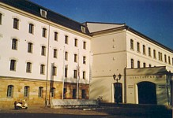

**_Foto:_** _Die ehemalige Heeresbäckerei mit dem Stadtarchiv an der Elisabeth-Boer-Straße_

Die zuvor als Straße C bezeichnete Straße im Industriegelände trägt seit März 1997 nach der Reformpädagogin Else Sander (1896-1988) den Namen Else-Sander-Straße. Else Sander war viele Jahre als Dozentin und Studienrätin an der Pädagogischen Hochschule tätig und verfasste in den 1920er Jahren einige Schriften, in denen sie sich für eine qualifizierte Berufsbildung junger Frauen einsetzte. Während des Zweiten Weltkrieges befand sich auf dem an dieser Straße gelegenen Sportplatz ein Barackenlager für Zwangsarbeiterinnen aus Osteuropa, welche vor allem bei Radio-Mende in der Rüstungsproduktion eingesetzt waren.

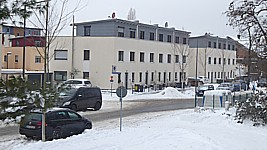Die 1879 angelegte Straße trug ursprünglich den Namen Fabricestraße nach dem Gründer der Albertstadt, dem früheren sächsischen Kriegsminister Graf Georg Friedrich Alfred von Fabrice (1818-1891). Fabrice war maßgeblich an der Reorganisation der sächsischen Armee nach Gründung des Deutschen Reiches beteiligt und wirkte an der Seite Bismarcks bei den Friedensgesprächen nach dem Deutsch-Französischen Krieg 1870/71 mit. 1876 wurde er mit der Leitung des Gesamtministeriums betraut und erhielt 1882 das Amt des Ministers des Auswärtigen übertragen. In der Folge entstanden hier verschiedene militärische Einrichtungen, u.a. das Militärgericht und einige Nebengebäude der [König-Georg-Kaserne](../../../neustadt/albertstadt/strassen_albertstadt/stauffenbergallee/) (spätere Flak-Kaserne).

Am 1. Juli 1946 wurde die Fabricestraße nach einer kleinen [Erhebung](../../../neustadt/albertstadt/) in den Hellerbergen in Proschhübelstraße umbenannt, erhielt jedoch auf Beschluss des Stadtrates am 29. September 2011 ihren ursprünglichen Namen zurück. 2010 begann der Bau des Wohngebietes “Carolapark” mit mehreren Doppel- und Reihenhäusern. 2012 folgte ein weiteres Wohnviertel (“Quartier Fabrice”) mit 14 Reihen- und 6 Doppelhäusern _(Foto)_. Seit 2013 gibt es zudem eine Kindertagestätte (Nr. 7).

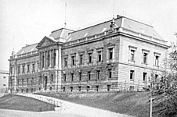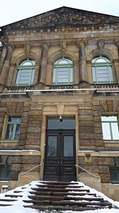Militärgericht: Seit 1901 befand sich auf der Fabricestraße 6 das Militärgericht der Dresdner Garnison mit angeschlossener Militärarrestanstalt. Zum Gebäudekomplex gehörten neben dem Gerichtsgebäude das Disziplinararresthaus für kleinere Vergehen, das [Festungsgefängnis](../../../neustadt/aussere_neustadt/antonstadt/konigsbrucker_strasse/) und ein Wohngebäude. Hier wurden bis zum Ende des Ersten Weltkriegs ausschließlich Militärangehörige verurteilt und inhaftiert.

Ab 1920 dienten die Gebäude als zivile Strafanstalt, nach 1933 wieder als Gerichtsgebäude des Divisionsgerichts 404 der Wehrmacht. Am 15. September 1945 bezogen Untersuchungshäftlinge des Dresdner Landgerichts die ehemalige Arrestanstalt, während das eigentliche Gerichtsgebäude zeitweise als Sitz der Landesverwaltung Justiz und der Generalstaatsanwaltschaft Sachsen diente. 1949 mussten die Justizbehörden ihr Domizil zugunsten der Deutschen Volkspolizei bzw. der Sowjetarmee verlassen. Seit 1998 befindet sich hier der Sitz der Bundesanstalt für Arbeitsschutz und Arbeitsmedizin. Im früheren Gefängnisgebäude soll künftig das Depot des Militärhistorischen Museums untergebracht werden.

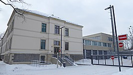Feuerwache Albertstadt: Die moderne Feuer- und Rettungswache entstand 2015/16 an der Ecke zur Magazinstraße als Ersatz für die nicht mehr den Anforderungen genügenden Neustädter Feuerwache auf der Katharinenstraße. Die Grundsteinlegung erfolgte am 21. Mai 2014, die offizielle Einweihung am 25. April 2016. In den Gebäudekomplex wurde ein 1893 erbautes Kasernengebäude der Arbeiterabteilung der sächsischen Armee einbezogen. Hier befinden sich Unterkunftsräume der Dresdner Berufsfeuerwehr und des DRK, Schulungs- und Ruheräume, Büros, eine Sporthalle und Küche mit Speiseraum. Die Wache bietet Platz für einen Löschzug mit vier Fahrzeugen sowie Spezialtechnik, u.a. für Straßenbahnhavarien. Das ehemalige Vorratsgebäude der Kaserne dient heute als Übungsraum.

Der Hammerweg ist Teil eines alten Verbindungsweges von Trachenberge über die Hellerberge nach Klotzsche. Seinen Namen erhielt er nach einem alten Waldzeichen, dem sogenannten "Hämmerchen". Beim Bau des Flugplatzes Hellerberge wurde er in den Zwanziger Jahren unterbrochen und besteht heute aus zwei Teilstücken am St.-Pauli- Friedhof sowie in der Nähe der [Deutschen Werkstätten Hellerau](../../../nord/hellerau/deutsche_werkstatten/). Ab 1996 entstand am Hammerweg eine moderne Justizvollzugsanstalt, die das bisherige Gefängnis an der Schießgasse ersetzt. Weitere Flächen werden von der 1993 aus ehemaligen Hausgärten hervorgegangen Kleingartensparte “St. Pauli” genutzt.

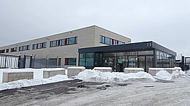2014 erfolgte der Abbruch der ehemaligen Mörtelfabrik am Hammerweg. Die Gebäude waren Ende des 19. Jahrhunderts errichtet worden und wurden nach 1945 u. a. von der Hutfabrik Klingner & Co. und der Wäscherei Schneeweiß genutzt. Künftig ist auf dem Grundstück eine Grünfläche geplant. Erhalten blieb die frühere Fabrikantenvilla Radeburger Straße 4.

Ein Jahr später begann auf dem Grundstück Hammerweg 26 der Bau einer Erstaufnahmeeinrichtung für Flüchtlinge, der jedoch nie bezogen wurde _(Foto)_. Stattdessen erfolgte ein Umbau für das sächsische Oberlandesgericht, um hier Prozesse mit großer Kapazität durchführen zu können. Hier fand u.a. 2017/18 der Prozess gegen die Mitglieder der rechtsradikalen "Gruppe Freital" statt.

Justizvollzugsanstalt: Die moderne JVA Dresden entstand zwischen 1996 und 1998 auf dem Areal einer ehemaligen Kaserne und ist größte in Sachsen. Sie bietet Platz für ca. 750 Strafgefangene (Frauen und Männer) sowie eine Untersuchungshaftanstalt für jugendliche Straftäter und Jugendarrest. Neben den Unterbringungsräumen gibt es auch eine Sporthalle, Werkstätten, Großküche und Bäckerei sowie Verwaltungsgebäude, die durch ein unterirdisches Gangsystem miteinander verbunden sind. Am 6. Juli 2000 wurde das Gefängnis eingeweiht.

Die ursprünglich Schimpff- bzw. Arsenalstraße genannte Verbindung zwischen Tannenstraße und Arsenalhauptgebäude entstand aus einem 1878 erstmals nachweisbaren Fußweg zur Pionierkaserne. Nach dem Ausbau dieses Weges wurde der südliche Abschnitt bis zur Stauffenbergallee ab 1896 Verbindungsstraße genannt. Ein Jahr später erfolgte die Umbenennung in Schimpffstraße. Namenspatron war Generalmajor Hans Otto von Schimpff (1822-1891). Zeitgleich erhielt der nördlich der Stauffenbergallee gelegene Teil den Namen Arsenalstraße.

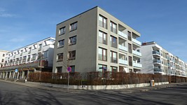Nach dem Ende des Zweiten Weltkriegs galten diese Namen als militaristisch, so dass man am 27. September 1945 zunächst die Schimpffstraße in Tollerstraße umbenannte. Namensgeber war der Dramatiker, Lyriker und Erzähler Ernst Toller. Am 1. Juli 1946 folgte die Eingliederung der bisherigen Arsenalstraße und die Zusammenlegung beider Straßenabschnitte. Durch die Eingemeindung von Niedersedlitz, wo es ebenfalls eine Ernst-Toller-Straße gab, machte sich jedoch 1953 eine erneute Namensänderung erforderlich. Fortan hieß diese “Zur Stadthalle”. Als Stadt- bzw. Nordhalle diente in der Nachkriegszeit das ehemalige Arsenalgebäude, in welchem sich heute das [Militärhistorische Museum](../../../neustadt/albertstadt/strassen_albertstadt/stauffenbergallee/militarmuseum/) befindet.

Am 25. Februar 1993 wurde die Straße in Hans-Oster-Straße umbenannt. General Hans Oster (geb. 1887 in Dresden) gehörte ab 1941 der Abteilung Abwehr/Ausland der Wehrmacht an und organisierte gemeinsam mit anderen regimekritischen Offizieren den Widerstand gegen Hitler. Im Zusammenhang mit den Ereignissen vom 20. Juli 1944 wurde Hans Oster verhaftet und am 9. April 1945 hingerichtet. 2009 begann an der Hans-Oster- / Tannenstraße der Bau einer Wohnanlage mit Reihen- und Mehrfamilienhäusern _(Foto)_.

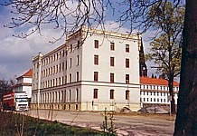Fachgerichtszentrum: Neben dem Militärhistorischen Museum haben an der Hans-Oster-Straße auch das Sächsische Landesvermessungsamt und seit 2007 das Fachgerichtszentrum ihren Sitz. Letzteres besteht aus zwei Gebäuden, welche durch einen modernen Zwischenbau miteinander verbunden sind. Das ältere Haus im Tudorstil _(Foto)_ von 1878 gehörte ursprünglich zum Arsenal und wurde, ebenso wie ein zwischen 1909 und 1913 entstandener Kasernenbau, noch bis 1990 militärisch genutzt. Die vor 1945 als Kleine Kaserne bzw. Große Kaserne bezeichneten Häuser waren bis zu deren Zerstörung beim Luftangriff Teil der [Schützenkaserne](../../../neustadt/albertstadt/strassen_albertstadt/alaunplatz/) am Alaunplatz. Zuletzt waren hier sowjetische Soldaten untergebracht. 2004-07 erfolgte eine grundlegende Sanierung der Kasernen, welche heute Büros und Verhandlungsräume des Arbeits-, des Sozial- und des Verwaltungsgerichts beherbergen.

Die Hartmut-Dost-Straße befindet sich auf dem Areal der früheren [Gardereiterkaserne](../../../neustadt/albertstadt/strassen_albertstadt/stauffenbergallee/) und wurde erst im Zuge der Neubebauung des Areals nach 1990 benannt. Da in den errichteten Neubauten u.a. die Sächsische Landesärztekammer ihren Sitz hat, erhielt sie den Namen des Kinderarztes Friedrich Hartmut Dost (1910–1985). Er gilt als Begründer der Pharmakokinetik, die sich mit der Erforschung der Wirkung von Arzneimitteln im Körper befasst.

Die Straße entstand Mitte der 1990er Jahre zur Erschließung des sogenannten "Carolaparks", einem kleinen Wohngebiet zwischen Stauffenbergallee und Fabricestraße. Die Namensgebung Hellerschanze erfolgte am 2. November 1995 zur Erinnerung an militärische Schanzanlagen aus dem preußisch-österreichischen Krieg 1866. Nachdem die preußische Elbarmee am 18. Juni 1866 in Dresden eingerückt war, ließ sie rund um die Stadt einen Ring aus Schanzen anlegen, darunter die speziell dem Schutz der Eisenbahnstrecke nach Schlesien dienende "Hellerschanze". Reste der offiziell als "Schanze VIII" bezeichneten Befestigung sind noch erhalten.

Die ehemalige Straße G im Industriegelände wurde im März 1997 nach einem Unternehmer Hermann-Mende-Straße benannt. Otto Hermann Mende (1885-1940) gründete 1923 die Mende & Co OHG, die unter dem Namen “Radio-Mende” bis 1945 bedeutendster Betrieb des Industriegeländes war. In den 1920er und 30er Jahren wurden hier vor allem Rundfunk- und Funkgeräte gebaut. Heute werden die Gebäude von einigen kleineren Unternehmen sowie als Musikclub “01099” genutzt. Ab 1901 befand sich die "elektrische Zentrale" der Albertstadt, ein [Kraftwerk](../../../neustadt/albertstadt/) an dieser Straße.

Der Holunderweg, eine kleine von der Arno-Holz-Allee abgehende Sackgasse, wurde am 8. Februar 1956 benannt. Grund für die Namensgebung waren örtliche Gegebenheiten. An der kurzen Straße stehen meherere Gebäude, so die Häuser Nr. 2 bis 8 und die Doppelhäuser Nr. 10, 14 und 16 unter Denkmalschutz.

Die Magazinstraße wurde im Zusamenhang mit dem Bau der Albertstadt zur Erschließung des ausgedehnten [Proviant- und Magazinhofes](../../../neustadt/aussere_neustadt/antonstadt/konigsbrucker_strasse/) angelegt und verläuft parallel zur Bahnstrecke Dresden - Görlitz. Neben Wirtschaftsgebäuden und Speichern zur Versorgung der Albertstand entstand hier 1892/93 die Kaserne der Arbeiterabteilung der sächsischen Armee. 1898 ist die Straße erstmals unter diesem Namen im Adressbuch verzeichnet.

Arbeiterabteilungskaserne (Nr. 1): Die Arbeiterabteilungskaserne wurde im Zuge des zweiten Bauabschnitts der Albertstadt zwischen 1892 und 1893 errichtet. Neben dem Kasernenhauptgebäude entstanden ein Vorrats- und Lagergebäude, welche bis heute erhalten sind. Nutzer war bis 1919 die Arbeiterabteilung der sächsischen Armee, eine 1868 eingerichtete Einheit, der hauptsächlich Bau- und Unterstützungsaufgaben oblagen. Eingesetzt wurden sowohl für den Kampfeinsatz untaugliche als auch aus disziplinarischen Gründen versetzte Soldaten. Seit April 2016 dienen die sanierten Gebäude der Dresdner Berufsfeuerwehr als Feuerwache Albertstadt. Im früheren Vorratsgebäude ist ein modernes Ausbildungszentrum untergebracht.

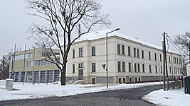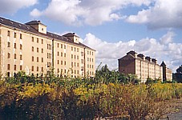

**_Foto:_** _Magazinstraße - links: ehem. Arbeiterkaserne - rechts die früheren Speicher des Provianthofes_

Die in den 1930er Jahren angelegte frühere Straße F, heute Melitta-Bentz-Straße, im Industriegelände wurde im März 1997 nach der Unternehmerin Melitta Bentz (1873-1950) benannt, die 1908 in Dresden den Kaffeefilter erfand. Zunächst entstanden die Filter in ihrer Wohnung in der Pirnaischen Vorstadt, später in einem Hintergebäude auf der Wilder-Mann-Straße in Trachau. 1929 verlegte das Familienunternehmen [“Melitta”](../../../nordwest/trachau/strassen_trachau/wilder-mann-strasse/melitta/) seinen Sitz nach Minden in Westfalen.

Die Meschwitzstraße wurde im Zusammenhang mit dem Bau der Albertstadt auf dem Gelände der Artilleriewerkstätten angelegt. Da sich hier das Pulverlaboratorium für die Munitionsherstellung befand, erhielt sie am 3. Januar 1879 zunächst den Namen Laboratoriumsstraße, wurde 1903 jedoch nach dem sächsischen General und Kriegsminister Carl Paul Edler von der Planitz (1837-1902) benannt. Da dieser Name als “militaristisch” galt, erfolgte 1946 die Umbenennung der Planitzstraße in Meschwitzstraße nach einem früheren Oberförster der Dresdner Heide. Friedrich Wilhelm Meschwitz (1815-1888) war maßgeblich an der Erschließung des Heidegebietes für den Tourismus beteiligt.

Im Zuge der Demilitarisierung nach dem Ersten Weltkrieg siedelten sich auf dem Areal der früheren Munitionsanstalt zivile Unternehmen an. Hier befanden sich u.a. die Produktionsräume der Firma Radio-Mende und der Louis Naumann AG. Weitere Nutzer waren das Papierwerk Willi Schwabe (Nr. 9) und die Dresdner Schürzen- u. Kleiderfabrik Hopf & Feilgenhauer (Nr. 20d). Das Grundstück Meschwitzstraße 10 diente viele Jahre als Sportplatz der BSG Motor Industriegelände und wird heute
von den Sportfreunden 01 Dresden Nord e. V. genutzt.

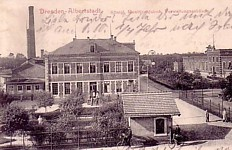Pulverlaboratorium: Die Gebäude entstanden 1875/76 und ersetzten das bisherige Pulverlaboratorium in der Friedrichstadt, welches dem Bau des [Berliner Bahnhofes](../../../zentrum/friedrichstadt/dresden_-_berlin/) weichen musste. Als Gegenleistung hatte sich die Direktion der Eisenbahn zum Ankauf eines Grundstückes und zum Bau von sieben neuen Magazinen am Rande der Dresdner Heide auf eigene Kosten verpflichtet. Nachdem diese durch das Kriegsministerium mit der entsprechenden Einrichtung ausgestattet waren, wurde die Anlage als Königlich-Sächsische Munitionsfabrik und Munitionsanstalt in Betrieb genommen. Fortan erfolgte hier die Fertigung von Artillerie- und Infanteriemunition für das XII. Sächsische Armeekorps. 1918 musste die Herstellung von Munition eingestellt werden. Die Gebäude wurden daraufhin abgetragen bzw. von anderen Firmen genutzt.

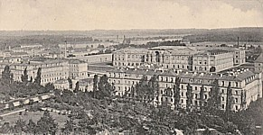Der Olbrichtplatz entstand 1877 als Vorplatz des [Arsenalhauptgebäudes](../../../neustadt/albertstadt/strassen_albertstadt/stauffenbergallee/militarmuseum/) der Albertstadt und wurde ab 1879 Königsplatz genannt. Als Mittelpunkt der Albertstadt legte man hier eine repräsentative Grünanlage mit einer direkt auf den Haupteingang des Arsenals zuführenden Allee an. Neben dem Arsenal (heute Militärhistorisches Museum) entstanden an den Seiten des Platzes Verwaltungsgebäude für das Bekleidungsamt des XII. Armeekorps

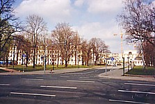Am 1. Juli 1946 erfolgte zunächst die Umbenennung in Nordplatz, am 18. Juli 1950 schließlich in Dr.-Kurt-Fischer-Platz. Die zum Arsenal führende Straße erhielt dabei den Namen “Zur Stadthalle”. Kurt Fischer (1900-1950) gehörte bereits in den Zwanziger Jahren der KPD an, emigrierte 1933 in die UdSSR und war nach 1945 maßgeblich an der gesellschaftlichen Umgestaltung im Sinne der neuen Machthaber beteiligt. Ab Mai 1945 hatte er das Amt des 1. Bürgermeisters von Dresden inne und übernahm wenige Monate danach das Amt des Vizepräsidenten der Landesverwaltung Sachsen. Später wurde er Innenminister Sachsens und war bis zu seinem Tod Chef der Deutschen Volkspolizei.

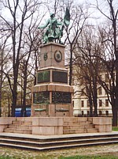Am 20. Juli 1991 wurde der Dr.-Kurt-Fischer-Platz in Olbrichtplatz umbenannt, die kurze Straße erhielt den Namen Hans-Oster-Straße. Beide Namen erinnern an verdienstvolle Offiziere, die am missglückten Hitlerattentat 1944 beteiligt waren. Friedrich Olbricht (1888-1944) wirkte viele Jahre in Dresden und war ab 1934 Chef des Generalstabs des IV. Armeekorps. Als Mitglied des Generalstabs der Wehrmacht unterhielt er enge Beziehungen zu anderen regimekritischen Offizieren und bereitete mit diesen gemeinsam das Attentat auf Hitler am 20. Juli 1944 vor. Das Grab des noch am gleichen Tag in Berlin hingerichteten Offiziers befindet sich auf dem Nordfriedhof.

Am Olbrichtplatz fand 1994 das [Sowjetische Ehrenmal](../../../neustadt/albertstadt/strassen_albertstadt/sowjetisches_ehrenmal/) seinen neuen Standort _(Foto)_, welches zuvor ab 1945 am heutigen Albertplatz stand. Schöpfer des Monuments war der Bildhauer Otto Rost. In einem bis 1990 militärisch genutzten Nebengebäude des Arsenals (Olbrichtplatz 1) hat seit 2002 das Dresdner Amtsgericht sein Domizil. Hier sind die Bereiche Zwangsvollstreckung / Insolvenz, das Registergericht und das Grundbuchamt untergebracht. Weitere Räume des 1999 sanierten Gebäudes beherbergen das Sächsische Landesamt zur Regelung offener Vermögensfragen.

Die Provianthofstraße entstand 1879 als Zufahrt zum Provianthof, des zentralen Wirtschafts- und Versorgungszentrums der sächsischen Armee. Zum Provianthof gehörten u.a. die noch heute weitgehend erhaltenen Gebäude der [Garnisonsversorgungsanstalt](../../../neustadt/aussere_neustadt/antonstadt/konigsbrucker_strasse/) und die jetzt als Stadtarchiv genutzte Heeresbäckerei.

Am 1. Juli 1946 wurde die Straße in Paul-Schrader-Straße umbenannt. Paul Schrader (1895-1946) war Mitglied des Roten Frontkämpferbundes und nach 1945 am Wiederaufbau der Gewerkschaften beteiligt. Da das Areal jedoch später von der Sowjetarmee genutzt und deshalb nicht öffentlich zugänglich war, hob man den Straßenamen in den 1960er Jahren auf. Im Zuge der Umgestaltung des früheren Provianthofes nach 1990 wurde die Straße wieder öffentlich gewidnet und erhielt 1999 ihren ursprünglichen Namen Provianthofstraße zurück.

Die Sandgrubenstraße im nördlichen Teil des Industriegeländes erhielt zusammen mit weiteren zuvor unbenannten Erschließungsstraßen des Areals am 17. Juli 1961 ihren Namen nach örtlichen Gegebenheiten. Durch spätere bauliche Veränderungen wurde der südliche Teil dieser Straße in ein Betriebsgelände einbezogen und der Straßenname am 30. November 1998 wieder aufgehoben. Der verbliebene nördliche Restabschnitt ist seitdem der Straße An der Schleife zugeordnet.

Die Schützenhöhe wurde erst 1995 als Erschließungsstraße des Wohngebietes "Carolapark" zwischen Fabricestraße und Stauffenbergallee angelegt. Der am 2. November 1995 offiziell eingeführte Name bezieht sich auf die frühere militärische Nutzung des Gebietes. Nach Entwürfen des Stuttgarter Architekten Prof. Striffler entstanden hier 1996/98 moderne Verwaltungsbauten der sächsischen Landesärzte- und Landeszahnärztekammer sowie der Kassenärztlichen Vereinigung Sachsen.

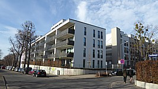Die Tannenstraße wurde im Zusammenhang mit dem Bau der Hechtviertels angelegt und 1859 wie auch die benachbarten Straßen nach einer Baumart benannt. Der östlich der Königsbrücker Straße gelegene Teil folgte erst 1871 als Zufahrt zur Schützenkaserne und trug ab 1897 bis 1945 den Namen Hausenstraße. Generalleutnant Max Clemens Lothar Freiherr von Hausen (1846-1922) gehörte dem Generalstab der sächsischen Armee an und war letzter sächsischer Kriegsminister. Sein Grab befindet sich auf dem Inneren Neustädter Friedhof. Nach dem Zweiten Weltkrieg wurde dieser Straßenabschnitt am 27. November 1945 wegen seines “militaristischen” Namens in die Tannenstraße einbezogen.

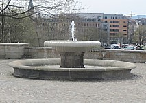An der Tannenstraße / Ecke Königsbrücker Straße entstand im Zusammenhang mit der
zweiten Ausbauphase der Albertstadt 1904 die Maschinengewehrkaserne. Bis zum Ende des Ersten Weltkriegs wurde diese von der 1. Sächsischen Maschinengewehrabteilung
genutzt und diente dann als Polizeikaserne. Heute hat hier das Staatliche Vermögens- und Hochbauamt seinen Sitz. Zwei weitere Kasernen, 1878 und 1913 errichtet und nach 1945 von der Sowjetarmee genutzt, beherbergen seit 2006 das Fachgerichtszentrum der sächsischen Justiz. Beide Gebäude waren 1945 teilzerstört und in den vergangenen Jahrenwieder aufgebaut worden. Oberhalb des Alaunparks entstand ab 2008 eine kleine Wohnsiedlung mit Mehrfamilien-Stadthäusern _(Foto links)_.

In der Nähe befindet sich ein kleiner Kelchbrunnen _(Foto rechts)_, dessen Rekonstruktion im Sommer 2011 abgeschlossen werden konnte. Der Brunnen entstand 1871 beim Bau der Schützenkaserne und wurde über eine Dampfmaschine betrieben. Zugleich diente er dem Brandschutz, da es hier Anschlüsse für Feuerwehrschläuche gab. Leider gingen die vier als Delfine gestalteten Wasserspeier später verloren.

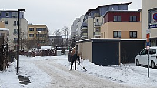Die Toni-Sender-Straße entstand 2012 im Zuge des neuen Wohnviertel „Quartier Fabrice“ an der Fabricestraße. Toni Sender (1888-1964) war Sozialdemokratin und Journalistin und gehörte von 1924 bis 1933 als Abgeordnete für Dresden und Bautzen dem deutschen Reichstag an. 1933 emigrierte sie in die Tschechoslowakei und 1935 in die USA, wo sie bis zu ihrem Tod politisch tätig war und u.a. in der UNO-Menschenrechtskommission und bei der UNRA (United Nations Relief and Rehabilitation Administration) wirkte.

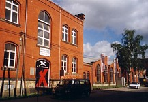Die frühere Straße E im Industriegelände wurde im März 1997 in Werner-Hartmann-Straße umbenannt. Mit der Namensgebung wird an den Physiker Werner Hartmann (1912-1988) erinnert. Hartmann befasste sich mit Festkörper- und Halbleiterphysik, musste nach 1945 am sowjetischen Kernforschungsprogramm mitarbeiten und wurde nach seiner Rückkehr 1956 Professor an der Technischen Universität. Hier forschte er vorrangig auf dem Gebiet der Mikroelektronik und war viele Jahre Leiter der Arbeitsstelle für Molekularelektronik (später ZMD).

Die an der Straße befindlichen Werkshallen wurden nach 1990 teilweise zum Konzert- und Veranstaltungsort (“Straße E”) umgebaut und sind heute beliebter Treffpunkt für Partys und Musikevents _(Foto)_. Historische Ziegelbauten und Schlusssteine an einzelnen Häusern erinnern an die früher hier ansässigen Firmen. Erhalten blieben auch die ehemalige Kantine und die Gebäude der Zünderwerkstatt der Munitionsfabrik.

Reithalle (“Bunker”): Das Gebäude entstand Ende des 19. Jahrhunderts als Reithalle der Königlich-Sächsischen Kavallerie. Später wurde es ein eine Rüstungsfabrik umgewandelt, in dem u.a. Munitionsteile gefertigt wurden. Während des Zweiten Weltkrieges legte man unter einem Anbau einen Luftschutzbunker für die hier beschäftigten Arbeiter an. Diese Räumlichkeiten sind heute unter dem Namen “Bunker” Veranstaltungsort für Dark-Wave-Konzerte. Auch die frühere Reithalle dient seit einigen Jahren als Konzertsaal.

Die Straße Zum Reiterberg entstand Mitte der 1990er Jahre im sogenannten "Carolapark", einem Wohngebiet zwischen Stauffenbergallee und Fabricestraße. Die Namensgebung erfolgte nach der früheren militärischen Nutzung des Gebietes und wurde am 2. November 1995 offiziell eingeführt.

[Albertstadt auf OpenStreetMap](https://www.openstreetmap.org/search?query=Dresden+Albertstadt)

* * *

 \[ [Home](../../../index.html)\] \[ [Nord](../../../nord/)\] \[ [Nordwest](../../../nordwest/)\] \[ [Neustadt](../../../neustadt/)\] \[ [Nordost](../../../nordost/)\] \[ [West](../../../west/)\] \[ [Zentrum](../../../zentrum/)\] \[ [Südwest](../../../sudwest/)\] \[ [Süd](../../../sud/)\] \[ [Südost](../../../sudost/)\] \[ [Ost](../../../ost/)\] \[ [Register](../../../Register/register.html)\] \[ [Kontakt](../../../Kontakt/kontakt.html)\] \[ [Impressum](../../../impressum/)\]
