* * *

_“So ist unser Alaunplatz aus einer öden Sandfläche zu einem militärischen Festplatz von geschichtlicher Bedeutung geworden. Kaiser und Könige, Fürsten und_
_Prinzen, berühmte Feldherren und Generäle, Offiziere aller Armeen und mehrere Generationen sächsischer Krieger hat er im Schmuck der Waffen gesehen, und immer bei Anlässen, die dem Wohle des_
_Vaterlandes, der Ehre der Armee, der Hochachtung unseres Königshauses galten. Möge auch in Zukunft der Dresdner Alaunplatz der Schauplatz friedlich- freudiger Ereignisse der Dresdner Garnison und_
_der Sächs. Armee sein.”_

_“Der Kamerad”, um 1900_

* * *

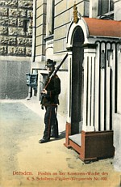

_Kasernenwache am Eingang der Schützenkaserne_

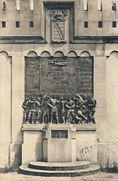

_Mittelteil des Schützendenkmals_

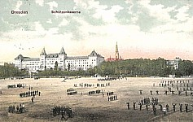Der Alaunplatz wurde im 18. Jahrhundert auf einem gerodeten Gelände am Rande der Dresdner Heide angelegt und diente ab 1830 als Exerzierplatz der sächsischen Infanterieeinheiten. Bereits 1765 war am Bischofsweg eine Alaunsiederei entstanden, die zu einer teilweisen Bebauung des Areals führte. Nach deren Abbruch wurde an gleicher Stelle 1841 ein Wachgebäude errichtet und ein Schießstand angelegt. Auf Grund seiner Lage am Ende der Alaunstraße erhielt der Platz 1862 offiziell seinen heutigen Namen.

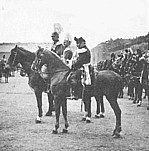Im 19. Jahrhundert begann die militärische Nutzung des Gebietes. Neben der Ausbildung der Soldaten fanden hier auch öffentliche Veranstaltungen militärischen Charakters statt. U.a. wurde auf dem Platz am 6. August 1848 die Dresdner Garnison auf die neue Landesverfassung vereidigt. Nach dem Bau der Schützenkaserne an der Nordseite des Alaunplatzes und dem Ausbau der Albertstadt wurde der Platz auf ca. 8,5 Hektar erweitert und zum wichtigsten Parade- und Exerzierplatz der sächsischen Armee. Zu den Höhepunkten des öffentlichen Lebens in der Albertstadt gehörten die alljährlich durchgeführten Königsparaden _( **Foto:** Prinz Johann Georg von Sachsen mit Generalleutnant von Schweinitz und Kriegsminister Max von Hausen)_ und die große Ehrenparade anläßlich des 800. Jubiläums des Hauses Wettin im Jahr 1889. An der Südseite des Alaunplatzes entstanden Ende des 19. Jahrhunderts mehrgeschossige Mietshäuser.

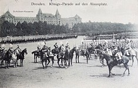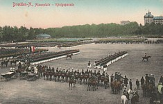

**_Fotos:_** _Königsparade auf dem Alaunplatz 1905 (links) und 1910 (rechts)_

Mit Ende des Ersten Weltkriegs endete die Zeit der Militärparaden am Alaunplatz. Stattdessen gab es auf der Fläche gelegentliche Gauklerfeste und Zirkusaufführungen. So gastierte im Frühjahr 1930 der bekannte Zirkus Knie für einige Tage auf dem Alaunplatz und zog hunderte Besucher an. 1933 übernahm die Hitlerjugend das Gelände und führte hier ihre Sommer-Feldlager durch, in denen junge Männer ihre vormilitärische Ausbildung erhielten.

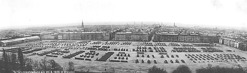

**_Foto:_** _Blick über den Alaunplatz 1936_

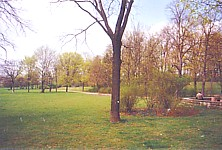1945 fiel die Schützenkaserne dem Luftangriff auf Dresden zum Opfer und wurde später abgetragen. Die übrigen Gebäude blieben weitgehend erhalten. In der Nachkriegszeit fanden hier die Dresdner Vogelwiese und Zirkusgastspiele statt. 1955 erfolgte die Umbenennung des Alaunplatzes in Platz der Thälmann-Pioniere. Ungefähr zur gleichen Zeit wurden die Freiflächen als Grünanlage parkähnlich gestaltet _(Foto)_. U.a. entstanden ein Kinderspielplatz und an der Nordseite eine kleine, allerdings nur selten genutzte Freilichtbühne, an die noch die Reste eines Pavillons erinnern. Bis Ende der 1960er Jahre fanden hier gelegentlich Konzerte, Tanz- und Showvorführungen statt. 1990 erhielt der Platz seinen früheren Namen Alaunplatz zurück. Heute gibt es hier neben Ruhebänken und Spielplätzen gleich drei Kindereinrichtungen: das “Eichhörnchennest” an der Kamenzer Straße, den Kindergarten “Alaunkids” und das Kinderhaus “Regenbogen” an der Paulstraße.

Schützenkaserne und Schützendenkmal:

Die Schützenkaserne entstand 1868 bis 1871 nach einem Entwurf von Theodor Friedrich als erster großer Kasernenneubau der Albertstadt _(Foto)_. Während des Baus wurden 1870/71 auch französische Kriegsgefangene eingesetzt, die in einem Barackenlager auf dem Alaunplatz und in Übigau untergebracht waren. Der schlossartige Bau mit drei bis vier Obergeschossen erhielt neben den Dienst- und Unterkunftsräumen der Soldaten auch ein eigenes Arresthaus, Montierungs- und Schlachthaus, Ställe und weitere Versorgungseinrichtungen. Den Eingang zierten zwei überlebensgroße Schützen aus Sandstein. In der Eingangshalle waren verschiedene Medaillons mit Darstellungen militärischer Orden und Marmortafeln mit den Namen im Deutsch-Französischen Krieg gefallenen Soldaten angebracht.

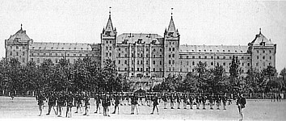

Nach seiner Fertigstellung wurde der Bau zunächst vom Königlich-Sächsischen Schützen-(Füsilier)-Regiment Nr. 108 “Prinz Georg” genutzt und deshalb Schützenkaserne genannt. Das Regiment war 1809 im Rahmen einer Neuordnung der sächsischen Armee entstanden und 1867 neu gebildet worden. Zunächst war diese Einheit in Leipzig und Wurzen stationiert, zog jedoch Mitte der 1860er Jahre nach Dresden und war bis zur Fertigstellung der Schützenkaserne in verschiedenen Bürgerhäusern einquartiert. In Friedenszeiten bestand die Einheit aus 18 Offizieren und ca. 1500 Mann.

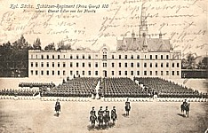Mehrfach erfolgten Modernisierungs- und Erweiterungsarbeiten, bei denen das Gebäude 1885 auch ein neues Dachgeschoss mit Schmucktürmen erhielt. Östlich des Hauptgebäudes lag ein der Versorgung des Regimentes dienender Wirtschaftshof, der als “Rittergut” bezeichnet wurde _(Foto links)_. Letzte Umbauarbeiten an diesem Gebäudekomplex erfolgten 1908. Ein Jahr später fanden aus Anlass des 100. Jubiläums des Regimentes große Feierlichkeiten statt.

Zu den zur Schützenkaserne gehörenden Einrichtungen gehörte auch ein großer Schießplatz am Jägerpark. Dieser wurde bevorzugt vom Schützen-Füsilier-Regiment No. 108, gelegentlich aber auch von anderen Einheiten genutzt. Neben dem Schießstand gab es hier auch eine kleine Verkaufsstelle, ein Wachgebäude und einen Schuppen zur Unterbringung der Schießscheiben. Gedenksteine erinnerten an die besten Schützen und den in Südwestafrika (Namibia) gefallenen Kameraden Max Zeibig, der am 17. März 1908 nach einem Gefecht bei Seatsub an den Folgen einer Verwundung starb.

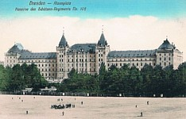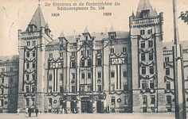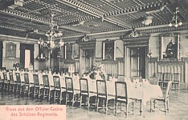

**_Fotos:_** _Die Schützenkaserne am Alaunplatz, in der Mitte im Festschmuck zur 100-Jahr-Feier des Schützenregimentes 1909, rechts ein Blick ins Offizierscasino_

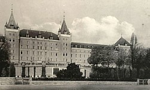Nach Auflösung der sächsischen Armee nutzten verschiedene Behörden die frühere Schützenkaserne _(Foto um 1928)_. Ab 1933 hatten hier u. a. das Wehrmeldeamt und die Wehrwirtschaftsinspektion IV ihren Sitz. 1945 wurde das Gebäude als eines der wenigen in der Albertstadt zerstört und 1954 abgetragen. An gleicher Stelle steht seit 1994 das Bürohaus Albertstadt, welches über 13.000 m² Bürofläche verfügt und heute Sitz verschiedener Unternehmen ist. Erhalten blieben das frühere Kammergebäude und einige Nebenbauten, die noch bis 1992 von den sowjetischen Truppen genutzt wurden. Heute befinden sich dort Büros.

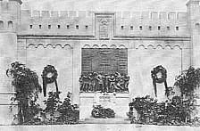Schützendenkmal: Unterhalb der Kaserne wurde 1928 ein Denkmal für die Gefallenen des Ersten Weltkrieges geschaffen. Das Monument bestand aus einer mit Zinnen verzierten Stützmauer, an der Porzellantafeln mit den Namen der 2.676 Soldaten angebracht wurden, die als Angehörige des Schützenregiments Nr. 108 im Ersten Weltkrieg ums Leben kamen. Im Mittelteil befand sich eine Relieftafel aus Bronze. Der Entwurf der Gesamtanlage stammte von Felix Voretzsch. Die Tafeln wurden von der bekannten Dresdner Firma Villeroy & Boch geschaffen und blieben bis 1945 erhalten. Die Weihe des Schützendenkmals erfolgte am 4. Juni 1928. 1952/53 wurde das Gelände an der Mauer mit Erdmassen aufgeschüttet, so dass das Denkmal heute nicht mehr zu sehen ist. Das Schicksal der zwischen 1947 und 1950 entfernten Tafeln konnte bislang nicht geklärt werden.

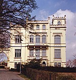Villa Rosenkranz:

Die Villa im neogotischen Tudorstil wurde 1875 für den Fuhrunternehmer Gottlieb
Rosenkranz auf einer kleinen Anhöhe neben der Schützenkaserne errichtet. Später vermieteten die Besitzer das Haus an Militärs der Albertstadt. Nach 1918 nutzten
wohlhabende Dresdner Bürger die Wohnungen, so um 1944 der ehemalige Ministerialrat Dr. jur. Leo Krokosius. 1999 wurde die Villa am Alaunplatz 2 denkmalgerecht saniert und beherbergt heute Büros und Wohnungen.

* * *

 \[ [Home](../../../../index.html)\] \[ [Nord](../../../../nord/)\] \[ [Nordwest](../../../../nordwest/)\] \[ [Neustadt](../../../../neustadt/)\] \[ [Nordost](../../../../nordost/)\] \[ [West](../../../../west/)\] \[ [Zentrum](../../../../zentrum/)\] \[ [Südwest](../../../../sudwest/)\] \[ [Süd](../../../../sud/)\] \[ [Südost](../../../../sudost/)\] \[ [Ost](../../../../ost/)\] \[ [Register](../../../../Register/register.html)\] \[ [Kontakt](../../../../Kontakt/kontakt.html)\] \[ [Impressum](../../../../impressum/)\]
