* * *

* * *

* * *

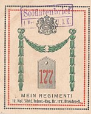

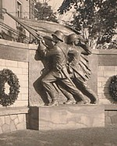

_Denkmal für die Gefallenen des Infanterie-Regiments Nr. 177_

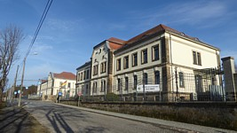Die Marienallee wurde als zweite große Hauptstraße der Albertstadt 1873 angelegt. Dabei bezog man einen Teil des [Kannenhenkelwegs](../../../../nordost/dresdner_heide/), einem schon im Mittelater existierenden Weg durch die Dresdner Heide ein. Ihren Namen erhielt die Straße fünf Jahre später nach Prinzessin Maria Anna von Portugal (1843-1884), Gemahlin des späteren sächsischen Königs Georg. Die Tochter des Prinzen Ferdinand von Sachsen-Coburg-Saalfeld und der portugiesischen Königin Maria II. hatte den Thronfolger 1859 in Lissabon geheiratet.

An der Marienallee entstanden u. a. das Garnisonslazarett, das Kriegsarchiv
und der Komplex der Kadettenanstalt. Die Bauten blieben auch nach 1945 zum Teil in militärischer Verwendung. Auf dem Gelände der früheren Kadettenanstalt hat heute die Heeresoffiziersschule der Bundeswehr ihren Sitz. In einer anderen früheren Kaserne befand sich seit 1947 die Sächsische Landesbibliothek. Nach deren Umzug zum Zelleschen Weg wurden die Räume nur noch als Depot genutzt und beherbergen heute eine Kita.

Einzelne Gebäude:

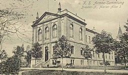Heeresarchiv (Nr. 3): Das Gebäude Marienallee Nr. 3 wurde 1896/97 als Königlich-Sächsisches Kriegs- und Heeresarchiv erbaut und gehört zu den ersten modernen Archivbauten in Sachsen überhaupt. Dem Baubeginn am 21. September 1896 waren heftige Diskussionen über die erforderliche Finanzierung vorangegangen, so dass sich die Arbeiten immer wieder verzögerten. Am 4. Oktober 1897 erfolgte die Eröffnung. Das Heeresarchiv bestand aus einem Verwaltungsgebäude und dem mit ihm baulich verbundenen Archivflügel, welcher mit Eisenblech beschlagenen Doppeltüren und modernen Feuerschutzeinrichtungen ausgestattet war. Hier lagen auch die Bibliothek und die Lesesäle. Verbunden waren die vier Etagen mittels einer eisernen Wendeltreppe und durch einen Aufzug.

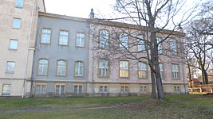Bis 1945 waren hier alle Unterlagen der früheren sächsischen Armee untergebracht. Die frühesten Urkunden stammten aus der Zeit des Dreißigjährigen Krieges. Später kamen Akten des Geheimen Kriegsratkollegiums aus dem 16. und 17. Jahrhundert sowie die Akten des 1831 entstandenen Sächsischen Kriegsministeriums hinzu. Mit der Eingliederung der sächsischen Armee in die Reichswehr 1921 endete die Sammeltätigkeit, wobei die vorhandenen Bestände bis 1945 an der Marienallee verblieben. Beim Bombenangriff auf Dresden gingen Teile des Archivs verloren, weitere Dokumente wurden nach Kriegsende in die UdSSR verbracht. Die verbliebenen und 1955 teilweise aus der Sowjetunion zurück gebrachten Akten kamen ins zentrale DDR-Militärarchiv und kehrten erst 1991 nach Dresden ins Staatsarchiv zurück. Ab 1956 nutzte die Nationale Volksarmee der DDR einige Räume als nicht öffentliche Militärbibliothek.

Während der Archivbau bis heute erhalten blieb, fiel das Verwaltungsgebäude 1945 dem Luftangriff zum Opfer. Nach Ausbau der Ruine diente das Gebäude viele Jahre als Dresdner [Stadtarchiv](../../../../neustadt/aussere_neustadt/antonstadt/konigsbrucker_strasse/stadtarchiv/), bevor dieses 1999 in die frühere Heeresbäckerei verlegt wurde.

Nr. 4: In diesem Haus wohnte viele Jahre der Maler und Schriftsteller Guido Hammer (1821-1898). Ursprünglich befand sich das Gartenhäuschen im Besitz des Grafen zu Solms-Klitschdorf, der es später als Dank für die Ausgestaltung seines Schlosses dem Maler schenkte. Hammer wurde vor allem durch seine Jagd- und Tierdarstellungen bekannt und gilt als "Maler der Dresdner Heide". Sein neues Domizil gestaltete er im Stil eines Forsthauses mit Jagdtrophäen, präparierten Tieren, Waffen und ihm gemalten Genrebildern aus. Das unter Denkmalschutz stehende Häuschen wurde nach 1990 saniert.

Freiherrlich-von-Fletchersches Schullehrerseminar (Nr. 5): Das Gebäude an der Marienallee 5 entstand 1880 für die 1825 gegründete Einrichtung für Lehrerbildung, welche von Friederica Christiana Elisabeth von Fletcher bereits 1769 gestiftet worden war. Aufgabe war die Ausbildung von Kindern aus einfachen Verhältnissen zu Lehrern für sächsische Volksschulen. Unterricht und Unterkunft waren kostenlos. Aus den Zinsen des Stiftungskapitals erwarb man zunächst ein Grundstück an der Freiberger Straße und richtete hier 1825 ein Seminar ein. Eng verbunden war die Einrichtung mit dem von Johann Friedrich Jencke mitgegründeten [Taubstummen-Institut](../../../../sud/plauen/strassen_plauen/chemnitzer_strasse/). Jencke, selbst noch Schüler hatte sich für die Ausbildung eines taubstummen Jungen eingesetzt und daraufhin sein eigenes Institut gegründet. Mit Hilfe des langjährigen Administrators Detlev von Einsiedel konnte 1847 auf der Freiberger Straße 5 ein Neubau bezogen werden.

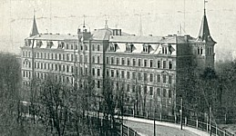1880 erfolgte der Umzug des Fletcherschen Schullehrer-Seminars in einen Neubau an der Marienallee. Der Gebäudekomplex bestand aus dem eigentlichen Schulhaus, einem langgestreckten dreistöckigen Gebäude mit Mittelbau und zwei Seitenflügeln _(Foto links)_. Außerdem gab es die kleinere sogenannte Übungsschule im Villenstil, eine Turnhalle und einen Garten mit Kegelbahn. Im Hauptgebäude war neben den Klassenzimmern Betsaal untergebracht. Zu den bekannten Absolventen der Einrichtung gehörte der Dresdner Schriftsteller Erich Kästner.

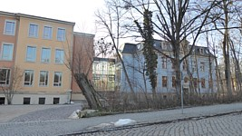Nach Auflösung aller Lehrerseminare wurde das Haus ab 1923 als höhere Schule genutzt. Die “Freiherrlich von Fletchersche Aufbauschule und Deutsche Oberschule zu Dresden-Neustadt” besaß ein eigenes Internat und stand nur für Jungen offen. Drei Jahre später bekam sie den Rang einer Staatlichen Oberschule. Während des Zweiten Weltkriegs wurde das Gebäude als Lazarett genutzt.

1945 brannte das Schulhaus aus, konnte jedoch in der Nachkriegszeit wieder stark verändert aufgebaut werden. Zu DDR-Zeiten befand sich hier die 1. POS “Dr. Kurt Fischer”, benannt nach dem kommunistischen Politiker Kurt Fischer (1900-1950), der ab 1945 sächsischer Innenminister und ab 1949 erster Chef der Deutschen Volkspolizei war. Ab 1990 nutzte die 1. Mittelschule “Freiherr von Fletcher” das Gebäude. Seit Schließung dieser Schule im Sommer 2004 ist im Gebäude die Freie Walddorfschule Dresden untergebracht _(Foto rechts)_.

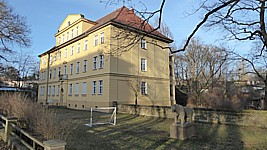Nr. 6/8: Die aus zwei baugleichen Wohnhäusern bestehene kleine Anlage entstand zwischen 1924 und 1927 für Militärangehörige der Albertstadt und ihre Familien. Die Gebäude besitzen eine markante neoklassizistische Fassadengestaltung mit betonten Mittelachsen und sind von einer kleinen Gartenanlage umgeben. Zwischen den Häusern fand eine Bärenplastik Aufstellung. Nach 1930 befanden sie sich im Besitz der Wohnbau GmbH Berlin-Dahlem.
Als Zeugnis der Baugeschichte der Albertstadt stehen diese Häuser unter Denkmalschutz.

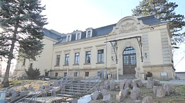Offizierscasino (Nr. 7): Das 1903 an der Ecke zur Carolaallee (heute Stauffenbergallee) errichtete Gebäude diente bis zum Ende der Monarchie als Offizierscasino des Königlich-Sächsischen Infanterie-Regiments No. 177. So wie fast alle Kasernen der Albertstadt hatte auch diese Einheit ein der Geselligkeit der Berufsoffiziere dienendes Haus erhalten. Im Inneren gab es Gast- und Gesellschaftsräume für den Aufenthalt nach Dienstschluss. Das im repräsentativen Neobarockstil gestaltete Gebäude blieb bis heute weitgehend unverändert erhalten. Zu DDR-Zeiten diente es ab 1956 als Kasino der NVA-Truppenteile, die in der nahegelegenen "Egon-Dreger-Kaserne" stationiert waren. Hauptsächlich wurde es von Stabsoffizieren der 7. Panzerdivision besucht. Nach erfolgter Sanierung gehört das Gebäude heute zur Offizierschule der Bundeswehr.

Nr. 10 (Kammergebäude): Für die militärischen Einrichtungen der Albertstadt befand sich im nördlichen Abschnitt der Marienallee ein Exerzierplatz. 1903 wurden hier ein Komplex aus verschiedenen Militärgebäuden errichtet, welche u.a. als Pulverhaus und Materiallager für Kleidung und Ausrüstungsgegenstände genutzt wurden. Nach 1990 diente das Haus dem Karstadt-Konzern als Warenlager. 2012 begann der Umbau zu einem Apartmenthaus.

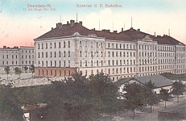Infanteriekaserne (Nr. 12): Die Kaserne wurde 1894/95 als Unterkunft eines geplanten neuen Infanterieregiments errichtet. Ein Erweiterungsbau folgte 1904. Im Gegensatz zu vielen anderen Kasernen der Albertstadt ist das Hauptgebäude im Neobarockstil gestaltet. Nutzer war ab 1897 das 12. Königlich-Sächsische Infanterie-Regiments Nr. 177. Zur Unterbringung der vier 1893 geschaffenen Halbbataillone der Grenadierregimenter Nr. 100 und 101 entstand zunächst auf dem Gelände ein sogenanntes "Barackenkasernement" mit Wirtschaftsgebäuden. Vier Jahre später erfolgte die Bildung des neues Infanterieregiments Nr. 177 und dessen Umzug in die neue Kaserne sowie auf die Festung Königstein. Nach Bewilligung weiterer Mittel konnten auch für die "Königsteiner" Einheit neue Räume geschaffen werden. Neben dem Hauptgebäude für das II. Bataillon entstanden ein Exerzierhaus, ein Stabsgebäude und ein Verheiratetenwohnhaus. Im Oktober 1904 wurden beide Bataillone in der Friedrich-August-Kaserne vereinigt.

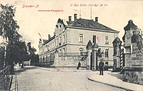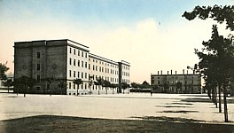

**_Fotos:_** _Haupteingang und Familienwohnhaus (links) und Kasernen der 3. und 4. Kompanie_

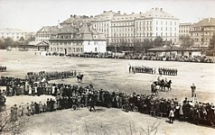Kurz vor Beginn des Ersten Weltkriegs folgten weitere kleinere Gebäude. Im Februar 1914 erhielt die Kaserne nach dem regierenden sächsischen König die Bezeichnung König-Friedrich-August-Kaserne. Teile des Areals nutzte man während des Krieges als Reserve-Lazarett. Danach übernahmen verschiedene Formationen der Reichswehr die Kaserne, die dafür organisatorisch geteilt und um zusätzliche Garagen und Werkstätten erweitert wurde. Später erweiterte die Wehrmacht das Kasernengelände nach Osten und nutzte es für ihre Kriegsschule (Lehrgang C).

Vor der Kaserne wurde am 1. November 1937 eine Bronzeplastik aufgestellt, die an das 40-jährige Bestehen des 12. Königlich-Sächsischen Infanterie-Regiments Nr. 177 und dessen im Ersten Weltkrieg gefallene Angehörige erinnern sollte. Schöpfer der Figuren, die einen stürmenden Fahnenträger und einen Hornisten darstellten, war der Bildhauer R. Schandauer, während die Bauausführung von Erwin Graebner realisiert wurde. Im August 1946 wurde das Denkmal auf Weisung der SMAD beseitigt und später eingeschmolzen.

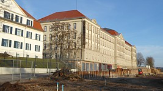Am 18. April 1946 beschloss die sächsische Landesverwaltung, die leer stehenden Kasernengebäude teilweise der [Sächsischen Landesbibliothek](../../../../sud/zschertnitz/strassen_zschertnitz/zellescher_weg/slub/) zur Nutzung zu überlassen. Diese hatte beim Luftangriff ihr bisheriges Domizil im Japanischen Palais verloren. Am 15. August 1947 erfolgte die Eröffnung im ehemaligen Hauptgebäudes des II. Bataillons. Zur Erweiterung enstanden später noch ein Anbau und ein neues Magazingebäude. Hier blieb die Bibliothek bis zu ihrem Umzug 2002 zum Zelleschen Weg. Danach blieben lediglich einige Magazinbestände an der Marienallee. Anfang 2003 wurden im Haus provisorische Depoträume der Dresdner Gemäldegalerie eingerichtet, da das bisherige Depot im Zwinger seit dem Elbehochwasser 2002 nicht mehr nutzbar war. 2012 begann der Umbau des Gebäudes zu einer Kindertagesstätte. Die Eröffnung der vom Deutschen Roten Kreuz betriebenen Einrichtung "Haus der kleinen Entdecker" erfolgte am 31. Mai 2013. Außerdem befindet sich hier die Melli-Beese-Grundschule, benannt nach der aus Laubegast stammenden Flugpionierin.

Die übrigen Teile der Kaserne wurden nach 1945 weiter militärisch genutzt. Einige kleinere Gebäude dienten der Sowjetarmee als Wohnhäuser für Offiziere. Die älteren Bauten sowie die meisten Garagen und Werkstätten kamen zur 1956 gegründeten Nationalen Volksarmee, die hier ein Panzerausbildungsregiment ansiedelte. Weitere Gebäude wurden von der 7. Panzerdivision der NVA genutzt. Heute sind sie Teil der Offiziersschule des Heeres der Bundeswehr.

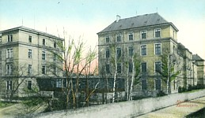Garnisonslazarett (Nr. 13): Das Garnisonslazarett entstand zwischen 1876 und 1879 als neues Militärlazarett für die Dresdner Garnison und löste die frühere Einrichtung an der Hospitalstraße ab. Die Anlage war im modernen Pavillonssystem gestaltet und bildete später das Vorbild für den Bau des [Güntzheimes](../../../../nordwest/trachau/guntzheim/) (heute Krankenhaus Neustadt) auf der Industriestraße.

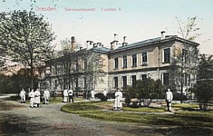Die Einzelbauten beherbergten Räume für Schwer-, Leicht- und epidemisch Kranke, Labors, Medikamentendepot sowie Wohnungen für das Personal. Aufgenommen werden konnten bis zu 425 Patienten. In einem weiteren Pavillon konnten ca. 250 leichtere Fälle untergebracht werden. Hinzu kamen Verwaltungsgebäude, Maschinenhaus und Isolierpavillons für ansteckende Patienten. Im hinteren Teil lag ein bis in den [Prießnitzgrund](../../../../nordost/dresdner_heide/priessnitzgrund/) hineinreichender Park. Zudem gab es Tennisplätze und eine sogenannte Wandelbahn, ein überdachter Gang für Spaziergänge an frischer Luft und eine Liegehalle.

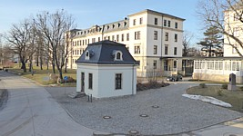Auch nach dem Ersten Weltkrieg blieb das Lazarett in Betrieb und wurde nun von der Reichswehr bzw. der Wehrmacht genutzt. Ab 1939 diente es bis zum Ende des Zweiten Weltkriegs als Reservelazarett Dresden. 1956 übernahm die Nationale Volksarmee (NVA) das Lazarett, nach der politischen Wende in der DDR fiel es an die Bundeswehr. Heute gehört es zusammen mit den Gebäuden der früheren Kadettenanstalt zur Offiziersschule der Bundeswehr.

Große Verdienste um die Entwicklung des Lazaretts und die moderne Militärhygiene erwarb sich der Arzt Wilhelm August Roth (1833-1892), der seit 1870 Generalarzt der sächsischen Armee war. An den Militärhygieniker erinnert ein Denkmal vor dem Gebäude mit einem Relief von Heinrich Epler.

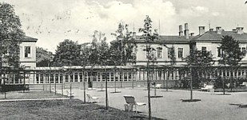

**_Foto:_** _Blick in den Hof des Garnisonslazaretts in den 1930er Jahren_

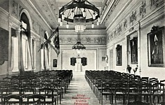Kadettenanstalt (Heeresoffiziersschule) (Nr. 14):  Im Zusammenhang mit dem Bau der Albertstadt wurde auch die bereits 1692 von Kurfürst Johann Georg IV. gegründete Kadettenanstalt aus der Ritterakademie in der Inneren Neustadt nach Norden verlegt. Für die Einrichtung entstand ein aus fünf Häusern bestehender Gebäudekomplex am Rand der Dresdner Heide, der 1875/78 fertig gestellt wurde. Der Hauptbau beherbergte neben den Wohn- und Schlafräumen der Kadetten auch die Lehrzimmer, eine Aula, eine Bibliothek, vier Arrestzellen sowie Wohnungen für das Lehrpersonal. Überdachte Gänge verbanden dieses Haus mit den benachbarten Gebäuden, in denen u.a. der Speisesaal, die Küche, Lagerräume und ein Tanzsaal untergebracht waren. Außerdem gab es eine großes Exerzierhaus, welches auch als Turn- und Fechthalle genutzt wurde, das Kommandantenhaus sowie Wachgebäude an der Marien- und Carolaallee. Die Pläne für die Bauten stammten vom Architektenbüro Gustav Rumpel & Sommerschuh. Das Bild (rechts) zeigt einen Blick in den für offizielle Anlässe genutzten "Fahnensaal".

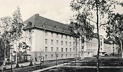Bis 1920 diente die Kadettenanstalt der Ausbildung des sächsischen Offiziersnachwuchses, musste dann jedoch wegen der Bestimmungen des Versailler Vertrages aufgelöst werden. Die Gebäude wurden nun einige Jahre als [Landesschule](../../../../nord/klotzsche/) (Reformrealgymnasium) genutzt. Am 18. November 1926 wurde auf dem Gelände der früheren Kadettenanstalt feierlich die neue Infanterieschule durch General Paul von Hindenburg eingeweiht. Leiter der Einrichtung war bis 1930 der spätere Infanterie-General Alexander Freiherr von Falkenhausen. Zu den bekanntesten Lehrern der Einrichtung gehörte Erwin Rommel, der während des Zweiten Weltkrieges als “Wüstenfuchs” bekannt wurde. Auch die späteren Generalfeldmarschälle Wilhelm List, Ferdinand Schörner, Maximilian von Weichs und Karl-Heinrich von Stülpnagel arbeiteten hier als Lehroffiziere. 1935 benannten die Nazis die Schule in Kriegsschule um. Während des Zweiten Weltkrieges befand sich auf dem Gelände einer Fahnenjunkerschule für angehende Infanterieoffiziere.

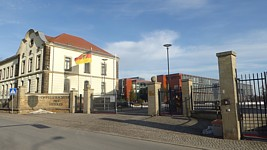Ab Mai 1945 wurden die Gebäude zunächst von der Roten Armee besetzt und danach von Polizei und Feuerwehr als Ausbildungsstätte genutzt, bevor 1952 die Kasernierte Volkspolizei, später die NVA einzog. U.a. waren hier die Stabskompanie, die 7. Panzerdivision und Teile der Militärakademie untergebracht. In diesem Zusammenhang erhielt der Komplex den Namen Egon-Dreger-Kaserne. Dreger (1899-1970) war Spanienkämpfer und Leutnant der Internationalen Brigaden, während es Zweiten Weltkriegs Mitarbeiter des Nationalkomitees Freies Deutschland und nach 1945 am Aufbau der sächsischen Verwaltung beteiligt. Zuletzt wirkte er bis zu seiner Pensionierung als Botschafter der DDR in Sofia.

1990 übernahm die Bundeswehr das Areal und ließ die vorhandenen Gebäude sanieren. Hinzu kamen einige Neubauten nach Entwürfen der Architekturbüros Auer, Weber & Partner (Mensa) und Friedrich + Partner (Lehrgebäude). Der Gesamtkomplex umfasst ein modernes Hörsaalzentrum mit insgesamt 38 Unterrichts- und Vortragsräumen, zwei Sporthallen sowie eine Schwimmhalle und bietet Platz für ca. 800 Offiziersbewerber. Am 14. September 1998 wurde die Einrichtung unter dem Namen “Albertstadtkaserne” als Heeresoffiziersschule der Bundeswehr feierlich eingeweiht und setzt heute die militärische Tradition der Albertstadt fort. Am 14. September 2013 erhielt sie den Namen Graf-Stauffenberg-Kaserne. Zum Gesamtkomplex gehören auch Teile der früheren Friedrich-August-Kaserne.

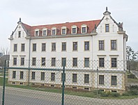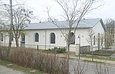

**_Fotos:_** _Bauten der Heeresoffiziersschule - links das ehemalige Lazarett, rechts die Exerzierhalle_

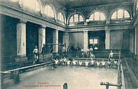Kadettenbadeanstalt: Das Gebäude wurde 1901/02 als Schwimmbad der Kadettenanstalt errichtet, wobei angeblich Karl August Lingner der Initiator gewesen sein soll. Im Inneren befand sich ein ca. 13 x 6,50 Meter großes Becken mit bis zu 2,40 Meter Wassertiefe. Die Baukosten betrugen nach historischen Unterlagen 125.362 Goldmark. Das im Jugendstil gestaltete Bad mit Keramikfliesen von Villeroy & Boch diente bis zur Schließung der Anstalt dem Schwimmunterricht der angehenden Offiziere. Nach 1945 wurde es nicht mehr genutzt und von der sowjetischen Armeein eine Bibliothek umgewandelt. Eine Sanierung des Gebäudes erfolgte 1998. Heute dient das Haus als Tagungsraum der Heeresoffiziersschule. Reste des historischen Bades sind unter dem “Blücher-Saal” noch erhalten.

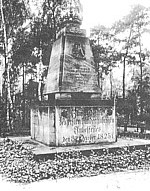Kadetten-Denkmal: Das Denkmal entstand 1920 im Park der früheren Kadettenanstalt und erinnerte an die im Ersten Weltkrieg gefallenen Angehörigen des Kadettencorps. Zu den gefallenen Kadetten gehörte auch der bekannte sächsische Jagdflieger Max Immelmann, der 1916 bei einem Einsatz ums Leben kam.

Das Denkmal bestand aus einem massiven Obelisken mit aufgesetzter sächsischer Krone. Der Sockel stammte bereits vom Vorläufer der Anstalt und befand sich bis 1878 an der Kasernenstraße vor der Ritterakademie. Eine Inschrift erinnerte an das 100. Jubiläum der Kadettenanstalt am 3. 10. 1825. Das von William Lossow geschaffene Kadettendenkmal fiel in der Nachkriegszeit wie die meisten Militärdenkmale der Albertstadt der “Bilderstürmerei” zum Opfer.

Nr. 14b: Das Gebäude auf dem Areal der ehemaligen Kadettenanstalt diente nach 1945 bis 1962 als zentrale Dynamo-Fußballschule. Hier wurden junge Fußballtalente für alle Polizeisportvereine in der DDR ausgebildet. Trainer waren u.a. Kurt Kresse und Heinz Hiering. 1962 kam die Einrichtung als Außenstelle zur DHfK Leipzig. Heute befindet sich hier eine Sportpension.

* * *

 \[ [Home](../../../../index.html)\] \[ [Nord](../../../../nord/)\] \[ [Nordwest](../../../../nordwest/)\] \[ [Neustadt](../../../../neustadt/)\] \[ [Nordost](../../../../nordost/)\] \[ [West](../../../../west/)\] \[ [Zentrum](../../../../zentrum/)\] \[ [Südwest](../../../../sudwest/)\] \[ [Süd](../../../../sud/)\] \[ [Südost](../../../../sudost/)\] \[ [Ost](../../../../ost/)\] \[ [Register](../../../../Register/register.html)\] \[ [Kontakt](../../../../Kontakt/kontakt.html)\] \[ [Impressum](../../../../impressum/)\]
