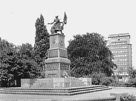
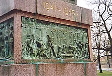
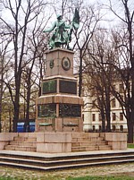
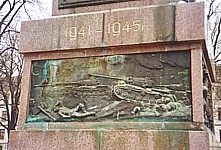

* * *

* * *

* * *

* * *

* * *

* * *

Das Sowjetische Ehrenmal befindet sich seit 1994 auf dem Vorplatz des
Militärhistorischen Museums an [Olbrichtplatz](../../../../neustadt/albertstadt/strassen_albertstadt/), nachdem es zuvor seinen Standort am Platz der Einheit (heute Albertplatz) hatte
_(Foto)_. Das Denkmal entstand unmittelbar nach Kriegsende und wurde bereits am 25. November 1945 eingeweiht. Den Auftrag für die Gestaltung erhielt trotz seiner früheren NSDAP-
Mitgliedschaft der an der Dresdner Kunstakademie als Lehrer tätige deutsche Bildhauer Otto Rost (1887-1970). Das Denkmal war erstes nach dem Zweiten
Weltkrieg auf deutschem Boden errichtetes Mahnmal für sowjetische Soldaten.

Das Monument besteht aus einem obeliskartigen Sockel aus rotem Meißner Granit, der von einer Bronzegruppe bekrönt
wird. Die Figuren stellen zwei sowjetische Soldaten mit Waffen und einer Fahne dar. Am Sockel befinden sich neben
verschiedenen Symbolen vier Bronzetafeln mit Darstellung von Kampfszenen und vom provisorischen Wiederaufbau der  Augustusbrücke. Eine Inschrift nennt die Worte:

_“Ewiger Ruhm den Kämpfern der Roten Armee, die in den Kämpfen gegen die deutschen faschistischen_

_Eroberer für die Freiheit und Unabhängigkeit der sowjetischen Heimat gefallen sind.”_

Auftraggeber für das Ehrenmal war die sowjetische Militäradministration, die vor allem an die gefallenen Angehörigen der in Dresden stationierten 5. Gardearmee erinnern wollte. Für den
Bau wurde der beschädigte Brunnen “Stürmische Wogen” entfernt, dessen Brunnenbecken als Fundament für das Denkmal diente. Im Zuge der Rekonstruktion der
historischen Brunnenanlage entschied man sich 1994 für eine Umsetzung des Sowjetischen Ehrenmals zum Olbrichtplatz. Zuvor war auch eine Versetzung an die Südseite des Albertplatzes bzw. zum [Sowjetischen Garnisonsfriedhof](../../../../neustadt/albertstadt/nordfriedhof/sowjet__garnisonsfriedhof/) in Erwägung gezogen worden.

**_Fotos:_** _Sowjetisches Ehrenmal mit Relieftafeln am Olbrichtplatz_

* * *

 \[ [Home](../../../../index.html)\] \[ [Nord](../../../../nord/)\] \[ [Nordwest](../../../../nordwest/)\] \[ [Neustadt](../../../../neustadt/)\] \[ [Nordost](../../../../nordost/)\] \[ [West](../../../../west/)\] \[ [Zentrum](../../../../zentrum/)\] \[ [Südwest](../../../../sudwest/)\] \[ [Süd](../../../../sud/)\] \[ [Südost](../../../../sudost/)\] \[ [Ost](../../../../ost/)\] \[ [Register](../../../../Register/register.html)\] \[ [Kontakt](../../../../Kontakt/kontakt.html)\] \[ [Impressum](../../../../impressum/)\]
