* * *

* * *

* * *

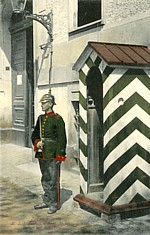

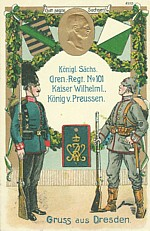

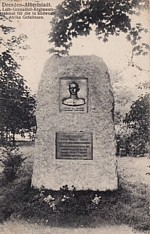

_Denkmal für die in Südwestafrika Gefallenen des 1. Leib-Grenadier-Regimentes_

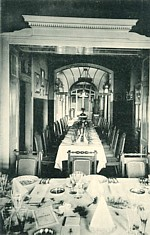

_Blick ins Offizierscasino der Train-Kaserne_

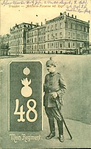

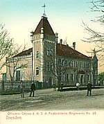

_Offizierscasino des_

_4\. Feldartillerie-Regiments No. 48_

_(Stauffenbergallee 77)_

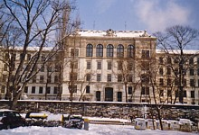Die Stauffenbergallee wurde 1873 als Hauptachse der Albertstadt angelegt und als Paradestraße auf 3 Kilometern Länge mit ca. 30 Metern Breite ausgebaut. Zur Überwindung des Prießnitzgrundes entstand eine 23 Meter hohe Bogenbrücke mit drei Bögen zu je 15 Meter Spannweite. Anfangs wurde die Straße Heerstraße genannt. Nach Fertigstellung erhielt der östliche Teil bis zur Königsbrücker Straße am 3. Januar 1879 den Namen Carolaallee, der westliche Teil den Namen Prinz-Georg-Allee. Namensgeber waren Königin Carola, Ehefrau des regierenden Königs Albert und dessen Bruder Prinz Georg. Nach Georgs Thronbesteigung 1902 wechselte der Name in König-Georg-Allee. Zu beiden Seiten der Straße errichtete die sächsische Armee verschiedene militärische Bauten, darunter mehrere große Kasernen _(Foto links: Grenadierkaserne)_, die Hauptwache der Albertstadt und die [Garnisonskirche.](../../../../neustadt/albertstadt/strassen_albertstadt/stauffenbergallee/garnisonskirche/)

Nach der Jahrhundertwende wurde die König-Georg-Allee bis zur Radeburger Straße verlängert und ausgebaut. Für diesen Abschnitt war ab 1908 der Name Train-Straße gebräuchlich, da sich hier die Trainkaserne für die Transporteinheiten der sächsischen Armee befand. Die frühere Train-Straße ist heute in ihrem ursprünglichen Verlauf nicht mehr erhalten und wurde in der Zeit nach dem Zweiten Weltkrieg zunächst bis zum Pappelweg verkürzt und Anfang der 1960er Jahre eingezogen. Erst um 1980 erfolgte ein erneuter Ausbau dieses Teils, jedoch auf veränderter Trasse.

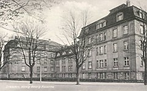Zu Anfang des 20. Jahrhunderts wurden weitere Kasernen erbaut, u. a. die Artilleriekaserne an der König-Georg-Allee _(Foto rechts)_. Die Gebäude blieben auch nach dem Ersten Weltkrieg in militärischer Nutzung. Obwohl die Bomben des Jahres 1945 auch hier einige Schäden hinterließen, sind die meisten Bauten bis heute erhalten und wurden bis 1990 von der Sowjetarmee und der NVA genutzt. Am 1. Juli 1946 erhielten Carolaallee, König-Georg-Allee und Trainstraße die gemeinsame Bezeichnung Nordallee. Im Zusammenhang mit der Umbenennung des Nordplatzes (heute Olbrichtplatz) erfolgte am 18. Juli 1950 eine erneute Umbenennung in Dr.-Kurt-Fischer-Allee. Kurt Fischer (1900-1950) war Funktionär der SED, Generalinspekteur der Deutschen Volkspolizei und Mitglied der DDR-Volkskammer. Da diese Namensgebung jedoch nach 1989 als unpassend betrachtet wurde, erhielt die Straße am 20. Juli 1991 den Namen Stauffenbergallee. Claus Schenk Graf von Stauffenberg (1907-1944) hatte 1927/28 an der Dresdner Infanterieschule seine militärische Ausbildung begonnen und war führender Kopf beim misslungenen Hitler-Attentat am 20. Juni 1944.

Gebäude an der Carolaallee:

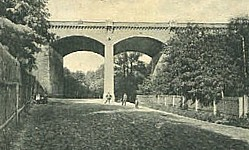Carolabrücke: Die Sandsteinbogenbrücke wurde im Zuge des Ausbaus der Carolaallee errichtet und überwindet mit drei 15 Meter weiten Bögen den Prießnitzgrund. Sie ist 23 Meter hoch und wurde 1876 fertiggestellt. 1879 erhielt sie in Anlehnung an den Straßennamen den Namen Carolabrücke. Als 1946 die gesamte Straße in Nordallee umbenannt wurde, entfiel diese Bezeichnung. Umgangssprachlich war sie nun als Prießnitzbrücke bekannt. Eine umfassende Sanierung erfolgte 2001.

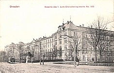Grenadierkasernen: Die beiden großen Kasernenbauten entstanden nach Plänen Hermann Nicolais zwischen 1873 und 1877 für die sächsischen Grenadierregimenter Nr. 100 und 101. Diese waren 1867 bei der Reorganisation der sächsischen Armee aus den früheren Leibregimentern der Landesherrscher hervorgegangen und wurden offiziell als 1. (Leib-)Grenadier-Regiment Nr. 100 (später mit Zusatz "König Friedrich August III.") und 2. Grenadier-Regiment Nr. 101 "Kaiser Wilhelm I., König von Preußen" bezeichnet. Bis zum Bau der Albertstadt waren sie in Kasernen an der Hauptstraße und am Palaisplatz untergebracht.

Die beiden Grenadierkasernen waren baugleich gestaltet und besaßen eine Frontlänge von je 345 Metern _(Foto)_. Über dem Tief- und Hochparterre erhoben sich drei Stockwerke und ein ausgebautes Mansardgeschoss. Im Zentrum der symmetrischen Anlage stand das Hauptwachgebäude der Albertstadt. Am 21. März 1877 wurden sie offiziell bezogen. Dabei nutzte das Grenadierregiment Nr. 100 den westlichen, das Grenadierregiment Nr. 101 den östlichen Bau, der zugleich den Abschluss der Albertstadt bildete. Insgesamt lebten hier bis zu 1.800 Militärangehörige.

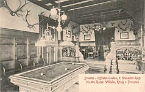Im Inneren waren die Gebäude nach modernsten Gesichtspunkten ausgestattet und erhielten Wasch- und Speisesäle, Aufenthaltsräume und Bäder. Im Hochparterre waren die Wohnungen der verheirateten Militärangehörigen zu finden, im Mittelbau die Wohnungen für unverheiratete Offiziere. Hinzu kamen mit Waffen und militärischen Erinnerungsstücken ausgestaltete Kasinos _( **Foto:** Offizierscasino des Grenadierregimenetes Nr. 101)_. Die einfachen Soldaten lebten in der Regel in großen Schlafräumen, welche mit bis zu 24 Personen belegt waren. Den hinteren Bereich des Areals nahm ein großer Exerzierplatz ein. Außerdem gab es Pferdeställe, eine Beschlagschmiede, ein Reithaus sowie einen Schießstand am Rande der Dresdner Heide. Hinzu kamen mehrere Wohngebäude in der Umgebung, die für verheiratete Berufssoldaten zur Verfügung standen. Die Gesamtanlage galt wegen ihrer modernen Ausstattung als Musterbeispiel für Militärbauten der damaligen Zeit und wurde international bewundert.

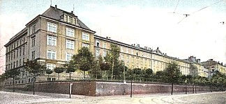

Nach 1918 nutzten Reichswehr und später die Wehrmacht die ehemaligen Grenadierkasernen. Beim Luftangriff auf Dresden brannte das linke der beiden Kasernengebäude nach Bombentreffern ab und wurde bis auf einen Seitenflügel und Teile des Erdgeschosses in der Nachkriegszeit abgetragen. Auf den Fundamenten des westlichen Endes entstand zu DDR-Zeiten ein Kindergarten in Leichtbauweise. Die übrigen Gebäude übernahm die Sowjetarmee, die hier bis zum Abzug 1991 ihre 1. Gardepanzerarmee unterbrachte. Heute haben in der erhaltenen Kaserne die Landesdirektion Sachsen - Dienststelle Dresden und das Landesamt für Steuern und Finanzen ihren Sitz.

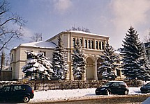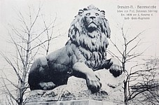Hauptwachgebäude: Zwischen den beiden Grenadierkasernen errichtete Hermann Nicolai 1877 ein Wachgebäude. Dieses wurde nicht nur als Aufenthalt der Wache genutzt, sondern erhielt auch zwölf Arrestzellen, Regimentsbüros und Räume für die Divisionsbibliothek. Vor dem Gebäude fanden zwei Löwenplastiken von Johannes Schilling Aufstellung. Die beiden Bronzefiguren wurden aus erbeuteten französischen Geschützen gegossen und sollten Krieg und Frieden symbolisieren. Um 1970 wurden sie demontiert und sind heute verschollen. Das Wachgebäude selbst diente nach 1945 bis zum Abzug der sowjetischen Truppen als “Museum des Kampfesruhms”. In diesem Zusammenhang fand auch ein Panzer des Typs T-34 auf einem Granitsockel vor dem Gebäude Aufstellung.
Heute hat hier der sächsische Staatsbetrieb Schlösser und Gärten seine Zentrale.

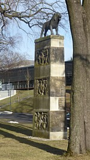Pionierdenkmal: Seit Oktober 2012 befindet sich an der Ausfahrt der Albertstadtkaserne an der Ecke Marienallee das Pionierdenkmal. Das Denkmal entstand 1923 zur Ehrung der ca. 4400 im Ersten Weltkrieg gefallenen sächsischen Pioniersoldaten und befand sich bis 1947 am Gondelhafen unterhalb der Brühlschen Terrasse. Schöpfer waren die Bildhauer Hermann Preiß und Hermann Kreß. Die feierliche Einweihung erfolgte am 17. Juni 1923. Das Denkmal besteht aus einem ca. sechs Meter hohen Sandsteinsockel und zeigt an den Seitenflächen sechs Reliefbilder mit Darstellungen aus der Arbeit der Pioniere sowie ein Bildnis August des Starken, der die erste sächsischen Pioniereinheit 1698 gegründet hatte. Texttafeln erinnern an die Geschichte der Eimheit. Bekrönt wird das Denkmal von einem aus Gußeisen gefertigten Löwen. Gegossen wurde die nach dem Vorbild des “Braunschweiger Löwen” gestaltete Plastik in Lauchhammer. Der Standort am Elbufer war gewählt worden, weil hier einst der Übungsplatz des Dresdner Pionier- und Brückentrains lag.

1947 fiel das Pionierdenkmal der geplanten Beseitung aller “militaristischen” Sachzeugen im öffentlichen Raum zum Opfer und wurde im städtischen Lapidarium eingelagert. Lediglich die Löwenplastik zierte von 1953 bis 1970 die Auffahrt zur Albertbrücke, wurde dann jedoch nach Beschädigung bei einem Verkehrsunfall beseitigt. Nach 1990 entdeckten Mitarbeiter der Heeresoffiziersschule die Fragmente und setzten sich für eine Restaurierung und Wiederaufstellung des Denkmals in der Albertstadt ein. Diese erfolgte am 13. Oktober 2012. Ein 1986 entstandener Bronzeabguss der Löwenplastik befindet sich seit Juli 2000 im Garten des Kinderhauses [Friedrichstraße](../../../../zentrum/friedrichstadt/strassen_friedrichstadt/friedrichstrasse/) 38/40.

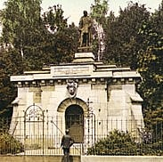Fabrice-Mausoleum: Das Mausoleum wurde 1893 von Konstantin Lipsius auf dem Gelände der Kadettenanstalt unmittelbar an der Carolaallee errichtet. Die finanziellen Mittel stammten von sächsischen Offizieren, die mit dem Bauwerk dem 25. März 1891 verstorbenen Kriegsminister und Gründer der Albertstadt, Graf Alfred von Fabrice ein Denkmal setzen wollten. Als Krönung des Gebäudes schuf Johannes Schilling eine Bronzestatue Fabrice´s. Diese zeigte den Grafen in Militäruniform mit Helm in der Hand. Über dem Eingang zum Mausoleum ist noch heute sein Familienwappen zu sehen. An der Vorderseite befand sich zudem einst eine Inschrifttafel: _DEM KRIEGSMINISTER GRAFEN v. FABRICE DIE SÄCHSISCHE ARMEE 1892_. Das Gebäude selbst ist in Form eines Festungstors gestaltet.

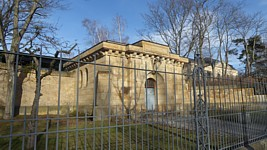Das Innere des quadratischen Raumes wird von einem Kreuzgewölbes gedeckt, welches mit Wachsmalerei verziert ist. In der Mitte befanden sich die beiden Sarkophage. Am Ende des Raumes stand ein kleiner Altar. Am 11. Oktober 1893 wurden die Särge des Generals und seiner Frau vom Inneren Neustädter Friedhof in das Mausoleum überführt.

Das Denkmal überstand den Zweiten Weltkrieg unbeschadet, wurde jedoch 1946 aufgebrochen und geplündert. Die dabei beschädigte Bronzefigur musste wenig später entfernt und eingeschmolzen werden. Erst in den 1950er Jahren wurden die sterblichen Überreste aus dem Mausoleum in die Familiengruft auf dem St.-Pauli-Friedhof verbracht. Das Fabrice-Mausoleum wurde 1992 von der Bundeswehr restauriert und befindet sich heute, bis auf die fehlende Plastik, wieder im Ursprungszustand.

Gebäude an der König-Georg-Allee:

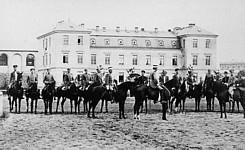Militärreitanstalt: Die Militärreitschule, offiziell Königlich Sächsische Militär-Reit-Anstalt genannt, wurde 1878/79 für den Bedarf der sächsischen Armee eingerichtet und diente der obligatorischen Reitausbildung der Offiziere. Der am 8. April 1879 eingeweihte Komplex an der Eisenbahnstrecke nach Görlitz bestand aus zwei Kasernengebäuden für Ausbilder und Kommandierte sowie einer Reithalle und war eine von drei derartigen Einrichtungen in Deutschland. Hinzu kamen ein Stallgebäude für 160 Pferde und ein großer Reitplatz. 1895 war hier die Kavallerie-Brigade Nr. 23 untergebracht.

1945 wurden große Teile des Areals durch Bomben schwer beschädigt. Nach Kriegsende entstanden hier die Kleingärten der Sparte “Friedenswacht”, deren Vereinsheim auf den Grundmauern der einstigen Reithalle steht. Außerdem erinnert die erhaltene und über 1000 Meter lange Umfassungsmauer an die Vergangenheit des Grundstücks. Ein Restgebäude der früheren Kaserne wird durch die sächsische Polizei genutzt.

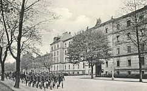Gardereiterkaserne (Fabrice-Kaserne): Die Kaserne entstand 1878 für das Gardereiter-Regiment der sächsischen Armee an der damaligen Prinz-Georg-Allee Nr. 12. Die Anlage bestand aus einem langgestreckten Kasernengebäude mit mehreren Seitenflügeln, fünf Pferdeställen für je 160 Pferde, einer Reithalle sowie einem Krankenstall für erkrankte Tiere. Im Hauptgebäude befanden sich die Wohn- und Schlafräume der Mannschaften, Wohnungen für Offiziere, Waschräume sowie die für den militärischen Alltag erforderlichen Einrichtungen. Außerdem gab es ein Offizierscasino mit Veranda und Garten sowie ausgedehnte Reit- und Exerzierplätze. Die Planungen für die Dachkonstruktion der Reithalle stammen vom französischen Ingenieur Alexandre Gustave Eiffel, welcher diese in der Zeit seiner Kriegsgefangenschaft 1870/71 in Dresden schuf. Berühmt wurde Eiffel durch den Pariser Eiffelturm. Übergeben wurde der Komplex am 1. April 1878.

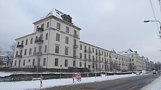Bis zum Ende des Ersten Weltkriegs wurden die Gebäude als Kavalleriekaserne genutzt. 1917 erhielt die ihren Namen nach dem ehemaligen sächsischen Kriegsminister Alfred Graf von Fabrice, der zugleich General der Kavallerie war. Nach Eingliederung der sächsischen Armee in die Reichswehr bezog 1919 das Reiter-Regiment Nr. 12 die Kaserne, dem später die Wehrmacht folgte. Nach 1945 belegten zunächst sowjetische Soldaten die Räume, die jedoch in den 1950er Jahren die Kaserne teilweise zu Wohnzwecken freigab. Nach längerem Leerstand wurden die Bauten an einen privaten Investor verkauft und ab 2009 zu einer Wohnanlage mit 230 Wohnungen umgebaut. Zahlreiche Nebengebäude waren zuvor bereits abgetragen worden.

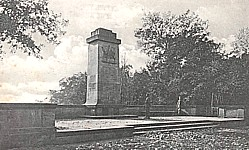Gardereiterdenkmal: 1919 wurde gegenüber dem Haupteingang ein Obelisk aufgestellt, der an die 108 gefallenen Angehörigen des Regiments im Ersten Weltkrieg erinnerte. Das Denkmal war sieben Meter hoch und trug neben den Namenstafeln ein Relief mit Darstellung eines Lanzenreiters. Schöpfer des Ehrenmals waren der Bildhauer Arthur Lange und der bekannte Architekt William Lossow, der selbst einige Jahre Offizier in dieser Einheit war. Als “militaristisches Denkmal” wurde das Gardereiterdenkmal mit Ausnahme des Sockels 1953 beseitigt. Die Anlage mit Bastion und Sandsteinbänken blieb dagegen bis heute erhalten und konnte nach 1990 mit Sponsorengeldern restauriert werden.

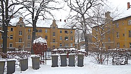Wohnanlage Nr. 29-45: Die aus mehreren Gebäuden bestehende Wohnanlage gegenüber den großen Kasernenbauten entstand um 1910 für Offiziersfamilien errichtet. Die dreigeschossigen Wohnhäuser sind in eine früher als "Gardereiterpark" bezeichnete Grünanlage eingebettet. Zentraler Mittelpunkt ist ein großzügiger Hog, umgeben von drei durch Torbögen miteinander verbundene Häuser. Als Zeugnis des Wohnungsbaus dieser Zeit steht die gesamte Anlage unter Denkmalschutz.

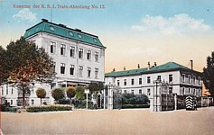Train-Kaserne (Kirchbach-Kaserne): Die Kaserne wurde zwischen 1875 und 1878 errichtet und am 1. April 1878 übergeben. Standort war das Areal zwischen Gardereiter- und Artilleriekaserne (Prinz-Georg-Allee 14). Hier waren die Nachrichtentruppen und das Königlich Sächsische Train-Bataillon Nr. 12 untergebracht. Der Komplex bestand aus einem Kasernengebäude _(Foto)_, einem Stallgebäude, Reithaus und Lagerschuppen. Später erhielt sie den Namen Kirchbach-Kaserne nach dem sächsischen General der Kavallerie Hans Kurt Eugen von Kirchbach (1835-1911). Kommandeur des Train-Bataillons war von 1882 bis 1892 Generalmajor Oskar von Krauß (1835-1915), ein Schwiegersohn des Mühlenbesitzers Traugott Bienert. Als einziges größeres Gebäude wurde die bis 1945 von der Wehrmacht genutzte Kirchbach-Kaserne im Zuge der Entmilitarisierung des Deutschen Reiches 1945 gesprengt.

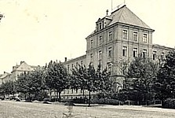Artilleriekaserne (König-Albert-Kaserne): Diese Kaserne entstand 1877/78 für das 1. Königlich Sächsische Feld-Artillerie-Regiment Nr. 12 und wurde am 1. April 1878 übergeben. Die Einheit gehörte zu den traditionsreichsten der sächsischen Armee und entstand als Feld- und Festungsartillerie-Kompanie bereits um 1620. Nach der Neustrukturierung der sächsischen Armee 1867 war sie zunächst in Radeberg stationiert.

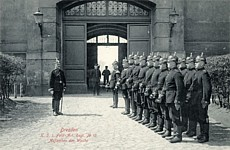Der Gebäudekomplex bestand aus vier Unterkunfts- und Verwaltungsgebäuden, in denen auch die Artilleriebibliothek und ein Offizierscasino untergebracht waren. Hinzu kamen vier Pferdeställe für je 100 Pferde, ein Reithaus und ein Lagerschuppen zur Deponierung von Geschützen und Wagen. Außerdem legte man mehrere Reit- und Exerzierplätze an. 1914 erhielt der Komplex den Namen König-Albert-Kaserne.

Mit Auflösung des Regiments nach dem Ersten Weltkrieg übernahm die Reichswehr den Gebäudekomplex, nach 1933 die Wehrmacht. 1945 bezogen zunächst sowjetische Truppen die beiden Artilleriekasernen, später nutzten Einheiten der Kasernierten Volkspolizei, danach die Bereitschaftspolizei die Gebäude. Nach erfolgter Sanierung haben hier seit 2010 verschiedene Einrichtungen der sächsischen Polizei, u.a. die Polizeidirektion “Oberes Elbtal”, ihr Domizil. Gegenüber befindet sich noch das frühere Offizierscasino des Regiments, derzeit noch in ruinösem Zustand (Stauffenbergallee 77).

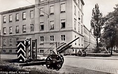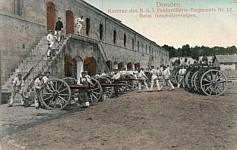

**_Fotos:_** _Eingang zur König-Albert-Kaserne um 1940, rechts ein Blick in den Geschützhof_

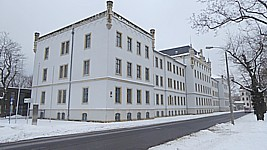König-Georg-Kaserne: Im Jahr 1900 entstand auf dem unmittelbar an die Artilleriekaserne angrenzenden Areal ein weiterer Kasernenbau für das 1899 aufgestellte 4. Königlich Sächsische Feld-Artillerie-Regiment Nr. 48, die nach dem damals regierenden König den Namen König-Georg-Kaserne bekam. Das neogotische Gebäude im Tudorstil bildete zugleich den westlichen Abschluss der Albertstadt. Gleichzeitig entstand auf der gegenüberliegenden Straßenseite ein neues Offizierskasino (Stauffenbergallee 77). Einige Ergänzungsbauten folgten bis 1919. Auch diese Kaserne diente später der Reichswehr bzw. bis 1945 einer Flak-Einheit der Wehrmacht, bevor zu DDR-Zeiten die Bereitschaftspolizei einzog. Nach 2010 wurde die viele Jahre leer stehende König-Georg-Kaserne saniert. Heute wird das Gebäude vom sächsischen Landesamt für Straßenbau und Verkehr genutzt.

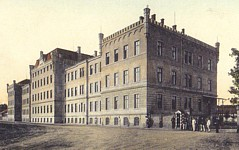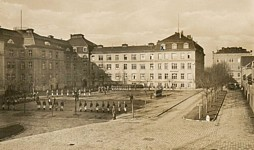

**_Fotos:_** _Die König-Georg-Kaserne um 1910 und 1939_

König-Georg-Denkmal: In Erinnerung an den 1904 verstorbenen sächsischen König Georg wurde auf dem Gelände der Artilleriekaserne 1928 ein Bronzestandbild des Monarchen aufgestellt. Das Reiterstandbild zeigte den König in Generalsuniform hoch zu Ross und stammte vom Bildhauer Fred Voelkerling. Dieses Denkmal wurde nach 1945 als künstlerisch wertlos eingestuft und 1952 auf Beschluss des Stadtrates beseitigt und eingeschmolzen.

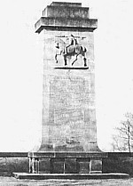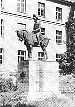

**_Fotos:_** _Militärdenkmäler in der Albertstadt: links das Gardereiterdenkmal, rechts das Denkmal König Georgs_

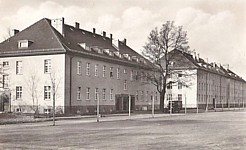Flak-Kaserne: Dieser Gebäudekomplex entstand als letztes größeres Militärobjekt der Albertstadt in den 1930er Jahren des 20. Jahrhunderts. Die Kaserne befand sich hinter dem Hauptgebäude der Artilleriekaserne und war über die Verlängerung der Fabricestraße erreichbar. Bis 1945 wurde sie von der Flak-Abteilung 4 der Wehrmacht, danach von der sowjetischen Armee genutzt. Im Zusammenhang mit dem Neubau der Justizvollzugsanstalt am Hammerweg erfolgte in den 1990er Jahren der Abriss der meisten Gebäude.

* * *

 \[ [Home](../../../../index.html)\] \[ [Nord](../../../../nord/)\] \[ [Nordwest](../../../../nordwest/)\] \[ [Neustadt](../../../../neustadt/)\] \[ [Nordost](../../../../nordost/)\] \[ [West](../../../../west/)\] \[ [Zentrum](../../../../zentrum/)\] \[ [Südwest](../../../../sudwest/)\] \[ [Süd](../../../../sud/)\] \[ [Südost](../../../../sudost/)\] \[ [Ost](../../../../ost/)\] \[ [Register](../../../../Register/register.html)\] \[ [Kontakt](../../../../Kontakt/kontakt.html)\] \[ [Impressum](../../../../impressum/)\]
