* * *

* * *

* * *

* * *

* * *

* * *

* * *

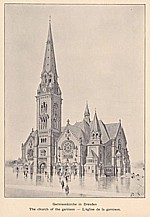

_Entwurfszeichnung der Garnisonkirche_

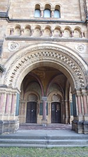

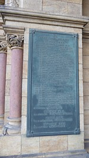

_Die Turmhalle mit Gedenktafeln für die Gefallenen des Deutsch-französischen Krieges 1870/71_

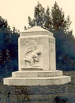

_Gefallenendenkmal der 192. Infanteriedivision_

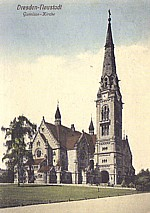Die Garnisonkirche entstand zwischen 1893 und 1900 an der Carolaallee im Zentrum der Albertstadt. Den Entwurf für den neoromanischen Bau lieferte das renommierte Architektenbüro Lossow & Viehweger, die technische Ausführung leitete der Garnisons-Bauinspektor Müller. Um beiden Konfessionen Raum für ihre Gottesdienste zu schaffen, wurde die Kirche von Anfang an als Simultankirche mit evangelischem und katholischem Teil geplant. Diese Zweiteilung unter einem Dach wurde hier erstmalig in Mitteleuropa umgesetzt. Als Garnisonkirche mit 2400 Sitzplätzen (2000 im evangelischen, 400 im katholischen Teil) war sie ausschließlich für Angehörige der Armee und deren Familienangehörige bestimmt. Die Grundsteinlegung erfolgte am 28. Oktober 1895; auf den Tag genau fünf Jahre später wurde sie am 28. Oktober 1900 geweiht. Ungewöhnlich ist, dass die Kirche drei Grundsteine besitzt, je einen für den katholischen und den evangelischen Teil sowie einen dritten für den beide verbindenden Kirchturm.

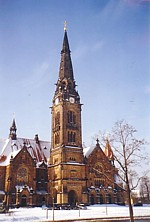Die Kirche überstand den Luftangriff auf Dresden ohne größere Schäden. Nach Eingemeindung der Albertstadt nach Dresden wurde der katholische Teil der Kirche der St.-Franziskus-Gemeinde der Dresdner Neustadt übergeben, deren Gotteshaus am Albertplatz 1945 zerstört worden war. Die Kirche erhielt dabei den Namen St.-Martins-Kirche und ist bis heute katholische Pfarrkirche der Neustadt. Der evangelische Teil diente nach Kriegsende bis 1968 als Ausweichquartier der [St.-Pauli-Gemeinde](../../../../../neustadt/leipziger_vorstadt/hechtviertel/st_-pauli-kirche/). 1971/72 wurde der Innenraum von Ludwig Gonschor neu gestaltet und erhielt 1984 einen Kreuzweg von A. Garn. Die aus dem Jahr 1900 stammende Orgel der Firma Jehmlich wurde 2004 restauriert. Da der evangelische Teil nach Fertigstellung des neuen Gemeindezentrums der St.-Pauli-Kirche nicht mehr für die Seelsorge benötigt wurde, zogen in die Räume ein Magazin des Staatstheaters und die [Phonothek](../../../../../sud/zschertnitz/strassen_zschertnitz/zellescher_weg/slub/) ein. Diese Abteilung der Landesbibliothek archiviert Tonträger aller Art. Zeitweise hatte hier auch die Puppentheatersammlung ihr Domizil. Noch heute sie diese Räume als Depot.

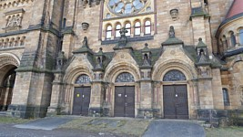1998 wurde die 1990 in den Besitz der Bundeswehr übergegangene Kirche an einen privaten Investor verkauft. Gleichzeitig begann eine umfassende Sanierung des denkmalgeschützten Gebäudes. Neben der Nutzung als Militärseelsorgezentrum der Heeresoffizierschule ist auch die Einrichtung eines Jugendzentrums und der Bau von
Seniorenwohnungen auf dem Kirchengrundstück geplant. 2003 konnte ein modernes Gemeindezentrum der katholischen St.-Franziskus-Xaverius-Gemeinde eingeweiht werden. Der vom Dresdner Architekten Werner Bauer entworfene Neubau beherbergt neben dem Pfarrsaal und Büroräumen auch zwei Wohnungen sowie den von der Caritas betriebenen Kindergarten "St. Benno" mit 9w Plätzen. Auf dem Dach des Gebäudes entstand eine moderne Solaranlage.

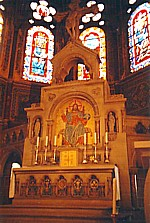Im Inneren der Kirche erinnern verschiedene Gedenktafeln an Dresdens Militärgeschichte. In der Vorhalle zum katholischen Teil befinden sich mehrere Bronzetafeln mit den Namen von 99 im Deutsch-Französischen Krieg 1870/71 gefallenen Dresdnern, die ursprünglich am Germania-Siegesdenkmal auf dem Altmarkt angebracht waren. Eine weitere Tafel erinnert an sechs Militärangehörige, die während der Kämpfe im früheren Deutsch-Südwestafrika starben. Im katholischen Teil befinden sich ein Altar aus Cottaer Sandstein _(Foto)_ sowie eine 2004 erneuerte Orgel der Firma Jehmlich mit 21 Registern. Die Buntglasfenster stammen aus der bekannten Glaskunstwerkstatt Urban & Goller, die Ausmalung des Kirchenraumes von Paul Mohn. Im Turm läuteten ursprünglich vier aus erbeuteten französischen Geschützen gegossene Bronzeglocken. Drei dieser Glocken wurden im Ersten Weltkrieg eingeschmolzen und 1931 durch ein neues Gußstahlgeläut ersetzt.

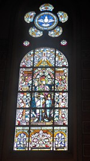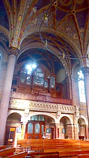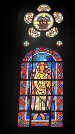

**_Fotos:_** _Der Innenraum des katholischen Teils mit Glasfenstern und Orgelempore_

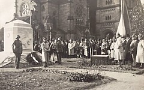Kriegerdenkmal: Vor der Kirche stand bis 1946 ein weiteres Ehrenmal, welches 1924 von Angehörigen der 192. Königlich-Sächsischen Infanteriedivision aufgestellt wurde. Der Sandsteinquader mit plastischem Schmuck und Schrifttafeln wurde von Otto Aurich entworfen und erinnerte an die Gefallenen der Einheit. 1946 wurde das Denkmal wegen seines “militaristischen Charakters” beseitigt.

_**Foto:** Einweihung des Gefallenendenkmals im Jahr 1924_

* * *

 \[ [Home](../../../../../index.html)\] \[ [Nord](../../../../../nord/)\] \[ [Nordwest](../../../../../nordwest/)\] \[ [Neustadt](../../../../../neustadt/)\]
 \[ [Nordost](../../../../../nordost/)\] \[ [West](../../../../../west/)\] \[ [Zentrum](../../../../../zentrum/)\] \[ [Südwest](../../../../../sudwest/)\]
 \[ [Süd](../../../../../sud/)\] \[ [Südost](../../../../../sudost/)\] \[ [Ost](../../../../../ost/)\] \[ [Register](../../../../../Register/register.html)\] \[ [Kontakt](../../../../../Kontakt/kontakt.html)\] \[ [Impressum](../../../../../impressum/)\]
