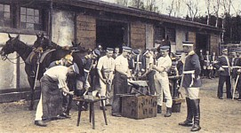

* * *

Das heutige Militärhistorische Museum am Olbrichtplatz entstand 1873 -
1876 als Arsenalhauptgebäude und bildete den Mittelpunkt der Albertstadt. Im Erdgeschoss fanden die Geschütze der sächsischen Armee Aufstellung, während die oberen Etagen als Depot für Handfeuerwaffen und Blankwaffen
diente. Mit Einweihung des Arsenals am 1. Mai 1877 wurde das alte Zeughaus an der Brühlschen Terrasse aufgegeben und in der Folge zum Albertinum umgebaut. Im Anschluss an das Arsenalhauptgebäude
erstreckten sich die ausgedehnten Anlagen der Artilleriewerkstätten, aus denen später das [Industriegelände](../../../../../neustadt/albertstadt/industriegelande/) hervorging. Hier befanden sich u.a.
Schmiede, Formerei, Gießerei, Stellmachermerkstatt, Tischlerei und andere Handwerksbetriebe, die zur Herstellung von
Artilleriewaffen erforderlich waren. Lediglich Geschützrohre, Gewehre und Munition mussten von außerhalb bezogen werden. Außerdem gab es ein Montierungsdepot, in welchem Bekleidung, Stiefel und andere persönliche
Ausrüstungsgegenstände der Soldaten aufbewahrt wurden.

Zu einem tragischen Unglück kam es am 28. Dezember 1916, als sich in den Munitionsdepots eine folgenschwere Explosion
mit anschließendem Großbrand ereignete. Bei der Untersuchung offenkundig mangelhafter Artilleriegranaten explodierten die
Geschosse und lösten eine Kettenreaktion von Bränden und weiteren Detonationen aus. Trotz sofortigen Feuerwehreinsatzes
brannten 30 Gebäude des Arsenalgeländes ab, 74 wurden zum Teil schwer beschädigt. Insgesamt kamen 17 Menschen ums
Leben, weitere wurden verletzt. Erst am Folgetag gelang es, das Feuer unter Kontrolle zu bringen. Die genauen Hintergründe
des Dresdner Arsenalbrandes konnten trotz Einsatzes einer Untersuchungskommission nicht geklärt werden. Vermutlich war menschliches Versagen, verbunden mit unzureichenden Sicherheitsvorkehrungen, die Ursache.

Nach dem Ersten Weltkrieg musste das Arsenal als Militärdepot aufgegeben werden. Während die Wirtschaftsgebäude an
verschiedene Unternehmen vermietet wurden, blieb das Hauptgebäude als Aufbewahrungsort für militärisches Gerät
bestehen und wurde 1923 als Sächsisches Armeemuseum der Öffentlichkeit wieder zugänglich gemacht. Dieses Museum
war bereits 1897 als “Historische Waffen- und Modellsammlung” zur Geschichte des sächsischen Militärwesens gegründet
worden und bestand bis 1918. 1940 wurde das Museum in Heeresmuseum umbenannt und war bis 1945 geöffnet. Zu den
letzten Höhepunkten vor Kriegsende gehörte 1943 eine Sonderausstellung mit Werken des Künstlers Ernst Hassebrauk zum
Thema “Waffen und Uniformen aus fünf Jahrhunderten”. 1993 konnte diese mit den erhalten gebliebenen Bildern des Malers an gleicher Stelle wiederholt werden.

Nach Kriegsende beschlagnahmte die Rote Armee sämtliche Bestände und ließ diese zum größten Teil in die Sowjetunion abtransportieren. Das Heeresmuseum wurde daraufhin aufgelöst.
Das Gebäude wurde von der Stadt Dresden übernommen und war als “Nordhalle” bis 1967 Schauplatz für Ausstellungen und andere Veranstaltungen. U. a. fand hier ab 1946 für einige Jahre
in Verbindung mit einer Weihnachtsmesse der Dresdner Striezelmarkt statt. Auch die erste Ausstellung zum Wiederaufbau Dresdens (“Das neue Dresden”) wurde 1946 in der Nordhalle
gezeigt. Weiterhin gab es regelmäßige Kunstausstellungen, Oster- und Blumenausstellungen, aber auch Leistungsschauen mit politischem Hintergrund zum sozialistischen Wiederaufbau in der DDR.
Im linken Seitenflügel nutzte das Stadtmuseum einige Räume als provisorische Ausstellungsfläche.

1972 bezog das 1961 in Potsdam gegründete Deutsche Armeemuseum das frühere
Arsenalgebäude. Schwerpunkt des nun Armeemuseum der DDR genannten Ausstellungszentrums war die Geschichte der Nationalen Volksarmee der DDR und der Armeen der befreundeten Staaten. Nach Rückgabe eines
Teils der Bestände des früheren Sächsischen Armeemuseums konnten auch diese gezeigt werden. 1990 übernahm das Bundesverteidigungsmuseum das Museum, welches heute Militärhistorisches Museum Dresden genannt wird.

Ab 2004 wurde das frühere Arsenalgebäude umgebaut und im Oktober 2011 fertiggestellt. Die Pläne für den Umbau, der
u.a. einen modernen dreieckigen Keil in die historischen Fassade setzte, stammen von Daniel Libeskind. Mit dem Keil soll
ein bewusster Bruch in der Militärgeschichte dokumentiert werden. Die Spitze zeigt exakt in Richtung Ostragehege, wo am 13. Februar 1945 die ersten Markierungsbomben für den Luftangriff abgeworfen wurden.

Heute präsentiert die Sammlung auf ca. 19.000 m² Ausstellungsfläche Sachzeugen zur Militärgeschichte von der Frühzeit bis
zur Gegenwart. Die Ausstellung wurde dafür völlig neu konzipiert und zeigt neben Waffen, Orden, Fahnen, Bekleidungs- und
Ausrüstungsgegenständen und anderen Dokumenten nun auch die Schrecken des Krieges und seine Folgen für die Soldaten
und die Bevölkerung. Im öffentlich zugänglichen Depot sind zudem zahlreiche Großgeräte und Fahrzeuge zu sehen. Zu den
Prunkstücken des Museums gehören die älteste erhaltene sächsische Kanone “Faule Magd” und das erste in Deutschland
gebaute U-Boot “Brandtaucher” von 1850. Auch die 2006 vom Meeresgrund geborgene Schiffsglocke des am 14. März 1915 vor der chilenischen Küste versenkten Kleinen Kreuzers “Dresden” ist hier ausgestellt.

Video: Das Militärhistorische Museum Dresden

* * *

 \[ [Home](../../../../../index.html)\] \[ [Nord](../../../../../nord/)\] \[ [Nordwest](../../../../../nordwest/)\] \[ [Neustadt](../../../../../neustadt/)\]
 \[ [Nordost](../../../../../nordost/)\] \[ [West](../../../../../west/)\] \[ [Zentrum](../../../../../zentrum/)\] \[ [Südwest](../../../../../sudwest/)\]
 \[ [Süd](../../../../../sud/)\] \[ [Südost](../../../../../sudost/)\] \[ [Ost](../../../../../ost/)\] \[ [Register](../../../../../Register/register.html)\] \[ [Kontakt](../../../../../Kontakt/kontakt.html)\] \[ [Impressum](../../../../../impressum/)\]
