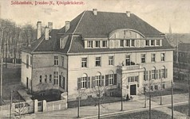
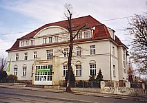
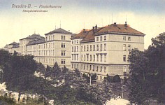
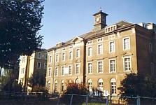
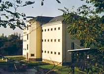
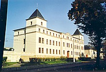
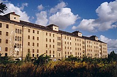

* * *

* * *

Gebäude in der Albertstadt:

Sächsisches Soldatenheim: Das Gebäude entstand 1911 nach Plänen der Baumeister Hartung und Dutzmann und wurde am 8. 10. 1911 als Sächsisches
Soldatenheim eröffnet _(Foto)_. Mit dem durch Spenden finanzierten Soldatentreffpunkt sollte der Besuch von Arbeiterlokalen durch Militärangehörige verhindert werden, um so unerwünschten politischen Einfluß
von diesen fernzuhalten. Das Dresdner Soldatenheim auf der Königsbrücker Straße 84 war drittes seiner Art in Sachsen. Im Haus befanden sich Aufenthalts-, Billard- und Leseräume für Soldaten, ein Festsaal und eine
Stehbierhalle. Das Obergeschoss stand den Unteroffizieren zur Verfügung. Außerdem besaß das Haus eine Wohnung für den Verwalter und im Keller eine Kegelbahn sowie ein Wannenbad.

Bis 1945 diente das Soldatenheim seiner Bestimmung. 1946 bis 1952 war es Sitz des sächsischen Landtages, da es an geeigneten Räumlichkeiten in der zerstörten Stadt fehlte. Im Anschluss übernahm die Technische Hochschule
das Gebäude und richtete hier ein Studentenwohnheim und Lehrräume ein. Ab 1962 wurde es von der Nationalen Volksarmee genutzt und Haus der NVA genannt. Hier befand sich
auch eine öffentliche Gaststätte. Nachdem die Bundeswehr das Gebäude übernommen hatte, wurde die Einrichtung 1991 geschlossen. Nach Umbau und Sanierung hat heute hier das Goethe-Institut seinen Sitz, welches im Haus
Sprachkurse, Vorträge und Seminare veranstaltet _(Foto rechts)_.

Pionierkaserne: Die Pionierkaserne entstand im Zusammenhang mit dem Bau der Albertstadt als Unterkunfts- und Dienstgebäude des 1.
Königlich-Sächsischen Pionierbataillons Nr. 12 und wurde am 1. April 1879 bezogen. Die Einheit war bereits 1698 von August dem Starken als Pontonierkompanie gebildet worden und bezog nach Fertigstellung das neue
Gebäude an der Königsbrücker Straße. Der Gebäudekomplex an der Ecke zur Carolaallee (heute Stauffenbergallee) erhielt neben den Schlaf- und Speisesälen der Mannschaften auch ein Unteroffiziers- und ein Offizierskasino,
die Ingenieurbibliothek und verschiedene Wirtschaftsgebäude. Im Mitteltrakt gab es außerdem mehrere Offizierswohnungen. Die beiden Flügelbauten boten Platz für je 500 Mann der beiden
Kompanien und waren durch eine eiserne Treppe miteinander verbunden. Das Tiefparterre beherbergte die Küche und zwei Speisesäle.

1912 wurde die Einheit nach Pirna verlegt und der Gebäudekomplex an das 2. Königlich-Sächs. Fußartillerie-Regiment
Nr. 19 übergeben. In dieser Einheit leistete der bekannte Dresdner Schriftsteller Erich Kästner seinen Wehrdienst. 1920
übernahm zunächst die Bereitschaftspolizei, 1935 wieder die Wehrmacht das Areal. Nach 1945 wurden die Kasernenbauten bis 1992 von der Sowjetarmee genutzt und zwischen 1997 und 1999 als Bürogebäude saniert. Heute
befindet sich hier das Landesfunkhaus des MDR mit Verwaltungsräumen, Fernseh- und Rundfunkstudios..

Städtische Arbeitsanstalt:
Das Gebäude (Königsbrücker Straße 117) entstand als einer der wenigen zivilen Bauten in der Albertstadt 1876/78 neben dem “Lindengarten” und war im Besitz der Stadt Dresden. Zuvor hatte man Bettler
und andere arbeitsunwillige Personen im Jakobshospital, ab 1853 im ehemaligen Stadtkrankenhaus an der Stiftsstraße untergebracht, oft gegen ihren Willen. Mit
Verlegung der Einrichtung in die Albertstadt konnten hier bis zu 300 Männer und 150 Frauen leben, die unter strenger Aufsicht zu Erd- und Feldarbeiten,
Besenbinden oder Lohnwäscherei herangezogen wurden. Das Speisehaus diente zugleich als Kapelle für den Gottesdienst. Auf Beschluss des Stadtrates wurde die Arbeitsanstalt am 1. April 1922 geschlossen.

Während des Zweiten Weltkrieges befand sich im Gebäude ein Reservelager für Hausrat, welcher im Falle eines Luftangriffes ausgebombten Familien zur Verfügung gestellt werden sollte. Die Möbel und Haushaltsgegenstände
stammten meist aus dem Besitz jüdischer Familien bzw. aus zerstörten Häusern. Nach 1945 wurde auch dieser Bau militärisch genutzt. Zuletzt befanden sich hier Büros. Eine Sanierung des Hauses ist geplant.

Pferdelazarett: Die offiziell als Militär-Tierklinik bezeichnete Einrichtung wurde 1936 von der Wehrmacht eingerichtet.
Bis zum Kriegsende wurden hier Militärpferde mit Schussverletzungen oder Huferkrankungen chirurgisch behandelt.
Pferde, die auch nach ihrer Behandlung nur noch eingeschränkt dienstfähig waren, gab man als Arbeitspferde an die
Landwirtschaft ab, die übrigen kehrten in die Militäreinheiten zurück. Nach den Luftangriffen wurde das Pferdelazarett Ende Februar 1945 aufgelöst und in die Region um Altenburg evakuiert.

Festungsgefängnis: Die Einrichtung ging auf eine 1835 gegründete Militärstrafanstalt zurück, die seit 1874 offiziell
Festungsgefängnis genannt wurde. Ursprünglich befand sich das Gefängnis auf der Magazinstraße und wurde 1879 zur Königsbrücker Straße 125 verlegt. Der von Magnus Küchling entworfene Gebäudekomplex bestand aus
Gerichtsgebäude, Gefängnis und einer Disziplinararrestanstalt für kleinere Vergehen. Hinzu kam ein kleineres Gebäude
mit den Dienstwohnungen der Angestellten. Die Gesamtanlage war ursprünglich von einer vier Meter hohen Mauer
umgeben, die einige Nebenbauten wie Schuppen, Ställe und das Wachhaus einbezog. Die offizielle Eröffnung erfolgte am 1. April 1879.

Im Mittelpunkt der Anlage befand sich das dreistöckige Gerichtsgebäude, welches im Erdgeschoss die Wache und
Büros sowie Wohnungen für die Aufseher beherbergte. Im 1. Obergeschoss hatten die Gerichte der sächsischen Armee
ihren Sitz, die in Korps-, Gouvernements- und Divisionsgericht unterteilt waren und alle Militärstraftaten innerhalb der
Armee ahndeten. Die beiden obersten Etagen wurden von Zellen für Untersuchungsgefangene eingenommen. Kam es zur Verurteilung zu einer Haftstrafe, wurden die Gefangenen bei
Strafen bis zu sechs Wochen im Disziplinararresthaus, bei längeren Strafen im Festungsgefängnis untergebracht. Beide Gebäude waren mit Zentralheizung, Bade- und
Waschräumen sowie mit Werkstätten ausgestattet und besaßen Platz für insgesamt 370 Inhaftierte. Im Festungsgefängnis gab es zusätzlich Wohnräume für die Aufseher, ein Unterrichts- und Besucherzimmer sowie eine
Sakristei mit Betsaal zur religiösen Betreuung der Gefangenen.

Obwohl das Gefängnis zur Zeit seiner Entstehung nach modernen Gesichtspunkten erbaut worden war, gerieten die Haftbedingungen immer wieder unter Kritik.
Grund waren vor allem die ungünstigen Licht- und Temperaturverhältnisse in den Gebäuden sowie die unzureichende Versorgung mit Lebensmitteln. Außerdem
deckte der sozialdemokratische Landtagsabgeordnete Kunertin 1897 auf, das Häftlinge Kleidungsstücke und Möbel für das Personal herstellen mussten und auch
gelegentlich als “Bedienungspersonal” bei Trinkgelagen der Wachhabenden eingesetzt waren. Daraufhin befasste sich ein Untersuchungsausschuss mit den
Vorwürfen, allerdings ohne durchgreifenden Erfolg. Inhaftiert waren hier bis zum Ende des Ersten Weltkrieges ausschließlich Angehörige der sächsischen Armee. 1920 wurde das Festungsgefängnis _(Foto)_
geschlossen und als Strafanstalt Dresden genutzt.

1924 erfolgte ein Umbau des Komplexes zum Verwaltungsgebäude, welches 1927 den Namen General-Müller-Block
erhielt. Generalleutnant Müller (1866-1925) war ab 1919 Landeskommandant von Sachsen und 1923 am Einmarsch der Reichswehr nach Sachsen beteiligt. 1925 kam er bei einem Manöver auf dem Truppenübungsplatz Jüterbog ums
Leben. Bis 1945 war das Gebäude zuletzt Sitz einer Wehrmachtsfachschule für Techniker. Schäden entstanden durch
einen Luftangriff im April 1945, wobei das ehemalige Festungsgefängnis völlig zerstört wurde. 1945 übernahm die Sowjetarmee den Komplex und nutzte ihn bis in die 1950er Jahre. Später befanden sich hier Dienststellen des
Ministeriums für Staatssicherheit. Trotz verschiedener Umbauten blieb die Grundstruktur der Gebäude bis heute im Wesentlichen erhalten. Jetzt hat hier das Bundesamt für Arbeitsschutz und Arbeitsmedizin seinen Sitz.

Garnisonsversorgungsanstalten: Der gesamte Komplex zwischen Königsbrücker Straße und Eisenbahnlinie wurde im Zusammenhang mit dem Bau der Albertstadt
als Versorgungszentrum der sächsischen Armee erbaut und früher auch Provianthof genannt. Neben der Versorgung der Dresdner Garnison waren hier
Lebensmittel- und Futtervorräte für den Kriegsfall gelagert und konnten Dank des bestehenden Eisenbahnanschlusses schnell an ihren Bestimmungsort verbracht
werden. Zur Garnisonsversorgungsanstalt gehörten eine Dampfwaschanstalt zur Reinigung der Bett- und Leibwäsche der Soldaten, Mehl- und Kornmagazine, das
Raufuttermagazin für die Pferde, die Garnisonsmühle und die angeschlossene Heeresbäckerei mit dem Brotmagazin, eine Schlachtanstalt und weitere Einrichtungen.

Organisatorisches Zentrum war die sogenannte Proviantamt-Administration im
Zentrum des Gebäudekomplexes mit Wohnungen und Büros der Beamten. Im Norden befanden sich die Schlachtanstalten mit Schlachtraum, Wurstküche, Räucherkammer und Fleischmagazin. Die übrigen Gebäude waren längs der
Bahnlinie angeordnet, wobei ein Kohledepot den erforderlichen Brennstoff für die Dampfmaschinen, Bäckerei und Wäscherei lieferte. Allein die Mühle konnte
täglich bis zu 15.000 kg Mehl herstellen, das zunächst in einem Mehlmagazin gelagert und im Anschluss in der Heeresbäckerei verarbeitet wurde. Bis zu 4000
Brote am Tag verließen zeitweise das Haus, welches mit Knet- und  Zwiebackmaschinen und fünf Backöfen eingerichtet war. Die beiden Körnermagazine waren mit modernen Aufzügen,
Transportbändern und Trichtern ausgestattet und ermöglichten an insgesamt 24 Stellen Einnahme und Ausgabe des Getreides. Für die Versorgung der hunderten Pferde der Armee stand das 3.900 Quadratmeter große Areal des
Raufuttermagazins zur Verfügung, wo in einfachen Lagerbaracken Hafer, Heu und Stroh aufbewahrt wurde.

Auch nach 1945 blieben die erhaltenen Gebäude
in Verwendung und wurden noch bis 1994 von der sowjetischen Armee genutzt. Nach Verkauf an einen privaten Investor und Abriss nicht mehr verwendbarer Nebengebäude wurde
der Komplex 1998 teilweise umgebaut. Heute befindet sich hier ein Einkaufszentrum. In den Gebäuden der früheren Heeresbäckerei hat seit 1999 das Dresdner [Stadtarchiv](../../../../neustadt/aussere_neustadt/antonstadt/konigsbrucker_strasse/stadtarchiv/) seinen Sitz. Eines der beiden ehemaligen Kornmagazine _(Foto)_
beherbergt seit 2012 das Zwischenarchiv des Stadtarchivs. Das südliche Magazin wurde 2008 zugunsten einer modernen Produktionsstätte der Firma Pharmatec abgerissen.

* * *

 \[ [Home](../../../../index.html)\] \[ [Nord](../../../../nord/)\] \[ [Nordwest](../../../../nordwest/)\] \[ [Neustadt](../../../../neustadt/)\] \[ [Nordost](../../../../nordost/)\] \[ [West](../../../../west/)\] \[ [Zentrum](../../../../zentrum/)\] \[ [Südwest](../../../../sudwest/)\] \[ [Süd](../../../../sud/)\] \[ [Südost](../../../../sudost/)\] \[ [Ost](../../../../ost/)\] \[ [Register](../../../../Register/register.html)\] \[ [Kontakt](../../../../Kontakt/kontakt.html)\] \[ [Impressum](../../../../impressum/)\]
