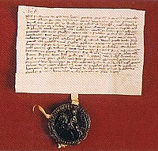

* * *

* * *

Das Dresdner Stadtarchiv entstand als selbstständige städtische Einrichtung 1864, nachdem der Stadtrat am 3. November 1863 einen entsprechenden Beschluss gefasst hatte. Allerdings wurden auch zuvor bereits Unterlagen des Rates gesammelt und archiviert. Das erste Register zu den Dresdner Stadtbüchern stammt aus dem Jahr 1517, ein städtischer Archivar ist seit Mitte des 18. Jahrhunderts nachweisbar. Zum ersten Leiter des Ratsarchivs berief man den Juristen Dr. Alfred Heinze, der 1879 von Dr. Otto Richter abgelöst wurde. Richter erwarb sich große Verdienste bei der wissenschaftlichen Aufarbeitung der Bestände und gründete auch den Dresdner Geschichtsverein. Zugleich war er Direktor der Stadtbibliothek.

 Ursprünglich hatte das Ratsarchiv seinen Sitz im Alten Rathaus am Altmarkt / Ecke Scheffelgasse. Nach dem Bau des Neuen Rathauses am Ring wurde 1910 auch das Archiv dorthin verlegt und 1936 nach Übernahme des Stadtverordneten-Archivs offiziell in Stadtarchiv umbenannt. 1945 gingen Teile der Bestände, darunter zahlreiche historisch wertvolle Ratsurkunden, durch Brand, Wasserschäden und Diebstahl verloren.

Die verbliebenen Akten wurden 1946/47 in das ebenfalls kriegsbeschädigte frühere [Sächsische Kriegs- und Heeresarchiv](../../../../../neustadt/albertstadt/strassen_albertstadt/marienallee/) auf der Marienallee 3 verbracht. Seit 1953 gab es dort auch einen öffentlichen Lesesaal.
1999 zog die Einrichtung auf das Gelände der früheren [Heeresbäckerei](../../../../../neustadt/aussere_neustadt/antonstadt/konigsbrucker_strasse/) an der Königsbrücker Straße um _(Foto)_. Neben den öffentlich nicht zugänglichen Archivräumen gibt es auch hier einen großen Lesesaal sowie Räume für Ausstellungen und Vorträge. Den Lesesaal schmückt ein 1999 dem Stadtarchiv als Leihgabe übergebenes Gemälde von Hermann Albert. Zur Unterbringung weiteren Archivmaterials erfolgte zwischen 2009 und 2012 der Ausbau eines benachbarten Kornspeichers zum Zwischenarchiv.

Aufbewahrt werden neben Unterlagen des Rates und der städtischen Behörden auch Akten von kommunalen Einrichtungen wie Schulen, Kulturstätten und Unternehmen, Archivgut aus aufgelösten Betrieben sowie historische Zeitungen, Bücher, Bauzeichnungen und Pläne. Die ältesten Urkunden stammen aus dem 12./13. Jahrhundert und verzeichnen u.a. städtische Privilegien und Rechte. 1517 wurden erstmals Stadtbücher zur Registrierung der Ratsarchivalien angelegt. Später kamen Unterlagen zu Steuer- und Finanzangelegenheiten, Einwohnerverzeichnisse und andere Akten hinzu. Auch die Dokumente aus den Gemeindearchiven der nach Dresden eingemeindeten Orte finden sich im Stadtarchiv. Hinzu kommen Nachlässe bedeutender Persönlichkeiten, darunter Korrespondenzen von Ludwig Richter und der Familie Körner. Stadtgeschichtlich interessant sind auch die ab 1702 bis 1944 regelmäßig erschienenen Adressbücher. Insgesamt besitzt das Archiv derzeit ca. 35 Kilometer Archivgut, 4.200 Urkunden, 80.000 Karten und Pläne sowie ca. 150.000 Fotos.

* * *

 \[ [Home](../../../../../index.html)\] \[ [Nord](../../../../../nord/)\] \[ [Nordwest](../../../../../nordwest/)\] \[ [Neustadt](../../../../../neustadt/)\]
 \[ [Nordost](../../../../../nordost/)\] \[ [West](../../../../../west/)\] \[ [Zentrum](../../../../../zentrum/)\] \[ [Südwest](../../../../../sudwest/)\]
 \[ [Süd](../../../../../sud/)\] \[ [Südost](../../../../../sudost/)\] \[ [Ost](../../../../../ost/)\] \[ [Register](../../../../../Register/register.html)\] \[ [Kontakt](../../../../../Kontakt/kontakt.html)\] \[ [Impressum](../../../../../impressum/)\]
