* * *

* * *

* * *

**Schulen in der**

**Leipziger Vorstadt:**

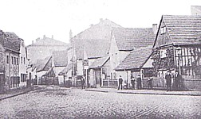Als Leipziger Vorstadt wird heute allgemein der nordwestlich des rechtselbischen Stadtkerns gelegene Teil der Neustadt bezeichnet. Er umfasst das zwischen Elbe - Oschatzer Straße - Weinböhlaer Straße - Stauffenbergallee und der Bahnlinie Dresden - Görlitz gelegene Gebiet. Historisch entwickelte sich die Leipziger Vorstadt in verschiedenen Etappen. Ältester Siedlungsteil ist das um 1550 gegründete [Neudorf](../../neustadt/leipziger_vorstadt/neudorf/), eine im Zusammenhang mit dem Festungsbau in der Inneren Neustadt entstandene Kleinbauern- und Häuslersiedlung an der heutigen [Moritzburger Straße](../../neustadt/leipziger_vorstadt/neudorf/moritzburger_strasse/) _(Foto)_. Diese vorstädtische Gemeinde besaß bis zu ihrer Eingliederung nach Dresden 1866 einen Sonderstatus, der immer wieder zu Konflikten zwischen der örtlichen Bevölkerung und dem städtischen Rat führte. Im letzten Drittel des 19. Jahrhunderts wuchs das bis dahin ländlich geprägte Neudorf mit dem benachbarten Pieschen zusammen, so dass die ehemalige Flurgrenze heute nicht mehr erkennbar ist. Heute dominieren hier mehrgeschossige Wohn- und Geschäftshäuser in geschlossener Bauweise. Hinzu kommen mehrere Kleingartenanlagen und gewerblich genutzte Flächen. Ab 1874 setzte sich für die ehemalige Neudorfer Flur und das angrenzende Gebiet der vom Stadtrat am 29. Oktober offiziell eingeführte Name Leipziger Vorstadt durch, wobei sowohl die [Leipziger Straße](../../neustadt/leipziger_vorstadt/leipziger_strasse/) als auch die hier entlang führende Eisenbahnlinie für die Namensgebung Pate standen.

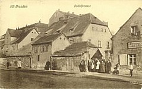Auch das Gebiet zwischen Großenhainer und Friedensstraße bildet faktisch eine “Ausgliederung” aus der eigentlichen Neustadt. Nach dem großen Stadtbrand von 1685 wurden hier die Scheunenhöfe angelegt, um diese besonders durch Feuer gefährdeten Gebäude außerhalb der Stadtmauer anzusiedeln _(Foto)_. Außerdem entstand 1732 in unmittelbarer Nähe der [Innere Neustädter Friedhof](../../neustadt/leipziger_vorstadt/innerer_neustadter_friedhof/) als Begräbnisplatz der Dreikönigskirche. Später wurde auch dieses Areal bebaut und ist alten Dresdnern noch unter dem Namen “Scheunenhofviertel” geläufig.

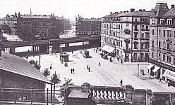Im 19. Jahrhundert begann sowohl auf Neudorfer Flur als auch im Umfeld der Scheunenhöfe die Ansiedlung gewerblicher Unternehmungen. Begünstigt wurde diese Entwicklung ab 1836 durch den Bau der ersten deutschen [Ferneisenbahn](../../neustadt/leipziger_vorstadt/dresden_-_leipzig/) zwischen Dresden und Leipzig. Die für deren Betrieb erforderlichen Bauten und technischen Anlagen, darunter der alte [Leipziger Bahnhof](../../neustadt/leipziger_vorstadt/dresden_-_leipzig/leipziger_bahnhof/) und die Eisenbahnwerkstätten, entstanden auf damals noch unbebautem Gebiet zwischen Leipziger und Großenhainer Straße. Nach Eröffnung des Neustädter Bahnhofes im Jahr 1901 diente der Leipziger Bahnhof als Güterbahnhof der Neustadt **_(Foto:_** _Bahnbrücken am Bischofsplatz)_.

Dem Eisenbahnbau folgten schon bald verschiedene Industriebetriebe, u.a. die [Drogenappretur-Anstalt](../../neustadt/leipziger_vorstadt/leipziger_strasse/arzneimittelwerk_dresden/) von Ludwig Gehe, das Dampfsägewerk Grumbt, die Steingutfabrik [Villeroy & Boch](../../neustadt/leipziger_vorstadt/leipziger_strasse/villeroy___boch/) und der Dresdner [Schlachthof](../../neustadt/leipziger_vorstadt/leipziger_strasse/alter_schlachthof/). An der [Großenhainer Straße](../../neustadt/leipziger_vorstadt/grossenhainer_strasse/) entstanden Produktions- und Verwaltungsgebäude der bekannten [Nähmaschinenfabrik Clemens Müller](../../neustadt/leipziger_vorstadt/grossenhainer_strasse/nahmaschinenwerk/). Hinzu kamen kleinere Handwerksbetriebe, Lagerhallen, aber auch Kleingarten- und Sportanlagen. Per Ortsgesetz vom 5. Februar 1878 wurde die Leipziger Vorstadt offiziell zum Industriebezirk erklärt.

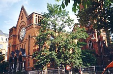Trotz dieser Entscheidung entstanden rund um die Industriezonen auch Wohnhäuser für die Arbeiter und Angestellten. Im nördlichen Teil der Vorstadt hatte 1836 der Dresdner Polizeidirektor Hans Ludwig von Oppell ein größeres Grundstück erworben, um hier auf planmäßigem Grundriss eine Arbeitersiedlung zu errichten. Nach ihm hieß dieser Bereich inoffiziell zunächst Oppellvorstadt, bevor sich später der volkstümliche Name [Hechtviertel](../../neustadt/leipziger_vorstadt/hechtviertel/) durchsetzte. Erst um 1875 begann der zunehmende Ausbau des Stadtteils, welcher vor 1945 zu den am dichtesten besiedelten Gebieten Dresdens gehörte. Zur kirchlichen Betreuung der hier lebenden Bevölkerung entstanden 1889 die [St. Petri-Kirche](../../neustadt/leipziger_vorstadt/st__petri-kirche/) am Großenhainer Platz sowie 1891 die [St. Pauli-Kirche](../../neustadt/leipziger_vorstadt/hechtviertel/st_-pauli-kirche/) am Königsbrücker Platz _(Foto links)_.

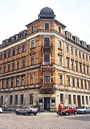Nach dem Ersten Weltkrieg wurde auf den noch verbliebenen Freiflächen an der Hechtstraße eine genossenschaftliche Wohnsiedlung erbaut. 1945 fielen Teile des Hechtviertels, aber auch Wohn- und Gewerbegebäude in den übrigen Teilen der Leipziger Vorstadt dem Luftangriff zum Opfer. Getroffen wurden u. a. der Güterbahnhof Neustadt sowie Wohnhäuser und Industrieanlagen an der Großenhainer und der Leipziger Straße. Bomben fielen auch auf Teile des alten Neudorfer Dorfkerns sowie in den angrenzenden Wohnvierteln. Heute weist der Stadtteil ein stark zergliedertes Bild auf. Neben bereits sanierten Wohnhäusern warten nach 1990 aufgegebene Industriebrachen auf ihre künftige Neugestaltung.

Jüngstes Projekt ist die geplante Umgestaltung des Areals zwischen Marienbrücke, Leipziger Straße und Elbufer zur “Hafencity” mit Wohnhäusern und Freizeiteinrichtungen. Zunächst war hier ein Projekt mit hochwertigen Wohnhäusern unter dem Namen "Marina Garden" vorgesehen. Hohe Auflagen, der Hochwasserschutz und ein nicht beizulegender Streit mit der Stadt führten schließlich zur Aufgabe. 2019 wurde das Areal an eine tschechische Immobilienfirma verkauft, die unter Leitung der Architektenbüros Barcode Architects und Lola Landscape Architects mit dem Bau begannen. Als erstes Gebäude konnte am 31. Januar 2020 das Richtfest für ein neues Hotel gefeiert werden.

Schulen in der Leipziger Vorstadt:

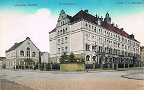Das erste Schulhaus der späteren Leipziger Vorstadt entstand 1689 als [Dorfschule](../../neustadt/leipziger_vorstadt/neudorf/) des Ortes Neudorf und befand sich am heutigen Moritzburger Platz. 1855 folgte ein Neubau an der Konkordienstraße 12, der ab 1866 als 8. Volksschule in das Dresdner Schulnetz eingegliedert wurde. Heute setzt die 8. Grundschule deren Tradition fort. Nachdem die Bevölkerung in diesem Teil der Neustadt deutlich angewachsen war, machte sich der Bau eines weiteren [Schulhauses](../../neustadt/leipziger_vorstadt/hechtviertel/) erforderlich. 1866 wurde in der Oppelvorstadt, dem heutigen Hechtviertel, ein großzügiger Schulneubau am Königsbrücker Platz eingeweiht. Eine weitere Schule entstand 1903 an der Windmühlenstraße 12 _(Foto)_. Beide Gebäude fielen 1945 dem Luftangriff zum Opfer.

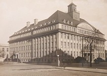Pestalozzi-Gymnasium: Das Gymnasium geht auf die frühere XI. Bürgerschule zurück. 1910/15 entstand am damaligen Riesaer Platz 22 ein moderner Schulneubau nach Entwürfen des Dresdner Stadtbaurates Hans Erlwein, dessen Eröffnung am 11. Oktober 1915 er jedoch nicht mehr miterleben konnte. Nach 1919 als 29. Volksschule genutzt, trug der Bau zwischen 1934 und 1945 den Namen Adolf-Hitler-Schule. Während des Zweiten Weltkrieges diente er als Reservelazarett Dresden VII. Ab 9. Mai 1945 befand sich hier bis 1946 die Sowjetische Stadtkommandantur der Roten Armee unter Leitung von Generaloberst Alexej Semjonowitsch Schadow.

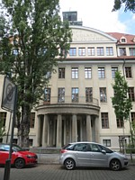Danach konnte das Schulhaus wieder seiner ursprünglichen Bestimmung zugeführt werden und beherbergte nun eine Grund- und eine Oberschule. Zeitgleich erhielt diese den Namen des Reformpädagogen Pestalozzi verliehen. Die im gleichen Komplex untergebrachte 29. POS trug ab 1971 den Namen "Arthur Ullrich". Arthur Ullrich (1894-1969) war in den 1920er Jahren Abgeordneter der KPD im Reichstag, schloss sich nach 1933 dem Widerstand an und wurde mehrfach inhaftiert. Nach 1945 hatte er verschiedene Funktionen im öffentlichen Bereich inne und war u.a. Kreisvorsitzender der SED in Görlitz, Mitglied der SED-Bezirksleitung Dresden und Vorsitzender des Rates des Kreises Meißen.

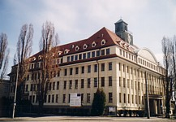 Seit Schließung der 29. POS wird das Gebäude seit 1992 ausschließlich vom Pestalozzi-Gymnasium genutzt und wurde 1996/99 saniert. Der markante Turm misst 35 Meter. Am Giebel über dem Hauptportal befindet sich der Spruch: "Die Kraft eines jeden Volkes liegt in seiner Jugend", der von Wilhelm Leopold Colmar Freiherr von der Goltz (1843-1916) stammt. Goltz war preußischer Generalfeldmarschall und arbeitete auch als Militärhistoriker und -schriftsteller.
2001 folgte der Neubau einer Turnhalle, welche sowohl von der Schule als auch mehreren Vereinen genutzt wird. Die frühere Turnhalle dient heute als Mehrzweckraum. 2013/14 entstand eine neue Mensa.

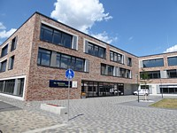145\. Oberschule: Die 145. Oberschule wurde zwischen 2017 und 2019 an der Gehestraße auf dem zuvor von der Deutschen Bahn genutzten Gelände des Neustädter Güterbahnhofs errichtet. Der moderne Neubau enstand nach einem städtebaulichen Wettbewerb und bietet Platz für eine fünfzügige Oberschule mit ca. 800 Schülern, was die Schule zur größten Oberschule Dresdens macht. Im gleichen Komplex befindet sich das neu gegründete Gymnasium Pieschen. Die Eröffnung erfolgte im Spätsommer 2019.

148\. Grundschule: Eine weitere neue Schule entstand 2018/19 an der Friedensstraße / Marta-Fraenkel-Straße. Der Neubau wurde auf dem früheren DREWAG-Gelände des einstigen Neustädter Gaswerks errichtet und am 31. August 2020 eröffnet. Die am 1. August 2019 gegründete Schule war zuvor provisorisch in den Räumen der 153. Grundschule an der Fröbelstraße untergebracht.

Neustädter Hafen:

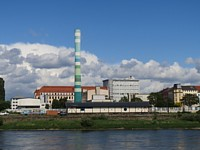Der Neustädter Elbhafen entstand Mitte des 19. Jahrhunderts und wurde 1872-1876 im Zusammenhang mit der zunehmenden Industrialisierung und zur Entlastung des Pieschener Hafens ausgebaut. Das ca. 380 m lange und 70 m breite Hafenbecken bot bis zu 40 Schiffen Platz. Als erster Verkehrshafen Sachsens erhielt er zugleich Anschluss an das Eisenbahnetz und ermöglichte somit die direkte Verladung von Gütern vom Wasser- auf den Schienenweg. Für den Umschlag wurden drei Dampfkräne angeschafft, die später Verstärkung durch zwei elektrische Kräne und eine Elevatoranlage erhielten. 1888/89 erfolgte nochmals eine Erweiterung des Hafenbeckens, um dieses zugleich als Winterhafen für die Passagierdampfer nutzen zu können. Das Foto zeigt eine Luftaufnahme des Hafens, am oberen Bildrand ist die Marienbrücke zu erkennen.

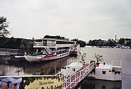Seine letzte Blütezeit als Umschlagplatz erlebte der Neustädter Hafen in der Nachkriegszeit. 1950 wurde auf der Moritzburger Straße sogar ein 425 m langes Gleis der Straßenbahn bis zum Elbkai verlegt, welches jedoch nur dem innerbetrieblichen Transport von Kies und Sand für die Verkehrsbetriebe diente. Später nutzte man das Hafenbecken nur noch als Winterdomizil der “Weißen Flotte”. Die Hafenanlagen stehen seit 1993 unter Denkmalschutz und sollen künftig Teil einer Elbuferpromenade werden. Auch die Einrichtung eines Yachthafens wird erwogen. Außerdem liegen hier zwei ehemalige Ausflugsdampfer der “Weißen Flotte” _(Foto)_. Das 1963 in Roßlau gebaute dieselelektrische Seitenradschiff “Karl Marx” (ab 1991 “Daniel Pöppelmann”) dient seit 2000 als Touristenherberge “Die Koje” und wurde bis 2012 von der städtischen Gesellschaft QAD betrieben. Danach wurde es zeitweise als Unterkunft für Asylbewerber genutzt und befindet sich heute als Beherbergungsschiff D. Pöppelmann in Privatbesitz. Ein zweites baugleiches Schiff, bis 1992 als “Friedrich Engels” bzw. “Johann Friedrich Böttcher” im Einsatz, wird vom CVJM als Jugendbildungs- und Begegnungszentrum genutzt.

[_Weiterführende Literatur und Quellen_](../../impressum/quellenverzeichnis/)

 \[ [Home](../../index.html)\] \[ [Nord](../../nord/)\] \[ [Nordwest](../../nordwest/)\] \[ [Neustadt](../../neustadt/)\] \[ [Nordost](../../nordost/)\] \[ [West](../../west/)\] \[ [Zentrum](../../zentrum/)\] \[ [Südwest](../../sudwest/)\] \[ [Süd](../../sud/)\]
 \[ [Südost](../../sudost/)\] \[ [Ost](../../ost/)\] \[ [Register](../../Register/register.html)\] \[ [Kontakt](../../Kontakt/kontakt.html)\] \[ [Impressum](../../impressum/)\]
