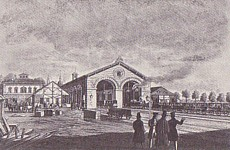
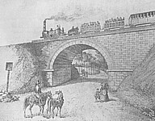
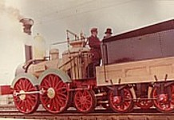
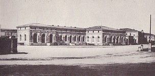
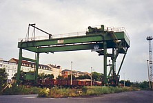
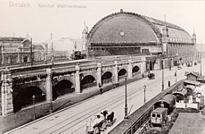
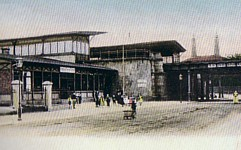
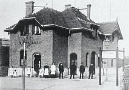

* * *

Die Eisenbahnstrecke Dresden - Leipzig entstand 1839 als erste deutsche
Fernbahn und zweite Bahnlinie des Landes überhaupt. Bereits am 17. März 1834 trafen sich im Leipziger Börsensaal zwölf interessierte Kaufleute und Unternehmer, die am 3. April ein Eisenbahnkomitee für einen Bahnbau
zwischen den beiden sächsischen Großstädten gründeten. Aus diesem ging die private “Leipzig-Dresdner Eisenbahn- Compagnie” hervor, die das Vorhaben
in die Realität umsetzte. Maßgeblich beteiligt war der Volkswirt Friedrich List, der ein Jahr zuvor in seiner Schrift “Über ein sächsisches Eisenbahnsystem als
Grundlage eines allgemeinen deutschen Eisenbahnsystems” den Bau eines Netzes von Bahnlinien zwischen den größeren deutschen Städten angeregt hatte.

Nach Diskussionen über die günstigste Streckenführung entschied man sich schließlich
für eine Linie von Dresden- Neustadt über Riesa - Oschatz - Wurzen nach Leipzig und begann mit den Vermessungsarbeiten. Am 1. März 1836 erfolgte in der Nähe
von Machern der erste Spatenstich für den eigentlichen Bahnbau. Als erster Abschnitt konnte ab 24. April 1837 die Strecke von Leipzig bis Althen befahren werden. Die
Arbeiten leitete der junge Ingenieur Carl Theodor Kunz, der zuvor als Hauptmann der sächsischen Armee und als Wasserbaudirektor tätig gewesen war. Wenig später
begann unter großer Anteilnahme der Bevölkerung auch in Dresden das Eisenbahnzeitalter. Erstmals fuhr am 19. Juli 1838 ein “Dampfwagen” von Dresden
bis zur Station Weintraube (Radebeul-West). Die beiden historischen Stiche zeigen den alten Leipziger Bahnhof in der Dresdner Neustadt _(oben)_ und eine Bahnunterführung in Trachau _(rechts)_.

Nach Fertigstellung des Eisenbahntunnels von Oberau und der Riesaer Elbbrücke
konnte die Gesamtstrecke am 7. April 1839 durchgängig in Betrieb genommen werden. Die Fahrzeit der Züge betrug anfangs drei Stunden und vierzig Minuten,
wobei die Aufenthaltszeiten auf den Unterwegsstationen allerdings bereits berücksichtigt waren. Zum Einsatz kamen zunächst aus England importierte Lokomotiven. Die von Andreas Schubert 1837/38 in der [Übigauer Maschinenbauanstalt](../../../nordwest/ubigau/schloss_ubigau/) konstruierte “Saxonia” (das Foto zeigt einen aus Anlass des
150-jährigen Streckenjubiläums entstandenen Nachbau) durfte auf Weisung der Bahnoberen keinen der Eröffnungszüge ziehen und geriet durch Sabotage im
Bahnhof Priestewitz auf ein falsches Gleis, was einen glücklicherweise glimpflich ausgegangenen Unfall auslöste. Die
Betriebsführung oblag in den Anfangsjahren der privaten Leipzig-Dresdner Eisenbahn-Compagnie. Erst 1876 erwarb
der sächsische Staat die Bahnstrecke und gliederte sie in das Netz der Königlich-Sächsischen Staatseisenbahn ein.

Im Zusammenhang mit der Umgestaltung der Dresdner Bahnanlagen erfolgten zwischen 1890 und 1901 größere
Veränderungen. So wurde die Strecke im gesamten Stadtgebiet auf Hochgleise verlegt. Seit 1901 verkehrten die Züge
über den neu erbauten Neustädter Bahnhof, während der alte Leipziger Bahnhof seitdem nur noch für die Güter- und
Expressgutabfertigung genutzt wurde. 1945 wurde das zweite Streckengleis demontiert und konnte erst 1967 wieder
durchgängig befahren werden. Mit Beginn des Winterfahrplans 1969/70 begann der elektrische Zugbetrieb zwischen
Dresden und Riesa, der am 28. Mai 1970 auf die Gesamtstrecke ausgedehnt werden konnte. Neben Fernzügen nutzen
heute auch die S-Bahnen nach Meißen die Bahnlinie. 2013 erfolgte nach Streckenausbau eine Trennung von Fern- und S-Bahn-Verkehr.

**Streckenverlauf und Stationen im Dresdner Stadtgebiet:**

Ihren Ausgangspunkt nahm die Strecke ursprünglich im 1837/39 errichteten [Leipziger Bahnhof](../../../neustadt/leipziger_vorstadt/dresden_-_leipzig/leipziger_bahnhof/), der damals noch
außerhalb der Stadtgrenzen auf Neudorfer Flur lag. Hier befanden sich sowohl die für die Abfertigung der Reisenden
erforderlichen Einrichtungen, aber auch Lok- und Wagenschuppen, Güterböden und technische Anlagen für den Bahnbetrieb. Da der Bahnhof bereits nach wenigen Jahren nicht mehr den Anforderungen genügte, wurden 1857
größere Umbauarbeiten vorgenommen. 1890 entschied man sich schließlich für einen kompletten Neubau an Stelle des alten Schlesischen Bahnhofes, der heute als Bahnhof Dresden-Neustadt
bekannt ist. Der alte Leipziger Bahnhof wurde daraufhin am 1. März 1901 geschlossen und die Anlagen nur noch als Güterbahnhof genutzt. Ein Teil der historischen
Gebäude ist jedoch bis zum heutigen Tage erhalten geblieben.

**_Foto:_** _Empfangsgebäude des Leipziger Bahnhofs um 1860_

Güterbahnhof Dresden-Neustadt: Im Zusammenhang mit der Umgestaltung der Dresdner Bahnanlagen, dem Bau der Hochgleisanlagen und des Rangierbahnhofes in Friedrichstadt entstand ab 1894 zwischen altem Leipziger Bahnhof, Leipziger und Großenhainer Straße der Güterbahnhof Dresden-Neustadt, der am 1. Mai 1902 offiziell in Betrieb genommen wurde. Zu seinen Aufgaben gehörte neben dem Rangierbetrieb für die Güterzüge nach Leipzig und Görlitz auch die Bedienung der zahlreichen Anschlussgleise zu den hier ansässigen Industriebetrieben sowie zum Neustädter Hafen. Während des Zweiten Weltkriegs war der Güterbahnhof Ausgangspunkt zweier Deportationszüge, welche sächsische Juden 1942 ins Rigaer Ghetto und 1943 in das Vernichtungslager Auschwitz brachten. An diese Ereignisse erinnert eine Gedenktafel am Eingang des Neustädter Bahnhofs.

Auch nach 1945 behielt der Neustädter Güterbahnhof seine Funktion und wurde 1968 für die Verladung von Containern mit zwei leistungsstarken Portalkränen ausgestattet _(Foto)_. Diese waren bis zur Eröffnung des neuen Terminals im [Güterverkehrszentrum Friedrichstadt](../../../zentrum/friedrichstadt/dresden_-_berlin/rangierbahnhof/) 2005 in Betrieb. Danach verlor der Neustädter Güterbahnhof seine Funktion und wurde nur noch als Ausweichmöglichkeit für Güter- und Personenzüge genutzt. Nach 2010 begann der Abbau der Gleisanlagen und die Beseitigung der meisten Gebäude. An ihrer Stelle entstand 2018/19 ein neuer Schulkomplex für das Gymnasium Dresden-Pieschen. Der Abschnitt entlang der Gehestraße wurde als kleine Parkanlage gestaltet.

Heute beginnen die von Dresden nach Leipzig verkehrenden Züge in der Regel am Hauptbahnhof. Dieser entstand ab 1892 an Stelle des früheren Böhmischen Bahnhofs am Rande der Altstadt und nahm am 18. Juni 1895 seinen Betrieb auf. Vom Hauptbahnhof führt die Bahnstrecke zunächst im Bogen um die Innenstadt, durchfährt die nur von der S-Bahn genutzten Stationen Freiberger Straße und Bahnhof Mitte und überquert im Anschluss die Elbe.

Haltepunkt Freiberger Straße: Die Station entstand als Umsteigepunkt zwischen S-Bahn und Straßenbahn an der Unterführung der [Freiberger Straße](../../../zentrum/wilsdruffer_vorstadt/freiberger_strasse/) in der Nähe des World-Trade-Centers und wurde im Dezember 2004 eröffnet. Zugänge bestehen sowohl von der Rosen- als auch von der Freiberger Straße.

Bahnhof Mitte: Die vor 1945 als Bahnhof Wettiner Straße bezeichnete Station wurde im Zusammenhang mit der Umgestaltung der Dresdner Bahnanlagen eingerichtet und 1901 in Betrieb genommen. Ursprünglich besaß sie eine die Gleisanlagen überspannende Bahnhofshalle, während die Abfertigungsräume und Fahrkartenschalter im Untergeschoss lagen. 1945 beschädigten Bomben die Halle, die daraufhin 1950 abgetragen wurde. Heute dient der in den letzten Jahren umgebaute Bahnhof Mitte nur noch dem S-Bahn-Verkehr.

Kurz nach Verlassen des Bahnhofes Mitte führt die Strecke über die Marienbrücke. Diese wurde 1852 als kombinierte Eisenbahn- und Straßenbrücke errichtet und verband damit die beiden wichtigen Fernstrecken von Dresden nach Prag und nach Leipzig. 1857 kam ein zusätzliches Verbindungsgleis zwischen den beiden Neustädter Bahnhöfen und der Marienbrücke hinzu. 1898/1901 entstand neben der alten, heute nur noch als Straßenbrücke genutzten, Marienbrücke eine zweite Elbüberquerung. Diese wurde am 1. März 1901 gleichzeitig mit der Eröffnung des Neustädter Bahnhofes für den Eisenbahnverkehr freigegeben.

Vom Bahnhof Neustadt verkehren die Züge heute auf einem Hochdamm entlang der Gutschmid- und Röderauer Straße in Richtung Pieschen. Auch diese Gleise entstanden erst nach 1890. Brücken überqueren den Bischofsweg sowie einige Seitenstraßen und sorgen so für störungsfreie Kreuzungen zwischen Eisenbahn- und Straßenverkehr. In der Nähe des Pestalozziplatzes ereignete sich am 22. September 1918 das bislang schwerste Eisenbahnunglück in der Dresdner Geschichte, als ein D-Zug aus Leipzig auf einen auf Einfahrt in den Neustädter Bahnhof wartenden zweiten Zug auffuhr. 38 Tote, 27 Schwer- und dutzende Leichtverletzte waren die tragische Folge _(Foto)_.

Haltepunkt Bischofsplatz: Der neue Haltepunkt entstand als S-Bahn-Station für das Hechtviertel im Bahnbogen am Bischofsplatz an der Überführung der Fritz-Reuter-Straße und wurde am 18. März 2016 eröffnet.

Bahnbetriebswerk Pieschen: Das Bahnbetriebswerk entstand 1868/69 als Betriebshof der Dresden-Leipziger Eisenbahn, die hier ihre Dampflokomotiven unterstellte. Dafür standen zunächst ein Lokschuppen mit 25 Ständen und eine Werkstatt für bis zu 20 Lokomotiven zur Verfügung. Später kam noch ein Rundlokschuppen mit zwölf Abstellgleisen hinzu. Organisatorisch war das Bw Pieschen ab 1900 dem Güterbahnhof Dresden-Neustadt zugeordnet. Das beim Luftangriff auf Dresden 1945 schwer beschädigte Bahnbetriebswerk diente nach seinem Wiederaufbau bis 1965 vorwiegend der Instandsetzung von Triebfahrzeugen. Nach Verlagerung der Lokwerkstatt war hier das Dresdner Kraftwagenbetriebswerk der Deutschen Reichsbahn untergebracht. Seit Schließung des Betriebes 1990 standen die Hallen viele Jahre leer und wurden trotz ihrer historischen Bedeutung 2010 abgerissen.

Haltepunkt Pieschen: Bereits bei Eröffnung der Dresden - Leipziger Eisenbahn kam in Pieschen der Wunsch nach einer eigenen Bahnstation auf. Dieser konnte jedoch erst 1899 in die Realität umgesetzt werden. Maßgeblichen Anteil daran hatte der örtliche Bezirks- und Handwerkerverein, der für die zahlreichen Arbeiter des Stadtviertels einen Haltepunkt forderte. Neben Fahrkartenschalter und Gepäckannahme gab es in dem zwischen 1898 und 1902 errichteten Bahnhof früher auch eine kleine “Trinkhalle” für die wartenden Fahrgäste. Unterhalb der Station richtete die Staatsbahn das Bahnbetriebswerk Pieschen ein. Heute dient der Pieschener Bahnhof nur noch dem S-Bahn-Verkehr. Eine umfassende Sanierung, der leider auch die hölzernen Bahnsteigüberdachungen zum Opfer fielen, erfolgte 2015. Unmittelbar hinter der Station trifft die heutige Strecke auf die Ursprungstrasse vom alten Leipziger Bahnhof, die seit 1901 nur noch von Güterzügen befahren wird.

Haltepunkt Trachau: Obwohl Trachau bereits 1838 mit Eröffnung des ersten Streckenabschnitts von Dresden nach Radebeul-Weintraube Bahnanschluss erhalten hatte, verweigerte der Gemeinderat zunächst die Einrichtung eines eigenen Haltepunktes. Noch 1877 wurde ein entsprechendes Gesuch des Schankwirts Gebler von den Gemeinderäten einstimmig abgelehnt. Erst ab 1889 bemühte man sich um eine eigene Station, zunächst jedoch ohne Erfolg. Nach Genehmigung eines entsprechenden Gesuchs des Trachauer Hausbesitzervereins durch den Sächsischen Landtag konnte schließlich am 1. Mai 1902 der Haltepunkt Dresden-Trachau eröffnet werden. Dieser wird bis heute von der S-Bahn genutzt. Nach Überquerung der Leipziger Straße erreicht die Bahnstrecke die Stadtgrenze zu Radebeul.

* * *

 \[ [Home](../../../index.html)\] \[ [Nord](../../../nord/)\] \[ [Nordwest](../../../nordwest/)\] \[ [Neustadt](../../../neustadt/)\] \[ [Nordost](../../../nordost/)\] \[ [West](../../../west/)\] \[ [Zentrum](../../../zentrum/)\] \[ [Südwest](../../../sudwest/)\] \[ [Süd](../../../sud/)\] \[ [Südost](../../../sudost/)\] \[ [Ost](../../../ost/)\] \[ [Register](../../../Register/register.html)\] \[ [Kontakt](../../../Kontakt/kontakt.html)\] \[ [Impressum](../../../impressum/)\]
