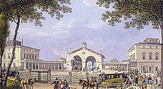
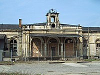
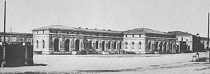
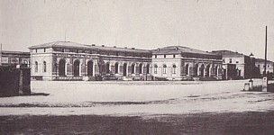

* * *

* * *

Der Leipziger Bahnhof wurde 1837/39 als Ausgangspunkt der ersten deutschen [Fernbahnstrecke nach Leipzig](../../../../neustadt/leipziger_vorstadt/dresden_-_leipzig/) errichtet und am 7. April 1839 feierlich in Betrieb genommen. Für den Bau hatte die Bahngesellschaft 4,5 Hektar Land auf Neudorfer Flur erworben. Für die Abfertigung der Passagiere entstanden nach Plänen von Gustav Hörnig zwei kleinere pavillonartige Gebäude mit Billettverkauf, Restauration, Expedition und Verwaltung sowie einigen Wohnungen für Bahnbeamte. Hinzu kamen eine überdachte viergleisige Wagenhalle, ein Maschinenhaus für die Lokomotiven, zwei Güterböden sowie die erforderlichen technischen Einrichtungen. Die für die Öffentlichkeit gedachten Gebäude waren durch einen bogenartigen Laubengang verbunden und gaben dem Vorplatz des Empfangsgebäudes ein repräsentatives Aussehen _(Bild)_

Bereits 1852 machten sich jedoch erste Erweiterungen der Bahnanlagen erforderlich. Dafür wurden, mit Ausnahme der beiden Hauptpavillons, alle Bauten abgebrochen und durch Neubauten ersetzt. Das neue Empfangsgebäude bestand nun aus einem großen Mittelbau _(Foto links)_ und zwei symmetrischen Seitenflügeln. Es erhielt großzügige Wartehallen, Schalter für den Fahrkartenverkauf und mehrere insgesamt 650 m lange Bahnsteige. Zwei Hallen, eine für abfahrende, die andere für ankommende Züge, dienten der Abwicklung des Personenverkehrs. Nach dem Bau der Marienbrücke endeten hier auch die aus Böhmen kommenden Züge, für die die sogenannte Prager Halle angelegt wurde. Hinzu kam ein am 20. Juni 1857 übergebenes Verbindungsgleis zum Schlesischen Bahnhof auf der gegenüber liegenden Seite des Vorplatzes. Außerdem entstanden ausgedehnte Anlagen für den Güterverkehr sowie der “Maschinenbahnhof” mit Lok- und Kohlenschuppen sowie einem Verladeperron. 1876 besaß der Leipziger Bahnhof insgesamt 32 km Gleise, 152 Weichen, fünf Lokomotiv- und zwei Wagendrehscheiben. Zu den prominenten Fahrgästen, die hier ankamen bzw. abfuhren, gehörte am Eröffnungstag 19. Mai 1857 König Johann mit seiner Familie und im August 1897 der thailändische König Rama V. von Siam.

**_Foto:_** _Der Leipziger Bahnhof nach dem Umbau 1857, links die “Prager Halle”_

1880 wurden die Anlagen des Leipziger Bahnhofs erneut umgestaltet. Vor allem technische Neuerungen machten diese Umbauarbeiten erforderlich. Diesen fiel auch die Prager Halle zum Opfer, während die übrigen Gebäude noch bis zur Einstellung des Personenverkehrs 1901 in Betrieb waren. Am 1. März verließ der letzte D-Zug in Richtung Leipzig die Station. Wegen der Fertigstellung des neuen Bahnhofes Dresden-Neustadt wurde der Leipziger Bahnhof daraufhin geschlossen und diente fortan nur noch als Güterbahnhof _(Foto links um 1910)_. Die vorhandenen Gebäude nahmen u.a. die Bahnhofsverwaltung, die Eilgutabfertigung sowie die Büros einiger Speditionen auf. Während des Zweiten Weltkrieges starteten von hier die Güterzüge zur Deportation der Dresdner Juden ins Rigaer Ghetto, nach Theresienstadt bzw. in die Vernichtungslager. An die Ereignisse erinnert seit 2001 eine Gedenktafel am Neustädter Bahnhof.

Bombenschäden vernichteten 1945 Teile der historischen Anlage, die jedoch in ihren Grundzügen noch heute erhalten ist. Zu DDR-Zeiten nutzte die Deutsche Reichsbahn die Station für den Güter- und Postverkehr. 1992 verließen hier die letzten in Dresden stationierten russischen Soldaten die Stadt in Richtung Heimat. Leider gelang es bislang nicht, die inzwischen stark sanierungsbedürftigen Gebäude einer neuen sinnvollen Nutzung zuzuführen. Erwogen wurde bislang u.a. die Einrichtung eines Eisenbahnmuseums bzw. eines Informationszentrums für Touristen oder die Umgestaltung des Areals zum Einkaufszentrum. In der soggenannten "Grünen Villa" befindet sich seit 1. September 2016 das Kreativzentrum "Blaue Fabrik".

Video: Impressionen vom Leipziger Bahnhof 2013

* * *

 \[ [Home](../../../../index.html)\] \[ [Nord](../../../../nord/)\] \[ [Nordwest](../../../../nordwest/)\] \[ [Neustadt](../../../../neustadt/)\] \[ [Nordost](../../../../nordost/)\] \[ [West](../../../../west/)\] \[ [Zentrum](../../../../zentrum/)\] \[ [Südwest](../../../../sudwest/)\] \[ [Süd](../../../../sud/)\] \[ [Südost](../../../../sudost/)\] \[ [Ost](../../../../ost/)\] \[ [Register](../../../../Register/register.html)\] \[ [Kontakt](../../../../Kontakt/kontakt.html)\] \[ [Impressum](../../../../impressum/)\]
