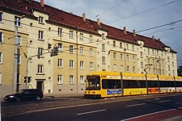
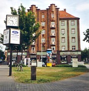
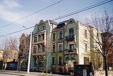
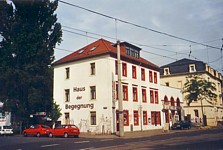
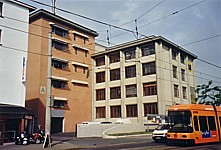
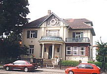
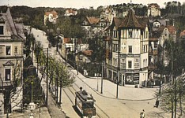

* * *

**Historische Bilder der Großenhainer Straße**

_Preisliste der Obstweinkellerei_

_Robert Weber_

_(Großenhainer Straße 33)_

_Großenhainer Straße 71_

_Großenhainer Straße 73_

_(Kolonialwarenhandlung)_

_Großenhainer Straße 118_

_(Uhrmacher Felix Lohan)_

_Werbung der Parfüm- und Feinseifenfabrik Guthmann (Nr. 137)_

**Gaststätte Hubertushof**

_Großenhainer Straße 154_

_Billardzimmer_

_Vereinszimmer_

* * *

Die heutige Großenhainer Straße geht auf die frühere “Haynische Straße” zurück, die schon im Mittelalter die Residenzstadt mit Großenhain verband. Diese wichtige Verbindung hatte ihren Ausgangspunkt am Leipziger Tor (Palaisplatz) und führte über Pieschener und Trachauer Flur weiter nach Großenhain. 1517 ist sie als "der Hainische Weg" erwähnt. Da sie als Poststraße von Bedeutung war, wurden um 1700 auch hier Meilensteine nach Plänen des sächsischen Vermessers Zürner aufgestellt, u.a. am heutigen Trachenberger Platz und am Abzweig Radeburger/ Hansastraße. Leider sind die Steine heute verschollen.

Ende des 18. Jahrhunderts bürgerte sich für diese wichtige Verbindung der Name Moritzburger Chaussee bzw. Berliner Straße ein. Nach 1850 wurde sie im stadtnahen Abschnitt offiziell Großenhainer Straße genannt. In Trachau und Trachenberge bekam sie erstmals 1897 eine Benennung und wurde nach der Kleinstadt Dahlen bei Oschatz Dahlener Straße genannt. 1912 erfolgte die Übertragung des Namens Großenhainer Straße auch auf diesen Abschnitt. Während der der Bahnlinie zugewandte Teil bereits um 1840 als Standort für verschiedene Gewerbebetriebe attraktiv wurde, entstanden die meisten Wohnhäuser der Nordseite erst nach 1890. Ab 1891 fuhren über die Großenhainer Straße die ersten Straßenbahnen, zeitweise sogar mit [Gasmotorantrieb](../../../neustadt/leipziger_vorstadt/grossenhainer_strasse/gasstrassenbahn/), zum Betriebshof Trachenberge und zum Wilden Mann **_(Foto:_** _Haltestelle Liststraße)_.

Zu den Firmen, die einst an der Großenhainer Straße ihren Sitz hatten, gehörten u.a. die [Nähmaschinenfabrik Clemens Müller](../../../neustadt/leipziger_vorstadt/grossenhainer_strasse/nahmaschinenwerk/), die Zigarrenfabrik Bürckner & Siebmann, die Kammgarnspinnerei Creuznach, die Maschinenfabriken Jahn & Beyer sowie Schilling & Co., die Blechwarenfabrik Mayer & Co., die Farbenfabrik Franz Pillnay, die Chemischen Fabriken Arlt & Borkowski, Hubert und Böhme, die Firma Schriftguß Gebrüder Butter, die Schokoladenfabrik Wilhelm Jentzsch sowie die Likörfabrik Woldemar & Schmidt. Hinzu kamen verschiedene Kleinbetriebe, Händler, Handwerker und Verkaufseinrichtungen. Fast alle größeren Unternehmen gingen nach 1945 in Volkseigenen Betrieben auf, von denen hier nur der VEB Typoart als Hersteller von Druckformen sowie die Firma DHZ Maschinenbau (ehem. Eisenwaren und Ofenbau Klotz) erwähnt werden sollen.

Leipziger Vorstadt:

Ihren Ausgangspunkt hat die Großenhainer Straße am Neustädter Bahnhof. Unmittelbar an der Eisenbahnunterführung erinnert eine Gedenktafel an den Ingenieur Theodor Kunz, der maßgeblich am Bau der für die weitere Entwicklung dieses Stadtteils wichtigen [Eisenbahnstrecke nach Leipzig](../../../neustadt/leipziger_vorstadt/dresden_-_leipzig/) beteiligt war. Der folgende Abschnitt ist von verschiedenen gewerblichen Unternehmen geprägt. Hinzu kommen Wohn- und Geschäftshäuser unterschiedlichsten Baustils. Markantestes Gebäude ist die am Großenhainer Platz gelegene [St.-Petri-Kirche](../../../neustadt/leipziger_vorstadt/st__petri-kirche/). Unweit der Kirche erinnert ein aus dem 19. Jahrhundert stammender Taubenturm an die ländliche Vergangenheit des Stadtteils. 1925-30 entstand zwischen Großenhainer, Hansa- und Conradstraße eine größere Wohnanlage durch die Eisenbahner-Wohnungsbau-Genossenschaft _(Foto)_. Die sogenannte "Hansasiedlung" besteht aus insgesamt 62 Gebäuden mit ca. 570 Wohnungen und wurde nach Plänen des Dresdner Architekten Curt Herfurth im expressionistischen Stil gestaltet.

VEB Typoart: Das Unternehmen entstand nach dem Zweiten Weltkrieg durch Zusammenschluss mehrerer Schriftgießereien. Zu den Vorläufern gehörte der 1889 gegründete Schriftgußbetrieb von Otto Ludwig Bechert, den 1892 die Brüder Butter übernahmen. Sitz der Firma war zunächst die Großenhainer Straße 92. Nach Umwandlung zur Aktiengesellschaft "Schriftguß AG vorm. Brüder Butter" verlegte der Betrieb 1924/25 seinen Sitz zur Großenhainer Straße 9. Zuvor hatte hier das von Karl August Lingner initiierte Dresdner Hygienemuseum sein Domizil. Neben der Einlagerung der im Rahmen der Internationalen Hygieneausstellung zusammengetragenen Exponate gab es hier um 1920 die Zentralstelle für hygienische Lehrmittel, das Pathoplastische Institut und den Deutschen Verlag für Volkswohlfahrt. Diese Einrichtungen widmeten sich der gesundheitlichen Volksaufklärung sowie der Anfertigung entsprechender Lehrmittel. 1930 fanden Museum und Werkstätten im neu erbauten Deutschen Hygienemuseum ihr neues Domizil.

Im Zuge der Firmenverlegung ließen die Eigentümer der Schriftguß AG die vorhandenen Gebäude modernisieren und erweitern. Der in Form eines Vierseitenhofes gestaltete Komplex verfügte über 4000 m² Nutzfläche und einen eigenen Gleisanschluss. Um 1930 konnte mit 50 Komplettgießmaschinen gearbeitet werden, hinzu kam die Herstellung von Maschinen und Gerätschaften für den Buchdruck. Mit Machtübernahme der Nazis schied 1933 das letzte Mitglied der Familie Butter aus dem Vorstand aus. 1937 erfolgte nochmals eine Rechtsformumwandlung in eine Kommanditgesellschaft (Schriftguß KG).

Nach dem Zweiten Weltkrieg wurde der Betrieb enteignet und 1948 zum VEB Schriftguß Dresden. 1951 ging dieser im VEB Typoart, einem Zusammenschluss mehrerer sächsischer Schriftgießereien auf. Künstlerischer Leiter war bis zu seinem Tod 1963 Herbert Thannhäuser, der mehrere Schriftarten entwarf und weiterentwickelte und für seine Tätigkeit 1960 den Kunstpreis der DDR erhielt. 1970 ging das Unternehmen in den Besitz der SED über und wurde der Zentrag in Berlin unterstellt. 1990 verkauft die Treuhand den Betrieb an den Unternehmer Karl Holzer, der das Produktionsprofil auf Softwareentwicklung und Offsetdruck umstellen ließ, jedoch ohne Erfolg. Mit der Insolvenz 1995 endete die Geschichte von Typoart. Heute haben auf dem Areal mehrere kleinere Unternehmen ihren Sitz.

Schilling & Co. (Nr. 11): Die Armaturen- und Metallwarenfabrik Schilling & Co. wurde 1889 gegründet und hatte ihren Sitz auf der Großenhainer Straße 11. Hergestellt wurden verschiedene Metallerzeugnisse und Armaturen, u.a. patentierte Spundventile für den Brauereibedarf. Zu DDR-Zeiten wurde das Hauptgebäude zum Betriebskindergarten des VEB "Typoart" umgebaut und am 5. Oktober 1983 eröffnet. Heute nutzt die Diakonie Dresden das Areal für die Mobile Arbeit mit Kindern und Familien.

Nr. 19: Auf dem Grundstück hatte vor dem Zweiten Weltkrieg die Maschinenbaufirma Paul Betzmer ihren Sitz, eine Spezialfabrik für Butterformmaschinen. Bis heute wird das Areal gewerblich genutzt.

Thalheims Gasthaus (Nr. 20): Das bis heute erhaltene Gebäude beherbergte bis Mitte der 1920er Jahre unter den Namen "C. Petzold's Restaurant" bzw. "Thalheims Gasthaus" eine Gaststätte mit Pension. Das Lokal warb in Anzeigen für seinen guten Mittagstisch und für "seine bequemen und comfortablen Zimmer á 5 bis 10 Rgr." Für Fuhrwerksbesitzer gab es zudem Stallungen zum Unterstellen der Pferde. Zudem diente das Haus als Arbeitsnachweis und Zahlstelle der Isolierer Dresdens, wurde also vermutlich häufig von reisenden Handwerkern und Gewerbetreibenden genutzt. Nach der Schließung entstanden im Gebäude Wohnungen.

Nr. 28: Das Grundstück wurde 1892 von den Ingenieuren Oskar Schwab und Carl Lührig erworben, die hier ihre 1889 in Leipzig begonnene Entwicklung gasbetriebener Straßenbahnfahrzeuge fortsetzten. Zunächst entstanden verschiedene Testmodelle, die am 28. Juli 1892 ihre erste erfolgreiche Probefahrt absolvierten. 1893/94 folgten weitere Fahrzeuge für den Einsatz auf den Strecken der englischen “Gas Traction Company Ltd.” in London. Schließlich konnten 1894 auch fünf Wagen für die Deutsche Straßenbahngesellschaft in Dresden gebaut werden, die bis zur Betriebseinstellung 1896 als [Gasstraßenbahn](../../../neustadt/leipziger_vorstadt/grossenhainer_strasse/gasstrassenbahn/) zwischen dem Albertplatz und dem Wilden Mann verkehrten. Später hatte auf dem Grundstück die Chemische Fabrik Böhme ihren Sitz. Heute dient das Areal an der Einmündung der Petrikirchstraße unter dem Namen "Chemiefabrik" für Konzerte und andere kulturelle Veranstaltungen.

Nr. 29: Auch dieses Grundstück wird seit dem 19. Jahrhundert gewerblich genutzt. 1897 ist hier die Thonwaarenfabrik Seidel u. Sohn ansässig. Später übernahm der Unternehmer Wilhelm Jentzsch die Gebäude und stellte unter dem Markennamen "Eno" in seinem Kakao- und Schokoladen-Werk verschieden Süßwaren her. Nach 1945 kam der Betrieb zum VEB Kombinat Süßwaren Delitzsch. Heute hat auf dem Grundstück die Stahlleichtbau Dresden GmbH ihren Sitz.

Nr. 30: Das Grundstück am Großenhainer Platz befindet sich seit 1885 im Besitz der St.-Petri-Kirchgemeinde. Ursprünglich plante diese, auf dem Areal ein neues größeres Gemeindehaus zu errichten, was jedoch nicht zustande kam. Das vorhandene Gebäude wurde bis zur Zerstörung 1945 als Pfarrhaus genutzt und in der Nachkriegszeit wieder aufgebaut. Im hinteren Teil des Areals befanden sich vor dem Zweiten Weltkrieg die Produktionsstätten der "Dresdener Cognac-Brennerei u. Likörfabrik Saxonia" und der "Dresdener Sodawasserfabrik Máquet", die hier Mineralwasser der Marke "Union-Sprudel" herstellte.

Orgelbau Jehmlich (Nr. 32): Die Orgelbauerwerkstatt wurde 1808 von den Brüdern Johann Gotthold, Gotthelf Friedrich und Carl Gottlieb Jehmlich im Erzgebirgsort Neuwernsdorf gegründet und 1826 nach Dresden verlegt. Johann Gottlieb war hier führend am Umbau der Kreuzkirchenorgel beteiligt und wurde 1836 zum Königlich-Sächsischen Hoforgelbauer ernannt. Unter seiner Regie und der seines Sohnes Carl Eduard entstanden bis 1888 auf dem Firmengrundstück an der Freiberger Straße 14 ca. 60 Orgeln, welche auch in andere europäische Länder exportiert wurden. 1889 übernahmen die Söhne Emil und Bruno Jehmlich das Unternehmen und bauten es weiter aus. Seit 1897 befinden sich die Büro- und Geschäftsräume auf der Großenhainer Straße 32, wo das Unternehmen bis heute von den Nachkommen der Familie fortgeführt wird. 1972 in einen VEB umgewandelt, erhielt Horst Jehmlich seinen Betrieb 1990 zurück.

In den Werkstätten entstanden zahlreiche Orgeln sowohl für sächsische Kirchen als auch für Kirchen und Konzerthallen im In- und Ausland. So baute Carl Eduard Jehmlich im Jahr 1888 die erste pneumatische Orgel Sachsens, welche noch heute in der Kirche in Röhrsdorf bei Wilsdruff zu hören ist. Außerdem erwarb sich die Firma Jehmlich Verdienste bei der Rekonstruktion der noch erhaltenen Silbermannorgeln und war 1964 am Nachbau der Silbermannorgel der Hofkirche beteiligt. In Dresden befinden sich Jehmlich-Orgeln u. a. in der Kreuzkirche, der St. Petri-Kirche am Großenhainer Platz, der Herz-Jesu-Kirche in Striesen, der Thomaskirche in Gruna und in der Pillnitzer Weinbergskirche.

Das Gebäude Großenhainer Straße 32 ist mit seinen verschiedenartigen Balkonen und Erkern auch architektonisch interessant. Errichtet wurde es als Wohn- und Geschäftshaus im Jugendstil. Um 1902 befand sich hier eine Geschäftsstelle der Ortskrankenkasse.

Lackfabrik Franz Pillnay (Nr. 33): Das Unternehmen wurde 1882 von Franz Josef Pillnay (1856-1928) gegründet und hatte seinen Sitz auf dem Grundstück Großenhainer Straße 31-33. Hauptsächlich wurde zunächst neben Holz- und Möbellacken auch Kunstharz, Firnis und Latex produziert. Später spezialisierte man sich auf die Herstellung von Auto- und Schiffslack und auf synthetische Lacke wie Lymanol. Dr wirtschaftliche Erfolg ermöglichte die Einrichtung von Zweigwerken in Freital-Deuben und in Berlin. Nach dem Tod Pillnays wurde das Berliner Werk 1934 an die Firma Teschner & Schwips verkauft. Da der Betrieb während des Zweiten Weltkriegs an der Belieferung des U-Boot-Baus beteiligt war, fiel das Familienunternehmen 1945 unter die Reparationsbestimmungen und wurde in eine Sowjetische Aktiengesellschaft überführt. Am 10. März 1947 übergab die Sowjetunion den Betrieb an die Sächsische Landesregierung zur Verstaatlichung.

Franz Pillnay galt als sozialpolitisch enagierter Unternehmer und gründete den "Verband für Jugendhilfe" zur Unterstützung von Jugendlichen aus schwierigen Verhältnissen. Das Familiengrab ist bis heute auf dem St. Pauli-Friedhof erhalten.

Nr. 33: Die moderne Rettungswache an der Großenhainer Straße 33 entstand 2014 als Ersatzneubau für die alte Wache an der Leipziger Straße. Der Bau beherbergt Aufenthalts-, Schulungs- und Sanitärräume für die Rettungssanitäter und dient zugleich als Depot für zwölf Einsatz- und Krankentransportwagen. Zusätzlich gibt es eine Fahrzeugdesinfektionshalle, Büros und eine Apotheke für die Bestückung der Rettungswagen.

Firma Wecusta (Nr. 34): Die 1895 errichtete Villa entstand als Wohnhaus für die Besitzer der auf dem Grundstück ansässigen Firma Wecusta, welche hier bis 1945 aus Rinderklauen hochwertige Uhrenöle herstellte. Besitzer des 1880 gegründeten Unternehmens waren die Fabrikanten W. Cuypers & Stalling (W. Cuypers & Stalling GmbH). Da der Betrieb als Produzent von Wehrmachtsbedarf in das Naziregime verstrickt war, wurde er 1945 enteignet und 1952 gemeinsam mit der Firma Gehe und dem Madaus-Werk in Radebeul zum [Arzneimittelwerk Dresden](../../../neustadt/leipziger_vorstadt/leipziger_strasse/arzneimittelwerk_dresden/) vereinigt. 1961 erfolgte der Zusammenschluss mit der Chemischen Fabrik von der Heyden zu einem bis 1990 existierenden Kombinat. Zu DDR-Zeiten befand sich in der Villa die Verwaltung des Zweigbetriebs. 2013 begann die Sanierung und der Umbau zum Wohnhaus.

Nr. 35: In diesem Haus hatte einst die 1874 gegründete Robert Werner Likörfabrik ihren Sitz. Vor dem Ersten Weltkrieg befand sich zudem die Böttcherei und Fsshandlung Weber & Thomas auf dem Grundstück. Heute dient das 1995/96 sanierte Gebäude als Wohnhaus.

Restaurant Zur ehemaligen Konkordienbrücke (Nr. 43): Das Eckhaus an der Einmündung der Kunzstraße beherbergte einst das Restaurant "Zur ehemaligen Konkordienbrücke". Um 1910 befand es sich im Besitz von Louis Herrmann, ab 1913 der Gastwirtin A. Pötzschke. Der Name des Lokals erinnert an die frühere Konkordienbrücke, die ab 1875 die Großenhainer Straße mit der Konkordienstraße verband. Im Zuge der Umgestaltung der Bahnanlagen verschwand diese jedoch, so dass die Kunzstraße heute bereits nach wenigen Metern als Sackgasse endet.

Pieschen:

An der Eisenbahnbrücke der Bahnstrecke Dresden - Leipzig und dem dahinter liegenden [Pestalozziplatz](../../../nordwest/pieschen/strassen_pieschen/) erreicht die Großenhainer Straße Pieschener Flur. Das markante Schulhaus wurde von Hans Erlwein entworfen, der Vorplatz gärtnerisch gestaltet. In den ersten Nachkriegsmonaten hatte in dem Gebäude die sowjetische Stadtkommandantur ihren Sitz. Die an der Ecke zur Weinböhlaer Straße befindliche Wohnanlage _(Foto)_ entstand nach 1990.

Werkzeugmaschinenfabrik Auerbach & Co. (Nr. 79/81):
Das 1890 gegründete Unternehmen hatte seinen Sitz ursprünglich auf der Großenhainer Straße 53/55, wurde jedoch noch vor 1920 zur Großenhainer Straße 79/81 verlegt. Inhaber waren die Fabrikanten Carl Auerbach und Otto Deil, die den Betrieb zunächst als Personengesellschaft, später als GmbH führten. Hergestellt wurden verschiedene Werkzeugmaschinen, vor allem Revolverdrehbänke für die Herstellung von Armaturen. 1931 übernahmen die [Hille-Werke](../../../sud/plauen/strassen_plauen/chemnitzer_strasse/) den Betrieb und führten ihn als Auerbach-Produktion bis zum Ende des Zweiten Weltkriegs weiter.

Schriftgießerei Brüder Butter (Nr. 92): Das Unternehmen entstand 1892 aus dem seit 1889 existierenden Schriftgußbetrieb von Otto Ludwig Bechert aus Danzig. Inhaber waren die Brüder Butter, die mit zunächst vier handbetriebenen Typengießmaschinen die Herstellung verschiedener Schriftgußtypen aufnahmen. Schwerpunkt lag später auf der Produktion von Schriften für Plakate und anderen Großdruckerzeugnissen. Bis zum Ersten Weltkrieg entwickelte sich die Firma zur bedeutendsten Dresdner Schriftgießerei mit 30 modernen Komplettgießmaschinen und 80 Angestellten.

1922 wurde der Betrieb zur Aktiengesellschaft "Schriftguß AG vorm. Brüder Butter" umgewandelt. Zugleich entstand eine enge Zusammenarbeit mit anderen Schriftgießereien im In- und Ausland, der Austausch von Schriften sowie eigene Entwicklungen. Erwähnt werden sollen die Schriftarten "Ohio-Kraft", eine Weiterentwicklung aus der USA, sowie die vom Litographen und Grafiker Karl Albert Fahrenwaldt entworfene Schrift "Minister". Für die gewachsenen Aufgaben entstanden ab 1923 an der Großenhainer Straße 9 durch Aus- und Umbau neue Betriebsgebäude. Wenig später verlegte der Betrieb auch seine Verwaltung dorthin. Die bisherigen Räume übernahm eine Weingroßhandlung sowie die bereits zuvor auf dem Grundstück ansässige Fleischhacker Lampen-Compagnie. Heute ist das frühere Verwaltungsgebäude Sitz der Regionalstelle Dresden der Sächsischen Bildungsagentur.

Deutsches Haus (Nr. 93): Die Gaststätte _(Foto)_ entstand Ende des 19. Jahrhunderts an der Großenhainer Straße 93 und wurde wegen ihres 1894/95 errichteten großen Saals auch für verschiedene politische Veranstaltungen genutzt. Außerdem fanden hier Bälle, Konzerte und ähnliche Vergnügungen statt. Besitzer war ab 1897 Emil Bergmann, der sein Lokal offiziell "Zum Deutschen Haus" nannte.

Während des Zweiten Weltkrieges richtete die NSDAP eine “Gefolgschaftsloge” in den Räumen ein. Nach 1945 wurde das Gebäude zunächst von einer Elektromotorenfabrik genutzt, bevor 1995 wieder eine Gaststätte einzog. Als “Haus der Begegnung” dient das sanierte Gebäude heute als Stadtgeschäftsstelle der Partei “Die Linke” und ist zugleich Sitz des Jugendvereins "Roter Baum".

Chemische Fabrik J. Richard Zschunke (Nr. 98/100): Das Unternehmen wurde 1876 von J. Richard Zschunke als Fabrik für Chemische, Gummiwaren und Isoliermittel gegründet. Neben dem Dresdner Firmensitz im Hintergebäude des Grundstücks Großenhainer Straße 98 gab es noch eine Zweigniederlassung im böhmischen Warnsdorf sowie einen Vertrieb in Elberfeld. Die Firma stellte verschiedene Produkte für den Maschinen- und Armaturenbau wie Stopfbüchsen sowie Schmier- und Isolierstoffe her, die unter den Warenzeichen "Monopol" und "Metall-Bismarck-Bronze" international vertrieben wurden. Inhaber Richard Zschunke selbst bewohnte eine Villa in Loschwitz (Victoriastraße 44 - heute Veilchenweg), wo er am 6. November 1913 verstarb. Nach seinem Tod wurde das Unternehmen von den Söhnen fortgeführt und existierte bis 1945, seit Anfang der 1930er Jahre unter der Anschrift Hauptstraße 26. Das Gebäude auf der Großenhainer Straße blieb bis heute erhalten und wird jetzt als Bürohaus genutzt.

Sächsisches Druck- und Verlagshaus: Das Gebäude an der Großenhainer Straße 101/ Ecke Heidestraße wurde 1940/41 nach Plänen von Emil Högg als bombensicherer Stahlbetonbau für die Fertigung kriegswichtiger Güter wie U-Boot-Teile gebaut und gehörte zur Firma Zeiss-Ikon (Goehle-Werk). 1945 übernahm das [Sächsische Druck- und Verlagshaus](../../../nordwest/pieschen/strassen_pieschen/) den Komplex und richtete eine Druckerei ein. Neben anderen Druckerzeugnissen wurde hier auch viele Jahre die “Sächsische Zeitung” gedruckt. Der Kultursaal diente in der Nachkriegszeit als Veranstaltungsort für Konzerte und Theateraufführungen sowie für politische Versammlungen. In den seit 1996 leer stehenden Räumen wurde 2004 ein Gründer- und Gewerbehof eingerichtet.

Busch´s Gaststätte (Nr. 102): Das Gebäude entstand im 19. Jahrhundert als Ausspanne für Fuhrleute und gehört zu den ältesten Häusern an der Großenhainer Straße. Seit 1870 befand sich hier ein kleines Familienlokal, welches ab 1912 nach seinem Inhaber Franz Bernhard Busch “Busch´s Gaststätte” genannt wurde. Die Gaststätte ist teilweise mit historischem Inventar aus den 1920er Jahren, u.a. einem Kegelbillard, ausgestattet und wird wegen ihrer preiswerten sächsischen Küche auch heute noch gern besucht.

Nr. 109: Dieses Grundstück war in den Anfangsjahren Firmensitz des Nähmaschinenteilewerks von Carl Würker, der zuvor als Kontorist in einem Zulieferbetrieb der Nähmaschinenfabrik Seidel & Naumann gearbeitet hatte. Bereits zwei Jahre nach der Gründung 1897 wurde der Betrieb zur [Barbarastraße 43](../../../nordwest/pieschen/strassen_pieschen/) verlegt.

Nr. 127: In diesem heute nicht mehr vorhandenen Wohn- und Geschäftshaus hatte früher die "Drachen-Drogerie" ihren Sitz. Der Abriss des Gebäudes erfolgte 2004.

Nr. 128: Im Eckhaus zur Hans-Sachs-Straße befand sich vor dem Ersten Weltkrieg das Restaurant "Zum Goldgräber", eine von zahlreichen Eckkneipen der dicht besiedelten nordwestlichen Dresdner Arbeitervororte. Das 1898 erstmals genannte Lokal war zeitweise nach seinem Besitzer auch als "Restaurant Richter" bekannt. Heute befindet sich in den früheren Gasträumen eine Wohnung.

Barbara-Apotheke (Nr. 129): Die Barbara-Apotheke wurde vom Apotheker Johannes Loos gegründet und am 18. Oktober 1906 eröffnet. Ihren Namen erhielt sie in Anlehnung an die angrenzende Barbarastraße nach der Schutzheiligen der Bergleute und Artilleristen. Am und im Gebäude finden sich noch einige Details der Geschichte. So erinnern an den beiden Türmchen die Initialen von Johannes Loos und die Jahreszahl 1906 an die Eröffnung der Apotheke. Außerdem gibt es ein altes Butzenglasfenster. 1938 übernahm Paul Grund die Barbara-Apotheke und führte sie bis zur Verstaatlichung 1945. Bereits 1946 ging sie jedoch wieder an private Besitzer über konnte 2006 ihren 100. Geburtstag feiern. 2011 erfolgte eine Modernisierung der Verkaufsräume und ihrer Einrichtung.

Nr. 131: Das Gebäude (ehemals Nr. 97) entstand kurz nach der Jahrhundertwende als Mietshaus für den Dresdner Spar- und Bauverein und ist erstmals im Jahr 1903 als "Eschebach-Haus" im Adressbuch verzeichnet. Seinen Namen bekam es, da die [Eschebachschen Werke](../../../nordwest/pieschen/eschebach-werke/) die Finanzierung des Baus unterstützt hatten.

Nr. 132 (Rheostat): Das Grundstück war ab 1919/20 Sitz der Firma "Rheostat", einer Spezialfabrik für elektrische Apparate und Bauteile. Das Unternehmen war 1911 von Edmund Kussi und den Brüdern Johann und Friedrich Cruse gegründet worden und hatte seinen Sitz zunächst auf der Freiberger Straße 75, ab 1913 auf der [Leipziger Straße 31](../../../neustadt/leipziger_vorstadt/leipziger_strasse/). Nach Trennung von seinen Geschäftspartnern führte Kussi den Betrieb allein weiter und erwarb kurz nach dem Ersten Weltkrieges das Doppelhaus Großenhainer Straße 130/132. Zuvor war hier die Blattgoldfabrik von Moritz Paul Müller untergebracht. Im Vorderhaus befanden sich die Büroräume, die Fabrikation erfolgte im Hinterhaus. Nach 1945 wurde der Betrieb in Volkseigentum überführt und kam 1954 zum VEB Elektroschaltgerätewerk.

Nr. 133/135: Das dreigeschossige Doppelhaus entstand 1902 als Wohnhaus. Die Fassade ist mit Backstein verkleidet, Teile des künstlerischen Schmucks weisen Jugendstilformen auf.

Accumulatoren-Fabrik Alfred Luscher: Im Hintergebäude von Nr.133/135 befanden sich einige Jahre die Produktionsräume der 1899 gegründeten Accumulatoren-Fabrik Alfred Luscher. Das als Werkstatt für Akkumulatorenbau gegründete Untrnehmen hatte seinen Sitz zunächst auf der Oschatzer Straße 17, wurde jedoch wenig später zur Großenhainer Straße 133/135 verlegt. Einen Zweigbetrieb gab es im böhmischen Bodenbach-Bünauburg. Produziert wurden neben Akkumulatoren auch Taschenlampen, Elektrobaukästen für Schüler und andere elektronische Kleingeräte. Mit Beginn des Ersten Weltkriegs verzog die Firma zunächst zur Grünen Straße 18/20 in die Wilsdruffer Vorstadt. 1931 erwarb das Unternehmen den ehemaligen [Gasthof Goldene Krone](../../../sudost/strehlen/strassen_strehlen/dohnaer_strasse/goldene_krone/) in Strehlen (Dohnaer Straße 7/9). Nach 1945 wurde der Betrieb enteignet und in VEB Akkumulatorenwerk Dresden umbenannt. Unter diesem Namen existierte die Firma bis 1977.

Cosmos Parfüm- und Feinseifenfabrik Guthmann (Nr. 137): Das Unternehmen wurde 1760 von Louis Guthmann als Feinseifenfabrik in Dresden gegründet und blieb bis nach dem Zweiten Weltkrieg in Privatbesitz. Unter dem Markennamen "Cosmos" stellte der Betrieb verschiedene Seifenarten und Parfüm her. 1949 nahm die "T. Louis Guthmann KG Dresden-Pieschen Feinseifenfabrik Cosmos" staatliche Beteiligung auf und firmierte ab 1952 als "Cosmos Parfüm- & Feinseifenfabrik" mit Sitz auf der Großenhainer Straße 137. 1964 endete die Seifen & Parfümerieproduktion zugunsten der Herstellung von Verpackungsstoffen & Wollplatten.

**_Foto:_** _Briefkopfbogen des Unternehmens_

Nr. 139: Architektonisch interessant ist das im hinteren Teil des Grundstücks 2019/20 entstandene Mehrfamilienhaus. Das als "Holzpalais Wilder Mann" bezeichnete Gebäude mit insgesamt 13 Wohnungen ist komplett aus Holz errichtet und lediglich außen verputzt.

Lichtspieltheater Großenhainer Straße (Nr. 146): Das Filmtheater in der Nähe des Hubertusplatzes (Ecke Rückertstraße) existierte bereits vor dem Zweiten Weltkrieg und ging aus einer als “Räthelsburg” bezeichneten Gaststätte hervor. Inhaber waren ab 1898 die Eheleute Räthel. Spätere Besitzer veränderten den Namen des Lokals nach dem Ersten Weltkrieg in "Rädelsburg. Ab 1928 befanden sich hier im Hintergebäude die "Rädelsburg-Lichtspiele" mit ca. 600 Kinoplätzen. 1945/46 dienten die Räume zeitweise als Quartier für russische Soldaten. Später wurde es noch bis Anfang 1981 als ”Lichtspiele Großenhainer Straße” weitergeführt, schließlich jedoch geschlossen. Das Gebäude wurde 1990 unter Denkmalschutz gestellt, verfiel jedoch in den Folgejahren mangels geeigneter Nutzung zur Ruine. 1997 erfolgte der Abriss. Erhalten blieb das Wohnhaus mit den ehemaligen Gasträumen _(Foto links)_.

Nr. 148: Die kleine Villa entstand kurz nach 1900 als Wohnhaus eines Gummiwarenfabrikanten. Das originelle Gebäude wurde ganz aus Holz gebaut und erinnert in seiner Gestaltung an altrussische Wohnhäuser _(Foto rechts)_. Bewohner waren Rudolf und Willy Schwieder, Inhaber der F. H. Schwieder Sächsische Gummi- und Guttaperchawarenfabrik. Das Unternehmen hatte seinen Stammsitz auf der Königsbrücker Straße 15. 1892 bezogen die Inhaber die Produktionsräume auf dem Nachbargrundstück Großenhainer Straße 150. Guttapercha ist ein dem Kautschuk ähnlicher Milchsaft des Guttaperchabaumes aus dem südostasiatischen Raum. 1906 übernahm die Vereinigte Berlin-Frankfurter Gummiwaaren-Fabriken AG den Betrieb, der ab 1930 ein Betriebsteil der Veritas Gummiwerke AG war.

Nr. 149: Das heute unter Denkmalschutz stehende Gebäude entstand 1913 im Auftrag der Kaiserlichen Reichspost und beherbergte zwischen 1914 und 1999 das [Postamt Dresden N 23](../../../nordwest/trachenberge/). Über dem Eingang sind noch deutlich Inschriften und Postsymbole aus der Entstehungszeit zu erkennen. 1999 wurde das Amt geschlossen und durch eine Postfiliale in einem nahegelegenen Schreibwarenladen ersetzt.

Hubertushof (Nr. 154): Die Gaststätte entstand um 1900 unmittelbar am Hubertusplatz und ist unter den Namen "Hubertushof" bzw. "Schankwirtschaft Hubertushof" in den Dresdner Adressbüchern zu finden. Sie gehörte jahrzehntelang zu den typischen Pieschener Arbeiterlokalen und war zeitweise Vereinsheim des Turnvereins Dresden-Trachenberge. Nach 1945 wurde sie von der HO betrieben und 1991 privatisiert, Mitte der 1990er Jahre jedoch geschlossen. 2000 zog mit dem "Little Habana" eines der ersten kubanischen Lokale Dresdens in die Räume. 2003 übernahm die Szenekneipe "Coyote", betrieben vom ehemaligen "Dynamo"-Torwart Ignac Kresic, die Räume. Heute befindet sich hier ein chinesisches Restaurant.

**_Fotos:_** _Das Doppelhaus Großenhainer Straße 116/118 (Hotel Amadeus) links,_

_die Villa Großenhainer Straße 157 (Mitte) und die Weinberg-Drogerie (Nr. 170) rechts._

Nr. 162/164: Das Doppelhaus an der Großenhainer Straße _(Foto rechts)_ wurde Ende der 1920er Jahre nach einem Entwurf des Architekten Paul Müller erbaut und gehört zur Siedlung "Zur guten Hoffnung", einer genossenschaftlichen Anlage. Die heute unter Denkmalschutz stehende Siedlung erstreckt sich zwischen Großenhainer und [Döbelner Straße](../../../nordwest/trachau/strassen_trachau/) und umfasst zahlreiche Doppel- und Reihenhäuser an der Duckwitz- und der Bolivarstraße.

Nr. 166: Im Erdgeschoss dieses Hauses wurde am 7. November 1957 die erste Selbstbedienungs-Verkaufsstelle der Dresdner Konsum-Genossenschaft eröffnet. Im Angebot waren Gemüsekonserven, Feinfrostprodukte, Spirituosen und Kosmetikartikel. Mit dem neuartigen Konzept sollte dem zunehmenden Mangel an Arbeitskräften begegnet werden. Bis Ende 1959 entstanden in ganz Dresden insgesamt 85 Verkaufsstellen mit Selbstbedienung, welche sowohl vom Konsum als auch von der DDR-Handelsorganisation HO betrieben wurden. Das Foto (links) zeigt die ehemaligen Geschäftsräume 2020.

Trachau und Trachenberge:

Im oberen Abschnitt der Großenhainer Straße erinnern noch einige Villen aus der zweiten Hälfte des 19. Jahrhunderts an die Vergangenheit des Vorortes Trachenberge als Sommerfrische. Bemerkenswert sind u. a. die Häuser Nr. 194 (Sommerfrische “Phönix”) und die 1885 im italienischen Renaissancestil erbaute Villa Großenhainer Straße 241. Um 1880 wurde am Wilden Mann die einst beliebte, nach 1990 jedoch geschlossene [“Bergwirtschaft”](../../../neustadt/leipziger_vorstadt/grossenhainer_strasse/bergwirtschaft/) eröffnet. Mittlerweile ist sie durch einen Neubau ersetzt, der die gastronomische Tradition fortsetzt. Unweit davon erinnert an der Ecke zur Buchholzer Straße eine Bismarckeiche an den "eisernen Kanzler" Otto von Bismarck. Sie wurde 1895 gepflanzt und 2003 durch eine Neupflanzung ersetzt.

**_Fotos:_** _Die Großenhainer Straße am Wilden Mann auf historischen Ansichtskarten_

Nr. 194: Das Gebäude entstand 1889 als “Villa Phönix” im historisierenden Stil der Renaissance _(Fotos)_ und befindet sich heute innerhalb der Gleisschleife der Straßenbahn. 2010 wurde das nach 1990 viele Jahre leer stehende Haus saniert und heute als Wohn- und Geschäftshaus genutzt. Postalisch ist es mittlerweile der Dippelsdorfer Straße 5 zugeordnet.

Nr. 199: Das Wohn- und Geschäftshaus an der Einmündung zur Burgsdorffstraße wurde um 1900 erbaut. Im Erdgeschoss gab es vor dem Ersten Weltkrieg die Gaststätte "Radeberger Hof". Heute werden die Räume als Ladenlokal genutzt.

Nr. 203: Das freistehende Doppelwohnhaus _(Foto)_ entstand 1902/03 für Gustav Emil Weber, Besitzer des Gasthofes "Wilder Mann". Die Bauausführung oblag dem Baumeister Otto Foerster, der für verschiedene Villen und Mietshausbauten in Dresden verantwortlich zeichnete. Das Gebäude mit Anklängen an den Jugendstil steht beispielhaft für die um diese Zeit errichten künstlerisch qualitätvollen Wohnhausbauten in Trachenberge.

Café Alwina (Nr. 219): In diesem Haus in der Nähe der Endhaltestelle der Straßenbahn befand sich ab 1899 das Café Alwina, welches als "Conditorei, Restaurant und Weinstube" um seine Gäste warb. Die Konzession hatte der Trachauer Bäckermeister Alwin Löffler erhalten und dem Lokal seinen Namen gegeben. Ihm folgte Wilhelm Kreusch, ab 1913 Albert Felix Röder, der das Lokal in Café Röder umbenannte. Nach einem weiteren Inhaberwechsel benannte man das Café in Café Rost um, nach 1945 bis Mitte der 1950er Jahre in Café Marschner. Die Räume werden bis heute gastronomisch genutzt, jetzt unter dem Namen Gaststätte Wilder Mann. Zu DDR-Zeiten gehörte es zur staatlichen Handelsorganisation HO.

Im Hinterhaus dieses Gebäudes wohnte in den 1930er Jahren der bekannte Leichtathlet Rudolf Harbig. Harbig arbeitete als Ableser bei der DREWAG und gehörte zu den populärsten Sportlern seiner Zeit Als “Wunderläufer” stellte er mehrere Weltrekorde auf und wurde mehrfach Welt- und Europameister. 1944 fiel er als Soldat an der Ostfront. An ihn erinnert das Rudolf-Harbig-Stadion an der Lennéstraße.

Nr. 223: Zu den zahlreichen denkmalgeschützten Wohnbauten des Viertels gehören auch die Häuser Großenhainer Straße 223 und 225. Erstere wurde Ende des 19. Jahrhunderts als "Villa Wilhelmine" errichtet. Das Nachbarhaus Großenhainer Straße 225, ungefähr zeitgleich bebaut, wurde 1900 zunächst Villa Amalie, 1905 Villa Marie genannt _(Foto links)_. Beide Gebäude sind typische Stadtvillen der späten Gründerzeit und mit historisierender Fassadengestaltung, Balkonen und reichem Bauschmuck gestaltet.

Nr. 241: Die zweigeschossige Villa entstand 1885 im Stil der italienischen Renaissance auf einem früheren Weinbergsgrundstück. Die Planungen stammen von den in der Lößnitz beheimateten Architektenbrüdern Ziller. Ursprünglich waren diese bereits 1875 für eine Villa in Oberlößnitz (Ortsteil von Radebeul) angefertigt worden, kamen dort jedoch nicht zur Ausführung und wurden 1885/86 in spiegelverkehrter Version in Trachenberge umgesetzt. Charakteristisch ist der das Hauptgebäude überragende Eckturm sowie eine Terrasse auf der Gartenseite. Mit der Gestaltung wurde geschickt auf die Hanglage des Grundstücks Rücksicht genommen.

Bauherr und erster Bewohner der Villa war der Unternehmer Carl Hermann Wachs, Teilhaber der Konservenfabrik Wachs & Flössner. Wachs hatte gemeinsam mit seinem Kompagnon einen Großhandel für landwirtschaftliche Produkte und Kolonialwaren gegründet und stellte Obst- und Gemüsekonserven sowie Marmelade und Konfitüren her. Der Sitz der Firma befand sich auf der [Kötzschenbroder Straße](../../../nordwest/mickten/strassen_mickten/kotzschenbroder_strasse/). 1909 erwarb der Arzt Dr. med. Albin Gustav Burkhardt die Villa. 1935 wurde sie an den Münchner Rudolf Michael Trinkl verkauft, dessen Nachkommen bis heute Eigentümer sind. 1997/98 erfolgte eine denkmalgerechte Sanierung des Gebäudes.

* * *

 \[ [Home](../../../index.html)\] \[ [Nord](../../../nord/)\] \[ [Nordwest](../../../nordwest/)\] \[ [Neustadt](../../../neustadt/)\] \[ [Nordost](../../../nordost/)\] \[ [West](../../../west/)\] \[ [Zentrum](../../../zentrum/)\] \[ [Südwest](../../../sudwest/)\] \[ [Süd](../../../sud/)\] \[ [Südost](../../../sudost/)\] \[ [Ost](../../../ost/)\] \[ [Register](../../../Register/register.html)\] \[ [Kontakt](../../../Kontakt/kontakt.html)\] \[ [Impressum](../../../impressum/)\]
