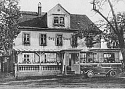

* * *

* * *

Die Bergwirtschaft “Wilder Mann” entstand um 1880 und befand sich zuerst im Besitz des Fleischermeisters Hermann Behnisch, der den Ausschank zunächst nur im Nebenerwerb betrieb. 1898 verkaufte Behnisch sein Lokal an Wilhelm Gottfried Hempel sowie seinen Geschäftsfreund Max Edmund Richter, der zugleich Pächter des [“Burgbergs”](../../../../nordost/loschwitz/strassen_loschwitz/burgberg/) in Loschwitz war. Beide ließen das Haus erweitern und eröffneten am 9. November 1899 feierlich die nun “Bergrestaurant” genannte Gastwirtschaft.

Ab 1902 wechselten mehrfach die Pächter des Lokals. Langjähriger Inhaber war der Gastwirt Arno Rosky, der die Schankstätte unter den Namen "Bergschänke", "Bergrestaurant" bzw. "Berg-Wirtschaft Trachau" bis in die 1930er Jahre bewirtschaftete. 1936 wurde das Gebäude zwangsversteigert. Auch in der Nachkriegszeit blieb das Restaurant zunächst in Privatbesitz, wurde später jedoch von der HO übernommen und bis 1991 betrieben. Nicht zuletzt wegen der Aussicht von der Gartenterasse war die “Bergwirtschaft” bis zur Schließung ein beliebtes Ausflugsziel
der Dresdner. Ende der 1970er Jahre nutzte der Jugendclub Dresden-Nord die Räumlichkeiten der liebevoll “Bergziege” genannten Gaststätte auch für Tanzveranstaltungen. Die 1994 erfolgte Rückübertragung an eine Erbengemeinschaft und mangelnde Investorennachfrage führten zum Verfall der Gebäude. Im Sommer 2005 wurde die frühere “Bergwirtschaft” abgerissen. An gleicher Stelle entstand ein 2007 eröffneter Neubau eines Hotels mit öffentlicher Gaststätte. 2019 wurde dieser nochmals umgebaut und modernisiert.

* * *

 \[ [Home](../../../../index.html)\] \[ [Nord](../../../../nord/)\] \[ [Nordwest](../../../../nordwest/)\] \[ [Neustadt](../../../../neustadt/)\] \[ [Nordost](../../../../nordost/)\] \[ [West](../../../../west/)\] \[ [Zentrum](../../../../zentrum/)\] \[ [Südwest](../../../../sudwest/)\] \[ [Süd](../../../../sud/)\] \[ [Südost](../../../../sudost/)\] \[ [Ost](../../../../ost/)\] \[ [Register](../../../../Register/register.html)\] \[ [Kontakt](../../../../Kontakt/kontakt.html)\] \[ [Impressum](../../../../impressum/)\]
