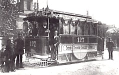

Nachdem bereits in verschiedenen Städten mit gasbetriebenen Schienenfahrzeugen experimentiert worden war, gründete sich 1893 auch in Dresden eine Gesellschaft, die unter dem Namen “The Gas Traction Company
Limited London and Dresden” auf der Großenhainer Straße ihre Werkstatträume bezog. Unter Leitung der Ingenieure Oskar Schwab und Carl Lührig entstanden mehrere Gasmotorwagen, die nach verschiedenen Tests und einer
erfolgreichen Probefahrt am 15. März 1894 nach London verbracht wurden. Wenig später kam es auch in Dresden zum regulären Einsatz der ersten Fahrzeuge. Die Gasmotoren lieferte die Motorenfabrik Deutz bei Köln, während
die Wagenkästen vom Dresdner Unternehmen [Carl Stoll](../../../../neustadt/leipziger_vorstadt/leipziger_strasse/) gebaut wurden. Die Wagen waren 3,5 m lang, wogen ca. 5 Tonnen und boten Platz für bis zu 36 Personen. Äußerlich unterschieden sie sich kaum von den bisherigen Pferdebahnwagen.

Die insgesamt fünf gebauten Fahrzeuge kamen im Auftrag der Deutschen Straßenbahn- Gesellschaft auf den Linien Albertplatz - Wilder Mann bzw.
Albertplatz - St.-Pauli- Friedhof zum Einsatz. Die Vorratsbehälter waren unter dem Fahrgastraum angebracht, der 10 PS starke Gasmotor befand sich unter
einer der beiden Sitzbänke. Als Betriebshof diente die Werkstatt der “Gas Traction Company” auf der Großenhainer Straße 28 (später 32). Als nachteilig
erwies sich, dass die Füllmenge der Behälter jeweils nur für eine Hin- und Rückfahrt ausreichte, so dass es beim Nachfüllen zu Wartezeiten für die Fahrgäste kam. Hinzu kamen Vorbehalte vieler Passagiere, die den
unangenehmen Gasgeruch sowie Explosionsgefahr bemängelten. Bestärkt wurden diese Befürchtungen durch eine Explosion beim Befüllen der Gastanks am 10. Dezember 1894, die jedoch nur geringe Schäden anrichtete.

Die Dresdner Gasstraßenbahn wurde nur knapp zwei Jahre, zwischen dem 27. Juli 1894 und dem 15. März 1896
betrieben. Später folgten bis zum Jahresende 1896 noch gelegentliche Fahrten, bevor die Fahrzeuge nach Dessau verkauft
wurden. Hier waren sie noch bis zur Betriebseinstellung 1901 im Einsatz. In Dresden setzte sich, so wie in den meisten anderen Städten, der elektrische Straßenbahnbetrieb durch.

* * *

 \[ [Nord](../../../../nord/)\] \[ [Nordwest](../../../../nordwest/)\] \[ [Neustadt](../../../../neustadt/)\] \[ [Nordost](../../../../nordost/)\] \[ [West](../../../../west/)\] \[ [Zentrum](../../../../zentrum/)\] \[ [Südwest](../../../../sudwest/)\]
 \[ [Süd](../../../../sud/)\] \[ [Südost](../../../../sudost/)\] \[ [Ost](../../../../ost/)\] \[ [Register](../../../../Register/register.html)\] \[ [Kontakt](../../../../Kontakt/kontakt.html)\] \[ [Impressum](../../../../impressum/)\]
