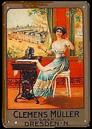
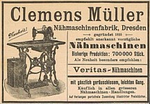
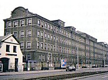

* * *

* * *

Das Unternehmen wurde 1855 als erste Nähmaschinenfabrik Europas von Clemens Müller gegründet. Müller (geb. 1828), Sohn eines Leinewebers, hatte die Idee der Nähmaschine von einem Besuch aus den USA mitbegracht und fertigte seine ersten selbstkonstruierten Exemplare in einer kleinen Werkstatt auf der Schössergasse an. 1873 verlegte er seinen Betrieb in die Leipziger Vorstadt auf ein Gelände an der Großenhainer Straße 1-5. Hier entstanden zunächst Kettenstichmaschinen mit Handbetrieb, später auch elektrische Doppelstichmaschinen. Bereits 1881 konnte die Firma ihre 200.000 Nähmaschine ausliefern und war Marktführer in Deutschland. 1884 richtete Müller zusätzlich eine Fabrik für Büromöbel ein und gründete zugleich eine betriebliche Unterstützungskase für die Mitarbeiter beider Unternehmen. Am 16. August 1902 verstarb der für seine Verdienste 1888 zum Kommerzienrat ernannte Unternehmer in seiner Villa auf der Holzhofgasse 4.

Der 1903 von seinen Kindern in eine GmbH umgewandelte Betrieb gehörte mit bis zu 1.300 Arbeitern zu den größten Dresdner Unternehmen und erwarb sich mit seinen Produkten Weltruf. Neben Nähmaschinen stellte die Firma ab 1909 auch Schreib- und Büromaschinen her. Unter den Markennamen “Veritas”, “Stella” und “Urania” wurden die Maschinen in zahlreiche Länder exportiert. Auch die sozialen Einrichtungen im
Betrieb, zu denen u.a. eine eigene Krankenkasse und die Clemens-Müller-Stiftung für Bedürftige gehörten, waren ihrer Zeit weit voraus.

1945 fielen Teile des Betriebsgeländes dem Luftangriff zum Opfer. Die erhaltenen Anlagen wurden in der Nachkriegszeit zum Großteil demontiert, die Firma selbst verstaatlicht. 1948 konnte in bescheidenem Rahmen die Produktion wieder aufgenommen werden. Ab 1951 firmierte der Betrieb nach der Fusion mit der Firma [Seidel & Naumann](../../../../west/cotta/strassen_cotta/hamburger_strasse/seidel___naumann/) unter dem Namen VEB Mechanik Schreibmaschinenwerke Dresden, später als VEB Reglerwerk. Noch bis 1990 wurden hier verschiedene mechanische und elektrotechnische Geräte und Bauteile hergestellt. Nach vergeblichen Versuchen, das Betriebsgelände zu verkaufen, wurden die leerstehenden Gebäude _(Foto)_ 2003 abgetragen. 2019 begann hier der Neubau eines Büro- und Geschäftshauses für den Bauträger TLG Immobilien.

* * *

 \[ [Home](../../../../index.html)\] \[ [Nord](../../../../nord/)\] \[ [Nordwest](../../../../nordwest/)\] \[ [Neustadt](../../../../neustadt/)\] \[ [Nordost](../../../../nordost/)\] \[ [West](../../../../west/)\] \[ [Zentrum](../../../../zentrum/)\] \[ [Südwest](../../../../sudwest/)\] \[ [Süd](../../../../sud/)\] \[ [Südost](../../../../sudost/)\] \[ [Ost](../../../../ost/)\] \[ [Register](../../../../Register/register.html)\] \[ [Kontakt](../../../../Kontakt/kontakt.html)\] \[ [Impressum](../../../../impressum/)\]
