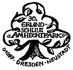
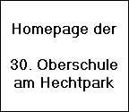
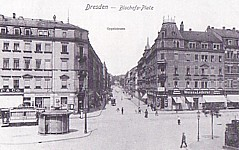
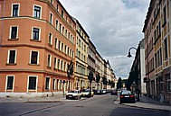
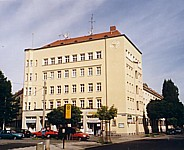
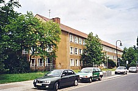

* * *

* * *

* * *

**Stadtteilseiten:**

* * *

**Schulen im Hechtviertel:**

Die Geschichte des Hechtviertels begann im Jahr 1836, als der damalige Dresdner Polizeidirektor Hans Ludwig von Oppell ein größeres Areal oberhalb des Bischofsweges erwarb. Zuvor war diese Fläche am Fuße der Hellerberge bis 1833 als Artillerieübungsplatz der sächsischen Armee genutzt worden. Durch Zukäufe konnte Oppell seine Besitzungen 1841 auf insgesamt 23 Hektar erweitern. Als einziges Gebäude existierte in diesem Bereich das [Weingut](../../../neustadt/leipziger_vorstadt/hechtviertel/hechtsches_weingut/) der Familie Hecht und ein Gasthaus, welche unter dem Namen “Zum Blauen Hecht” beliebtes Ausflugsziel der Dresdner war _(Foto)_.

Oppell plante auf seinem Grundstück den Bau einer Kleinhaussiedlung für die zahlreichen in den umliegenden Industriebetrieben beschäftigten Arbeiter. Nachdem der Bebauungsplan 1842 genehmigt worden war, begann man in der Nähe des Bischofsplatzes mit der Errichtung der ersten Wohnhäuser. 1851 eröffnete Hermann Roch hier eine Zündholzfabrik. Allerdings ging die Besiedlung nur sehr langsam voran, was vor allem an der fehlenden Erschließung des Areals durch Straßen und Kanalisation lag. Hinzu kam ein zweijähriger Baustopp, um den geplanten Eisenbahnbau nach Görlitz nicht zu gefährden. Die im Volksmund “Oppellvorstadt” genannte Siedlung erhielt 1855 amtlich den Namen “Neuer Anbau auf den von Oppellschen Feldern”.

**_Foto:_** _Blick vom Bischofsplatz in die Oppellstraße (heute Rudolf-Leonhard-Straße) um 1910_

Erst nach der Stiftung einer beträchtlichen Summe für den Bau von Arbeiterwohnhäusern durch den Großkaufmann Johann Meyer konnte in der zweiten Hälfte des 19. Jahrhunderts mit dem planmäßigen Ausbau der “Oppellvorstadt” begonnen werden. Die Straßen wurden nun schrittweise kanalisiert, gepflastert und 1859 auch mit Namen versehen. Mittelpunkt des neuen Wohnviertels war die nach dem nahegelegenen früheren Weingut benannte [Hechtstraße](../../../neustadt/leipziger_vorstadt/strassen_leipziger_vorstadt/hechtstrasse/). Um 1865 gab es hier bereits 114 Wohnhäuser sowie mehrere Kleinbetriebe und Gärtnereien. 1869 folgte die Installation von Gaslaternen, acht Jahre später der Anschluss an die städtische Wasserversorgung.

1875 wurde in Abweichung der ursprünglichen Planungen der Bau von mehrgeschossigen Mietshäusern in geschlossener Bauweise erlaubt. Zugleich war der neuentstandene Stadtteil an die Leipziger Vorstadt angegliedert worden. Bis 1890 bildete sich hier eines der am dichtesten besiedelten Wohnviertel Dresdens heraus, welches um die Jahrhundertwende fast 15.000 Bewohner zählte. Ab 1901 verkehrte eine Straßenbahnlinie durch die Hechtstraße bis zum 1862 angelegten [St.-Pauli-Friedhof](../../../neustadt/leipziger_vorstadt/hechtviertel/st_-pauli-friedhof/). Bereits 1891 hatte die Vorstadt mit der [St.-Pauli-Kirche](../../../neustadt/leipziger_vorstadt/hechtviertel/st_-pauli-kirche/) ein eigenes Gotteshaus erhalten.

In den Zwanziger Jahren entwickelte sich der “Rote Hecht” zu einem Zentrum der Arbeiterbewegung, nicht zuletzt durch die teilweise katastrophalen Wohn- und Lebensbedingungen in diesem Stadtteil bedingt. Neben Arbeitern lebten hier jedoch auch Handwerker, Kleingewerbetreibende und Händler. Zwischen 1926-29 folgten weitere [Wohnviertel](../../../neustadt/leipziger_vorstadt/strassen_leipziger_vorstadt/hechtstrasse/) im Bereich Hechtstraße / Bärwalder Straße _(Fotos)_, initiiert vom Kleinwohnungs-Bauverein Dresden e.V. Architekt der Siedlung war der Dresdner Otto Schubert, welcher selbst zu den Gründungsmitgliedern des 1910 entstandenen Vereins gehörte. Bereits am 16. Januar 1945 trafen Bomben Teile des “Hechtviertels”, denen 376 Menschen zum Opfer fielen. Auch ein weiterer Angriff im März forderte seine Opfer und zerstörte u.a. die Schule am Königsbrücker Platz sowie die St.-Pauli-Kirche.

Nach 1945 konnte mit Beseitigung der Kriegsschäden begonnen werden. An Stelle zerstörter Wohngebäude entstanden in den 1960er und 70er Jahren moderne Wohnblocks. In den Erhalt der Altbausubstanz wurde hingegen kaum investiert, was zum Verfall vieler Straßenzüge im Hechtviertel führte. Erst nach 1990 begann die Sanierung der meisten Wohnhäuser. Ähnlich wie in der Äußeren Neustadt entwickelte sich auch hier eine abwechslungsreiche Kneipenszene mit Bars, Restaurants und kleinen Cafés, die den “Hecht” zu einem beliebten Wohnviertel für junge Leute machen. Einige noch verbliebene Baulücken wurden mit modernen Wohnhäusern geschlossen, u.a. an der Kiefernstraße.

Schulen im Hechtviertel:

Nachdem die Bevölkerung in diesem Teil der Neustadt deutlich angewachsen war, machte sich um 1864 der Bau eines eigenen Schulhauses erforderlich. Zunächst entstand lediglich eine “Aushilfsschule”, bevor 1866 nach Entwürfen von Theodor Friedrich ein großzügiger Schulneubau am Königsbrücker Platz eingeweiht werden konnte _(Foto)_. Diese wurde zunächst als 7. und 14. Bezirks-, ab 1919 als 14. Volksschule bezeichnet. Hier befand sich auch eine Zweigstelle der Dresdner Volksbibliothek. Eine weitere Schule entstand 1903 an der Windmühlenstraße 12 (heute Seitenstraße). Zunächst 30. Bezirksschule genannt, wurde aus dieser ab 1919 die 30. Volksschule.

Beim Luftangriff vom 16. Januar 1945 wurden auch die beiden Schulen des Hechtviertels schwer beschädigt. Nach Abbruch der Ruinen entstand 1965 an Stelle zerstörter Wohnhäuser an der Hechtstraße 55 ein Neubau für die 30. POS, die am 3. Januar 1967 den Namen des ersten DDR-Präsidenten Wilhelm Pieck rhielt. Ab 1992 nutzten die 30. Grundschule “Am Hechtpark” und die 30. Mittelschule gemeinsam das Gebäude. 2009 erfolgte die Vereinigung von 15. und 30. Mittelschule mit den Standorten Görlitzer Straße und Hechtstraße. 2012 wurde diese zum Unteren Kreuzweg verlagert, so dass es heute im Hechtviertel nur noch eine Grundschule gibt. Das Areal der früheren 14. Volksschule dient heute als Grünanlage mit Kinderspielplatz und einer kleinen Freilichtbühne.

**_Foto:_** _Neubau der 30. Grundschule an der Hechtstraße_

 \[ [Home](../../../index.html)\] \[ [Nord](../../../nord/)\] \[ [Nordwest](../../../nordwest/)\] \[ [Neustadt](../../../neustadt/)\] \[ [Nordost](../../../nordost/)\] \[ [West](../../../west/)\] \[ [Zentrum](../../../zentrum/)\] \[ [Südwest](../../../sudwest/)\] \[ [Süd](../../../sud/)\] \[ [Südost](../../../sudost/)\] \[ [Ost](../../../ost/)\] \[ [Register](../../../Register/register.html)\] \[ [Kontakt](../../../Kontakt/kontakt.html)\] \[ [Impressum](../../../impressum/)\]
