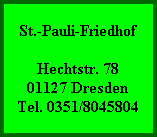
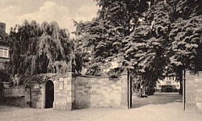
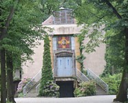
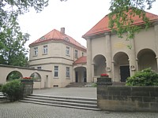

* * *

* * *

* * *

Nachdem der [Innere Neustädter Friedhof](../../../../neustadt/leipziger_vorstadt/innerer_neustadter_friedhof/) für die stark angewachsene Bevölkerung der Dresdner Neustadt zu klein geworden war, entschloss man sich um 1860 zur Anlage eines neuen Begräbnisplatzes am Fuße der Hellerberge. 1862 wurde das zunächst als Neuer bzw. Äußerer Neustädter Friedhof bezeichnete Areal übergeben. Die terrassenförmige Anlage zwischen Hechtstraße und der heutigen Stauffenbergallee bietet auf zwölf Hektar Platz für ca. 30.000 Gräber und gehört damit zu den größten Dresdner Friedhöfen. Die erste Beisetzung fand am 21. Mai 1862 statt. Das Grab des mit nur 29 Jahren verstorbenen Maurers Preller ist noch erhalten. Zeitgleich entstand eine kleine Kapelle mit Totenhalle nach einem Entwurf des Architekten Carl Adolph Canzler.

Zu den ältesten Anlagen des St.-Pauli-Friedhofs gehört ein 1866 geschaffener Ehrenhain für die Opfer des Preußisch-Österreichischen Krieges. Weitere Begräbnisse erfolgten nach 1871, als hier zahlreiche preußische und sächsische Soldaten sowie 427 in Dresden verstorbene französische Kriegsgefangene ihre letzte Ruhestätte fanden. In Erinnerung an diese Kriegsopfer wurde 1874 ein durch Spenden finanzierter Gedenkstein aufgestellt. Der von Hofmaler Ludwig Theodor Choulant entworfene Stein trägt die Inschrift _“Den Deutschen Kriegern Dank und ehrenvolles Andenken / in den Jahren 1870/71 / Den Tod für das Vaterland gestorben / in Lazarethen Dresdens”_, Namenstafeln der Gefallenen sowie einen Bibelspruch.

1910/11 errichteten die Dresdner Architekten Schilling & Gräbner eine Feierhalle, die eine Orgel der Firma Jehmlich erhielt. Hinzu kam die mit farbigen Terrakottaziegeln von Karl Groß und einem für die damalige Zeit modernen Lastenaufzug ausgestatte Totenhalle. Beide Gebäude wurden in den letzten Jahren saniert und stehen unter Denkmalschutz. Neben zahlreichen Einzelgräbern, darunter auch Grabstätten bekannter Dresdner Persönlichkeiten, befinden sich auf dem St.-Pauli-Friedhof mehrere Gräberfelder. Zwei dieser Felder werden als Begräbnisplatz für die verstorbenen Schwestern der Diakonissenanstalt genutzt.

Eine Gedenkstätte für die Opfer von Krieg und Gewaltherrschaft entstand 1999. Hier fanden 428 Menschen ihre letzte Ruhestätte: Tote des Bombenangriffs von 1945, verwundete Kriegsgefangene und nach 1945 aus politischen Gründen Hingerichtete. Bepflanzt wurde die Anlage nach dem Vorbild mittelalterlicher Friedhöfe mit Apfelbäumen - Symbolen des Lebens und der Erneuerung. Eine weitere Mahnstätte erinnert seit 2014 an die im [“Hellerlager”](../../../../nord/) verstorbenen Kinder russischer und polnischer Zwangsarbeiterinnen, die dort zwischen 1943 und 1945 ums Leben kamen. Ein Gedenkstein für diese Kinder (insgesamt sind 225 Todesfälle nachgewiesen) entstand bereits in der Nachkriegszeit.

Da in den vergangenen Jahren die Zahl der Erdbestattungen stetig zurückging und die Unterhaltung des Friedhofes für den Neustädter Friedhofsverband, zu dem auch der Innere Neustädter Friedhof und der Markusfriedhof gehören, zu teuer wurde, entschloss man sich Ende 2015 zur Stilllegung des St.-Pauli-Friedhofes. Künftig werden hier nur noch Beisetzungen von Ehepartnern in bereits bestehenden Gräbern möglich sein. Die Anlage des Friedhofs soll jedoch auf Dauer erhalten bleiben. Das am Eingang befindliche Gebäude dient seit 1996 als Gemeindehaus der Evangelisch-Mennonitischen Freikirche.

Gräber bedeutender Persönlichkeiten:

Franz Ludwig Gehe: Gehe gründete mit nur 25 Jahren in Dresden eine Arzneimittelfirma, die 1866 zur Leipziger Straße verlegt wurde. Unter dem Namen Drogen-Appretur-Anstalt, später Gehe & Co. AG erlangte das Unternehmen Weltruf und war Vorgänger des heutigen [Arzneimittelwerkes](../../../../neustadt/leipziger_vorstadt/leipziger_strasse/arzneimittelwerk_dresden/). Franz Ludwig Gehe verstarb 1882. Das künstlerisch bedeutsame Grabmal wurde von Johannes Schilling geschaffen und befindet sich an der Nordostseite des Friedhofs.

Georg Friedrich Alfred Graf von Fabrice: Der als Generalmajor im Preußisch-Österreichischen Krieg 1866 zu ersten militärischen Erfolgen gekommene Offizier wirkte 25 Jahre lang als sächsischer Kriegsminister und war maßgeblich am Aufbau der Albertstadt beteiligt. 1876 übernahm er zugleich das Amt des sächsischen Ministerpräsidenten. Fabrice wurde nach seinem Tod 1891 zunächst in einem für ihn errichteten Mausoleum an der [Carolaallee](../../../../neustadt/albertstadt/strassen_albertstadt/stauffenbergallee/) beigesetzt. 1950 erfolgte die Umbettung in das Familiengrab auf dem St.-Pauli-Friedhof.

Friedrich Hermann Müller: Der wohlhabende Unternehmer (1819-1898) besaß ab 1863 das noch heute existierende Wohnhaus [Döbelner Straße](../../../../nordwest/trachenberge/strassen_trachenberge/) 24 in Trachenberge und unterstützte seinen Heimatort mit verschiedenen Zuwendungen, u.a. für den Ausbau des Straßennetzes, den Neubau der Schule und die Ausstattung der Pieschener Markuskirche. Seine Tochter Helene war mit dem letzten Hofarzt des sächsischen Königs Dr. med. Gotthold Opitz verheiratet. Beide wurden nach ihrem Ableben ebenfalls in der Familiengrabstelle beigesetzt.

Willem Ernst Smitt (1862-1922): Der in Leipzig geborene Mediziner gilt als einer der Wegbereiter der Physiotherapie und war ab 1919 erster Direktor der von ihm initiierten Staatsanstalt für Krankengymnastik und Massage. Seit 2007 erinnert an ihn eine vom Verein Physiotherapeuteninitiative zur Gesundheitsförderung gestiftete Gedenktafel.

Carl Georg Levin von Metzsch-Reichenbach: Der aus einer vogtländischen Adelsfamilie stammende Politiker trat 1870 in den Staatsdienst ein und war ab 1891 sächsischer Innenminister, ab 1894 Außenminister. 1901 übernahm er das Amt des Ministerpräsidenten, musste jedoch im Zuge der Wahlrechtskämpfe 1906 zurücktreten. Ein Jahr zuvor hatte ihm die Stadt Dresden die Ehrenbürgerwürde verliehen. Nach seinem Tod am 7. November 1927 fand er im Familiengrab seine letzte Ruhestätte.

Bruno Jehmlich: Der aus der bekannten sächsischen Orgelbauerdynastie stammende Bruno Jehmlich fand 1940 in einer der insgesamt vier Jehmlich-Gräber auf dem St.-Pauli-Friedhof seine letzte Ruhestätte. Der Grabstein ist mit einer Orgel verziert. Die Firma an der [Großenhainer Straße](../../../../neustadt/leipziger_vorstadt/grossenhainer_strasse/) wird bis heute von seinen Nachkommen fortgeführt.

Ida Amalia und Emil Richard Kästner: Das unscheinbare Grab beherbergt die sterblichen Überreste der Eltern des bekannten Dresdner Schriftstellers Erich Kästner. Ida Amalia Kästner, geborene Augustin verstarb 1951, ihr Mann Emil Richard sechs Jahre später. Auch Kästners Onkel, der Pferdehändler Franz Augustin und seine Familie liegen auf dem St.-Pauli-Friedhof begraben.

Familiengrabstätte Meschwitz: Die heute nicht mehr erhaltene Grabstätte gehörte der Familie des Forstfachmanns und langjährigen Oberförsters der Dresdner Heide Friedrich Wilhelm Meschwitz (1815-1888). Nach dem Tod eines seiner Söhne im Alter von nur 19 Jahren ließ Meschwitz 1880 am Grab eine Schindeleiche pflanzen, die noch heute zu den Naturdenkmalen Dresdens gehört. Seit Oktober 2013 erinnert davor eine Gedenktafel an den Forstmann und seine Verdienste.

Weitere Grabstätten:

**_Grabstätte_**

**_Todesjahr_**

August Ferdinand Theodor Graf Marschall, Oberforstmeister (Gedenkbaum "Marschalleiche")

1868

Heinrich Klemm, Bibliothekar, Gründer der Europäischen Modenakademie

(2016/17 wiederhergestellt)

1886

Rudolf Baron, Baumeister und Architekt

1895

Ernst Traugott Tischer, Braumeister und Stifter

1897

Guido Hammer, Tiermaler und Illustrator

1898

Ernst Wilhelm Bucher, Mitbegründer des Militär-Genesungs-Heims ["Glasewalds Ruhe"](../../../../Nord/Wilschdorf/Strassen_Wilschdorf/strassen_wilschdorf.html)

1905

Carl Echtermeier, Bildhauer

1910

Hermann Vetter, Musikpädagoge, Direktor des Dresdner Konservatoriums

1928

Wilhelm Buck, Politiker (SPD), sächsischer Ministerpräsident

1945

Reinhold Rabich, Professor Tragwerkstechnik

1974

Gerhart Potthoff, Verkehrswissenschaftler, Professor an der Hochschule für Verkehrswesen

1989

Herbert Naumann, Maler, Professor an der Hochschule für Bildende Künste

2003

Johann Lelansky, Besitzer des [Dampfsägewerkes Lelansky](../../../../nordwest/mickten/strassen_mickten/)

* * *

 \[ [Nord](../../../../nord/)\] \[ [Nordwest](../../../../nordwest/)\] \[ [Neustadt](../../../../neustadt/)\] \[ [Nordost](../../../../nordost/)\] \[ [West](../../../../west/)\] \[ [Zentrum](../../../../zentrum/)\] \[ [Südwest](../../../../sudwest/)\]
 \[ [Süd](../../../../sud/)\] \[ [Südost](../../../../sudost/)\] \[ [Ost](../../../../ost/)\] \[ [Register](../../../../Register/register.html)\] \[ [Kontakt](../../../../Kontakt/kontakt.html)\] \[ [Impressum](../../../../impressum/)\]
