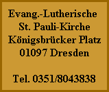
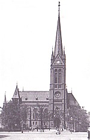
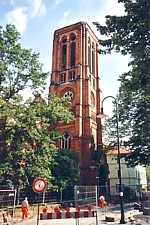
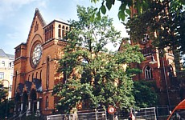

* * *

* * *

* * *

* * *

* * *

* * *

Die St.-Pauli-Kirche wurde im Zuge des Ausbaus des Hechtviertels als Gotteshaus für
diesen Teil der Dresdner Neustadt erbaut. Bereits 1881 war die mit über 60.000 Mitgliedern zweitgrößte sächsische Kirchgemeinde der Dreikönigskirche in drei
selbstständige Gemeinden aufgeteilt worden. Am 31. Mai 1889 konnte schließlich am Königsbrücker Platz der Grundstein für den vorerst letzten Kirchenneubau in der Neustadt
gelegt werden. Innerhalb von nur 18 Monaten entstand nach Plänen von Christian Schramm ein neogotischer Backsteinbau mit einem markanten 78 m hohen Turm ( _Foto)_.

In Anklang an den Namen erhielt die Kirche über dem Haupteingang Sandsteinfiguren des heiligen Paulus und des Propheten Jesaja. Die Altarfenster gestaltete der Künstler Bruno
Carl Urban mit Darstellungen des predigenden, betenden und opfernden Christus. Die Orgel stammte aus der Werkstatt der Gebrüder Jehmlich. Im Inneren des dreischiffigen
Gotteshauses fanden bis zu 1000 Gläubige Platz. Die Weihe erfolgte am 4. Februar 1891. Im Turm läuteten bis 1917 drei Bronzeglocken, welche 1921 durch ein neues Geläut der Dresdner Glockengießerei
Pietzel ersetzt wurden. Heute ist von diesen nur noch die kleinste erhalten geblieben.

Am 16. Januar und am 2. März 1945 wurde die St.-Pauli-Kirche von Bomben schwer getroffen und brannte aus.
Auch der markante Turm verlor dabei seine Spitzhaube. Gerettet wurden der vorsorglich eingelagerte Altar, ein Lesepult, zwei Ölgemälde und weitere Teile der Innenausstattung, welche noch heute im Gemeindehaus auf der
Fichtenstraße zu sehen sind. Hier finden bis heute die Gottesdienste der Gemeinde statt.

Obwohl in den 60er Jahren Pläne zum Wiederaufbau der gut erhaltenen Ruine existierten, konnten diese nicht in die
Realität umgesetzt werden. Zwischen 1965 und 1969 enttrümmerten Gemeindemitglieder die Ruine und führten erste Sicherungsmaßnahmen durch. Nach 1990 erfolgten weitere Beräumungsarbeiten im Innenraum, um diesen für
verschiedene Veranstaltungen, aber auch für Freiluftgottesdienste nutzen zu können. 1996 erhielt die städtische
Tochtergesellschaft STESAD von der evangelischen Kirche das Nutzungsrecht für 50 Jahre übertragen. Seit März 1997 finden hier in den Sommermonaten regelmäßig Konzerte und Theateraufführungen statt, welche vom Verein
“TheaterRuine St. Pauli e.V.” organisiert werden. 2005/06 erfolgten Sicherungs- und Sanierungsarbeiten am Turm und
den Außenmauern. Um die Ruine künftig auch bei ungünstiger Witterung nutzen zu können, erhielt sie 2011 über dem Kirchenschiff ein Glasdach

**_Fotos:_** _Die St.-Pauli-Kirchenruine im Sommer 2005_

* * *

 \[ [Home](../../../../index.html)\] \[ [Nord](../../../../nord/)\] \[ [Nordwest](../../../../nordwest/)\] \[ [Neustadt](../../../../neustadt/)\] \[ [Nordost](../../../../nordost/)\] \[ [West](../../../../west/)\] \[ [Zentrum](../../../../zentrum/)\] \[ [Südwest](../../../../sudwest/)\] \[ [Süd](../../../../sud/)\] \[ [Südost](../../../../sudost/)\] \[ [Ost](../../../../ost/)\] \[ [Register](../../../../Register/register.html)\] \[ [Kontakt](../../../../Kontakt/kontakt.html)\] \[ [Impressum](../../../../impressum/)\]
