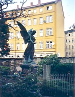
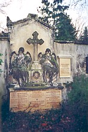
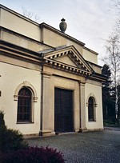
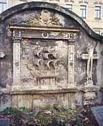
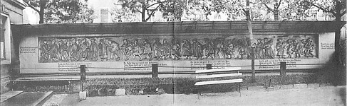
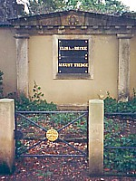
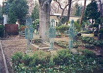
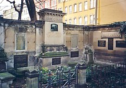
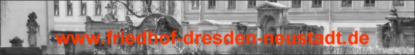

* * *

* * *

* * *

Der Innere Neustädter Friedhof enstand ab 1731 auf einem Areal außerhalb der Stadtbefestigung. Zuvor wurden die verstorbenen Einwohner Altendresdens auf einem unmittelbar an der Dreikönigskirche gelegenen Gottesacker beerdigt. Sowohl aus Platz- als auch aus hygienischen Gründen hatte man bereits 1556 eine Verlegung erwogen. Ausschlaggebend für die Umsetzung des Vorhabens waren aber die Bebauungspläne August des Starken für seine “Neue Königstadt”. Der neuen Hauptstraße stand dabei die Dreikönigskirche im Wege, die deshalb abgerissen und auf einem neuen Grundstück wieder aufgebaut werden sollte. Als Bauplatz wählte man das bisherige Friedhofsgelände, so dass ein neuer Begräbnisplatz gesucht werden musste.

Nach längeren Diskussionen entschied man sich für ein Areal in der Nähe der Scheunenhöfe. Am 10. November 1731 wurde das vom Kurfürsten zur Verfügung gestellte Grundstück abgesteckt und nach Plänen des Architekten Georg Maximilian von Fürstenhoff gestaltet. Die Leitung der Arbeiten übernahm Stadtrichter und Religionsamtsverwalter Friedrich Schlintzig. Neben den Grabstellen entstanden mehrere Grufthäuser, ein Wohnhaus für den Totengräber sowie eine Umfassungsmauer. An den Entwurfsarbeiten war auch der Dresdner Ratsmaurermeister Johann Gottfried Fehre beteiligt. Einige historisch wertvolle Epitaphien und Grabsteine setzte man vom alten Friedhof nach hier um. Die erste Beisetzung auf dem Inneren Neustädter Friedhof, eine Frau aus Neudorf, erfolgte am 31. Januar 1732.

Obwohl das Gelände mit ursprünglich ca. “200 Ellen in´s Geviert” relativ großzügig geplant war, machten sich schon bald Erweiterungen des Friedhofs erforderlich. 1759 und zu Beginn des 19. Jahrhunderts konnten diese angrenzenden Flächen erworben werden, so dass das Areal nun ca. 38.000 m² umfasste. Noch heute trennen Begrenzungsmauern mit zwei Durchgängen diese drei Friedhofsbereiche.

Heute stellt der Innere Neustädter Friedhof vor allem wegen seiner zahlreichen barocken Grabdenkmale ein besonderes Zeugnis der Dresdner Kultur- und Friedhofsgeschichte dar. Die ältesten Grabsteine stammen noch vom alten Dreikönigskirchhof. Weitere entstanden im 18. und 19. Jahrhundert für Dresdner Bürger, aber auch für Militärangehörige und die Bewohner von Neudorf. Auch einige bekannte Dresdner Persönlichkeiten haben hier ihre letzte Ruhestätte gefunden. Ein Obelisk erinnert an die 1849 beim Dresdner Maiaufstand gefallenen Revolutionäre, ein weiteres Mahnmal an 28 Dresdner, die im Mai 1945 von den sowjetischen Besatzungstruppen erschossen wurden.

Einzelne Gebäude und Grabstätten:

**“1\. Land” (ältester Friedhofsteil):**

Dieser Friedhofsteil entstand als erster der drei Bereiche und wurde ab 1732 genutzt. Am Eingang Friedensstraße weist eine Tafel am früheren Wohnhaus des Totenbettmeisters auf die Gründung des Friedhofes hin. Die wertvollsten Grabstellen befinden sich an der Friedhofsmauer. Bemerkenswert sind u.a. das Grabmal des russischen Staatsrates und Generals Wassili von Armstrong (1817-1869) mit Darstellung eines Schiffes und die Gruft des Hofbildhauers Gottfried Knöffler (1715-1779). An Stelle des früheren “Totentanzes” stehen heute mehrerer Sandsteinplastiken, die zum Teil noch vom alten Dreikönigskirchhof stammen. 1799 entstand das heute als Trauerhalle genutzte einstige Grufthaus.

Gruft- und Leichenhalle: Das Gebäude wurde 1799 als “Kirchengruft” errichtet und besaß zwei Leichenstuben und ein Wächterzimmer. Ein besonderes Kuriosum stellte früher ein “Klingelapparat” zur Erweckung Scheintoter dar. Mit Hilfe von Schnüren, die an den Fingern und Zehen der aufgebahrten Toten befestigt wurden, und einem ausgeklügelten System von Rollen und Glöckchen sollten eventuelle Lebenszeichen des Verstorbenen registriert und so die Beerdigung Scheintoter verhindert werden. In den unterirdischen Gewölben fanden bis zur Schließung der Gruft 1880 69 Personen ihre letzte Ruhestätte.

Die Entwürfe für den schlichten klassizistischen Bau stammen von Christian Traugott Weinlig und Friedrich Christian Hünich. Über dem Portal befindet sich ein Ausspruch Klopstocks: _“Unsterbliches Leben wird der uns schuf, uns geben. Gelobt sey Er”_. 1891 erfolgte der Umbau des Gebäudes zur Parentationshalle. Bei Sanierungsarbeiten wurde 1994 ein Marmorrelief des Bildhauers Johannes Schilling entdeckt. Das Relief befand sich ursprünglich am Grab des Juristen Ludwig Winkler (1766-1856) und kam 1911 in die Trauerhalle.

Gregory-Gruft: Das Grufthaus (Nr. 89) unmittelbar am Friedhofseingang entstand 1754 für die Familie Gregory. Beisetzungen erfolgten zwischen 1757 und 1932. Viele der hier Beerdigten waren Militärs der sächsischen bzw. der kaiserlichen Armee. Einige Schrifttafeln erinnern an die im Ersten Weltkrieg gefallenenen Familienmitglieder.

Grabmal Wassili Armstrongs: Die Grabstätte (Nr. 4) an der Friedhofsmauer jenseits der Toreinfahrt gehört zu den künstlerisch bedeutendsten des Friedhofs. Ihr Schöpfer ist unbekannt. Eine Relieftafel zeigt ein in den Hafen einlaufendes Schiff, welches die Vollendung des Lebens mit dem Tod symbolisieren soll _(Foto)_. Beigesetzt wurde hier der 1869
verstorbene Kaiserlich-Russische Staatsrat, Ritter und General Wassili Armstrong.

Grabmal Carl Spitzner: In dieser Grabstelle (Nr. 5) wurde 1899 der Arzt und Kunstsammler Dr. med. Carl Gustav Adolf Spitzner (1831-1899) beigesetzt. Der zeitweise auch als Stadtverordneter und Mitglied des sächsischen Altertumsvereins tätige Mediziner besaß eine der bedeutendsten Dresdner Privatsammlungen Meißner Porzellans. 1890 verkaufte er diese für 90.000 Markt an die Königliche Generaldirektion für Kunst und Wissenschaft (heute Staatliche Kunstsammlungen), wo sie noch heute zum Bestand der Porzellansammlung gehört.

Knöffler-Gruft: Das Grufthaus (Nr. 7) wurde noch zu Lebzeiten von Gottfried Knöffler selbst entworfen und 1750 fertiggestellt. Knöffler schuf u.a. die Figurengruppen am Eingang des Coselpalais und den Delphinbrunnen auf der Brühlschen Terrasse. Für die Erhaltung der Familiengrabstätte stiftete der Hofbildhauer ein Legat von 600 Talern an die Dreikönigskirche. In der Gruft fanden neben dem Bildhauer selbst (1715-1779) auch seine Frau Sophie Charlotte, sein Sohn sowie die befreundete Familie des Bildhauers Benjamin Thomae ihre letzte Ruhestätte. Knöffler war mit einer Tochter Thomaes verheiratet. 1997 wurde die zu den bedeutendsten Dresdner Grabstätten gehörende Gruft saniert.

Grabmal Christoph Ernst von Reitzensteins: Das zu den älteren Grabdenkmalen aus der Barockzeit gehörende Monument erinnert an den am 2. Januar 1746 an den Folgen seiner Verwundung in der Schlacht von Kesselsdorf gefallenen Obristen Ch. E. von Reitzenstein und steht stellvertretend für eine Reihe von Militärgräbern, die nach der Schlacht auf dem Inneren Neustädter Friedhof angelegt wurden. Der leider stark verwitterte Stein informiert auf der Vorderseite über die Leistungen des Offiziers: _“Nachdem er seinem Könige 33 Jahr rechtschaffen gedient, so setzte er auch vor Höchst Dieselben sein Leben auf”_. Die Rückseite trägt die nur noch schwer lesbare Inschrift: _“Was hilft Commando Stab, der Adel und der Orden? Der alles dieses trug, ist doch zu Asche geworden”_ (B.6. 12/13).

Grabmal Christian Friedrich von Beust: Die 2,70 m hohe barocke Stele wurde zu Ehren eines 1735 verstorbenen Kadetten der sächsischen Armee aufgestellt. Der Obelisk besteht aus einer großen Inschriftenkartusche, die mit Fahnenbündeln umgeben ist. Die Rückseite des Grabmals stellt einen Lindenbaum dar, der mit seinen Wappen den weitverzeigten Stammbaum der Familie von Beust symbolisiert (D.).

Grabmal Friedrich Garadet: Die Grabstätte (Nr. 22) des Reformierten Predigers Friedrich Garadet (1789-1841) an der Südmauer des Friedhofs ziert eine interessante Barockplastik, die einen weiblichen Engel mit Kreuz darstellt. Der Schöpfer der Plastik ist unbekannt.

Totentanz: Das 12,5 Meter lange Relief wurde 1534 von Christoph Walther I. geschaffen und befand sich ursprünglich am Georgentor des Dresdner Schlosses. Das Kunstwerk zeigt einen Trauerzug von 24 Personen, die hinter der Gestalt des Todes herziehen und so die Gleichheit aller Menschen vor dem Tod symbolisieren. 1701 gelangte der Totentanz als Schenkung an die Dreikönigskirche, die ihn 1733 an der Mauer des Inneren Neustädter Friedhofes anbringen ließ. Um einer weiteren Verwitterung zu begegnen, wurde er dort jedoch 1975 entfernt und ist nach erfolgter Restaurierung seit 1991 an der Orgelempore der Dreikönigskirche zu bewundern.

**_Foto:_** _Der Totentanz an seinem ehemaligen Standort auf dem Inneren Neustädter Friedhof_

Saturnplastik: Die barocke Grabplastik entstand 1726 für den Kaufmann Dietrich Schmidt, der sich auch als Wohltäter für die Armenversorgung der Dreikönigskirchgemeinde engagierte. Als eines der wenigen erhaltenen Grabmale stammt es noch vom alten Dreikönigskirchhof und wurde später zum Inneren Neustädter Friedhof umgesetzt. Die stark verwitterte Sandsteinplastik befindet sich heute an Stelle des früheren “Totentanzes”.

**2\. Land” (mittlerer Friedhofsteil):**

Nachdem der alte Friedhof zu klein geworden war, erwarb das Neustädter Religionsamt 1759 fünf Scheffel Land und erweiterte ihn in Richtung Osten. Grund war u. a. die Anlage von über 400 Soldatengräbern für die preußischen Gefallenen des Siebenjährigen Krieges. Auch auf dem sogenannten “2. Land” befinden sich einige wertvolle Grabdenkmale und die Ruhestätten bekannter Dresdner Unternehmer, wie z. B. der beiden Gründer der ersten deutschen Schokoladenfabrik Jordan & Timaeus.

Gemeinschaftsgrabmal Elisa von der Recke und Christian August Tiedge: Auf eigenen Wunsch wurden die beiden befreundeten Schriftsteller in einem gemeinsamen Grab beigesetzt. Es befindet sich in der Nordostecke der II. Abteilung und gehört zu den künstlerisch interessantesten in diesem Bereich. Elisa von der Recke verstarb 1833, Christian August Tiedge 1841. Beide unternahmen gemeinsam mehrere Reisen und bewohnten ab 1819 ein Haus am Kohlmarkt, wo sie einen Kreis von Schriftstellern, Wissenschaftlern und Künstlern um sich versammelten. Das Grabmal ist im klassizistischen Stil gestaltet und wurde 1995 durch die Tiedge-Stiftung erneuert _(Foto)_.

Grabmal Christian August Eberhardts: Das Grab befindet sich in der Nähe des Recke - Tiedge- Grabes auf dem zweiten Teil des Friedhofes (G. 24.65) und beherbergt die sterblichen Überreste des Schriftstellers Dr. Christian August Gottlob Eberhardt (1769-1845). Die Grabplatte wurde von August Schreitmüller geschaffen und zeigt ein Motiv aus seinem bekanntesten Werk “Hanne und die Küchlein”.

Zschinsky\`sche Gruft: Die Gruft (Nr. 73) an der Nordmauer entstand in der Zweiten Hälfte des 19. Jahrhunderts für die Familie von Zschinsky. Bedeutendstes Familienmitglied war der sächsische Jurist Ferdinand von Zschinsky, der 1845 Vizepräsident des Appellationsgerichtes Dresden wurde. Am 7. März 1848 übernahm er die provisorische Leitung des Innenministeriums und war während der Maiunruhen 1849 sächsischer Innen- und Justizminister. Für seine Verdienste erhielt er sieben Jahre später von König Johann den erblichen Adelstitel verliehen.

Grabstätte Julien Vogel: Die künstlerisch wertvolle Grabplastik schuf der Bildhauer Franz Pettrich für die 1828 mit nur 20 Jahren verstorbene erste Ehefrau des Hofmalers Carl Christian Vogel von Vogelstein (Nr. 86).

Gedenkstätte “Sächsischer Heimatschutz”: Die Grabstätte, bestehend aus drei grün gestrichenen Metallkreuzen, erinnert an den Begründer des Landesvereins “Sächsischer Heimatschutz” Karl Schmidt (1853-1922) und zwei seiner engsten Mitstreiter. Oswald Hempel (1895-1945) wurde als Puppenspieler bekannt und kam am 13. Februar 1945 beim Luftangriff ums Leben. Sein Leichnam konnte nie gefunden werden. Werner Schmidt (1868-1952) übernahm 1945 das Amt des Direktors und war maßgeblich am Wiederaufbau des Vereins nach dem Krieg beteiligt.

**“3\. Land” (jüngster Friedhofsteil):**

Dieser Abschnitt entstand als dritte und letzte Erweiterung des Inneren Neustädter Friedhofes zwischen 1818 und 1843. Im Gegensatz zum 1. und 2. Land sind hier nur relativ wenig bemerkenswerte Gräber vorhanden. Außerdem wurden Teile der Anlage durch Bombenangriffe 1945 in Mitleidenschaft gezogen. Historisch interessant ist das Grab der Eltern des Schriftstellers Ludwig Renn (Bertha und Johann von Vieth) im nördlichen Teil.

Grabmal Carl Friedrich von Rumohr: Der Grabstein wurde von Gottfried Semper für den Kunstschriftsteller und -sammler Carl Friedrich von Rumohr (1785-1843) geschaffen. Rumohr befasste sich mit verschiedenen kunsthistorischen Aspekten, gilt als einer der Begründer der Denkmalpflege in Deutschland und verfasste 1832 seine gastronomische Schrift “Der Geist der Kochkunst”. Ursprünglich befand sich das Grab im Feld H, 4. Reihe, wurde 1845 jedoch an die Friedhofsmauer umgesetzt. Der im Auftrag des dänischen Königs geschaffene Stein trug die Inschrift: “ _Dem geistreichen, kundigen Schriftsteller ueber Staats- und Lebens-Verhaeltnisse der Vor- und Mitwelt / Dem Begruender eines tiefen Studium der Kunstgeschichte des Mittelalters / Dem vielseitigsten Kenner frueherer / Dem edlen Foerderer neuerer Kunst / weihete dieses Denkmal Christian VIII., Koenig von Daenemark”_. Leider fiel die historische Grabstätte (Nr. 106) 1945 den Bomben zum Opfer und blieb nur noch in Resten erhalten. Mit Unterstützung der Nachfahren Rumohrs und mehrerer Stiftungen konnte das Grabmal 2010 nach historischem Vorbild wieder hergestellt werden.

Familiengrabstätte Calberla: Das große Familiengrab an der westlichen Quermauer (Nr. 21) beherbergt die Gräber des Unternehmers Heinrich Wilhelm Calberla (1774-1836) und seiner Nachkommen. Calberla gründete 1817 eine Zuckerraffinerie am Theaterplatz, deren Gebäude bis zur Zerstörung 1945 als Hotel “Bellevue” bekannt waren. Außerdem gilt er als Initiator des Dampfschiffverkehrs auf der Oberelbe. Im Familiengrab liegen auch der Schöpfer des Gänsediebbrunnens, Robert Diez (1844-1922) und seine Ehefrau Luise, geb. Calberla (1852-1933) begraben.

Gräber bedeutender Persönlichkeiten:

**_Grabstätte_**

**_Todesjahr_**

**_Standort\*_**

Adam Zürner, Geograph, Schöpfer der Postmeilensäulen

1742

Johann Christian Feige, Bildhauer

1751

Benjamin Thomae, Bildhauer

1751

I / Nr. 7

Gottfried Knöffler, Bildhauer

1779

I / Nr. 7

Samuel Gotthelf Locke, Architekt und Generalakzisebaudirektor

1793

I / Nr. 82

Christian Friedrich Exner, Oberlandbaumeister

1798

Johann Christoph Adelung, Bibliothekar und Sprachwissenschaftler

1806

Karl Wilhelm Daßdorf, Bibliothekar

1812

Wilhelm Gottlieb Becker, Dichter und Kunsthistoriker

1813

F. J. von Rackwitz, Kunstwissenschaftler und Goethe-Freund

1818

Elisabeth von der Recke, Schriftstellerin

1833

II / Nr. 56

Christiane Karoline Schlegel, geb. Lucius, Brieffreundin Ch. Gellerts

1833

II / Nr. 58/59

Friedrich Adolf Ebert, Herausgeber der Lucius-Gellert-Briefe

1834

II / Nr. 43

Heinrich Wilhelm Calberla, Unternehmer

1836

III / Nr. 21

F. Berthold, Zeichner und Radierer

1838

v. Tromlitz (eigentl. v. Witzleben), Schriftsteller

1839

Christian August Tiedge, Schriftsteller

1841

II / Nr. 56

Dr. Christian August Gottlob Eberhardt, Schriftsteller

1845

II /G. 24.65

Ferdinand von Zschinsky, sächs. Justizminister

1858

II / Nr. 73

Gottfried Heinrich Christoph Jordan, Schokoladenfabrikant

1860

II

Karl Theodor Kunz, Eisenbahningenieur

1863

Dr. Julius Ludwig Klee, Rektor der Kreuzschule

1867

II / Nr. 15

von Craushaar, Generalmajor

1870

Dr. Hermann Walther, Leibarzt König Johanns

1871

II / F. 20.8

Franz Eduard Gehe, Jurist und Stadtrat

1875

Ludwig Ferdinand Stolle, Schriftsteller und Verleger

1872

1977 aufgelöst

Friedrich Timaeus, Schokoladenfabrikant (“Jordan & Timaeus”)

1875

II

Gustav Nieritz, Lehrer und Schriftsteller

1876

I / D.2. 9.10.

Familiengrabstelle von Oppell / von Werthern, u. a. Hans Ludwig von Oppell, Polizeidirektor und Gründer der Oppellvorstadt

1876

I / Nr. 48/49

Carl August Emil Grützner, Unternehmer

1888

II / Nr. 7/8

Friedrich August Quosdorf, Gründer des Kurbades Königswald

1889

Dr. Gottlob Friedrich Heinrich Küchenmeister, Medizinalrat, Wegbereiter der Feuerbestattung in Sachsen

1890

I / Nr. 18

Karl August Fischer, Komponist und Organist der Dreikönigskirche

1892

Wilhelm August Roth, Militärarzt und Hygieniker

1892

II / G. 9.32.33

Rudolph August Luboldt, Chemiker (Gehe-Werk)

1894

Dr. med. Carl Spitzner, Porzellansammler

1899

I /Nr. 5

Gustav Moritz Calberla, Partikulier

1906

III / Nr. 21

Prof. Adolf Stern, Literaturhistoriker und Erzähler

1907

I / Nr. 13/14

Emil Sulze, Pfarrer der Dreikönigskirche

1914

I / A

Max Freiherr von Hausen, Generaloberst und sächs. Kriegsminister

1922

II / E. 2.6/7

Robert Diez, Bildhauer

1922

III / Nr. 21

P. Schreiber, Begründer der modernen sächs. Meteorologie

1924

Dr. Johann von Vieth, Privatlehrer der sächs. Prinzen, Vater des Schriftstellers Ludwig Renn

1938

III

Prof. Dr. phil. Friedrich Kummer, Theaterkritiker und Schriftsteller

1939

II / Nr. 92

Prof. Dr. phil. Erich Haenel, Direktor des Grünen Gewölbes

1940

III / Nr. 12

Hans Körnig, Maler und Graphiker

1989

I / B. 3.7.

Gertrud Döhnert, Schauspielerin

1992

I / D. 14.12.

\\* Die Grabstätten wurden, soweit mir bekannt, mit Ihrem Standort aufgenommen. Die römischen Ziffern bezeichnen dabei den
Friedhofsteil  (1. - 3. Land), die Angaben dahinter den entsprechenden Standort. Gräber mit Nummern sind Wandgräber an der
Friedhofsmauer, die mit Buchstaben und Zahlen benannten Grabstätten Reihengräber. Die Angaben erfolgen ohne Gewähr.

* * *

 \[ [Nord](../../../nord/)\] \[ [Nordwest](../../../nordwest/)\] \[ [Neustadt](../../../neustadt/)\] \[ [Nordost](../../../nordost/)\]
 \[ [West](../../../west/)\] \[ [Zentrum](../../../zentrum/)\] \[ [Südwest](../../../sudwest/)\] \[ [Süd](../../../sud/)\] \[ [Südost](../../../sudost/)\] \[ [Ost](../../../ost/)\] \[ [Register](../../../Register/register.html)\] \[ [Kontakt](../../../Kontakt/kontakt.html)\] \[ [Impressum](../../../impressum/)\]
