* * *

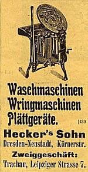

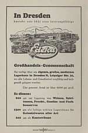

_Edeka-Großhandel_

_(Lagerhaus Leipziger Straße 31)_

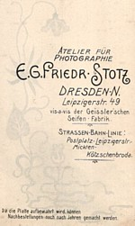

_Visitenkarte des Ateliers für Photographie von_

_E. G. Friedrich Stotz (Leipziger Straße 49)_

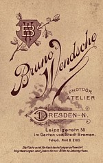

_Visitenkarte des Photographischen Ateliers von_

_Bruno Wendsche_

_(Leipziger Straße 58)_

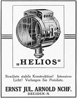

_Werbung der Metallwarenfabrik Ernst Julius Arnold Nachf. (Leipziger Straße 78)_

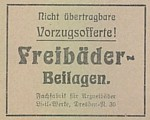

_Werbung der Firma Li-iL_

* * *

Die heutige Leipziger Straße verdankt ihre Existenz Kurfürst Friedrich August dem Gerechten, der im Jahr 1786 den Auftrag zum Bau einer neuen Poststraße nach Meißen gab, um die alte, hochwassergefährdete Wegführung am Elbufer zu verlegen. Zuvor verlief diese wichtige Verbindung vom Weißen Tor aus (Palaisplatz) bis zum Pieschener Elbwinkel, zweigte in Höhe des [Ballhauses Watzke](../../../nordwest/mickten/ballhaus_watzke/) ab und führte im Verlauf der heutigen [Kötzschenbroder Straße](../../../nordwest/mickten/strassen_mickten/kotzschenbroder_strasse/) weiter nach Serkowitz und Kötzschenbroda. Im Zuge der Vermessung der sächsischen Poststraßen durch Zürner wurden auch hier um 1700 Meilensteine aufgestellt, von denen allerdings keiner die Zeiten überdauerte.

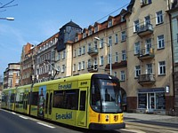Vor allem die schweren Überschwemmungen von 1784 führten zur Überlegung, den Trassenverlauf auf hochwassersicheres Gelände zu verlegen. Nach nur zwei Jahren Bauzeit war am 10. November 1787 die neue Straße fertiggestellt. Die nun als “Neue Meißner Post- und Landstraße” bezeichnete Verbindung führte zum wirtschaftlichen Aufschwung der Anliegergemeinden und zum Bau neuer Häuser entlang dieser Straße. Aufgrund ihrer Richtung erhielt sie im 19. Jahrhundert den Namen Leipziger Straße. 1899 wurde vom Straßenbahnhof Mickten aus die schmalspurige [“Lößnitzbahn”](../../../nordwest/mickten/lossnitzbahn/) nach Radebeul eingerichtet, die 1929/30 in Stadtspur umgebaut wurde. Zuvor verkehrten bereits ab 1882 Pferdebahnen durch die Leipziger Vorstadt bis nach Mickten. Heute gehört die Leipziger Straße zu den am stärksten befahrenen Verkehrszügen der Stadt und wurde in den vergangenen Jahren saniert und neu ausgebaut.

Leipziger Vorstadt:

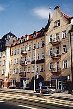Die Leipziger Straße beginnt an der Bahnunterführung in der Nähe des Neustädter Bahnhofes und durchquert zunächst die Flur des ehemaligen [Neudorfs](../../../neustadt/leipziger_vorstadt/neudorf/), welches 1866 nach Dresden eingemeindet und seit 1875 offiziell als Teil der Leipziger Vorstadt gilt. In diesem Abschnitt siedelten sich seit Mitte des 19. Jahrhunderts zahlreiche Gewerbebetriebe an, die von der [Eisenbahnlinie Dresden - Leipzig](../../../neustadt/leipziger_vorstadt/dresden_-_leipzig/), dem nahegelegenen Neustädter Güterbahnhof, aber auch von dem 1868 hier angelegten [Neustädter Elbhafen](../../../neustadt/leipziger_vorstadt/) profitierten. Bekannteste Unternehmen waren die Steingutfabrik [Villeroy & Boch](../../../neustadt/leipziger_vorstadt/leipziger_strasse/villeroy___boch/), die [Drogen-Appretur-Anstalt Gehe](../../../neustadt/leipziger_vorstadt/leipziger_strasse/arzneimittelwerk_dresden/) (Vorgänger des Arzneimittelwerkes), die Farbenfabrik Geißler & Lüders, die Holzgroßhandlung Grumbt, der [Städtische Schlachthof](../../../neustadt/leipziger_vorstadt/leipziger_strasse/alter_schlachthof/), die [Maschinenfabrik und Schiffswerft Schlick](../../../nordwest/ubigau/schloss_ubigau/schiffswerft_ubigau/) und die Sächsische Champagner-Fabrik. Hinzu kamen Wohnhäuser, Gaststätten und kleinere Gewerbebetriebe. Um 1900 war die bauliche Entwicklung in diesem Bereich im Wesentlichen abgeschlossen **_(Foto:_** _Leipziger Straße 32/34)._

Nr. 10: Das heute nicht mehr existierende Gebäude im hinteren Teil des Grundstücks entstand vermutlich im Zusammenhang mit dem Bau des Alten Schlachthofs und beherbergte um 1905 eine Werkzeugfabrik für die Herstellung von Fleischergeräten, die sich im Besitz des Hoflieferanten Hänselmann befand. Ab 1911 war hier das sogenannte "Petriheim", ein Jugendheim des Vereins Christlicher Junger Männer (CVJM) untergebracht. In den 1920er Jahren firmierte es unter dem Namen "Rothkirch-Heim", benannt nach dem Vater der deutschen CVJM-Bwegung Eberhard von Rothkirch (1852-1911). Heute befindet sich auf dem Grundstück ein Automarkt.

Nr. 11 (Villa Adolpha): Das Mitte des 19. Jahrhunderts im Stil der Neorenaissance entstandene Gebäude (ehem. Nr. 6) war ab 1873 Sitz der [Chemischen Fabrik Dr. Friedrich von Heydens](../../../neustadt/leipziger_vorstadt/leipziger_strasse/arzneimittelwerk_dresden/), der in einer zugehörigen Remise sein Labor einrichtete. Hier gelang ihm die erstmalige Herstellung von künstlicher Salicylsäure, einem Grundstoff für das Medikament Aspirin. Nach Verlegung des Firmensitzes nach Radebeul diente die Villa als Büro und Packerei der Firma. 1908 erfolgte der Abbruch zugunsten des Neubaus der benachbarten Chemischen Fabrik Gehe & Co.

Gasthaus “Elbschlößchen” (Nr. 15): Die Gastwirtschaft zwischen Leipziger Straße und Elbe ging vermutlich aus der ehemaligen Neudorfer Schiffsmühle hervor, die 1860 ihren Betrieb einstellen musste. Später befand sie sich im Besitz der Familie Schwabe und wurde als “Schwabes Restauration Elbschlößchen” bezeichnet. Das Grundstück ist heute Teil der sogenannten "Hafencity".

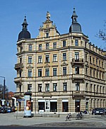Nr. 22:  Das repräsentative Geschäftshaus entstand um 1900 im Jugendstil und gehört wegen seiner Fassadengestaltung zu den markantesten Gebäuden in der Leipziger Vorstadt _(Foto)_. Auf dem Dach befindet sich die überlebensgroße Gestalt eines Ritters in altdeutscher Tracht. Im Erdgeschoss existierte früher die Gaststätte “Zum deutschen Ritter”. Weitere Räume nutzte die Lilien-Drogerie. 1995 wurde das Haus am Erfurter Platz umfassend saniert.

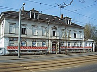Maschinenfabrik Schlick (Nr. 27): Die Firma entstand 1861 und befand sich im Besitz des Mechanikers Ernst Otto Schlick. Zunächst fertigte das Unternehmen Maschinenteile unterschiedlichster Art, spezialisierte sich später jedoch auf den Schiffbau. Ab 1872 firmierte es als Sächsische Dampfschiff- u. Maschinenbau-Anstalt vorm. Schlick & Co. 1884 übernahm die Österreichische Nordwest-Dampfschifffahrts-Gesellschaft die Fabrik und baute hier Binnenschiffe, Schleppkähne und Prähme, aber auch Dampfmaschinen, Lokomobile und andere Fahrzeuge. 1899 wurde die Firma in eine Aktiengesellschaft umgewandelt und 1905 mit der [Übigauer Werft](../../../nordwest/ubigau/schloss_ubigau/schiffswerft_ubigau/) vereinigt.

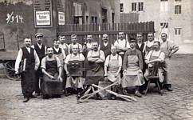Im Anschluss siedelten sich auf dem früheren Werftgelände verschiedene Unternehmen an. Das Adressbuch von 1944 nennt die Metallwarenfabrik Wirsing, die Glashandlung Krüger und eine Niederlassung des Biergroßhandels “Augustinerbräu” _(Foto links)_. Zeitweise gab es hier auch eine Gurkenfabrik und eine Niederlassung der Mannheimer Maschinenfabrik Siegerin-Goldmann-Werke. Nach 1945 nutzte die bekannte Dresdner Autowerkstatt des Rennfahrers Heinz Melkus die Gebäude als Verwaltung, Werkstatt und Fahrschule _(Foto)_. Im Frühjahr 2016 begann die Sanierung des früheren Verwaltungsgebäudes und dessen Umbau zu zehn Wohnungen.

Eisenberger Hof (Nr. 28): Das Eckhaus an der Eisenberger Straße beherbergte bereits vor dem Ersten Weltkrieg eine Gaststätte, die unter dem Namen "Eisenberger Hof" bis in die DDR-Zeit bestand. Als Familiengaststätte bot das Lokal an den Wochenenden auch regelmäßig Unterhaltungsmusik an. Nach 1945 übernahm die HO die Bewirtschaftung. Später firmierte das Lokal bis zu seiner Schließung um 2010 als "Neustädter Faß", bevor eine Tauchschule in die Räume einzog.

RHEOSTAT (Nr. 31): Dass Unternehmen wurde im August 1911 von Edmund Kussi und den Brüdern Johann und Friedrich Cruse als Spezialfabrik elektrischer Apparate gegründet und hatte seinen Sitz zunächst auf der Freiberger Straße 75. Kussi stammte aus Böhmen und war ab 1906 als Generalvertreter für Staubsaugeapparate und Inhaber einer Entstaubungsmaschinenhandlung auf der Waisenhausstraße 24 tätig. Bereits zwei Jahre später, im September 1913 bezog die Firma neue Produktionsräume auf der Leipziger Straße 31. Zuvor hatte hier die Max Stahl GmbH, eine Fabrik für Jutewaren, Säcke und Planen, ihren Sitz.

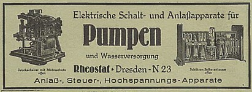

1914 trennten sich die Geschäftspartner. Die Cruse-Brüder gründeten in der Friedrichstadt die "Spezialfabrik elektrischer Steuerapparate Gebr. Cruse & Co.", während Kussi seinen Betrieb unter dem bisherigen Namen "RHEOSTAT" weiterführte. 1919/20 verlegte er seinen Betrieb zur Großenhainer Straße 130/132. Hier wurden bis 1945 verschiedene elektrische Kleinteile und Zubehör gefertigt. Zur Blütezeit waren bei Rheostat Anfang der 1930er Jahre über 600 Angestellte beschzäftigt, womit die Firma zu den größten mittelständischen Firmen in Dresden gehörte. Nach dem Tod des Firmengründers übernahmen seine beiden Söhne, Victor und Werner Kussy (Kussi senior hatte den Familiennamen in Kussy geändert) das Unternehmen. Als Juden wurde die Familie nach Machtantritt der Nationalsozialisten drangsaliert und 1939 zum Verkauf des Werkes an den Düsseldorfer Unternehmer Hans Hitzbleck gezwungen. Beide Familien flohen daraufhin in die Niederlande, wurden dort im Sommer 1942 verhaftet und nach Auschwitz deportiert. Lediglich Werner Kussy überlebte diese Zeit und kehrte nach Ende des Krieges nach Dresden zurück.

Zunächst übernahm Kussy den unbeschädigten Betrieb und engagierte sich auch beim Wiederaufbau der Dresdner jüdischen Gemeinde. Die Entwicklung in der frühen DDR und erneute antisemitische Strömungen veranlassten ihn jedoch 1953 zur Flucht in den Westen und 1954 zur Übersiedlung in die USA. Der daraufhin verstaatlichte Betrieb kam 1954 als Werk 6 zum [VEB Elektroschaltgeräte Dresden](../../../nordwest/mickten/strassen_mickten/) mit Stammsitz auf der Fritz-Lehmann-Straße in Mickten. Hier existierte die Firma noch bis zur Liquidierung durch die Treuhand 1991.

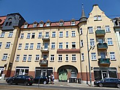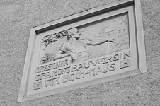Nr. 32/34: 1901/02 entstand nach Plänen des renommierten Architektenbüros Schilling & Gräbner das Doppelhaus Leipziger Straße 32/34, welches im Eingangsbereich ebenfalls Jugendstilformen und -malereien aufweist. Bauherr des Wohn- und Geschäftshauses war der Dresdner Spar- und Bauverein, der es nach einem seiner Stifter "Von-Boch- Haus" nannte. Noch heute erinnert eine Relieftafel an Stifter und Verein _(Foto rechts)_.

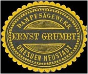Dampfsägewerk Grumbt (Nr. 33): Das Unternehmen wurde 1857 von Friedrich August Krüger als Holzgroßhandlung und Dampfsägewerk gegründet. 1868 pachtete Carl Ernst Grumbt diese Firma und konnte sie bereits im Folgejahr käuflich vom Vorbesitzer erwerben. Diese profitierte von ihrer günstigen Lage am Elbufer und bezog das Holz auf dem Wasserweg aus Tschechien, Schweden und Rußland, welches dann zu Bauholz und Brettern verarbeitet wurde. Der wirtschaftliche Erfolg ermöglichte Grumbt den Bau einer repräsentativen [Villa](../../../neustadt/leipziger_vorstadt/strassen_leipziger_vorstadt/alexander-puschkin-platz/), welche nach dem Zweiten Weltkrieg als “Puschkinhaus” der Gesellschaft für Deutsch-Sowjetische Freundschaft diente. Zugleich war er auch politisch engagiert und gehörte dem Reichstag sowie dem Sächsischen Landtag an. Auf dem Grundstück siedelten sich später weitere Unternehmen an, darunter eine Metallgießerei und die Autowerkstatt Nicht, die nach 1945 von der Familie Melkus übernommen wurde. Heinz und Ulli Melkus wurden zu DDR-Zeiten als Motorsportler bekannt und entwickelten in den 1970er Jahren den einzigen DDR-Seriensportwagen.

Nach 1990 lag das Areal einige Jahre brach und wurde 2005 vom Verein "Freiraum Elbtal" übernommen, der hier ein alternatives Wohn- und Arbeitsprojekt einrichtete.
Zur Anlage gehörten eine Begegnungsstätte, Gemeinschaftsgärten, Ateliers, Selbsthilfewerkstätten und verschiedene Arbeitsräume für Handwerker und Künstler. Mit fortschreitender Planung für das Neubauviertel "Hafencity" musste der Verein das Grundstück 2015 räumen, bemüht sich jedoch um neue Räume nach Abschluss der Arbeiten.

Nr. 35: Auf diesem Grundstück befand sich seit Ende des 19. Jahrhunderts das Büro der Firma Petzoldt & Schliephacke, einem Hersteller von Maschinenölen und -fetten. Die Rohstoffe wurden vom gegenüberliegenden Schlachthof bezogen, wo es eine Dampf-Talgschmelze und Knochenöl-Raffinerie gab. Dabei verarbeitete man die beim Schlachten übrig gebliebenen Knochen und Fette zu hochwertigen Industriefetten.

Nr. 40: Das Gebäude an der Ecke zur Hartigstraße beherbergte früher das Postamt Dresden 11, später N 11. Zu DDR-Zeiten wurde es ab 1964 Postamt 8011 genannt, nach der Wende jedoch geschlossen. Heute dient das Gebäude als Ärztehaus.

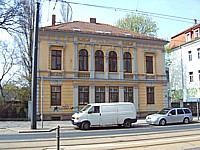Nr. 43 (Villa Martha): Die zweigeschossige Villa _(Foto)_ entstand 1871/72 als Wohnsitz für den Kammermusikus Alexander Richter und gehört zu den wenigen Villenbauten der Leipziger Vorstadt. Architekten des im Stil der italienischen Neorenaissance gestalteten Gebäudes waren die Gebrüder Ziller aus Radebeul, die sich bei der Fassadengestaltung an den Ideen Gottfried Sempers orientierten. Ursprünglich besaß das Haus zur Straßenseite einen Balkon und eine Terrasse, die jedoch dem späteren Straßenausbau zum Opfer fielen. 1985 und nach 1990 wurde die Villa saniert.

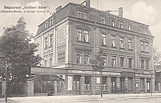Goldener Anker (Nr. 45): Die Gaststätte “Zum Goldnen Anker” wurde um die Jahrhundertwende von Gustav Veit im Wohn- und Geschäftshaus Leipziger Straße 45 eingerichtet _(Foto)_. Neben Gaststube und Gesellschaftsraum gehörte auch eine Gartenwirtschaft auf der Elbseite dazu. Mehrfach wechselten die Besitzer, die das Lokal als Schankwirtschaft Goldener Anker bzw. Restaurant Goldener Anker bezeichneten. In den 1930er Jahren kam die Gaststätte in den Besitz der Familie Feist und existierte noch bis in die Nachkriegszeit.

Gaststätte “Zur Einheit Deutschlands” (Nr. 51): Die kleine Schankwirtschaft “Zur Einheit” war eines von zahlreichen Arbeiterlokalen der Leipziger Vorstadt. Gegründet wurde sie bereits vor dem Ersten Weltkrieg von Julius Missbach, der sie "Gaststätte zur Einheit" nannte. Unter diesem Namen blieb sie bis 1989 geöffnet. Für Aufsehen sorgte in den Wendemonaten 1989/90 die Umbenennung in “Zur Einheit Deutschlands”, mit der den zunehmenden Forderungen nach der deutschen Wiedervereinigung Rechnung getragen werden sollte. Seit 1993 befindet sich in den Räumen ein Küchenstudio.

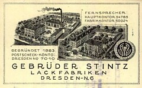Lackfabrik Gebrüder Stintz (Nr. 51): Das Unternehmen wurde 1883 von den Brüdern Traugott und Hermann Stintz gegründet und stellte zunächst hauptsächlich Öllacke und Spirituslacke für die Spielwarenindustrie her. Produktionstandorte waren das Hintergebäude der Leipziger Straße 51 und die Querallee 8 in der Nähe des Neustädter Bahnhofs. 1921 trat Traugotts Sohn Max, ein studierter Chemiker, in die Firma ein. Fortan konzentrierte man sich auf die Herstellung von Speziallacken, Appreturen und Steifen für die Hutindustrie. Diese Spezialisierung ermöglichte die Erweiterung des Absatzgebietes, so dass Stentz´ Produkte sogar nach Südamerika und Australien geliefert wurden.

1945 entstanden auch an den beiden Lackfabriken erhebliche Schäden. Dennoch konnte die Herstellung bald wieder aufgenommen werden. Im Zuge der Umstrukturierung der DDR-Wirtschaft wechselte Ende der 1950er Jahre das Produktprofil hin zu Lacken für das grafische Gewerbe. 1972 wurde die Firma Gebrüder Stintz verstaatlicht. Heute existiert das Unternehmen nicht mehr.

Galerie Nord (Nr. 56): Die in einem Ladenlokal untergebrachte Galerie für bildende Kunst entstand als erste Dresdner Stadtbezirksgalerie im Jahr 1974. Initiatoren waren die Künstler Joachim Böttcher, Veit Hofmann, Marlies Lilge, Stefan Plenkers, Rainer Zille und anderere. Zwei Jahre später konnten weitere Räume im Nachbarhaus Nr. 54 angemietet werden. Nach Umbauten standen fortan fünf Galerieräume für wechselnde Kunstausstellungen zur Verfügung. Zudem fanden häufig kleinere Konzerte und Lesungen statt. Nach 1990 geriet die Kulturstätte jedoch in finanzielle Schwierigkeiten und wurde am 20. Juli 1991 geschlossen. Anschließend nutzte bis 1996 die Künstlergruppe Dresdner Sezession 89 die Räume, die heute gewerblichen Zwecken dienen.

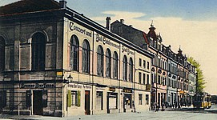Gasthof “Stadt Bremen” (Nr. 58): Die Gaststätte ging auf den alten Neudorfer Gasthof zurück, der bereits 1619 das Schankrecht bekommen haben soll. Ursprünglich hieß dieser zur besseren Unterscheidung zu einem weiteren Lokal im Dorfkern “Oberer Gasthof” und wurde vor allem von durchreisenden Fuhrleuten besucht. 1856 ist erstmals der Name “Stadt Bremen” erwähnt. Das ein Jahr später auf den Fundamenten dreier kleinerer Häuser als Tanz- und Ballsaal erbaute Gebäude Leipziger Straße 58 _(Foto um 1900)_ wurde bis Anfang der 1920er Jahre als Vergnügungslokal genutzt, bevor 1928 das Kino “Lichtspiele Stadt Bremen” (ab 1929 “Astoria”) mit ca. 400 Plätzen einzog. Außerdem gab es im Erdgeschoss die Gaststätte “Bremer Biertunnel”. Weitere Räume im Haus dienten zeitweise als Kaffeerösterei. Im hinteren Grundstücksteil hatte ein Photographisches Atelier sein Domizil.

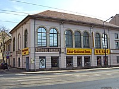Das Filmtheater blieb auch nach dem Zweiten Weltkrieg zunächst bestehen und wurde ab 1966 Jahre als Programmkino und für Vorführungen des des Camera-Programms des Staatlichen Filmarchivs der DDR genutzt. 1970 wurde es geschlossen. Der Saal diente dann von 1978 bis 1993 als Probebühne des Staatsschauspiels. Nach mehrjährigem Leerstand und Verfall konnte das Haus 1993 verkauft und saniert werden. Eine hier eingerichtete Gaststätte schloss jedoch bereits kurze Zeit später wieder. Im Anschluss nutzte ein Party-Veranstalter das Haus unter dem Namen “Der Nachtgarten” für verschiedene Veranstaltungen. 1996 zog das lateinamerikanische Kulturzentrum “Casa Latina” in die Räume und organisierte im Saal Tanzkurse. Heute befindet sich hier das China-Restaurant “Sonne”.

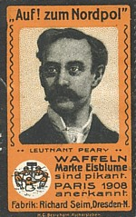Waffelfabrik Seim (Nr. 70):Das Grundstück war ab 1923 Sitz der Süßwarenfabrik Seim. Das Unternehmen wurde 1890 vom “Bonbonkocher” Ernst Seim gegründet. Hauptsächlich wurden später jedoch Waffeln hergestellt. 1905 hatte die Waffel- und Oblatenfabrik Seim ihren Sitz auf der Windmühlenstraße 8. Wenig später verlegte Seim seine Fabrikation zur Hechtstraße 69. Drei Jahre vor Ausbruch des Ersten Weltkrieges bezog Nachfolger Richard Seim das zuvor von der Sächsischen Kofferfabrik "Stabilist" und dem Rohproduktenhändler Julius Gubisch genutzte Fabrikgebäude auf der Leipziger Straße 70. Eine Niederlassung gab es im böhmischen Bodenbach (heute Decin). Ein anderes Familienmitglied, Georg Seim, siedelte 1910 nach Nürnberg über und gründete dort gemeinsam mit seinem Bruider Otto die erste Waffelfabrik der Stadt.

Hauptprodukt des Betriebes waren Waffeln der Marke "Eisblume", die Seim sogar 1908 auf einer internationalen Ausstellung präsentierte. 1923 übernahm Ewald Wagner das Unternehmen. 1945 zerstörten Bomben das Vordergebäude. Die Produktionsräume im hinteren Teil des Grundstücks blieben jedoch erhalten. Auf dem Grundstück siedelte sich später eine Autowerkstatt an. Im Frühjahr 2019 wurde das Areal geräumt und die baulichen Reste der einstigen Waffelfabrik beseitigt. An ihrer Stelle entstand bis 2020 ein Mehrfamilienhaus.

Nr. 72: Auf diesem Grundstück eröffnete 1931 in den Räumen der früheren Möbelfabrik Richard Rentzsch & Co. der Tischler Kurt Schlosser seine Werkstatt, nachdem er zuvor in den [Deutschen Werkstätten Hellerau](../../../nord/hellerau/deutsche_werkstatten/) die Kündigung erhalten hatte. Schlosser gehörte viele Jahre dem Betriebsrat dieses Unternehmens an und engagierte sich auch nach 1933 politisch. 1943 wurde er als einer der leitenden Köpfe einer Dresdner Widerstandsgruppe verhaftet und am 16. August 1944 im Hof des Landgerichts am Münchner Platz hingerichtet. Kurt Schlosser leitete zwischen 1927 und 1933 den Sächsischen Bergsteigerchor, der seit 1949 seinen Namen trägt. An ihn erinnert ein am 28. September 2015 vor dem Haus verlegter Stolperstein. Das Gebäude selbst wurde 1945 zerstört und soll 2020 durch Wohn- und Geschäftshaus ersetzt werden.

Kleingartenverein “Am Hafen” (Nr. 75): Die Gartenanlage an der Leipziger Straße entstand 1931 auf einer früheren Grube der Keramikfabrik Villeroy & Boch, die das Unternehmen als Deponie für Scherben und andere Reste der Produktion nutzte. Nachdem diese mit Erde aufgefüllt worden war, wurde das Areal an Sozialfürsorgeempfänger abgegeben, damit diese sich hier mit Obst und Gemüse selbst versorgen konnten. Nach 1945 entwickelte sich aus diesen Parzellen die Gartensparte “Am Hafen”, welche heute 47 Kleingärten und ein Vereinsheim besitzt.

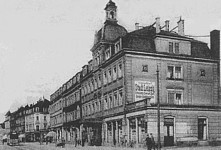Faunpalast (Nr. 76): Das Gebäude Leipziger Straße 76 wurde Ende des 19. Jahrhunderts als Gasthof “Stadt Leipzig” eröffnet und war ein bekannter Treffpunkt Neustädter Arbeiter, die hier ihre politischen Versammlungen abhielten. Außerdem fanden im 1895 angebauten, ca. 1.000 Personen fassenden Saal regelmäßig Tanzveranstaltungen und andere Vergnügungen statt. Hinzu kamen eine Kegelbahn ("Neustädter Keglerhaus") sowie eine Stehbierhalle. Zu den Großereignissen im “Stadt Leipzig” gehörte im November 1908 eine Wahlrechtskundgebung gegen das herrschende Drei-Klassen-Wahlrecht sowie am 28. Juli 1914 eine Protestkundgebung der SPD gegen den drohenden Krieg.

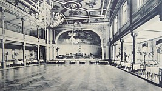Nach dem Ersten Weltkrieg sank die Nachfrage nach großen Ballsälen spürbar ab. Hinzu kam die Konkurrenz ähnlicher Etablissements in der näheren Umgebung. 1923 entschieden sich die Besitzer des Hauses deshalb, im Saal der Gaststätte die “Original Bühnenschau Faun-Lichtspiele” einzurichten. Nach einem großzügigen Umbau durch den bekannten "Kino-Architekten" Martin Pietzsch besaß das 1929 eröffnete Filmtheater ca. 600 Plätze und gehörte damit zu den größeren Dresdner Kinos. Durch die Zerstörung der Filmtheater der Innenstadt war der "Faunpalast" zeitweise nach der "Schauburg" zweitgrößtes Kino der Stadt. Pläne, den Saal auch für Varietévorstellungen zu nutzen, blieben unrealisiert.

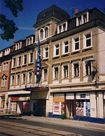1964 erhielt das Kino eine gekrümmte Leinwand, um hier Filme im neuartigen Totalvisions-Verfahren zu zeigen (Cinemascope). Zugleich erfolgte eine Erweiterung der Bühne und einiger Nebenräume. Mit dem Einbau einer modernen Kinomaschine vom Typ "Dresden 21" war der Faunpalast bis zur Eröffnung des Rundkinos an der Prager Straße 1972 das modernste Filmtheater Dresdens. Die Einweihung erfolgte kurz vor Ostern 1964 mit dem Film "Festung am Rhein". Nach einer umfassenden Sanierung des Zuschauerraums in 1982/82 Jahren blieb der "Faunpalast" noch bis 1991 Spielstätte und wurde dann aus baupolizeilichen Gründen geschlossen. Danach nutzten verschiedene Geschäfte das Haus als provisorische Verkaufsstätte bzw. als Lager. Mit Ausnahme des denkmalgeschützten Vorderhauses _(Foto links)_ wurde der ehemalige Ballsaal 2003 abgerissen. An gleicher Stelle entstand ein Supermarkt mit einer Ladenpassage im früheren Kinofoyer.

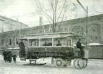Firma Carl Stoll (Nr. 78): Das Unternehmen wurde Ende des 19. Jahrhunderts von Carl Stoll gegründet. Stoll hatte nach bestandener Meisterprüfung die alte Plauener Dorfschmiede übernommen und zu einer Werkstatt für den Bau von Kutschen und Wagen ausgebaut. Das ab 1890 “Dresdner Geschäfts-, Luxus- und Straßenbahnwagenfabrik” genannte Unternehmen baute im Auftrag der beiden Dresdner Straßenbahngesellschaften auch die ersten Straßenbahnen für die Stadt. Nachdem die beengten Verhältnisse in Plauen eine Erweiterung des Betriebes nicht mehr zuließen, verlegte Carl Stoll seine Firma 1898 auf die Leipziger Straße 78.

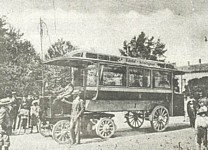Hier konnte er seine erfolgreiche Geschäftstätigkeit zunächst fortsetzen. 1901 entwickelte er ein schienenloses Fahrzeug mit elektrischem Antrieb, Vorläufer der späteren O-Busse. Da sich kein Auftraggeber für sein Projekt fand, ließ er auf eigene Rechnung 1902 die [“Haidebahn”](../../../nord/klotzsche/haidebahn/) zwischen Arsenal und Klotzsche errichten, die am 24. März 1903 ihren Betrieb aufnahm _(Foto links)_. Technische und wirtschaftliche Probleme ließen das Unternehmen jedoch scheitern. Bereits 1904 musste Stoll nach dem Scheitern eines weiteren Projekts im rumänischen Hermannstadt _(Foto rechts/Wikipedia)_ den Betrieb wieder einstellen. Der durch diesen Misserfolg und wegfallende Aufträge im Ausland völlig ruinierte Unternehmer beging am 10. Januar 1907 Selbstmord. Sein Sohn Hans-Ludwig Stoll übernahm den väterlichen Betrieb und verlegte ihn nach Wien, wo die Firma noch bis 1914 als Erbauer von O-Bus-Anlagen tätig war. Nach dem Ersten Weltkrieg wurden die Räume um 1930 von der Metallwaren-Fabrik Ernst Julius Arnold Nachf. und zuletzt bis zur Demontage 1946 vom Reifendienst Müller & Co. genutzt.

Pieschen:

An der Einmündung der Oschatzer Straße erreicht die Leipziger Straße die Flurgrenze Pieschens. Bereits Ende des 19. Jahrhunderts waren Pieschen und die Leipziger Vorstadt baulich weitgehend zusammengewachsen. Beide Viertel gehörten zu den dichtbesiedelten Arbeiterwohnorten der Stadt und werden bis heute von mehrgeschossigen Wohn- und Geschäftshäusern, Läden und kleinen Gewerbebetrieben geprägt. 1993 entstand an der Einmündung Leipziger/ Bürgerstraße mit dem “Elbcenter” ein modernes Stadtteilzentrum.

Video: Mit der Straßenbahn von der Oschatzer Straße bis Altpieschen (2009)

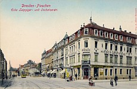Nr. 80 - 88: Auftakt zur folgenden geschlossenen Bebauung bis zur Torgauer Straße bildet das Eckhaus zur Oschatzer Straße (Nr. 80). Der kleine Laden beherbergte einst eine Fleischerei und war dann viele Jahre Filiale der stadtweit bekannten Fischhandelskette Paschky. Zu DDR-Zeiten setzte das "Fisch-Eck Nord" die Tradition fort. Im gegenüberliegenden Eckhaus Nr. 82 _(Foto)_ war einst die Hirsch-Apotheke beheimatet. Nach 1990 gab es hier verschiedene Modegeschäfte. Zu den traditionsreichsten Läden im Stadtviertel gehörte die Firma "Farben-Hitzer", ein Fachhandelsgeschäft für Farben und Tapeten, das aus der 1921 gegründeten Lackfabrik Franz Hitzer & Co. hervorging (Nr. 84).

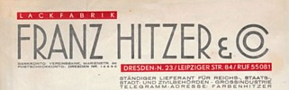

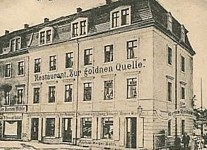Zur goldenen Quelle (Nr. 85): Das 1898 erstmals genannte Restaurant wurde von Christian Ludwig Trommer gegründet, wenig später jedoch an Ernst Bauer übergeben ("Ernst Bauer's Restaurant Zur goldnen Quelle"). Das bis Angang der 1990er Jahre ununterbrochen bewirtschaftete Lokal mit Biergarten zur Elbe diente zu DDR-Zeiten zeitweise als Broilerbar des Konsum. In den 1990er Jahren wurde das verfallende Gebäude abgetragen _(Foto rechts)_.

Nr. 90: Das Eckhaus Leipziger Straße 90 / Torgauer Straße beherbergte bereits vor dem Ersten Weltkrieg eine Gaststätte, die 1910 "Kuchengarten" genannt wurde. 1945 fiel das Haus wie auch die angrenzenden Gebäude Nr. 92 und Torgauer Straße 1 und 3 den Bomben zum Opfer. Die Fläche wurde bislang nicht wieder neu bebaut.

Zur Börse (Nr. 95): Die Gaststätte auf der Leipziger Straße 95 war Ende des 19. Jahrhunderts ein Treffpunkt der Pieschener Arbeiter. Hier entstand 1882 der “Sozialdemokratische Verein für Pieschen und Umgebung”, der in den Räumen der “Börse” sein Vereinslokal hatte. Der politisch sehr aktive Verein organisierte regelmäßige Veranstaltungen, für die z.T prominente Redner der Sozialdemokratie eingeladen wurden. U. a. weilten August Bebel, Wilhelm Liebknecht und Rosa Luxemburg in Pieschen und sprachen hier vor den Arbeitern. Das zu DDR-Zeiten verfallene Haus wurde nach 1990 abgerissen und ein neues Wohn- und Geschäftshaus ersetzt.

Nr. 99: Das markante Eckgebäude am Abzweig des Elberadwegs unmittelbar an der [Pieschener Molenbrücke](../../../nordwest/pieschen/) entstand um 1900 als Kopfbau der Häuserzeile Leipziger Straße 99 bis 111 im zeittypischen Stil des Historismus. Im Erdgeschoss befand sich von Beginn an ein Restaurant, welches sich ab 1914 bis zum Ende des Zweiten Weltkriegs im Besitz der Familie Saupe befand. Nach 1990 wurde es einige Jahre unter dem Namen "Elbhütte" geführt, später als russisches Spezialitätenrestaurant "Olga" und jetzt als türkisches Lokal "Bosporus".

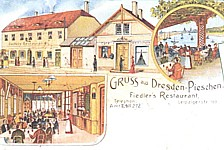Nr. 101-111: Auch die angrenzenden Gründerzeithäuser wurden von Beginn an als Wohn- und Geschäftshäuser konzipiert und bilden an der platzartigen Abzweigung von Bürgerstraße und Mohnstraße das Pieschener Stadtteilzentrum. 1895 entstand das Doppelhaus Nr. 103/105 mit Läden im Erdgeschoss. Im 1904 errichteten Mietshaus Nr. 107 befand sich früher die Drogerie zum Schwan. Zuvor hatte an dieser Stelle Fiedler´s Restaurant, eines von zahlreichen Alt-Pieschener Gartenlokalen, mit Kaffeegarten und Weinschank gestanden _(Bild)_. Betreiber war der Pieschener Schmiedemeister Carl Fiedler, das das Lokal im Nebenerwerb bewirtschaftete. Der nach dem Abbruch von Ernst Dreßler gestaltete Neubau erhielt neben einer zeittypischen Klinkerfassade interessante Treppenhausmalereien, die bis heute erhalten sind.

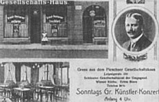Pieschener Gesellschaftshaus (Nr. 109): Das Lokal befand sich im Erdgeschoss des 1903 erbauten Wohn- und Geschäftshauses Leipziger Straße 109 und besaß einen großem Gesellschaftssaal, welcher für verschiedenste Veranstaltungen genutzt wurde. Vor dem Ersten Weltkrieg fanden hier regelmäßig große Sonntagskonzerte und Tanzveranstaltungen statt. Außerdem war das Haus Vereinslokal des Männer-Turn-Vereins Dresden-N. 1879. Zeitweise war die Gaststätte auch unter dem Namen "Duttlers" (nach dem Inhaber Gottfried Duttler) bzw. bis zur Schließung 1957 als "Elbblick" bekannt. 1997 wurde in den Erdgeschossräumen die “Pälzer Stubb” mit Vinothek typisch Pfälzer Gastronomie eingerichtet **_(Foto:_** _Werbepostkarte des “Pieschener Gesellschaftshauses”)_.

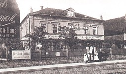Hafenschänke (Nr. 108): Diese Gaststätte an der Ecke Leipziger/ Rehefelder Straße gehörte zu den preiswerteren Pieschener Lokalen und entstand Ende des 19. Jahrhunderts. Um 1900 wurde sie vom Fleischermeister Ewald Paul Mai betrieben. Nach dem Ersten Weltkrieg übernahm Max Merbitz das Lokal und ließ das Haus 1918 umbauen. Neben den Gaststättenräumen gab es im Erdgeschoss auch eine Fleisch- und Wurstwarenhandlung, im Obergeschoss befanden sich Wohnungen

Besonders die im Pieschener Elbhafen beschäftigten Männer nutzten das Lokal mit seinem Biergarten. Zudem war die Gaststätte Versammlungslokal der Dresdner Geflügelzüchter. 1906 wurde in der Hafenschänke der Klub der Maltesertaubenzüchter Deutschlands gegründet. Hier war auch der Mittelpunkt des erstmals 1923 begangenen Pieschener Hafenfestes. Nach 1945 wurde die Hafenschänke geschlossen, blieb als Gebäude jedoch noch bis 2009 erhalten. 2016 entstand an ihrer Stelle die Wohnsiedlung "Markus-Projekt" mit der neu angelegten Hans-Fromm-Straße.

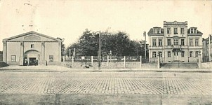Deutscher Kaiser (Nr. 112): Das Konzert- und Ballhaus an der Leipziger Straße 112 entstand 1883 für den Gastwirt Gustav Reißig und war nach der Jahrhundertwende wichtigstes Versammlungslokal der Pieschener Arbeiter. Zum Haus gehörte ein Konzert- und Biergarten, ein großer Speisesalon sowie ein in einem separaten Gebäude befindlicher Ballsaal. Am 11. Dezember 1911 sprach hier Rosa Luxemburg auf einer Wahlkampfveranstaltung. Außerdem fanden regelmäßig Tanz- und Varietéveranstaltungen, Theateraufführungen, Konzerte sowie Vereinstreffen statt. Eine 1989 vom Dresdner Künstler Martin Hänisch angefertigte Gedenktafel befindet sich derzeit im Archiv der Rosa-Luxemburg-Stiftung Dresden.

Ab 1910 gab es zudem ein Kino, welches zunächst Varieté- und Lichtspieltheater Deutscher Kaiser, später Deutsche-Kaiser-Lichtspiele genannt wurde und über 600 Plätze bot. Nach seiner Schließung um 1930 diente das Gebäude bis 1945 als Produktionsstätte einer Hutfabrik. Auch die Gaststätte wurde nach 1945 geschlossen, blieb als Gebäude jedoch erhalten und wurde zuletzt von einem Pizzaservice genutzt. Lediglich der beim Luftangriff 1945 beschädigte Saalbau musste abgerissen werden. 2019 erfolgte auch der Abbruch des früheren Gaststättengebäudes zugunsten neuer Wohnhäuser und eines Einkaufsmarktes.

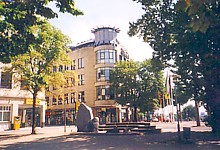Elbcenter mit Sparkassenmuseum (Nr. 116-120): Das moderne Geschäftshaus entstand 1993/94 auf dem Grundstück Leipziger / Rehefelder / Bürgerstraße und nimmt auch das Areal der heute nicht mehr benannten Schiffsstraße ein. Neben Ladengeschäften im Erdgeschoss befinden sich in den oberen Etagen Büro- und Wohnräume. Zeitweise gab es hier auch eine Gaststätte. Außerdem besteht eine Postfiliale. Heute wird das Gebäude u.a. von der Ostsächsischen Sparkasse genutzt.

Sparkassenmuseum: Einige Räume im zweiten Obergeschoss des "Elbcenters" beherbergten von 1999 bis 2015 das von einem ehemaligen Angestellten gegründete Dresdner Sparkassenmuseum mit einer Sammlung historischer Dokumente und Sachzeugen aus der Geschichte des Kreditinstitutes. Zu sehen waren u.a. alte Rechenmaschinen und die ersten DDR-Geldautomaten. Zudem waren in dem in der Regel nur nach Voranmeldung zu besichtigenden Museum über 500 historische Sparbücher aus ganz Deutschland, alte Kundenverzeichnisse und frühere Zahlungsmittel ausgestellt. Auch die ersten DDR-Kreditkarten, Plakate, Spardosen und Werbemittel gehören zum Bestand. Zu den besonderen Exponaten gehört ein Kontrollkasten der Dresdner Wach- und Schließgesellschaft, in dem der Nachtwächter nach seiner Runde eine Markierung machte. Da die Räume anderweitig benötigt wurden, schloss das Museum 2015 seine Pforten. Ein Teil der Exponate wird temporär in der Hauptfiliale der Ostsächsischen Sparkasse Dresden am Güntzplatz gezeigt.

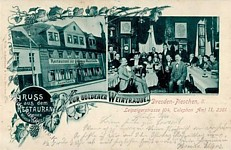Zur goldenen Weintraube (Nr. 122): Das kleine Lokal befand sich in einem der älteren Gebäude am Rande des Pieschener Dorfkerns. Im 19. Jahrhundert entwickelte sich der Ort zu einem beliebten Ausflugsziel der Dresdner, was zur Gründung zahlreicher Wein- und Ausflugslokale führte. Neben den zeittypischen Gast- und Gesellschaftsräumen gehörte auch eine Weinhandlung und ein Gartenbereich zum Lokal. Um 1890 warb Besitzer Friedrich Franze mit einem "fein decorirten Gesellschaftssaal" und einem "schönen schattigen Garten mit heizbarer Marquise". Die Gaststätte existierte bis Ende der 1920er Jahre. 1930 wurde sie mit der gesamten Häuserzeile zwischen der heute nicht mehr existierenden Schiffstraße und der Mohnstraße abgerissen.

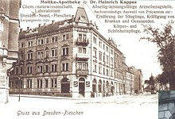Moltke-Apotheke (Nr. 150): Das Gründerzeithaus an der Einmündung der Robert-Matzke-Straße entstand 1897/98 und war, wie die meisten in dieser Zeit an der Leipziger Straße entstandenen Häuser von Beginn an als Wohn- und Geschäftshaus geplant. Während sich in den oberen Etagen Wohnungen befanden, gab es im Erdgeschoss zwei Ladenlokale, die als Apotheke und Filiale des Süßwarengeschäftes Richard Selbmann genutzt wurden. Die 1902 eröfnete Apotheke trug zunächst nach der angrenzenden Moltkestraße (heute Robert-Matzke-Straße) den Namen Moltke-Apotheke und befand sich im Besitz des Apotheker Dr. Heinrich Kappes, der zuvor das Gebäude erworben hatte. Im Obergeschoss gab es in den 1930er Jahren eine Kinderarztpraxis.

Spätere Besitzer änderten den Namen der Apotheke in Pfauen-Apotheke. Durch fehlende Werterhaltung verfiel das Gebäude jedoch zu DDR-Zeiten und wurde schrittweise freigezogen. Als einer der letzten Mieter verließ die Pfauen-Apotheke 1994 das Haus und verzog ins nahegelegene Elbcenter. Nach mehrfachem Besitzerwechsel erfolgte 2019/20 die Sanierung.

Zur guten Quelle (Nr. 156): Das zweistöckige Haus unmittelbar gegenüber dem Straßenbahnhof Mickten, welches jedoch noch zur Pieschener Flur gehört, diente ab 1898 als Gaststätte "Zur guten Quelle". Besitzer war Robert Anton, der für sein Lokal auf der damaligen Leipziger Straße 20 mit geräumigen Lokalitäten, einem Gesellschaftszimmer, einer Asphalt-Kegelbahn und einem großen schattigen Garten warb. Die Gaststätte blieb bis nach dem Zweiten Weltkrieg in Familienbesitz, wurde später von der HO übernommen und als "Express Mickten" bis 1990 betrieben. Nach 1990 erfolgte eine Sanierung des Hauses und der Umbau zu zwei Ladenlokalen.

Mickten:

Klax (Nr. 131): Das kleine Gebäude an der Einmündung zur Sternstraße diente ursprünglich als Wohnhaus; im Erdgeschoss befand sich eine Fleischerei. Später wurden die Räume als Imbiss genutzt. 1990 erwarb der bekannte Dresdner DJ und Partyveranstalter Wolfgang "Wolle" Förster das Haus und richtete hier die Nachtbar "Klax" ein. Ursprünglich war in den Räumen eine Spielothek geplant, woran noch heute der Name (nach einem Spielautomatenmodell) erinnert. Als Nacht- und Stripteasebar ist das "Klax" heute Dresdens wohl bekanntestes Lokal seiner Art.

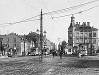Straßenbahnhof Mickten (Nr. 133): Der Straßenbahnhof Mickten entstand 1892/97 und war bis 1930 zugleich Ausgangspunkt der schmalspurigen [Lößnitzbahn](../../../nordwest/mickten/lossnitzbahn/) nach Radebeul. Zur Anlage gehörten neben dem Verwaltungsgebäude an der Leipziger Straße mehrere Fahrzeughallen und Werkstätten, die das gesamte Areal zwischen Leipziger, Stern- und Franz-Lehmann-Straße einnehmen. Während in der zentralen Wagenhalle Fahrzeuge der Dresdner Straßenbahn abgestellt und gewartet wurden, nutzte die schmalspurige Lößnitzbahn die hölzerne Wagenhalle an der Lommatzscher Straße. Zum Komplex gehörte ein umfangreiches regel- und schmalspuriges Gleisnetz sowie zwei Schiebebühnen, über welche die Straßenbahnfahrzeuge zu den jeweiligen Abstellgleisen befördert wurden.

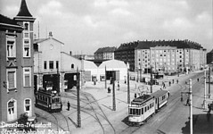Mit Umstellung der Lößnitzbahn auf die Dresdner Stadtspur wurden deren Anlagen nicht mehr benötigt und fortan als Kfz-Werkstatt für Busse und Lkw der Verkehrsbetriebe genutzt. 1992 schlossen die Dresdner Verkehrsbetriebe den Straßenbahnhof und verkauften das Areal vier Jahre später an einen privaten Investor. Nach jahrelangem Leerstand und der Übergabe an neue Eigentümer entstand in der unter Denkmalschutz stehenden großen Wagenhalle 2009 ein Einkaufszentrum. Zahlreiche Nebengebäude und die frühere Lößnitzbahnhalle wurden ganz oder teilweise abgerissen und in die Neugestaltung des Areals integriert. Das frühere Verwaltungsgebäude beherbergt ein Ärztehaus, Büros und Wohnungen.

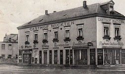Gasthof Mickten (Nr. 170): Die Schankwirtschaft entstand Ende des 19. Jahrhunderts im Zusammenhang mit dem Ausbau des Stadtteils Neu-Mickten an der Leipziger Straße 10 (heute Nr. 170). 1889 befand sie sich im Besitz des Gastwirts Karl Mäser und bot als Ausspanne an der wichtigen Fernstraße sogar Übernachtungsmöglichkeiten. Um die Jahrhundertwende warb das Lokal mit "gutbürgerlichem Mittagstisch" und wöchentlichen Schlachtfesten. Auch nach 1945 blieb der Gasthof zunächst in Privatbesitz, wurde dann von der HO übernommen und bis zur Wende als Milchbar Mickten genutzt. Heute ist hier eine Spielothek untergebracht.

Trachau:

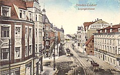Nach dem Ausbau der neuen Meißner Poststraße über Trachau entstanden hier außerhalb des Dorfkerns einige neue Häuser, darunter der 1787 gegründete Gasthof. Im Folgejahr baute der aus Serkowitz stammende Schmied Johann Christoph Wenzel eine Schmiede, der bald weitere Handwerker- und Häusleranwesen folgten. Die Schmiede musste 1898 dem Wohnhausneubau Leipziger Straße 206 weichen. Weitere mehrgeschossige Wohnhäuser folgten nach 1900 und veränderten das einstige Ortbild.

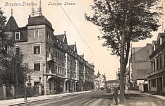Tabakfabrik A. R. Jedicke & Sohn (Nr. 153/55): Das Wohn- und Geschäftshaus Leipziger Straße 153/55 _(Foto)_ wurde 1899 für den Zigarrenfabrikanten Friedrich Otto Jedicke errichtet. Mit der Ausführung des Baus beauftragte er den Kaditzer Architekt Emil Rösler. Das Gebäude entstand als Kopfbau einer geschlossenenen Häuserzeile und wurde nach seiner Fertigstellung 1900 vermietet. Im Hintergebäude betrieb der Eigentümer die Zigarrenfabrik A. R. Jedicke & Sohn. In Anspielung an die “Internationalität” dieser Branche zieren das Haus Reliefköpfe verschiedener menschlicher Rassen. Eine zweite [Zigarrenfabrik](../../../nordwest/trachau/strassen_trachau/) mit Namen "Gebrüder Jedicke" gab es ab 1900 auf der Leipziger Straße 224 (heute Pettenkoferstraße 10).

Das Unternehmen war bereits 1886 in der Leipziger Vorstadt von den Brüdern Friedrich Otto und Hermann Jedicke gegründet worden und verlegte seinen Sitz aus Platzgründen 1889 nach Trachau. In diesem Jahr 1889 genehmigte die damals noch selbständige Gemeinde Trachau den Bau einer Wohnvilla (Villa Louise - Nr. 151) und eines Fabrikgebäudes (Nr. 153/55) auf dem Grundstück. 1929 wurde der Firmensitz zur Holbeinstraße 36 in die Johannstadt verlegt, wo sie bis zur Zerstörung 1945 unter gleichem Namen weiterproduzierte. In den nun nicht mehr benötigten Räumen in Trachau richtete die Stadt Dresden 1930 ein Asyl für Obdachlose ein. Seit 1945 werden die Gebäude als Wohnhäuser genutzt und 2012 saniert.

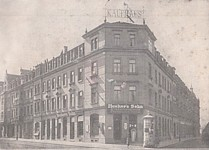Nr. 159: Das Eckhaus zur Micktener Straße entstand Ende des 19. Jahrhunderts an der Einmündung der Micktener Straße. Ab 1892 befand sich hier eine Filiale der 1855 von August Julius Bernhard Hecker gegründeten Eisen- und Kurzwarenhandlung Hecker's Sohn. Außerdem hatte in diesem Gebäude für einige Jahre die Reichspost eine Filiale. Im Obergeschoss lebte um 1900 der Schneidermeister Franz Hummitzsch, Vorsitzender des Radfahrerverein für Trachau und Umgegend. Nach 1990 bezog eine Filiale der Deutschen Bank die Erdgeschossräume.

Nr. 163: Das zweistöckige Wohn- und Geschäftshaus war vor 1945 Sitz der Adler-Drogerie von Paul Berner. Zu DDR-Zeiten befand sich hier eine sogenanntes "Mach-Mit-Zentrum" mit Selbsthilfewerkstatt, in dem sich Bürger Werkzeuge und Geräte für kleinere Bau- und Reparaturarbeiten ausleihen konnten.

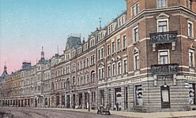Zur Münze (Nr. 181): Das um 1900 erbaute Wohn- und Geschäftshaus an der Ecke zur Bunsenstraße _(im Bild rechts)_ befand sich viele Jahre im Besitz der Familie Pfennig, die hier, wohl in Ableitung ihres Nachnamen, das Lokal "Zum Pfennig" betrieb. Um 1910 warb die Schankwirtschaft mit "musikalischer Unterhaltung und angenehmem Familienaufenthalt". Auch nach 1945 gab es hier eine Gastwirtschaft, nach 1990 unter dem Namen "Saustall" bzw. "Almhütte" mit österreichischer Küche. 1997 wurde das Gebäude saniert.

Nr. 187: Das moderne Gebäude entstand 2016 an Stelle eines abgerissenen Vorgängerbau und wurde vom Architekten Michael Koenitz entworfen. Das Einfamilienhaus ist unter Einsatz von Naturmaterialien gestaltet, Bauherr war der Gastronom Jujhar Singh, Inhaber mehrerer indischer Restaurants in Dresden.

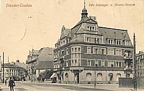Nr. 210: 1899 ließ der Eigentümer des Grundstückes Leipziger Straße 210 Heinrich Moritz Berger an der Einmündung der Henricistraße ein repräsentatives Wohn- und Geschäftshaus im Stil des Historismus errichten _(Foto links)_. Mit der Ausführung wurde der Kaditzer Architekt Emil Rösler beauftragt, der an verschiedenen Wohn- und Geschäftshäusern im Dresdner Nordosten beteiligt war. Im Gegensatz zur Dresdner Bauordnung durften in Trachau auch Stuckornamente an der Fassade angebracht werden. Die Reliefs zeigen zum Teil Jugendstilornamente und sind bis heute erhalten geblieben. In den Anfangsjahren gab es im Erdgschoss eine Gastwirtschaft (Schankwirtschaft von Rotzsche). Heute dienen die Räume als Ladenlokal.

Weinschänke Kockel (Nr. 212): Die kleine Schänke wurde um 1860 eröffnet und war bis 1888 im Besitz eines Trachauer Winzers, der hier einen Ausschank betrieb. 1929 wurde das Haus zugunsten der Wohngebäude Leipziger Straße 212/214 abgerissen. Im Gegensatz zu den meisten Nachbarhäusern aus der Gründerzeit besitzt der Neubau eine expressionistische Fassade.

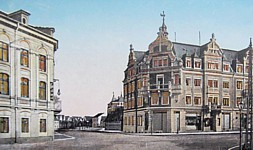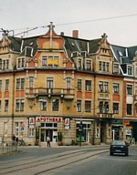Elisabeth-Apotheke (Nr. 218): Das Gebäude an der Leipziger Straße 218 entstand 1899/1900. Für den Bau musste eine der alten Scheunen des Dorfkerns und das frühere Blumenbergische Gut weichen. Das dreigeschossige Wohn-und Geschäftshaus wurde im Erdgeschoss zunächst von einer Bäckerei genutzt, deren Besitzer Arthur Gierisch hier das beliebte “Café Germania” betrieb. Seit 1921 befindet sich in den Räumen die Elisabeth-Apotheke, erste Trachauer Apotheke. Gründer war der Apotheker und Nahrungsmittelchemiker Dr. Max Heinze, der sein Geschäft am 1. Oktober 1921 eröffnete. Als einzige Dresdner Apotheke blieb die Elisabeth-Apotheke auch zu DDR-Zeiten in Privatbesitz. Neben dem üblichen Medikamentenangebot wurden hier auch homöopathische Präparate hergestellt und verkauft.

Größere Umbauten in den Räumen erfolgten 1980/81 und 1991. Im Inneren stellt ein von Alfons Garn geschaffenes Kupferrelief das Leben der Heiligen Elisabeth und die Bedeutung der Pharmazie dar. Garn ist auch Schöpfer des zweiten Wandbildes “Lebensbaum”.

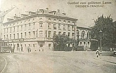Goldenes Lamm (Nr. 220): Der Gasthof entstand als erstes Gebäude auf Trachauer Flur an der neu angelegten Poststraße und erhielt am 13. Juni 1787 die Schankkonzession. Besitzer war der Häusler und Fleischer Johann Gottfried Ockert. Seit 1839 tagte hier auch der Trachauer Gemeinderat. 1881 wurde der alte Gasthof “Zum Lämmchen” durch den damaligen Besitzer Hermann Heinrich Hanke in heutiger Gestalt neu aufgebaut und in diesem Zusammenhang in “Goldenes Lamm” umbenannt _(Foto links)_. Im Jahr 1895 entstand nach Plänen des Baumeisters Gustav Richard Martin noch ein vergrößerter Tanzsaal. Weitere Umbauten erfolgten 1918.

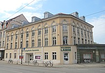 Der Saal diente in den 1920er Jahren zeitweise auch als Turnsaal des Trachauer Turnvereins und seit 1925 als Kino, wobei die Firmierungen "Lichtspiele Goldenes Lamm" bzw. "Tonfilm-Theater Goldenes Lamm" üblich waren. Ab 1962 wurden die Räumlichkeiten bis 1997 als Domizil des Dresdner Puppentheaters genutzt. Danach stand das Gebäude leer, lediglich im Erdgeschoss befand sich noch eine kleine Gaststätte.

2005 übernahm die Freie Evangelische Gemeinde das Haus, um hier ihr Gemeindezentrum einzurichten _(Foto rechts)_. Nach erfolgter Sanierung konnte dieses im September 2007 eröffnet werden. Neben dem Kirchensaal mit ca. 230 Plätzen stehen weitere Räume für die Gemeinde- und Jugendarbeit der Freikirche zur Verfügung. Im Unterschied zur evangelisch-lutherischen Kirche werden ausschließlich Erwachsene nach entsprechendem Bekenntnis zu Christus getauft.

Nr. 230/232: Auch diese beiden Wohnhäuser entstanden kurz vor der Eingemeindung Trachaus und tragen zum städtischen Erscheinungsbild der früheren Vorstadt bei. Die Fassaden wurden ganz im Stil der Zeit mit neogotischen und Jugendstilornamenten verziert und mit farbigen Klinkern verkleidet. Derartige Fassadengestaltungen finden sich an zahlreichen Trachauer Wohn- und Geschäftshäusern im alten Ortskern.

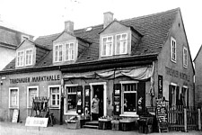Trachauer Markthalle (Nr. 242): Das einstöckige Gebäude befindet sich gegenüber dem heute als "Theaterhaus Rudi" genutzten Neukaditzer Gasthof und diente ursprünglich als Verkaufsstelle für Waren des täglichen Bedarfs. Später wurde es als Obst- und Gemüsehandel genutzt. Nach dem Abriss des Nachbarhauses 1986 erwarb der private Inhaber auch dieses Grundstück und nutzte es als Parkplatz. Nach 1990 bezog eine Gaststätte die ehemaligen Verkaufsräume, bevor 2007 die Familie Keyl das Haus sanieren ließ und dort eine Produktionsstätte für Speiseeis einrichtete. Neben Großabnehmern und Supermärkten betreibt die Firma "Eis-Keyl" heute auch mehrere Filialen in Dresden und Radebeul.

Nr. 258: In diesem Haus wurde am 15. August 1878 der Maler Otto Fischer (1878-1858) geboren, der sich seit 1907 nach seinem Geburtsort Fischer-Trachau nannte. Nach seinem Studium an der Kunstgewerbeschule und der Kunstakademie arbeitete er ab 1908 freischaffend in Hamburg, später in Leipzig. Bekannt wurde er vor allem als Raumkünstler, der zahlreiche Innenräume für Hamburger Bauten gestaltete. Außerdem schuf Otto Fischer-Trachau expressionistische Gemälde und Zeichnungen, entwarf Plakate und verfasste Artikel für Fachzeitschriften. Zu seinen bedeutendsten Schöpfungen gehört die 2010 wiederhergestellte Ausmalung der Pfeilerhalle des Leipziger Grassimuseums.

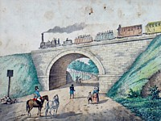Eisenbahnbrücke: Die unmittelbar vor der Stadtgrenze zu Radebeul befindliche Eisenbahnunterführung entstand 1837 und ist eine der ältesten in Deutschland überhaupt. Ursprünglich war sie als gemauerte Sandsteinbogenbrücke ausgeführt, über die die Bahnstrecke Dresden - Leipzig führte. 1898/99 wurde sie deutlich verbreitert und durch eine Eisenkonstruktion ersetzt.

_**Foto:** Die Eisenbahnunterführung Trachau auf einer Lithografie um 1840_

Waldvilla (Nr. 300): Das Gasthaus entstand 1875/76 als “Balletablissement Waldvilla Trachau” und wurde von seinem Besitzer Johann Moritz Gebler zu einem der beliebtesten Tanzlokale im Nordwesten Dresdens ausgebaut. Zur Gaststätte gehörten neben dem Saal auch ein großer Gästegarten und eine Kegelbahn. 1922 wurde die “Waldvilla”, von den Anwohnern liebevoll “Wilde Wally” genannt, geschlossen. Das Haus Leipziger Straße 300 war seitdem Firmensitz der Arzneimittelfirma “Li-il GmbH”.

**_Foto:_** _Blick zur Trachauer “Waldvilla” (Bildmitte) um 1900_

Firma Li-il: Das Unternehmen wurde 1910 von Richard Carl Pittlik als “Deutsche Arzneibäderfabrik Li-il Werk” in der Johannstadt gegründet. Der Name leitet sich von den lateinischen Begriffen “Lithium” (wurde als Trägersubstanz für die Essenzen genutzt) und “ilatium” (von außen nach innen) her und weist auf das Grundprinzip der hergestellten Produkte her. Diese von Ärzten, Apothekern und Chemikern entwickelten ätherischen Öle und Badezusätze sollten “von außen nach innen” wirken und galten seinerzeit als neuartige Naturheilmittel, welche in Kurkliniken und ähnlichen Einrichtungen zum Einsatz kamen.

1922 bezog das “Li-il”-Werk die ehemalige Gaststätte “Waldvilla” und stellte hier, ab 1928 unter Leitung von Dr. Ernestine Gabriele Böhme, verschiedene medizinisch-badeheilkundliche Erzeugnisse her, u.a. das bis heute verwendete Camphoderm und Tussidermil. Den Zweiten Weltkrieg überstand die Fabrik ohne größere Schäden, wurde 1972 jedoch zwangsweise verstaatlicht und 1975 an das Arzneimittelwerk Dresden angeschlossen. 1992 erwarb ein hessischer Unternehmer den Betrieb von der Treuhand und ließ diesen schrittweise modernisieren. Heute werden hier neben traditionellen Gesundheitsbädern und Emulsionen auch verschiedene kosmetische Produkte hergestellt und zum Teil exportiert.

Neukaditz:

Der Stadtteil Neukaditz entwickelte sich ab 1872 auf den früheren Feldern des wüsten Dorfes [Gleina](../../../nordwest/kaditz/gleina/), welche später von Kaditzer Bauern bewirtschaftet wurden. Begünstigt durch die industrielle Entwicklung in den Nachbarorten entstanden hier, abseits des alten Kaditzer Dorfkerns, Wohnhäuser, die zum Teil von Genossenschaften, zum Teil auch von privaten Bauherren errichtet wurden. Bemerkenswert ist die ab 1887 entstandene Wohnsiedlung zwischen Leipziger Straße, Kolbe- und [Roscherstraße](../../../nordwest/kaditz/strassen_kaditz/), die zu den ersten genossenschaftlichen Bauvorhaben in Dresden gehörte. Erstes Gebäude war jedoch der heute als [Theaterhaus “Rudi”](../../../neustadt/leipziger_vorstadt/leipziger_strasse/rudi_arndt/) genutzte ehemalige Gasthof “Zum Feldschlößchen”.

Ranke-Drogerie (Nr. 199): Das dreigeschossige Wohn- und Geschäftshaus an der Einmündung zur Rankestraße entstand 1929/30 im Auftrag der Stadtgemeinde Dresden. Markant ist die eingeschossige "runde Ecke", die ursprünglich als Wartehalle für Straßenbahnfahrgäste diente _(Foto um 1935)_. Das ansonsten weitgehend schmucklose Haus wird lediglich durch einen leicht hervorstehenden Erker und die großen Rundbogenfenster des Ladenlokals im Erdgeschoss gegliedert. Zunächst hatte in diesen Räumen der Korbmachermeister Arthur Wenzel seine Werkstatt, bevor wenig später die "Ranke-Drogerie" einzog. Die nach der angrenzenden Rankestraße benannte Drogerie wurde von Alfred Mißbach gegründet und am 1. April 1931 eröffnet. Neben klassischen Drogeriewaren wurden hier auch Fotoapparate und Zubehör verkauft. 1966 übernahm eine frühere Angestellte die Geschäftsleitung und führte das traditionsreiche Unternehmen noch bis 2006 und zog dann zur Industriestraße um. Heute befindet sich in den Räumen das italienische Restaurant “La Dolce Vita”. Bei dessen Einzug wurde die frühere Wartehalle in die Gasträume integriert.

Wohnhausgruppe Nr. 203-209: Die vier Häuser entstanden Ende des 19. Jahrhunderts im Auftrag des Kaditzer Architekten Friedrich August Jähnig und wurden von diesem baukünstlerisch gestaltet. Nach ihrem Fassadenschmuck werden sie als Kaiser-Wilhelm-Haus (Nr. 203), Lutherhaus (Nr. 205), Gustav-Adolf-Haus (Nr. 207) und Kronenhaus (Nr. 209) bezeichnet und stehen als Zeugnisse des Späthistorismus unter Denkmalschutz.

Friedrich-August-Haus: Das Gebäude an der Einmündung Kolbestraße (Kolbestraße 1 / Roscherstraße 2) wurde 1899 als erstes Haus des ein Jahr zuvor gegründeten gemeinnützigen Dresdner Spar- und Bauvereins gebaut. Schirmherr des Bauvorhabens war der damalige Prinz Friedrich August, der 1904 die Nachfolge König Georgs antrat. Friedrich August unterstützte den Unterhalt des Gebäudes mit einer jährlichen Zahlung von 50 Mark. Die Finanzierung des Baus übernahm der Vorstand der Chemischen Fabrik von Heyden, die auch über das Belegungsrecht für fünf Wohnungen verfügte. Das architektonisch anspruchsvoll gestaltete Doppelhaus mit 20 Wohnungen und zwei Ladengeschäften wurde vom Architekten Thüme entworfen und zeigt an der Fassade Anklänge an den Jugendstil sowie Spruchbänder. Eine umfassende Erneuerung fand 1993/94 statt.

**_Foto:_** _Das Friedrich-August-Haus an der Leipziger Straße. Inschrift am Giebel (links):_

 _“Wer dieses Haus jetzt tadeln will, der stehe nun ein wenig still,_

_und denk in seinem Herzen frei, ob er ganz ohne Tadel sei”._

* * *

 \[ [Home](../../../index.html)\] \[ [Nord](../../../nord/)\] \[ [Nordwest](../../../nordwest/)\] \[ [Neustadt](../../../neustadt/)\] \[ [Nordost](../../../nordost/)\] \[ [West](../../../west/)\] \[ [Zentrum](../../../zentrum/)\] \[ [Südwest](../../../sudwest/)\] \[ [Süd](../../../sud/)\] \[ [Südost](../../../sudost/)\] \[ [Ost](../../../ost/)\] \[ [Register](../../../Register/register.html)\] \[ [Kontakt](../../../Kontakt/kontakt.html)\] \[ [Impressum](../../../impressum/)\]
