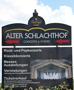
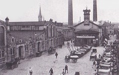
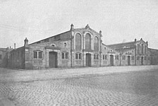
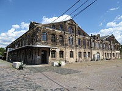

[Alter schlachthof  gothaer str. 11 01097 dresden  tickets: 0351 / 86 66 00 0351 / 84 04 20 02](http://www.alter-schlachthof.de)

* * *

Der Schlachthof der Dresdner Fleischerinnung entstand 1870-73 auf dem Grundstück Leipziger Straße 8 bis 12. Zuvor erfolgte die Fleischverarbeitung in den “Kuttelhöfen” an der Gerbergasse in der Wilsdruffer Vorstadt, die jedoch nicht mehr den gewachsenen Anforderungen entsprachen. Die Planung des aus mehreren Schlachthäusern, Ställen, Hallen und einem zentralen Viehmarkt bestehenden Komplexes oblag dem Baumeister Wehinger. Ein eigenes Elektrizitätswerk sorgte für die Stromversorgung. Nach zwei Jahren Bauzeit konnte der neue “Central-Viehhof” am 2. Januar 1873 eröffnet werden. Schon bald machten sich Erweiterungen erforderlich, die auf dem zur Verfügung stehenden Grundstück jedoch nur eingeschränkt möglich waren. 1879 wurde mit dem Hotel Central-Schlachthof eine eigene Gaststätte eröffnet. 1895 folgte eine Fachschule zur Ausbildung von Fleischerlehrlingen. Außerdem fanden hier zwischen 1875 und 1878 die Dresdner Pferdeausstellungen mit Ausstellern aus ganz Sachsen und bis zu 700 Tieren statt.

Mit Inbetriebnahme des von Hans Erlwein projektierten neuen Schlachthofes im Ostragehege wurde der Schlachthof auf der Leipziger Straße am 31. März 1907 geschlossen. Fortan nutzten verschiedene Betriebe das Areal. Außerdem fandenn bereits vor dem Ersten Weltkrieg gelegentlich Veranstaltungen, u.a. "Sechstagerennen" der Radsportler statt. Nach 1945 dienten die Hallen als Ersatzteillager des DDR-Landmaschinenherstellers “Fortschritt”. Ab 1998 wurden die zum Teil denkmalgeschützten Gebäude in ein Veranstaltungszentrum umgewandelt und sind heute regelmäßig Schauplatz von Konzerten und anderen Events. In die alte “Pferdebörse” zogen 2008 die Musikkneipe “Flowerpower” und der “nubeatzz Club” ein. Weitere Gebäude dienen gewerblichen Zwecken und werden seit 1995 unter der postalischen Bezeichnung Gothaer Straße zusammengefasst.

Unternehmen auf dem Gelände des Alten Schlachthofes um 1944 (Auswahl):

**Rohproduktenhandlung Schmoeller & Naake**

**Glasgroßhandlung Paul & Stäglich GmbH**

**Keramische Versuchsanstalt von Villeroy & Boch**

**Futter- und Düngemittel Schaupt**

**Autoreparaturwerkstatt Schadewitz**

**Eisen- und Drahtwaren Billhardt & Co.**

**Dresdner Eisschrank- und Blechwarenfabrik Reindel**

**Fleischereimaschinen Enzmann**

**Autoverwertung Meincke**

**Kaffeegroßhandlung Faulhaber & Sohn**

**Schlosserei Hickmann**

**Altstoffe Wittig & Nürnberger**

**Spedition Eichler & Lohse**

**Technische Öle Roß**

**Sägespänegroßhandlung Krannich**

**Fuhrunternehmen Drechsel**

**Karosseriebau Nagetusch**

**Kistenfabrik Becher**

**Eisenwarengroßhandlung Feustel**

**Reifen und Altgummi Müller**

Video: Konzertauftritt von Roger Cicero am 26. Oktober 2014 im Alten Schlachthof

* * *

 \[ [Home](../../../../index.html)\] \[ [Nord](../../../../nord/)\] \[ [Nordwest](../../../../nordwest/)\] \[ [Neustadt](../../../../neustadt/)\] \[ [Nordost](../../../../nordost/)\] \[ [West](../../../../west/)\] \[ [Zentrum](../../../../zentrum/)\] \[ [Südwest](../../../../sudwest/)\] \[ [Süd](../../../../sud/)\] \[ [Südost](../../../../sudost/)\] \[ [Ost](../../../../ost/)\] \[ [Register](../../../../Register/register.html)\] \[ [Kontakt](../../../../Kontakt/kontakt.html)\] \[ [Impressum](../../../../impressum/)\]
