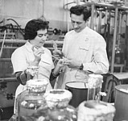

Das Arzneimittelwerk Dresden (AWD) entstand 1951/61 durch den Zusammenschluss der beiden traditionsreichen Dresdner Arneimittelhersteller Gehe & Co. und Dr. Friedrich von Heyden mit dem Radebeuler Madaus-Werk. 1979 wurde dieses Unternehmen in das Kombinat GERMED eingegliedert. Der bis 1990 als VEB Arzneimittelwerk Dresden geführte Betrieb war einer der wichtigsten Hersteller für Medikamente in der DDR. Im Zuge der Wiedervereinigung erfolgte 1990 die Umwandlung in eine GmbH mit anschließender Privatisierung. 1991 übernahm die Asta Medica-Gruppe das Traditionsunternehmen, welches heute unter dem Namen AWD.pharma zum italienischen Menarini-Konzern gehört. Anfang 2007 wurde der Firmensitz von der Leipziger Straße 7 _(Foto)_ ins benachbarte Radebeul verlegt.

Firma Gehe:

Die Geschichte des Unternehmens begann im Jahr 1834, als der junge Drogist Franz Ludwig Gehe (1810-1882) auf der Moritzstraße in der Nähe des Neumarktes die Firma Gehe & Schwabe (ab 1835 Gehe & Co.) gründete. Mit dem Eintrittseines wissenschaftlich hochgebildeten Neffen Dr. Rudolf Luboldt im Jahr 1859 gelang es Gehe, neue Produkte zu entwickeln und auf den Markt zu bringen. Am 7. Mai 1866 eröffnete er auf der Leipziger Straße eine “Drogen- und Appretur-Anstalt” zur industriellen Produktion chemischer Heilmittel. Bereits um 1900 stellte man hier über 1000 verschiedene Präparate her, die in zahlreiche Länder exportiert wurden. 1904 wurde das Familienunternehmen in die Gehe & Co. AG umgewandelt.

Gehe galt nicht nur als erfolgreicher Unternehmer, sondern engagierte sie auch auf politischem und sozialen Gebiet. U.a. trat er für eine Reform des Innungswesens und für den Wegfall der Zollschranken ein. Außerdem trug er eine reichhaltige pharmazeutische Lehrsammlung zusammen, die später der Technischen Hochschule übergeben wurde. Aus seinem Nachlass entstand 1902 die Gehe-Stiftung, die die größte staatswissenschaftliche Bibliothek in Sachsen unterhielt und für ehemalige Betriebsangehörige großzügige Ruhegehälter auszahlte.

1945 wurde die Gehe AG enteignet und in einen volkseigenen Betrieb umgewandelt. Teile der früheren Belegschaft gründeten das Unternehmen unter seinem alten Namen in Stuttgart neu. Diese Firma konzentrierte sich später hauptsächlich auf den Großhandel mit Medikamenten und stellte erst seit 1989 auch wieder eigene Produkte her. Seit 2003 trägt dieses Unternehmen den Namen Celesio AG. Der Traditionsname Gehe wird hingegen von der 1993 als Tochterfirma gegründeten Gehe Pharma Handels AG fortgeführt.

**_Foto:_** _Jugendbrigade im Arzneimittelwerk 1960 (Quelle: Bundesarchiv / Wikipedia)_

Chemische Fabrik von Heyden:

Die Chemische Fabrik wurde 1873 von Dr. Friedrich von Heyden (1838-1926) auf der Leipziger Straße gegründet. Der
mit zahlreichen Ehrentiteln ausgezeichnete Chemiker richtete dafür in der von ihm erworbenen Villa “Adolpha” und deren
Nebengebäuden Forschungslabors und Produktionsräume ein. Bedeutendste Leistung des Unternehmens war die
erstmalige industrielle Herstellung von Acetylsalicylsäure, dem Grundstoff für das Schmerzmittel Aspirin. Dieser chemische
Stoff wurde 1859 von Prof. Dr. Hermann Kolbe zum ersten Mal synthetisch erzeugt. Unter Mitwirkung von Kolbes
ehemaligem Schüler Rudolf Schmitt, Professor für Chemie am Dresdner Polytechnikum, und dessen Assistenten Prof. Dr. Bruno Seifert ließ von Heyden das Verfahren weiterentwickeln.

Nachdem
der Nachweis des therapeutischen Wirkung dieser Säure gelungen war, begann von Heyden 1874 mit der industriellen Großproduktion. Die Räumlichkeiten auf der Leipziger Straße 6 genügten dafür jedoch nicht mehr den
Anforderungen, so dass der Firmensitz bereits im gleichen Jahr nach Radebeul verlegt wurde. Hier entwickelte sich die
Chemische Fabrik von Heyden AG zu einem der wichtigsten deutschen Pharmahersteller. Durch geschickte Werbung und
die zunehmende Nachfrage erzielte das junge Unternehmen schnell hohe Umsätze. 1885 zog sich Friedrich von Heyden
aus der Leitung der Firma zurück, blieb jedoch noch bis ins hohe Alter von 82 Jahren Aufsichtsratsvorsitzender.

Zeitgleich erfolgten auch in Wuppertal Forschungen zur Weiterentwicklung des Herstellungsverfahrens. 1897 begann die
Firma Bayer mit der Produktion des verbesserten Wirkstoffes. Nachdem sowohl Bayer als auch von Heyden das
Medikament unter den registrierten Warenzeichen Aspirin und Acetylin (später Acesal) auf den Markt gebracht hatten,
entwickelte sich nach 1900 ein Rechtsstreit. Dieser endete mit der Entscheidung, beiden Unternehmen die Rechte zu
überlassen., so dass sowohl die Bayer-Werke in Leverkusen als auch der Radebeuler Hersteller das Medikament weiter
produzieren durften. Bis heute ist dieses das am meisten verwendete Arzneimittel der Welt geblieben. Neben Aspirin
wurden später auch Spezialfolien für Röntgengeräte, Kunstleder und andere synthetische Produkte hergestellt, so dass der Betrieb in den Zwanziger Jahren größter Chemiebetrieb Sachsens war.

1948 wurde das Radebeuler Unternehmen verstaatlicht und in VEB Chemische Werke Radebeul umbenannt. 1961 erfolgte die Eingliederung in den VEB Arzneimittelwerk Dresden. 1991 wurde der Betrieb an die Degussa-Tochterfirma
ASTA Medica verkauft. Heute produziert die Firma in Radebeul unter dem Namen arevipharma verschiedene Wirkstoffe
für die Pharmaindustrie. Von den ehemaligen Produktionsstätten in der Leipziger Vorstadt hingegen sind keine Spuren mehr erhalten geblieben.

* * *

 \[ [Home](../../../../index.html)\] \[ [Nord](../../../../nord/)\] \[ [Nordwest](../../../../nordwest/)\] \[ [Neustadt](../../../../neustadt/)\] \[ [Nordost](../../../../nordost/)\] \[ [West](../../../../west/)\] \[ [Zentrum](../../../../zentrum/)\] \[ [Südwest](../../../../sudwest/)\] \[ [Süd](../../../../sud/)\] \[ [Südost](../../../../sudost/)\] \[ [Ost](../../../../ost/)\] \[ [Register](../../../../Register/register.html)\] \[ [Kontakt](../../../../Kontakt/kontakt.html)\] \[ [Impressum](../../../../impressum/)\]
