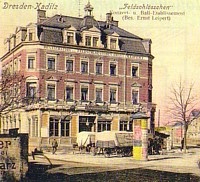
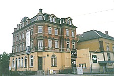

* * *

* * *

## [Theaterhaus](http://www.rudi-dresden.de)

Das erste Gebäude an der Einmündung der heutigen Fechnerstraße in die Leipziger
Straße wurde 1872 für den früheren Trachauer Mühlenbesitzer Karl Friedrich Trentzsch erbaut. Am 12. März 1874 eröffnete er hier eine Gastwirtschaft mit
Namen “Feldschlößchen”, die 1898 einem Neubau mit Saalanbau weichen musste _(Foto)_. Architekt des repräsentativen Hauses war der Dresdner Baumeister Carl
Käfer. Fortan diente das Gebäude als Tanz- und Vergnügungslokal und war Schauplatz für Bälle, Konzerte und Theateraufführungen. Ab 1920 gab es hier mit
den “Elbschloss-Lichtspielen” auch ein Kino mit ca. 300 Plätzen. 1932 ist das Kino als “Feldschlösschen-Lichtspiele” im Adressbuch verzeichnet.

1946 bezog kurzzeitig die SED-Kreisleitung das “Feldschlößchen”, welches zeitweise auch Sitz der Abteilung Kultur
beim Rat des Stadtbezirkes Nord war. Der ehemalige Saal diente als Lager;  außerdem bewohnten einige Familien das
Haus. Lediglich die Gaststätte im Erdgeschoss wurde auch weiterhin von der HO bewirtschaftet. Ab 1957 war das Neukaditzer Tanzlokal als Jugendclubhaus “Rudi Arndt” bekannter Jugendtreff. Seinen Namen erhielt es nach dem
kommunistischen Arbeiterfunktionär Rudi Arndt (\* 1909), der 1940 im KZ Buchenwald von den Nazis ermordet wurde. Seit 1997 erinnert an ihn eine kleine Ausstellung

1976 erwarb die Stadt Dresden das Gebäude und unterzog es einer
umfassenden Sanierung. Am 28. November 1981 erfolgte die erneute Einweihung mit Veranstaltungssaal, Tagescafé und Kellerdisco. Regelmäßig traten hier bekannte DDR-Rockbands auf, hinzu kamen Wohngebiets- und
Kinderfeste, Familientanzveranstaltungen und Filmvorführungen. Leider geriet das Haus Ende der 80er Jahre durch häufige Schlägereien in Verruf und war im
Volksmund auch als “blutiger Rudi” berüchtigt.  Nach 1990 hatten hier zeitweise der Club “Twenty Five” und das Theater 50 ihr Domizil, wofür Veränderungen
im Inneren vorgenommen wurden. Seit 10. November 1997 trägt das Gebäude offiziell den Namen “Theaterhaus Rudi” und ist Spielstätte verschiedener Amateurtheatergruppen.

* * *

 \[ [Home](../../../../index.html)\] \[ [Nord](../../../../nord/)\] \[ [Nordwest](../../../../nordwest/)\] \[ [Neustadt](../../../../neustadt/)\] \[ [Nordost](../../../../nordost/)\] \[ [West](../../../../west/)\] \[ [Zentrum](../../../../zentrum/)\] \[ [Südwest](../../../../sudwest/)\] \[ [Süd](../../../../sud/)\] \[ [Südost](../../../../sudost/)\] \[ [Ost](../../../../ost/)\] \[ [Register](../../../../Register/register.html)\] \[ [Kontakt](../../../../Kontakt/kontakt.html)\] \[ [Impressum](../../../../impressum/)\]
