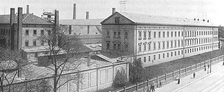
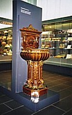
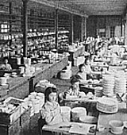

Die Firma Villeroy & Boch geht auf eine bereits 1748 von Francois Boch in Lothringen gegründete Töpferei  zurück. 1766 eröffnete Bruder Peter Joseph Boch in Septfontain eine weitere Keramikfabrik,
die später noch einen Betriebsteil im saarländischen Mettlach erhielt. Hier befindet sich bis heute das Stammhaus des Unternehmens. Der geschäftliche Erfolg ermöglichte schon bald die Einrichtung weiterer
Niederlassungen. 1836 fusionierte der Familienbetrieb mit der Porzellanfabrik Villeroy zur bis heute existierenden Firma Villeroy & Boch.

Nachdem Gespräche mit dem Gemeinderat des damals noch selbständigen Ortes Neudorf erfolgreich verlaufen waren,
konnte Villeroy & Boch am 9. Juli 1856 seine Dresdner Niederlassung an der Leipziger Straße eröffnen _(Foto)_. Vor
allem die vereinfachten Genehmigungsverfahren und die geringeren Grundstückspreise gaben den Ausschlag bei der Wahl
des Standortes. Dieser lag zudem verkehrsgünstig an der Bahnstrecke Dresden - Leipzig und in Nähe des Neustädter
Hafens. Die für die Keramikherstellung erforderlichen Rohstoffe Ton und Steinkohle erhielt man aus Meißen und dem
Döhlener Revier. Mit fast 600 Beschäftigten war Villeroy & Boch zeitweise größtes Dresdner Unternehmen. Bis 1905
stieg die Beschäftigtenzahl sogar auf fast 1.600 an. Zeitweise verlegte die Geschäftsleitung sogar den Firmensitz des Gesamtbetriebes nach Dresden, zuletzt 1939-40.

Zunächst produzierte man hier verschiedenste keramische Produkte wie Gebrauchsgeschirr,
Zierkeramik, aber auch Kachelöfen, Wandfliesen und baukünstlerischen Schmuck für das In- und Ausland. Zeugnisse aus dieser Zeit haben sich u.a. in der Ladenausstattung von “Pfunds
Molkerei” auf der Bautzner Straße 76 erhalten. Ab 1903 spezialisierte sich das Unternehmen vorrangig auf Sanitärkeramik und Zubehör für Wasserleitungen. Zu den Pionierleistungen von
Villeroy & Boch gehörte die erstmalige Herstellung von Hartsteingut sowie die Einführung von mit Wasserkraft betriebenen Drehscheiben in der Formung. Das Foto zeigt einen Waschtisch
aus Dresdner Produktion (Werksmuseum Mettlach/Saarland)

Beispielhaft für die damalige Zeit waren die sozialen Leistungen der Firma. Bereits 1857 hatte
man für alle Angestellten eine Betriebskrankenkasse gegründet. Außerdem gab es eine eigene Lebensmittelverkaufsstelle im Werksgelände, eine Suppenküche und eine Betriebskantine. Für
die Arbeiter und ihre Familien entstand 1873 eine Werkssiedlung an der [Weinböhlaer Straße](../../../../neustadt/leipziger_vorstadt/strassen_leipziger_vorstadt/).
Sogar eine Kinderferienkolonie und eine Spar- u. Darlehenskasse wurde von der Betriebsleitung finanziert.

Beim letzten Luftangriff auf Dresden am 17. April 1945 entstanden auf dem Betriebsgelände
schwere Bombenschäden. Auch die frühere Fabrikantenvilla fiel diesem Angriff zum Opfer. Die verbliebenen Produktionsanlagen wurden nach Kriegsende durch die sowjetische
Besatzungsmacht demontiert. Trotzdem konnte bereits 1946 die Fertigung in bescheidenem Umfang wieder aufgenommen werden. 1948 wurde der Betrieb verstaatlicht und stellte unter
dem Namen VEB Steingutfabrik Dresden (ab 1965 VEB Sanitärporzellan) bis 1990 vor allem Toiletten- und Waschbecken her.

Nach Schließung des Unternehmens wurden verschiedene Konzepte über die künftige
Nutzung des Areals erarbeitet, wobei die denkmalgeschützten Teile der historischen Bausubstanz, u. a. die Orangerie und zwei 1856 errichtete Produktionshallen, erhalten bleiben sollten. Im Ergebnis eines
städtebaulichen Wettbewerbs war 1994 die Bebauung mit einem Komplex aus Wohn- und Bürogebäuden vorgesehen. Auch als möglicher Standort der Messe bzw. der Gläsernen VW-Manufaktur war das
Grundstück im Gespräch. Nach dem Scheitern dieser Projekte wartet das Gelände noch immer auf eine künftige städtebauliche Neugestaltung.

* * *

 \[ [Home](../../../../index.html)\] \[ [Nord](../../../../nord/)\] \[ [Nordwest](../../../../nordwest/)\] \[ [Neustadt](../../../../neustadt/)\] \[ [Nordost](../../../../nordost/)\] \[ [West](../../../../west/)\] \[ [Zentrum](../../../../zentrum/)\] \[ [Südwest](../../../../sudwest/)\] \[ [Süd](../../../../sud/)\] \[ [Südost](../../../../sudost/)\] \[ [Ost](../../../../ost/)\] \[ [Register](../../../../Register/register.html)\] \[ [Kontakt](../../../../Kontakt/kontakt.html)\] \[ [Impressum](../../../../impressum/)\]
