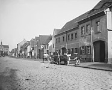
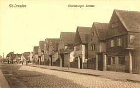
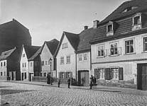
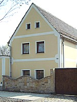
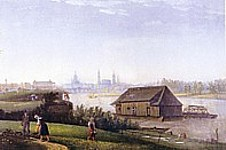
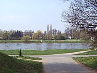
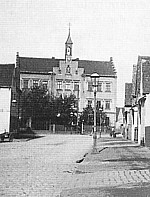
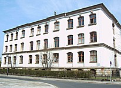

* * *

**Gemeindesiegel von Neudorf**

Die Geschichte von Neudorf begann am 15. März 1546, als der sächsische Herzog Moritz eine Verfügung zur Umsiedlung von 29 Familien aus Altendresden erließ. Grund war die geplante Inanspruchnahme deren Grundstücke für den Ausbau der rechtselbischen Stadtbefestigung. Als Entschädigung erhielten die Betroffenen Flächen in der Nähe des Bischofsweges nordwestlich der Stadt sowie die Nutzungsrechte am [Neudorfer Werder](../../../neustadt/leipziger_vorstadt/neudorf/neudorfer_werder/), einer ehemaligen Elbinsel am Südende der Moritzburger Straße. Außerdem mussten die übrigen Bewohner
Altendresdens beim Abriss und Wiederaufbau der Gebäude helfen. Auch das Baumaterial wurde kostenlos gestellt.

Innerhalb weniger Jahre entstand nun ein Straßendorf mit kleinen bäuerlichen Anwesen zu beiden Seiten der heutigen [Moritzburger Straße](../../../neustadt/leipziger_vorstadt/neudorf/moritzburger_strasse/) _(Foto)_. Allerdings war dieses Areal vermutlich bereits in der Stein- und Bronzezeit besiedelt gewesen, da entsprechende Funde gemacht wurden. Die Existenz einer hier vermuteten slawischen Siedlung konnte bislang jedoch nicht belegt werden. Da die neuen Bewohner vor ihrer Zwangsumsiedlung Bürger Altendresdens gewesen waren, durften sie verschiedene städtische Privilegien behalten, so die Befreiung vom Brückenzoll und vom Marktpfennig. Später versuchte der städtische Rat, diese Rechte einzuschränken, was regelmäßig zu Konflikten zwischen der Gemeinde und der Stadt Dresden führte. In Urkunden wurde die neue Ansiedlung als “Nawe Stadt” bzw. “Nawe Sorge” bezeichnet, später auch als “Stadt Neudorf”, obwohl der Ort nie das Stadtrecht besaß. Aus diesem Grund durften die Bewohner nur eingeschränkt städtischen Gewerben nachgehen. Allerdings besaß Neudorf einen eigenen Gemeindevorstand, der in
örtlichen Angelegenheiten die Entscheidungsbefugnis besaß und auch kleinere Streitfälle schlichten konnte.

Schwer getroffen wurde der Ort immer wieder in Kriegszeiten. Begünstigt durch die Lage am Rande zweier Fernstraßen zogen wiederholt Truppen durch Neudorf, die hier plünderten und zerstörten. Auch unter den häufigen Einquartierungen von fremden Soldaten, u. a. 1745, 1759, 1778 und 1813 hatten die Bewohner zu leiden. Da der Ort offiziell als Bestandteil der Dresdner Neustadt galt, mussten die Einwohner auch einheimische Soldaten beherbergen. Zudem waren sie zur Zahlung von Militärgeld als eine Art Neudorfer Sondersteuer verpflichtet. Größere Dorfbrände sind aus den Jahren 1738 und 1741 überliefert, als ca. die Hälfte aller Gebäude den Flammen zum Opfer fiel. Letztmalig brannten am 7. August 1802 16 Gehöfte des Unterdorfes nieder, konnten jedoch schon bald wieder aufgebaut werden.

Wirtschaftlich lebte Neudorf vor allem von der Landwirtschaft und vom Gartenbau. Außerdem verdienten sich einige Einwohner ihren Lebensunterhalt als Elbschiffer. Größere Bauerngüter entwickelten sich jedoch nicht. Wichtigste Einnahmequelle war der Verkauf der angebauten Produkte auf dem Dresdner Markt. Somit blieb Neudorf bis ins 19. Jahrhundert eine arme Gärtner- und Häuslergemeinde am Rande der sich entwickelnden Großstadt. Erst nach dem Bau der [Eisenbahnstrecke](../../../neustadt/leipziger_vorstadt/dresden_-_leipzig/) nach Leipzig siedelten sich ab 1840 auf Neudorfer Flur, angelockt durch günstige Grundstückspreise und Steuervergünstigungen, verschiedene Industriebetriebe an. Bedeutendstes Unternehmen war die 1854 gegründete Keramikfabrik [Villeroy & Boch](../../../neustadt/leipziger_vorstadt/leipziger_strasse/villeroy___boch/) an der [Leipziger Straße](../../../neustadt/leipziger_vorstadt/leipziger_strasse/). Außerdem gab es Mitte des 19. Jahrhunderts mehrere Gasthöfe, von denen das spätere Tanz- und Ballhaus “Stadt Bremen” (Leipziger Straße 58) am bekanntesten war.

Am 1. Januar 1866 wurde die Gemeinde Neudorf nach mehrjährigen Verhandlungen mit der Stadt Dresden als Vorstadt
Neudorf eingemeindet, womit sich ein lange gehegter Wunsch der Einwohner erfüllte. Auf  Beschluss des Stadtrates vom
29\. Oktober 1874 erhielt Neudorf gemeinsam mit den angrenzenden Scheunenhöfen offiziell die Bezeichnung [Leipziger Vorstadt](../../../neustadt/leipziger_vorstadt/). Mit der Einbeziehung des ehemaligen Dorfkerns in die ständig wachsende Großstadt wandelte sich auch die
Struktur Alt-Neudorfs. An Stelle landwirtschaftlicher Anwesen traten handwerkliche Kleinbetriebe, Läden und
Gaststätten. Bereits um 1880 mussten die ersten Gebäude an der Moritzburger Straße mehrgeschossigen Mietshäusern weichen. Auch die verbliebenen Felder und Gärten wurden nun mit Wohnhäusern und Betriebsgebäuden bebaut.

Ebenso wie das benachbarte Pieschen entwickelte sich
die Leipziger Vorstadt zu einem dichtbesiedelten Arbeiterwohnort mit allen sozialen und wirtschaftlichen Problemen. Bis um 1900 war fast die gesamte Neudorfer Flur vollständig bebaut, im stadtnahen Teil vorrangig mit
gewerblichen Unternehmen, in Richtung Pieschen mit Wohn- und Geschäftshäusern. Auf dem früheren Elbwerder und an der [Hansastraße](../../../neustadt/leipziger_vorstadt/strassen_leipziger_vorstadt/hansastrasse/) entstanden nach 1900 Kleingartenanlagen. In den
1930er Jahren wurden schließlich auf einigen Baulücken bzw. Abrissgrundstücken Wohnblocks errichtet. Die Luftangriffe des Zweiten Weltkrieges trafen auch Teile der Neudorfer Flur.

Die Nachkriegszeit war vom zunehmenden Verfall vieler Gebäude gekennzeichnet, der erst mit der politischen Wende 1989 gestoppt werden konnte. 1996 verschwanden die letzten
Reste des ehemaligen Dorfes zugunsten einer modernen Wohnanlage an der neu angelegten Ilmenauer Straße. Lediglich zwei Wohnhäuser des alten Dorfkerns blieben bis heute an der Moritzburger Straße erhalten ( **_Foto:_** _Moritzburger Straße 76)._

Neudorfer Schiffsmühle:

Die Neudorfer Schiffsmühle war eine von ursprünglich drei derartigen Mühlen im
Dresdner Raum und wurde 1661 erstmals genannt. Wiederholt wechselte sie ihren Standort und lag ab 1789 oberhalb der heutigen Erfurter Straße in der Nähe des Neustädter Hafens. Die Mühle, die sich bis 1779 im Besitz des
kurfürstlichen Kammergutes Ostra befand, übte den Mahlzwang über Pieschen, Trachau und Mickten aus und erwirtschaftete so gute Erträge.

1779 erwarb sie der bisherige Pächter Eichler als Eigentum. Nach seinem Tod
1795 übernahm dessen Witwe die Schiffsmühle und richtete hier im Nebenerwerb eine kleine Schankstätte ein. Mehrfach wurde die Mühle durch Hochwasser und Eisgang beschädigt.
1823 erhielt die Müllersfamilie die Erlaubnis, zusätzlich eine Windmühle zu errichten, die bis 1856 existierte und dann
den Produktionshallen von Villeroy & Boch weichen musste. Die Neudorfer Schiffsmühle bestand noch bis 1860, wurde
dann jedoch wegen Schadhaftigkeit stillgelegt. Zwei Jahre später besiegelte ein Elbehochwasser endgültig deren
Schicksal. Das Mühlenschiff trieb bis nach Serkowitz ab, blieb dort am Ufer liegen und wiurde wenig später zur
Holzgewinnung demontiert. Das Bild (rechts) zeigt die Schiffsmühle auf einem Gemälde von C. G. Nieritz um 1820.

Elbfähre:

Die Neudorfer Elbfähre wurde um 1840 in Verlängerung der heutigen Eisenberger
Straße eingerichtet und verband den Ort mit dem gegenüberliegenden Ostragehege. Betreiber war bis 1923 die Dresdner Fischerinnung, danach der Pieschener
Fährmeister Albert Jacob. Bis 1945 wurde sie gern von den Besuchern der Gartenwirtschaft “Onkel Toms Hütte” im Ostragehege genutzt, welche unmittelbar an
der Fährstelle lag. Zurückgehende Passagierzahlen führten 1992 zur Einstellung des Betriebes. Das Foto zeigt die ehemalige Fährstelle im Frühjahr 2013.

Schulen in Neudorf:

Dorfschule: Obwohl es bereits frühzeitig Bestrebungen gab, in Neudorf eine eigene Schule einzurichten, mussten die Kinder des Ortes noch bis 1687 die Schule der “Mutterstadt” Altendresden (Neustadt) besuchen. Erst nach dem Bau eines eigenen Schulhauses um 1689/90 und Bestellung eines Kinderlehrers erfolgte der Unterricht direkt im Ort. Standort dieses Gebäudes, welches 1881 abgerissen wurde, war der heutige Moritzburger Platz.

Auf Grund der starken Bevölkerungszunahme genügte die alte Dorfschule Mitte des 19. Jahrhunderts nicht mehr den Anforderungen. Deshalb beschloss der Gemeinderat 1852 den Bau einer neuen Schule, die am 4. Juli 1855 an der Ecke Hauptstraße / Bischofsweg (heute Konkordienstraße 12) eingeweiht werden konnte. Mit der Eingemeindung Neudorfs kam diese Schule in den Besitz der Stadt Dresden und wurde ab 1866 als 8. Bezirksschule in das Städtische Schulnetz eingegliedert. 1871 musste dem Haus ein zweites Stockwerk aufgesetzt werden, um Platz für neue Klassenräume zu schaffen. Nach Eröffnung eines Neubaus an der Konkordienstraße diente das zweite Neudorfer Schulhaus noch bis zu seinem Abbruch 1902 als Schifferschule und Asyl für mittellose Familien _(Foto)_.

8\. Volksschule: Trotz Erweiterungen und verschiedener Provisorien machte sich 1881 ein weiterer Schulneubau an der Konkordienstraße 12 erforderlich (Eröffnung am 27. April 1881). Ein Ergänzungsgebäude entstand 1892. Zugleich konnte auch eine eigene Schulturnhalle eingeweiht werden, womit sich der lange Weg bis zur Turnhalle im Hechtviertel erübrigte. Die Turnhalle, zugleich als Versammlungsraum genutzt, fiel im April 1945 den Bomben zum Opfer. Auch die Schulhäuser, ab 1919 als 8. Volksschule bezeichnet und 1928/29 modernisiert und erweitert, wurde schwer beschädigt. Nach Behebung der Kriegsschäden konnten beide Gebäude später wieder als 8. Polytechnische Oberschule “Rosa Luxemburg” bzw. 8. Mittelschule genutzt werden. Nach Schließung der Mittelschule im Juli 2005 hat hier heute nur noch die 8. Grundschule ihr Domizil.

* * *

 \[ [Home](../../../index.html)\] \[ [Nord](../../../nord/)\] \[ [Nordwest](../../../nordwest/)\] \[ [Neustadt](../../../neustadt/)\] \[ [Nordost](../../../nordost/)\] \[ [West](../../../west/)\] \[ [Zentrum](../../../zentrum/)\] \[ [Südwest](../../../sudwest/)\] \[ [Süd](../../../sud/)\] \[ [Südost](../../../sudost/)\] \[ [Ost](../../../ost/)\] \[ [Register](../../../Register/register.html)\] \[ [Kontakt](../../../Kontakt/kontakt.html)\] \[ [Impressum](../../../impressum/)\]
