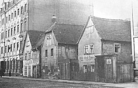
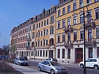
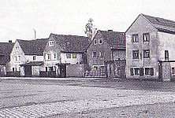
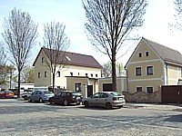
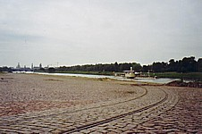

* * *

* * *

Die Moritzburger Straße, bis 1866 Dorfgasse, Hauptgasse bzw. Hauptstraße
bezeichnet, bildete einst den Kern von [Neudorf](../../../../neustadt/leipziger_vorstadt/neudorf/). Zu beiden Seiten lagen die ca.
50 kleinen Anwesen des Ortes, die meist aus Wohnhaus, Scheune und weiteren Nebengebäuden bestanden _(Foto)_. In der zweiten Hälfte des 19. Jahrhunderts
wurde die zuvor dominierende landwirtschaftliche Nutzung immer stärker durch kleine Handwerks- und Gewerbebetriebe und Läden verdrängt. Außerdem gab es hier mehrere Gastwirtschaften. Im Zusammenhang mit dem Eisenbahnbau
entstand 1839 ein Bahnübergang, der 1875 durch einen Tunnel ersetzt wurde. Bei der Umgestaltung der Bahnanlagen nach 1890 und der Schaffung der
Hochgleise verschwand dieser Tunnel wieder. Dabei wurde 1898 auch der Moritzburger Platz angelegt.

Im
Zuge der großstädtischen Entwicklung der Dresdner Vororte wurden ab 1880 die ersten Alt-Neudorfer Häuser abgerissen und durch mehrgeschossige Mietshäuser ersetzt _(Foto)_
. In einem dieser Gebäude (Nr. 59) befand sich das Stadtbüro der [Flugschule](../../../../nordwest/kaditz/flugplatz_kaditz/) von Hermann Reichelt, welcher am 10. April 1914 in Kaditz bei einer
Flugschau ums Leben kam. Zwischen 1938/39 und 1941 errichtete die Wohnungsbaugesellschaft GEWOBAG an der Moritzburger Straße zwei Wohnblocks, denen ebenfalls zahlreiche Häuser des alten Dorfkerns zum Opfer
fielen. Weitere Gebäude wurden 1945 zerstört bzw. zu DDR-Zeiten aufgrund ihres schlechten Bauzustandes abgerissen. Als letzte Häuser der ursprünglichen Bebauung
verschwanden 1996 die Häuser Moritzburger Straße 10, 12 und 14 zugunsten einer modernen Wohnanlage. Heute erinnern lediglich die Gebäude Nr. 76 und 78 an die dörfliche Vergangenheit der Moritzburger Straße.

**_Fotos:_** _Wohnhäuser an der Moritzburger Straße 76 - 78 um 1935 und 2013_

Unterer Gasthof:

Der Gasthof entstand vermutlich im 17. Jahrhundert als eine von zwei Neudorfer Schankstätten und wurde zur Unterscheidung zum Oberen Gasthof an der Leipziger Straße (später [“Stadt Bremen”](../../../../neustadt/leipziger_vorstadt/leipziger_strasse/)) Unterer Gasthof genannt. Die
Gaststube befand sich im früheren “Uhleschen Gut” (Neudorf  Nr. 64) und stellte eine ernsthafte Konkurrenz zum
Reiheschank dar, was wiederholt zu Streitigkeiten zwischen den Betreibern und der Gemeinde führte. Mehrfach
wechselten die Besitzer, zu denen zeitweise auch die Försterfamilie Hecht gehörte. Johann August Hecht hatte das
Uhlesche Gut nach 1715 erworben und verpachtet. Ab 1739 besaßen die Besitzer des Gasthofes auch das Recht, Gäste zu beherbergen.

Nach Hechts Tod 1743 übernahmen seine Nachkommen die Gastwirtschaft. Trotz wiederholter Eingaben und Petitionen
seitens der Gemeinde behielt die Försterfamilie die Schankkonzession. 1823 wurde der Untere Gasthof an den bisherigen Pächter verkauft. Später fiel das Gebäude der Neubebauung des Ortskerns zum Opfer.

Elbkies-Ladegleis:

Jenseits der Leipziger Straße führte seit 1950 ein ca. 425 Meter langes Gleis der
Straßenbahn bis zum Elbkai. Dieses diente bis Mitte der 60er Jahre dem Transport von Kies und Sand für den Bedarf der Dresdner Verkehrsbetriebe. Das vorrangig als Bremssand benötigte Material stammte aus Pirna-Posta und
wurde von dort per Lastlahn zur Anlegestelle verbracht. Hier erfolgte das Umladen auf Straßenbahn- Güterloren, die den Sand in die Betriebshöfe
transportierten. Gelegentlich nutzte man die Gleisanlage auch für Sonderfahrten bei sportlichen Großveranstaltungen im nahegelegenen Paul-Gruner-Stadion.

Mitte der 60er Jahre erwies sich diese Transporttechnologie als unwirtschaftlich und wurde zugunsten des Lkw-
Transports aufgegeben. Die Gleise dienten nun noch einige Jahre dem Abstellen ausgemusterter Straßenbahnwagen und
als Lagerplatz der Verkehrsbetriebe und des Wasser- und Schifffahrtsamtes. 1969 erfolgte der Ausbau der Weiche zur
Leipziger Straße und damit die Stilllegung des Anschlussgleises. Reste sind jedoch noch heute im Straßenpflaster der Moritzburger Straße zu finden.

* * *

 \[ [Home](../../../../index.html)\] \[ [Nord](../../../../nord/)\] \[ [Nordwest](../../../../nordwest/)\] \[ [Neustadt](../../../../neustadt/)\] \[ [Nordost](../../../../nordost/)\] \[ [West](../../../../west/)\] \[ [Zentrum](../../../../zentrum/)\] \[ [Südwest](../../../../sudwest/)\] \[ [Süd](../../../../sud/)\] \[ [Südost](../../../../sudost/)\] \[ [Ost](../../../../ost/)\] \[ [Register](../../../../Register/register.html)\] \[ [Kontakt](../../../../Kontakt/kontakt.html)\] \[ [Impressum](../../../../impressum/)\]
