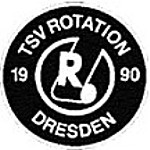
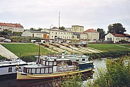
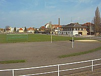

* * *

* * *

* * *

* * *

**Homepage der TSV Rotation Dresden:**

Der Neudorfer Werder, eine frühere, nur durch einen schmalen Flussarm vom Ufer getrennte Elbinsel, lag am Südende der heutigen [Moritzburger Straße](../../../../neustadt/leipziger_vorstadt/neudorf/moritzburger_strasse/). Die Ausdehnung des Elbwerders, auch als Neudorfer Heger bezeichnet, betrug in der Länge ca.
675 Meter, in der Breite ca. 135 Meter, was einer Fläche von ungefähr 5,5 Hektar entspricht. Bereits im 18. Jahrhundert verlandete der Elbarm, so dass der Werder seine Inseleigenschaft verlor und heute nicht mehr als
solche erkennbar ist.

1546 erhielten die aus Altendresden umgesiedelten Neudorfer Bauern den Elbwerder als Entschädigung für ihre verlorenen Grundstücke
zugesprochen und durften diesen gegen Zahlung einer jährlichen Pacht als Weideland nutzen. Da sich auf der Insel auch einige aus dem Ostragehege entkommene Fasane und Rebhühner ansiedelten, kam es zum Streit zwischen den Forstbehörden und der Gemeinde, da die Nutzung der Insel zur Gras- und Holzgewinnung mit den kurfürstlichen Jagdinteressen kollidierten. Daraufhin wurde der Werder dem Ostragut unterstellt und den Neudorfern das Betreten der Insel untersagt.

In der Folge entwickelte sich ein langwieriger Rechtsstreit zwischen Forstbehörden und Bauern, da sich die Neudorfer auf das ihnen zugesicherte Nutzungsrecht beriefen und die Abtretung nicht
akzeptierten. 1721 eskalierte die Situation, nachdem sich die Bewohner entgegen behördlicher Anordnungen eigenmächtig Zutritt zur Insel verschafft hatten. Nach Anhörung beider Parteien durch den Stadtrichter verfügte
August der Starke ein Verbot für alle Beteiligten, den Neudorfer Werder zur Grasgewinnung zu nutzen und stationierte zwei Wachposten auf der Insel. Nachdem auch diese Anordnung keinen dauerhaften Erfolg gebracht hatte,
erhielt die Försterfamilie Hecht die Insel wieder als Weideland für ihre Dienstpferde zugesprochen.

Erst 1781 bekam [Neudorf](../../../../neustadt/leipziger_vorstadt/neudorf/) den Elbwerder per Vertrag vom 13. August wieder übereignet. Allerdings durfte das Areal lediglich als Weideland und zur
Grasgewinnung, nicht jedoch zum Holzeinschlag genutzt werden. Außerdem mussten sich die Neudorfer bei Bedarf für Jagddienste zur Verfügung halten. Mittlerweile war der Wasserarm weitgehend verlandet und konnte nur mit
aufwendigen Schachtarbeiten entschlammt werden. Ende des 18. Jahrhunderts gab man diese Arbeiten auf und wandelte die neu gewonnene Fläche ebenfalls in
Weideland um. Ein Teil des früheren Elbarms wurde 1859 für die Anlage des [Pieschener Elbhafens](../../../../nordwest/pieschen/) verwendet _(Foto)_.

Am 22. März 1864, zwei Jahre vor der Eingemeindung des Ortes nach Dresden, erwarb der Staatsfiskus das Grundstück des Elbwerders und errichtete hier 1866 den Wasserbauhof. Heute werden die Gebäude vom Sächsischen
Wasser- und Schifffahrtsamt genutzt. Weitere Flächen nehmen verschiedene Kleingartenanlagen ein. 1933 entstand
außerdem ein Sportplatz an der Eisenberger Straße. U.a. finden hier Fußballspiele des Vereins TSV Rotation 1990 statt.

TSV Rotation Dresden:

Der Verein wurde 1945 unter dem Namen SG Pieschen von ehemaligen Mitgliedern
des Fußballvereins Sportfreunde 01 gegründet und nutzte zunächst einen Sportplatz an der Wurzener Straße in der Nähe des Sachsenbades. Wenig später wechselte
man jedoch in das ehemalige Allianz-Stadion (Paul-Gruner-Stadion) zwischen Moritzburger und Eisenberger Straße _(Foto)_. Ab 1950 beteiligte man sich als BSG
Sachsenverlag bzw. als BSG Rotation Dresden am Spielbetrieb und schaffte es bis in die DDR-Oberliga. Trägerbetrieb war zeitweise der Verlag der “Sächsischen
Zeitung”. Zu den größten sportlichen Erfolgen gehörte der vierte Platz in der Meisterschaftssaison 1952/53 sowie der Gewinn des FDGB-Pokals 1958.

Ab 1954 war neben dem Paul-Gruner-Stadion das Heinz-Steyer-Stadion Austragungsort vieler Fußballspiele. Als SC Einheit gehörte der Verein bis 1962 der Oberliga, danach der 2. DDR-Liga an. 1965 wechselte die Namensgebung
erneut in FSV Lokomotive. 1990 erhielt der Traditionsverein seinen Namen TSV Rotation zurück.
