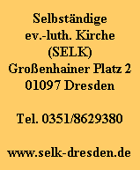
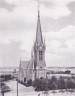
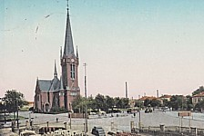
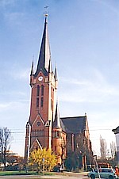
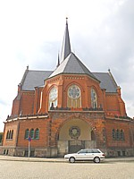

* * *

* * *

* * *

* * *

* * *

* * *

Die St. Petri-Gemeinde entstand am 29. März 1881 als eigenständige Kirchgemeinde der Leipziger Vorstadt, nachdem die Bewohner der hier gelegenen Orte Neudorf und des “Scheunenhofviertels” zuvor der Dreikönigskirche zugeordnet waren. Als deren Mitgliederzahl um 1875 die Grenze von 64.000 überschritten hatte und damit zweitgrößte Kirchgemeinde Sachsens war, entschloss man sich zur Auspfarrung der Vororte. Neben der St. Petri-Kirchgemeinde entstanden so auch die Martin-Luther-Gemeinde in der Äußeren Neustadt und [St. Pauli](../../../neustadt/leipziger_vorstadt/hechtviertel/st_-pauli-kirche/) in der Oppellvorstadt.

Zunächst mussten die Gläubigen mangels einer eigenen Kirche ihre Gottesdienste in der Turnhalle der 8. Volksschule an der Konkordienstraße abhalten. Erst am 15. Mai 1889 konnte am Großenhainer Platz der Grundstein für die neue St. Petri-Kirche gelegt werden. Nach Plänen des Leipziger Architekten Julius Zeißig entstand innerhalb weniger Monate ein Ziegelbau im neogotischen Stil. Der Turm misst bis zur Spitze 68 Meter, der Innenraum bietet Platz für 645 Menschen. Am 5. November 1890 weihte Superintendent Franz Wilhelm Dibelius die Kirche ein. 1906 folgte an der Rückseite der Kirche der Anbau einer Sakristei durch das Architektenbüro Schilling & Gräbner.

Für die Innenausstattung erhielt die Gemeinde verschiedene Kunstwerke gestiftet, u.a. drei Farbglasfenster zu den Themen “Buße”, “Glauben” und “Barmherzigkeit” des Glasmalers Alfred Diethe sowie eine Darstellung des Apostels Petrus mit den vier Evangelisten über dem Haupteingang. Leider gingen diese bei Zerstörung der Kirche im Zweiten Weltkrieg verloren, ebenso die Sauer-Orgel. Erhalten ist hingegen ein 1909 vom Bildhauer Otto Petrenz geschaffenes Majolika-Relief “Christus in Begleitung zweier römischer Soldaten” am Treppenaufgang. Hergestellt wurde das Kunstwerk in der Merziger Fabrik von Villeroy & Boch. Nach mehreren Bombentreffern brannte der Innenraum der Kirche am 14. Februar 1945 aus, wenige Tage später stürzte der Dachstuhl des Gebäudes ein. Die zunächst unzerstörte Turmhaube wurde noch in den letzten Kriegstagen durch Beschuss schwer beschädigt. Auch das Pfarrhaus der Kirche fiel den Bomben zum Opfer.

1950 konnte die St. Petri-Gemeinde mit dem Wiederaufbau der Kirche beginnen. Während das Äußere heute wieder weitgehend dem ursprünglichen Zustand entspricht, gestaltete man den Innenraum komplett neu. Dabei fanden u.a. zwei Keramikplastiken des Bildhauers Gustav Schmidt Aufstellung im Altarraum. Die Plastiken zeigen die Passionsgeschichte und die Auferstehung Jesu. Außerdem finden sich hier zwei Bilder Schmidts sowie eine Kopie des bekannten Gemäldes “Das Kreuz im Gebirge” von Caspar David Friedrich, geschaffen von der Amateurmalerin Martha Henckel Pillnay. Am 18. Dezember 1955 wurde die Kirche erneut geweiht.

1958 konnte die Gemeinde wieder eine Orgel erwerben. Angefertigt wurde diese von der in unmittelbarer Nachbarschaft beheimateten Orgelbaufirma Jehmlich. Wegen ihrer guten Akustik besitzt die St. Petri-Kirche auch einen guten Ruf als Aufführungsort sakraler Musik. Zwischen 1991 und 1996 erfolgte eine umfassende Sanierung des Gebäudes. Dabei erhielt die Kirche ihre Turmbekrönung zurück.

Aufgrund des Rückgangs der Gläubigenzahlen entschloss sich die evangelisch-lutherische Landeskirche 2001, die St. Petri-Kirche an die freikirchliche “Selbständige Evangelisch-Lutherische Kirche” (SELK) zu verpachten. Diese entstand nach dem Austritt einiger Christen aus der Evangelisch-lutherischen Kirche Ende des 19. Jahrhunderts und besitzt in Dresden seit 1871 eine eigene Gemeinde. Die SELK bekennt sich zu einer strengeren Auslegung der lutherischen Lehre und lehnt u.a. die Ernennung von Frauen zu Pfarrerinnen ab. Bis 1945 existierten mit der Trinitatis- und der St.-Pauls-Gemeinde zwei kirchliche Gemeinschaften, deren Gotteshäuser auf der Alaunstraße und am Hauptbahnhof jedoch zerstört wurden. Heute nutzen die SELK, die 1991 mit der Altlutherischen Kirche vereinigt wurde, und die seit 1999 mit den anderen Neustädter Kirchen zusammengeschlossene St.-Petri-Gemeinde das Gotteshaus gemeinsam.

Video: Glockengeläut der St. Petri-Kirche

* * *

 \[ [Home](../../../index.html)\] \[ [Nord](../../../nord/)\] \[ [Nordwest](../../../nordwest/)\] \[ [Neustadt](../../../neustadt/)\] \[ [Nordost](../../../nordost/)\] \[ [West](../../../west/)\] \[ [Zentrum](../../../zentrum/)\] \[ [Südwest](../../../sudwest/)\] \[ [Süd](../../../sud/)\] \[ [Südost](../../../sudost/)\] \[ [Ost](../../../ost/)\] \[ [Register](../../../Register/register.html)\] \[ [Kontakt](../../../Kontakt/kontakt.html)\] \[ [Impressum](../../../impressum/)\]
