

Die Auenstraße geht auf einen alten, jedoch nicht benannten Fußweg zwischen Leipziger Straße und den Scheunenhöfen zurück. Durch den Bahnbau und die Anlage des [Städtischen Schlachthofes](../../../neustadt/leipziger_vorstadt/leipziger_strasse/alter_schlachthof/) wurde dieser Weg später unterbrochen und überbaut. Seit 1861 trägt das Reststück an der Großenhainer Straße den Namen Auenstraße.

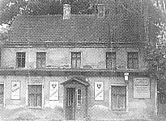Die Bärnsdorfer Straße existierte bereits im Mittelalter und verband als Alte Radeburger Straße die Stadt Altendresden mit Radeburg. Gleichzeitig bildete sie bis 1866 die Grenze zwischen Neudorf und den zur Neustadt gehörenden Scheunenhöfen. Das Gelände war noch bis nach dem Ersten Weltkrieg zum Großteil unbebaut und wurde von ausgedehnten Feldern bzw. Gartenkolonien eingenommen. Am nördlichen Ende gab es die beliebte, um 1960 abgerissene Schankwirtschaft “Zur Grünen Aue” _(Foto links)_.

Nach dem Ersten Weltkrieg wurde die Alte Radeburger Straße ausgebaut und am 26. Februar 1925 nach dem kleinen Ort Bärnsdorf bei Moritzburg benannt. Aus einem früheren Sportplatz ging später das Stadion der Bauarbeiter hervor, welches später noch um eine Radrennbahn erweitert wurde. Um 1925 entstand zwischen Bärnsdorfer Straße und Hechtstraße eine Wohnsiedlung des Heimstättenvereins Dresden-Nordwest _(Foto rechts)_. An der Einmündung der Straße in die Hechtstraße steht eine Stiel-Eiche, die als Naturdenkmal ausgewiesen ist.

Stadion Dresden-Neustadt: Die Anlage entstand ursprünglich als Sportplatz des 1902 gegründeten Fußball-Clubs "Dresdner Fußballring 02". Größte Erfolge waren die Endspielteilnahmen im Kampf um die Mitteldeutsche Meisterschaft 1917 und 1919. Zudem gewann der "Fußballring" zwischen 1913 und 1922 sechsmal die Ostsächsische Fußballmeisterschaft. Zu dieser Zeit gehörte der Verein neben dem DSC zu den besten Fußballmannschaften Sachsens. 1921 wurde das Stadion umfassend saniert und mit einem Spiel gegen den FC Bayern München eingeweiht. Neben Spiel- und Trainingsflächen gehörte auch eine moderne Radrennbahn zu dieser nun als "Stadion Dresden-Nord" bezeichneten Sportstätte.

1930 erhielt der "Dresdner Fußballring 02" nach seinem Hauptsponsor, der [Zigarettenfabrik Greiling](../../../zentrum/sudvorstadt/strassen_sudvorstadt/zwickauer_strasse/), den Namen "Ring-Greiling Dresden". Im Zuge der nationalsozialistischen Gleichschaltungspolitik folgte 1933 die Zwangsfusion mit dem SV Brandenburg 01 und dem VfR Rasensport zum neuen Verein Sportfreunde 01. Gespielt wurde auch weiterhin an der Bärnsdorfer Straße. Bereits im gleichen Jahr qualifizierte man sich für die damals höchste Spielklasse, die Gauliga Sachsen, der man insgesamt fünf Spielzeiten angehörte.

1945 wurde der Verein, wie alle anderen Vereine auch, durch die Besatzungsmächte verboten und aufgelöst. Als Nachfolger entstand 1946 die SG Neustadt, die bis 1989 unter den Namen BSG Bau-Union-Süd Dresden und BSG Aufbau Dresden-Mitte im Amateursport aktiv war. Das Stadion erhielt in diesem Zusammenhang den Namen "Stadion der Bauarbeiter". Am 4. Mai 1990 wurde der Verein Sportfreunde 01 Dresden neu gegründet und schloss sich 2001 mit dem SV Nord Dresden zu den Sportfreunden 01 Dresden-Nord zusammen. Gleichzeitig erfolgte eine Verlagerung des Fußballspielbetriebs von der Bärnsdorfer Straße zur Meschwitzstraße.

Neben Fußballspielen fanden im Stadion an der Bärnsdorfer Straße regelmäßig auch Radsportveranstaltungen statt. Unter anderem gab es im August 1962 ein Auswahlrennen des DDR-Radsportverbandes. Nach dem Zweiten Weltkrieg wurde die Radrennbahn kurzzeitig sogar für Motorradrennen genutzt. Seit März 1994 dient das Stadion Dresden-Nord als Trainings- und Heimspielstätte des American Football Clubs "Dresden-Monarchs".

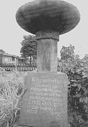Kleingartenverein “Rudolphia”: Die Kleingartenanlage zwischen Bärnsdorfer und Johann-Meyer-Straße wurde 1902 angelegt und sollte nach dem Willen ihres Initiators Erich Rudolph vorrangig der Erholung der Arbeiter im dichtbesiedelten “Hechtviertel” dienen. Anfangs standen dafür insgesamt vierzig Gärten zur Verfügung. 1914 erfolgte nach Ankauf weiterer Flächen eine Erweiterung des Geländes auf 6,8 Hektar mit insgesamt 310 Parzellen.

In den 1920er Jahren entstand das nach einem weiteren Förderer der Sparte, dem Schlosser Otto Stamm, benannte Kulturheim, welches Schauplatz verschiedenster Veranstaltungen war. Beliebt waren regelmäßige Konzerte und Sportwettbewerbe sowie das alljährliche Sommerfest des Vereins. 1938 mussten auf Weisung der Behörden in der Sparte Maulbeerbäume für die Seidenraupenzucht gepflanzt werden. Seide war ein wichtiger Rohstoff für Fallschirme. Heute gehören zur “Rudolphia” 271 Gärten, was den Verein zu einem der größten in Dresden macht. An den Vereinsgründer Erich Rudolph, dem die Sparte auch ihren Namen verdankt, erinnert seit 1952 ein Gedenkstein _(Foto)_.

Kleingartenverein “Rosenhain”: Der zu den kleineren Vereinen in diesem Gebiet gehörende KGV “Rosenhain” wurde 1902 von einem Herrn Schwips gegründet. Die Anlage erstreckt sich entlang des Bahndamms und der Hansastraße und besitzt heute 51 Parzellen. Angrenzend befindet sich die 1920 entstandene Gartensparte "Grüne Hoffnung".

Die Bärwalder Straße wurde in den 1920er Jahren beim Bau des Wohnviertels um den Niederauer Platz angelegt und am 23. September 1926 nach dem Ort Bärwalde bei Radeburg benannt. Die Wohngebäude entstanden nach Plänen Otto Schuberts für den Kleinwohnungs-Bauverein Dresden. Während des Luftangriffs vom 2. März 1945 entstanden an den Gebäuden teilweise Schäden. Stark zerstört wurden u.a. die Häuser Nr. 5 und 7. Eine umfassende Sanierung der unter Denkmalschutz stehenden Wohnanlage erfolgte ab 2000.

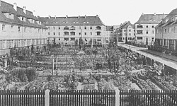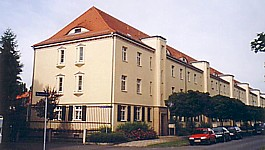

**_Fotos:_** _Wohnsiedlung Bärwalder Straße um 1930 - Blick in die Bärwalder Straße_

Die Berbisdorfer Straße wurde nach dem Ersten Weltkrieg im Zusammenhang mit dem Bau einer genossenschaftlichen Wohnsiedlung angelegt. Die meisten Straßen in diesem Viertel sind nach Orten nördlich von Dresden benannt. Deshalb erhielt auch diese Straße am 12. Mai 1927 ihren Namen nach dem Ort Berbisdorf bei Radeburg.

Als Bischofsplatz wird seit 1892 die Straßengabelung am westlichen Ende des Bischofsweges im früheren Scheunenhofviertel benannt. An seiner Südseite liegt der [Innere Neustädter Friedhof](../../../neustadt/leipziger_vorstadt/innerer_neustadter_friedhof/), während die Ostseite von den Bahnunterführungen der Strecken nach Leipzig und Görlitz beherrscht wird. Seinen Namen verdankt er dem Bischofsweg, einem bereits im 13. Jahrhundert von den Meißner Bischöfen angelegten Verbindungsweg von Meißen nach Stolpen.

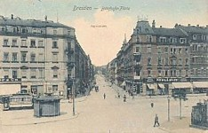Schon vor 1945 war der Bischofsplatz ein wichtiges Geschäftszentrum für das angrenzende Hechtviertel und die Scheunenhöfe. Zu den hier ansässigen Geschäften gehörte das Konfektionshaus Weiß und Lederer (Nr. 4/6) und bis 1938 das Warenhaus des jüdischen Unternehmers E. Meidner (Nr. 8) _(Foto rechts)_. Das 1945 beschädigte Gebäude wurde in der Nachkriegszeit abgerissen und 2017 durch einen Neubau ersetzt. Architektonisch bemerkenswert sind die sogenannten "Römmler-Häuser" (Nr. 12-16) an der Einmündung der Johann-Meyer-Straße, die unter Denkmalschutz stehen. Bauherr war der bekannte Fotograf und Unternehmer Emil Römmler (1842-1941), Inhaber der Lichtdruckanstalt [Römmler & Jonas](../../../zentrum/johannstadt/strassen_johannstadt/blasewitzer_strasse/rommler___jonas/). Die in der Platzmitte stehende Blockstation der Dresdner Gas-, Wasser- und Elektrizitätswerke (DREWAG) stammt von 1930 und war einst mit einer Blumenhalle kombiniert. Architekt des Kleinbaus war Otto Röder.

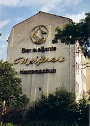Da der Bischofsplatz 1945 von größeren Kriegsschäden verschont blieb und so sein Bild als typisches Arbeiterviertel der Gründerzeit bewahren konnte, drehte Kurt Maetzig hier in den 1950er Jahren verschiedene Szenen seines Thälmann-Films. Die Gebäude stehen heute unter Denkmalschutz. Bemerkenswert war bis zu ihrer Demontage 2011 eine noch erhaltene Leuchtwerbung der Meißner Schuhfabrik an einer Giebelwand zur Hechtstraße _(Foto)_. Die 1961 von der Dresdner Firma “Neon-Müller” geschaffenen Elemente wurden beim Abbau geborgen und sollen nach ihrer Restaurierung an anderer Stelle wieder angebracht werden. Am 18. März 2016 wurde am Bischofsplatz ein neuer S-Bahn-Haltepunkt eingeweiht.

T.B.-Lichtspiele: 1926 entstand am Bischofsplatz im Hinterhof des Grundstücks Nr. 4/6 nach Plänen von Martin Pietzsch das Kino “TeBe”, später auch als T.B.- Lichtspiele (= Theater am Bischofsplatz) bezeichnet. Das Filmtheater besaß 500 Plätze und hatte bis Ende der 1960er Jahre geöffnet. Nach seiner Schließung dienten die Räume zeitweise als Polstermöbellager, später auch als Verkaufsstelle. 2002 erfolgte der Abriss.

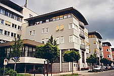 Die Buchenstraße wurde 1859 im Zusammenhang mit dem Ausbau des Hechtviertels angelegt und zwei Jahre später offiziell benannt. Zu den ersten Gebäuden gehörten die vom Dresdner Kaufmann Johann Meyer finanzierten Arbeiterwohnhäuser der nach ihm benannten “Johann- Meyer-Stiftung” (Nr. 24-27). Mit dem Bau wollte der durch Großhandelsgeschäfte zu Wohlstand gekommene Unternehmer menschenwürdige Unterkünfte für Arbeiterfamilien schaffen. Die 1873-76 von Carl Lisske entworfene Anlage gehört zu den ältesten Sozialsiedlungen in Dresden und steht unter Denkmalschutz.

Weitere Wohngebäude entstanden Ende des 19. Jahrhunderts bzw. nach 1990, darunter das Comfort Hotel (ab 2007 Best Western Macrander) mit öffentlicher Gaststätte “Orangerie” _(Foto rechts)_ (Nr. 10). Im Eckhaus zur Oppelstraße (Rudolf-Leonhard-Straße) befand sich vor dem Ersten Weltkrieg das Lokal “Petzbräu” (Nr. 6 - _Foto links_). Im Nachbarhaus Nr. 8 hatte bis nach 1930 die Möbelfabrik Türpe ihren Sitz. Später nutzte die Zentralgenossenschaft Deutscher Drogisten die Räume.

Möbelfabrik Türpe (Nr. 8): Das Unternehmen wurde 1841 von August Türpe als Kunsttischlerei gegründet und hatte seinen Sitz zunächst auf der Marienstraße 24 in der Nähe des Postplatzes. Hergestellt wurden verschiedene Holz- und Metall-Marqueterie-Möbel, Salonuhren und ähnliche Wohnausstattungen. Spezialisiert war die Firma auf intarsienähnliche Einlege- und Furnierarbeiten (Marketerien) und Holzmosaiken. Nach 1860 trat auch sein Sohn Alwin (1843-1918) in das Unternehmen ein. 1867 ließ Türpe, der sogar als Hoflieferant werben durfte, auf der Buchenstraße eine größere Fabrik erbauen und verlegte dorthin seinen Firmensitz. In der Marienstraße blieb lediglich eine Verkaufshalle, in der am 16. Dezember 1882 erstmals in Dresden eine elektrische Beleuchtungsanlage in Betrieb genommen wurde. Bis Mitte der 1930er Jahre war das Unternehmen als Dresdner Fabrik für Möbel aus gebogenem Holz tätig. Danach übernahm die De-Dro Zentralgenossenschaft deutscher Drogisten eGmbH die Räumlichkeiten.

Die heutige Conradstraße wurde einst als “Marienwegel” bzw. Rosmarienweg bezeichnet und verband die Scheunenhöfe mit der Landstraße nach Großenhain. 1874 bekam sie ihren heutigen Namen nach dem Wettiner Konrad dem Großen (1099-1157). Konrad erhielt 1130 die Mark Meißen zum Lehen und war maßgeblich am Ausbau der wettinischen Macht im Elbe-Saale-Gebiet beteiligt. Als Begründer der über 800-jährigen Herrschaft des Fürstenhauses in Sachsen führt er den Fürstenzug an.

Die Wohnhäuser der Eisenbahner-Wohnungsbau-Genossenschaft zwischen Conrad-, Hansa- und Großenhainer Straße entstanden zwischen 1927 und 1930 nach Plänen von Curt Herfurth (Nr. 11-23 - _Foto_). Außerdem gab es hier um 1918 die Zigarettenfabrik Compagnie Macedonia (Nr. 6) und auf dem Grundstück Nr. 34 einen Betrieb zur Herstellung vom Holzhäusern und Baracken. Zu DDR-Zeiten hatte hier der VEB Holzverarbeitung seinen Sitz.

Der Ebersbacher Weg entstand Mitte der 1920er Jahre beim Bau der Wohnsiedlung “Oberer Hecht” rund um den Niederauer Platz. Seine Benennung erfolgte 1927 nach dem Ort Ebersbach in der Nähe von Radeburg.

Die 1901 so benannte Eisenbahnstraße befindet sich südwestlich des Bahnhofes Dresden-Neustadt. Jenseits der Straße lag der teilweise auf dem Gelände des einstigen [Leipziger Bahnhofes](../../../neustadt/leipziger_vorstadt/dresden_-_leipzig/leipziger_bahnhof/) entstandene Güterbahnhof Dresden-Neustadt. Seit dessen Schließung 2005 liegt das Gelände brach, eine Bebauung ist jedoch geplant. Die Eisenbahnstraße ist zudem Teil einer bei Umleitungen und Verkehrsstörungen genutzten Gleisschleife der Dresdner Straßenbahn.

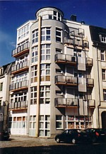Die Eisenberger Straße wurde 1888 an Stelle eines Feldweges angelegt und erhielt ihren Namen nach dem Ort Eisenberg, der heute unter dem Namen Moritzburg bekannt ist. In der Folge wurden hier im Abschnitt nördlich der Leipziger Straße mehrgeschossige Wohnhäuser errichtet. Außerdem existierten bereits um 1890 zwei Gastwirtschaften, die den Namen “Stadt Oschatz” (Nr. 1) und "Restaurant Kurfürst Moritz" (heute “Lilienstein” - Nr. 15) trugen. 1911 folgte das Doppelhaus Eisenberger Straße 16/18 als Teil einer Wohnanlage des Kleinwohnungsbauvereins.

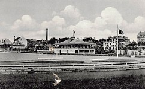Der südliche Abschnitt der Straße bis zum Elbufer blieb hingegen unbebaut, Aus einem hier 1933 von der Allianz-Versicherung auf dem Gelände des früheren [Elbwerders](../../../neustadt/leipziger_vorstadt/neudorf/neudorfer_werder/) angelegten Sportplatz ("Allianz-Arena") ging das heutige Stadion des Sportvereins “TSV Rotation Dresden 1990 e.V.” hervor _(Foto vor 1945)_. Nach einem Dresdner Antifaschisten wurde es bis 1990 offiziell als “Paul-Gruner-Stadion” bezeichnet. Gegenüber befindet sich das Kinderfreizeitzentrum “Eselnest”. Am Ende der Straße lag bis 1992 die Anlegestelle einer [Elbfähre](../../../neustadt/leipziger_vorstadt/neudorf/) zum Ostragehege. Heute erinnert noch der Name der 1946 gegründeten Kleingartensparte “An der Fähre” an diese Verkehrsverbindung.

Die Erfurter Straße entstand Ende des 19. Jahrhunderts im Zuge der planmäßigen Bebauung der Neudorfer Flur und wurde 1897 nach der Stadt Erfurt benannt. Vorrangig befanden sich hier gewerbliche Einrichtungen, die zum Neustädter Güterbahnhof bzw. zum [Schlachthof](../../../neustadt/leipziger_vorstadt/leipziger_strasse/alter_schlachthof/) gehörten. Das Eckhaus am Großenhainer Platz (Nr. 32) beherbergte um 1910 die Gaststätte "Erfurter Hof". 1920 errichtete die Dresdner Fleischerinnung an der Erfurter Straße den Gebäudekomplex Nr. 1-13 als Wohnungen für ihre Mitglieder. 2019 entstand auf einem früheren Bahngrundstück an der Erfurter und Gehestraße das neue Gymnasium Dresden-Pieschen.

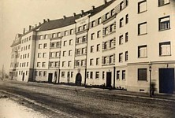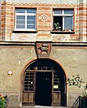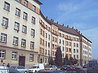

**_Fotos:_** _Die Wohnanlage der Dresdner Fleischerinnung an der Erfurter Straße_

Die Erlenstraße entstand 1859 im Zuge des Ausbaus des Hechtviertels und wurde, wie auch die benachbarten Buchen-, Fichten- und Kiefernstraße, nach einer Baumart benannt. Wenig später entstanden hier mehrgeschossige Wohnhäuser in geschlossener Bauweise, welche überwiegend an Arbeiterfamilien vermietet wurden.

In den Erdgeschossräumen waren oft Läden und kleine Handwerksbetriebe untergebracht. So gab es auf der Erlenstraße 10 früher die Schankwirtschaft “Erlenschänke”, welche noch bis nach dem Zweiten Weltkrieg existierte. Im Eckhaus zur Johann-Meyer-Straße (Erlenstraße 22) hat sich mit der “Erlenklause” noch bis heute eine der einst typischen Eckkneipen des Stadtviertels erhalten. Die gastronomische Nutzung der Räume begann vermutlich bereits kurz nach Fertigstellung des Hauses. 1913 ist das Lokal unter dem Namen “Neustädter Reichelbräu” im Adressbuch verzeichnet und befand sich im Besitz von Ernst Eiselt.

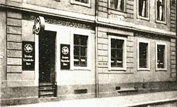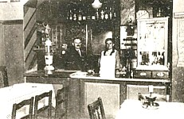

**_Fotos:_** _Die “Erlenschänke” (Nr. 10) um 1930_

Peterbrunnen (Nr. 6): Das Unternehmen wurde 1896 als Fabrik zur Herstellung von alkoholfreien Getränke gegründet. Inhaber war der Biergroßhändler Gustav Herrmann Borkmann. Unter Nutzung eines eigenen Brunnen produzierte Borkmann Tafelwasser, Fassbrause und andere nichtalkoholische Getränke, die unter den Marken "Peterbrunnen" und "Triumph" vertrieben wurden. In den 1930er Jahren übernahm Hermann Otto Borkmann, später Egon Borkmann den Betrieb, der mit seinen 10 Mitarbeitern auch zu DDR-Zeiten in Privatbesitz blieb. In den 1980er Jahren konnten hier täglich bis zu 18.000 Flaschen abgefüllt werden. Seit 1969 gab es zudem eine Produktion im "Drucktankverfahren" direkt beim Endverbraucher, z.B. bei der Mitropa in den beiden großen Dresdner Bahnhöfen und an der TU Dresden. Nach 1990 wurde die Getränkeherstellung eingestellt. Heute nutzt ein Getränkegroßhandel das Areal.

Die Fichtenstraße entstand Mitte des 19. Jahrhunderts beim Ausbau des Hechtviertels und wurde 1859 benannt. Wie auch einige Straßen in der Nachbarschaft erhielt sie ihren Namen nach einer Baumart.

Wie in vielen Straßen rund um den Königsbrücker Platz gab es auch hier kleine Läden und Lokale. So existierte in der Nr. 4 bereits vor dem Ersten Weltkrieg das “Restaurant von Peschel”, ab 1911 von einem ehemaligen Feldwebel nach der nahegelegenen Trainkaserne in der Albertstadt "Zum Sächsischen Train" genannt. Später änderten neue Inhaber den Namen in “Königsbrücker Hof”. Im Nachbarhaus (Nr. 6) betrieb Hulda Fabig 1910 ihr Restaurant "Zum sächsischen Gardereiter". Auf der Fichtenstraße 15 konnten die Anwohner in der Schankwirtschaft von Böhnisch einkehren, die sogar eine Asphaltkegelbahn besaß (ab 1916 "Zum Königswald"). Zu den kleineren Gewerbebetrieben des Viertels gehörte die “Chocolade- und Zuckerwaaren-Fabrik” von Paul Meissner (Nr. 7). Im Eckhaus zum Königsbrücker Platz (Fichtenstraße 2) befand sich das Pfarrhaus der [St.-Pauli-Kirche](../../../neustadt/leipziger_vorstadt/hechtviertel/st_-pauli-kirche/).

Die Friedensstraße war einst Teil der alten Radeburger Landtraße und stellte zugleich die für die Versorgung der Stadt wichtige Verbindung zwischen Altendresden und Rähnitz her. An diesen mittelalterlichen Verkehrszug erinnert heute noch die Rähnitzgasse. Mit Ausbau der Festungsanlagen verlor dieser Weg an Bedeutung, da hier kein Stadttor vorhanden war. Auf dem Areal außerhalb der Stadtmauern wurden 1685 die Scheunenhöfe errichtet, die man wegen der Feuersgefahr aus dem Zentrum verbannen wollte. Die kleine Siedlung war später unter dem Namen “Gemeinde auf den Scheunenhöfen” bekannt und wegen der hier befindlichen Ausflugslokale ein beliebtes Ziel der Dresdner Bevölkerung. Das historische Foto zeigt das sogenannte Scheffelsche Gut (Nr. 41) um 1910, welches damals noch landwirtschaftlich genutzt wurde und später Domizil einer Futtermittelhandlung war.

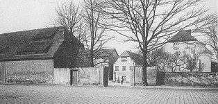

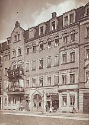1732 legte man in unmittelbarer Nachbarschaft den neuen Friedhof der Dreikönigskirche an, da sein Vorgänger den Bauplänen August des Starken für die “Neue Königstadt” weichen musste. Als [Innerer Neustädter Friedhof](../../../neustadt/leipziger_vorstadt/innerer_neustadter_friedhof/) beherbergt er zahlreiche bedeutende Grabdenkmale der Barockzeit sowie die Grabstätten verschiedener Prominenter. In diesem Zusammenhang entstand auch ein neuer Weg von der Neustadt, der jedoch erst seit 1874 offiziell als Friedensstraße bezeichnet wird. Wenig später begann die zunehmende Bebauung des Areals mit Wohnhäusern. Nach den historischen Gegebenheiten wurde dieser Stadtteil im Volksmund “Scheunenhofviertel” genannt und 1874 in die neu gebildete Leipziger Vorstadt eingegliedert.

Wie in vielen Straßen der Vorstadt ließen sich auch hier Kleingewerbetreibende, Händler und Gastwirte nieder. Lokale gab es früher u.a. im Eckhaus zur Lößnitzstraße (Nr. 1), in der Nr. 23 (Weißer Adler), Nr. 24 (Zur Friedensburg) und 33 (Schankwirtschaft von Schurig). Im Haus Nr. 19 betrieb Oskar Zacharias eine Likörfabrik mit zugehöriger Weingroßhandlung (Schinke & Zacharias). Spezialität der Firma war der "Echt Original-Sanitäts-Wermutwein". 1917 warb die Firma damit, ältester Wermutweinhersteller in Sachsen zu sein. Verkauft wurden aber auch Spirituosen und Tee, u.a. die Eigenmarke "Vater Schinke". Das Bild links zeigt ein typisches Wohn-und Geschäftshaus (Nr. 18) aus der Zeit vor dem Ersten Weltkrieg. Die Ladenräume wurden damals von einer Bäckerei, später von einem Fleischer genutzt. Bis heute prägen vor allem Wohngebäude der Gründerzeit das Straßenbild. 2019 entstand an der Ecke Fritz-Reuter-Straße eine aus mehreren Einzelhäusern bestehende Wohnanlage mit über 100 Wohnungen (Quartier Friedenseck).

Filmtheater “Casablanca”: Das kleine Kino wurde am 1. Mai 1991 im Eckhaus Friedensstraße 23 eröffnet und war mit nur 50 Plätzen kleinstes Dresdner Filmtheater. Zuvor hatten die Räume zeitweise als Gaststätte (“Weißer Adler”) bzw. um 1940 als Buchdruckerei gedient. Betreiber des Filmtheaters war zunächst die Nickelodeon Dresden GmbH, ab 1996 der Filmvorführer Michael Rudolph. Das Programm bestand hauptsächlich aus Dokumentar- und Spielfilmen jenseits des Mainstreams. Zudem wurde bis 1996 allwöchentlich der namengebende Filmklassiker “Casablanca” gezeigt. 2003 übernahm Wolfhard Pröhl das Kino, der 2009 einige Umbauten und Modernisierungen vornahm. Zuletzt wurde das Ende August 2013 aus finanziellen Gründen geschlossene Programmkino von seinem Sohn Sebastian geführt.

Die heutige Fritz-Hoffmann-Straße im “Scheunenhofviertel” der Leipziger Vorstadt wurde ursprünglich Radebeuler Straße genannt und verbindet Hansa- und Friedensstraße. Am 8. Februar 1956 erhielt sie den Namen des Dresdner Antifaschisten Fritz Hoffmann (1907–1942). Hoffmann gehörte ab 1924 der KPD an und leitete die KPD-Straßenzelle „Hansa“ in der Oppelvorstadt. Während der NS-Zeit wurde er mehrfach wegen illegaler Untergrundarbeit und dem Verteilen von Flugblättern verhaftet und 1942 in Berlin-Plötzensee hingerichtet.

**_Foto:_** _Die ehemalige Schankwirtschaft "Goldene Sonne" (Fritz-Hoffmann-Straße 10)_

Die heutige Fritz-Reuter-Straße verband einst als Teil des Bischofsweges den Briesnitzer Burgwart mit den bischöflichen Besitzungen in Stolpen. Auf Anregung des Vereins “Schurr Murr”, einer Vereinigung zur Pflege norddeutschen Brauchtums, erhielt der auf Neudorfer Flur gelegene Abschnitt 1891 den Namen des Dichters Fritz Reuter (1810-1874). Reuter verfasste zahlreiche Erzählungen und Gedichte, meist in norddeutscher Mundart.

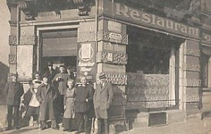An der zunächst unbebaut gebliebenen Straße siedelten sich nach 1900 verschiedene Unternehmen der Baustoffindustrie an. Zu den wichtigsten Firmen gehörte die Holzgroßhandlung Höhne, die hier große Lagerplätze besaß (Nr. 41). Wohnhaus des Besitzers war die noch erhaltene Villa Fritz-Reuter-Straße 37. Im Hinterhaus von Nr. 10 gab es die Maschinenfabrik Liebig & Ludewig, die Blechscheren, Stanzen und ähnliche Maschinen zur Metallverarbeitung herstellte. Das erhaltene Produktionsgebäude wurde nach 2010 zum Wohnhaus umgebaut.

Um die Jahrhundertwende entstanden auch auf den benachbarten Grundstücken Wohn- und Geschäftshäuser mit Läden und kleinen Ecklokalen, u.a. im Eckhaus zur Johann-Meyer-Straße der "Johann-Meyer-Tunnel" _(Nr. 2 - Bild rechts)_ und die Schankwirtschaft Berger an der Einmündung der Helgolandstraße (Nr. 11). An Stelle des zerstörten Eckhauses zur Conradstraße (Nr. 1), welches bis 1945 Sitz der Verwaltung des Stadtbezirkes 15 war, wurde 2019 ein modernes Wohn- und Geschäftshaus gebaut.

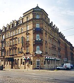Fritz-Reuter-Hof (Nr. 21): Das um 1900 errichtete Eckhaus zur Friedensstraße _(Foto links)_ wurde bereits vor dem Ersten Weltkrieg unter dem Namen “Fritz-Reuter-Hof” gastronomisch genutzt. Unter wechelnden Betreibern existierte die Gaststätte bis 1990. Danach übernahm ein Investor das Haus und ließ es zum Hotel umbauen. Zunächst firmierte dieses ab 1991 unter dem Namen "Alpha Hotel", nach einem Betreiberwechsel als “Tryp by Wyndham”. Im Zuge des Flüchtlingskrise übernahm im Dezember 2015 die Stadt Dresden das Hotel und nutzte es bis 2018 als Asylbewerberheim. Heute wird es von der IBIS-Hotelkette unter dem Namen "ibis Styles Dresden Neustadt" geführt.

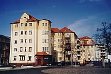Die Gehestraße entstand 1887 im Zusammenhang mit der Anlage des Neustädter Güterbahnhofes. Ihren Namen verdankt sie dem Unternehmer Franz Ludwig Gehe (1810-1882), der 1865 auf der Leipziger Straße eine Drogenappretur-Anstalt gründete, aus der später das [Arzneimittelwerk](../../../neustadt/leipziger_vorstadt/leipziger_strasse/arzneimittelwerk_dresden/) hervorging. Gehe engagierte sich auch auf sozialem Gebiet und hinterließ einen Teil seines Vermögens einer Stiftung zugunsten bedürftiger Kinder. Die Gehe-Stiftung existiert bis heute und finanzierte u.a. den Aufbau des Erich-Kästner-Museums und die Sanierung des Schillerhäuschens.

Die Bebauung der Gehestraße mit Wohn- und Geschäftshäusern begann erst nach 1900 und wurde 1911 mit einer Wohnanlage des Kleinwohnungsbauvereins Dresden (Nr. 1a-d) fortgesetzt _(Foto rechts)_. 1930 folgten die Häuser Nr. 23-35, errichtet von der Eisenbahner-Baugenossenschaft _(Foto links)_. Auf dem Gelände des [Neustädter Güterbahnhofes](../../../neustadt/leipziger_vorstadt/dresden_-_leipzig/) wurde 1968 der Containerbahnhof Dresden-Neustadt angelegt, der noch bis 2005 existierte. Heute sind nur noch wenige Bauten des Bahngeländes erhalten. In einem dieser Gebäude, dem ehemaligen Wagenausbesserungswerk, hat seit 2007 die Ateliergemeinschaft “geh 8” ihr Domizil. Der Verein aus Künstlern, Architekten und Designern nutzt die Halle dabei für die eigene Tätigkeit, organisiert aber auch kleinere Ausstellungen und Veranstaltungen. Gegenüber entstand 2019 ein moderner [Schulkomplex](../../../neustadt/leipziger_vorstadt/) für das Gymnasium Pieschen und die 145. Oberschule.

Ursprünglich gehörte das Areal zum alten Dresdner [Schlachthof](../../../neustadt/leipziger_vorstadt/leipziger_strasse/alter_schlachthof/) und wurde nach dessen Schließung 1907 von verschiedenen Gewerbebetrieben genutzt. Erst nach 1990 entschloss man sich, die Zufahrtsstraße und die hier ansässigen Betriebe unter einer neuen Adresse zu führen. Auf Beschluss des Stadtrates erhielt diese am 2. November 1995 den Namen Gothaer Straße. Bei der Namensgebung orientierte man sich an der benachbarten Erfurter und Weimarischen Straße, welche ebenfalls nach Thüringer Städten benannt sind.

Der Großenhainer Platz entstand 1862 als Mittelpunkt einer geplanten, jedoch nie realisierten Wohnanlage und wurde in Anlehnung an die den Platz kreuzende Großenhainer Straße benannt. 1889/90 baute man hier die [St. Petri-Kirche](../../../Neustadt/Leipziger_Vorstadt/St_Petri-Kirche/st_petri-kirche.html). Außerdem gab es am Platz um 1910 die Polizeiwache des 9. Bezirks (Nr. 1) sowie im Eckhaus zur Erfurter Straße (Nr. 32) die Schankwirtschaft "Stadt Erfurt".

Die Ende des 19. Jahrhunderts parallel zum Bahnbogen angelegte Gutschmidstraße im “Scheunenhofviertel” erhielt im Jahr 1900 ihren Namen nach dem sächsischen Kabinettsminister Christian Gotthelf von Gutschmid (1721-1798). Gutschmid übernahm 1762 die Leitung des Geheimen Archivs und war Lehrer des Kurprinzen. Als Dank für seine Tätigkeit wurde er 1770 von Friedrich August II. zum Minister ernannt. Verdienste erwarb er sich vor allem bei Reformen im Justizwesen und als Stifter. Die Wohnhäuser entstanden um 1900 in geschlossener Bauweise. Im Haus Nr. 7 gab es vor dem Ersten Weltkrieg das vom "Kraftwirt" Moritz Büttner betriebene Restaurant "Zur Kraftprobe". Nach 1990 befand sich in den Räumen viele Jahre der Tanzclub "Elypso".

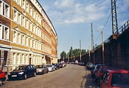

**_Foto:_** _Blick in die Gutschmidstraße - rechts die Hochgleisanlage der Bahnlinie Dresden - Leipzig_

Die Hafenstraße unterhalb der Marienbrücke wurde 1878 benannt und erhielt ihren Namen nach dem nahegelegenen 1850 eröffneten [Verkehrs- und Winterhafen Dresden-Neustadt](../../../neustadt/leipziger_vorstadt/). Sie verbindet die Ufer- mit der Ludwigstraße und bildet ein kleines Wohnkarree mit Häusern überwiegend aus der Gründerzeit. In einer durch Kriegsschäden entstandenen Baulücke wurden 2016/18 drei Mehrfamilienhäuser mit Miet- und Eigentumswohnungen errichtet, wobei für die Gebäude individuelle architektonische Gestaltungen, u.a. mit japanischen Katagamis und Deckenmalereien nach dem Vorbild des Einsteinhauses in Caputh gewählt wurden.

**_Foto:_** _Neubauten an der Hafenstraße_

Die Hallesche Straße entstand 1895 beim planmäßigen Ausbau dieses Teils der Leipziger Vorstadt und wurde ab 1901 mit Wohn- und Geschäftshäusern bebaut. Ihren Namen erhielt sie 1899 nach der Stadt Halle, womit an eine Tradition angeknüpft wurde, neue Straßen in diesem Gebiet nach mitteldeutschen Städten zu benennen.

Die Harkortstraße wurde Ende des 19. Jahrhunderts im Zusammenhang mit der Umgestaltung der Bahnanlagen des Neustädter Güterbahnhofes angelegt. Ihr seit 1898 verwendeter Name erinnert an den ersten Direktor der Leipzig - Dresdner Eisenbahngesellschaft Gustav Harkort (1795-1865). Hier befanden sich bis 2005 die Anlagen des nach 1870 entstandenen Maschinenbahnhofes, später [Güterbahnhof Dresden-Neustadt](../../../neustadt/leipziger_vorstadt/dresden_-_leipzig/).

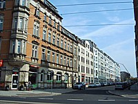Auf dem Gelände des früheren Neudorfer Flurstücks Ploschen entstand 1895 die Hartigstraße, die ihren Namen dem Professor und Rektor der Technischen Hochschule Dr. Carl Ernst Hartig (1836-1900) verdankt. Die amtliche Benennung erfolgte nach Hartigs Tod im Jahr 1900.

In dieser Zeit begann auch die Bebauung dieser Straße mit Mietshäusern. Außerdem siedelten sich einige kleinere Unternehmen an. U.a. gab es in der Nr. 1 die Seifen- und Parfümeriefabrik Wilhelm Geissler mit Zweigbetrieben auf der Leipziger Straße und der Erfurter Straße. 1929 siedelte sich auf dem Grundstück die Marmeladenfabrik Ringelhan an. Außerdem gab es hier zeitweise eine Buchdruckerei und eine Wäscherei. Vorhandene Baulücken wurden erst 1995 mit dem Wohnblock Hartigstraße 1-5 geschlossen _(im Foto links hinten)_.

Der Hedwig-Langner-Weg entstand 2015 im Zusammenhang mit einem kleinen Wohngebiet an der Flurgrenze zu Pieschen. Das als "Pieschener Melodien" bezeichnete Viertel liegt zwischen Moritzburger Straße und Konkordienplatz. Benannt wurde der Weg nach der Puppenhändlerin Hedwig Langner (1870-1945), die an der [Bürgerstraße](../../../Nordwest/Pieschen/Strassen_Pieschen/Burgerstrasse/Burgerstrasse.html ) 40 ein Ladengeschäft besaß.

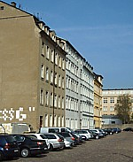Die 1878 angelegte Hedwigstraße befindet sich in der Nähe der Marienbrücke unmittelbar am Neustädter Elbufer. Ihren Namen erhielt sie nach der sächsischen Kurfürstin Hedwig von Dänemark (1581-1641), Gemahlin Kurfürst Christian II. Die kinderlose Fürstin verwaltete nach dem Tod ihres Mannes 1611 mehrere Ämter und engagierte sich für den Ausbau von Kirchen und Schulen. Außerdem setzte sie sich für die Eindeichung der Elbe zum Hochwasserschutz ein und spendete während des Dreißigjährigen Krieges für Hungernde und Pestkranke.

Das Straßenbild prägen auf der linken Seite heute mehrgeschossige Mietshäuser _(Foto)_. Weitere Flächen gehören zum Areal des angrenzenden Arzneimittelwerks.

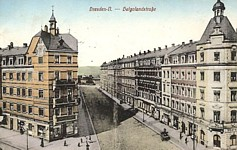Die Helgolandstraße entstand 1890 als Seitenstraße der Conradstraße und wurde im gleichen Jahr nach der Nordseeinsel Helgoland benannt. Helgoland war 1890 per Vertrag zwischen dem Deutschen Reich und Großbritannien zu Deutschland gekommen. Die Bebauung erfolgte mit mehrgeschossigen Wohn- und Geschäftshäusern.

Vor dem Ersten Weltkrieg gab es hier zwei Gaststätten: Das Restaurant "Zum Kuckuck" im Haus Nr. 8 und die Gaststätte "Zur Insel Helgoland" in Nr. 15 _(Foto rechts)_. Auf der Helgolandstraße 19 hatte ab 1910 der von Carl August Döge und Ernst Arno Adam gegründete Kunstverlag Döge & Adam seinen Sitz. Weitere Gebäude beherbergten kleinere Läden wie eine Lebensmittelverteilungsstelle des Konsumvereins Vorwärts im Erdgeschoss von Nr. 10.

Kunstverlag Döge & Adam (Nr. 19): Der Verlag wurde 1910 von Carl August Döge und Ernst Arno Adam gegründet und am 1. Mai ins Handelsregister eingetragen. Adam war zugleich Inhaber einer Ansichtskarten- und Papierwaren-Großhandlung in der Johannstadt (Stephanienstraße 13). Bereits zwei Jahre später trennte er sich jedoch von seinem Geschäftspartner und gründete gemeinsam mit seinem Bruder Rudolf Adam eine eigene Firma, aus der der bis heute bestehende [Ansichtskartenverlag A. & R. Adam](../../../ost/tolkewitz/strassen_tolkewitz/alttolkewitz/adam-ansichtskartenverlag/) hervorging. Carl Döge führte sein Unternehmen fortan allein weiter. Nach seinem Tod 1932 übernahm Sohn Kurt Döge den Verlag, gab diesen jedoch 1939 wegen seiner Einberufung zum Militärdienst auf, womit die Geschichte der Firma endete.

Die Ilmenauer Straße gehört zu den jüngsten Straßen der Leipziger Vorstadt und wurde erst Ende der 1990er Jahre angelegt. Sie zweigt östlich von der Moritzburger Straße ab und erschließt ein kleines Wohngebiet. Ihren Namen erhielt sie in Anlehnung an benachbarte Straßen nach der Stadt Ilmenau in Thüringen.

**_Fotos:_** _Neubauten an der Ilmenauer Straße_

Die erst im September 2018 amtlich benannte Straße geht auf einen alten Fußweg zurück, der von der heutigen Johann-Meyer-Straße bis zur Großenhainer Straße führte. Nach 1900 entstanden in diesem Gebiet zahlreiche [Kleingartensparten](../../../neustadt/leipziger_vorstadt/strassen_leipziger_vorstadt/hansastrasse/), die heute oft als "Hansapark" bezeichnet werden. Mit Errichtung des Pestalozzi-Gymnasiums musste der Weg teilweise verlegt werden und zweigt heute nach einem Knick zum Pestalozziplatz ab. Um den Kleingartenanlagen eine eigene Postanschrift geben zu können erhielt dieser zuvor als "Weg 59" bezeichneten Fuß- und Radweg auf Beschluss des Stadtrates 2018 den Namen Im Kleingartenpark.

Die Johann-Meyer-Straße bildet den westlichen Abschluss des Hechtviertels und wurde im letzten Drittel des 19. Jahrhunderts angelegt. Ihren Namen erhielt sie 1874 nach dem Stifter der hier entstandenen Wohnsiedlung. Der Dresdner Großkaufmann und Ehrenbürger Johann Meyer (1800-1887) hatte damals 100.000 Taler für den Bau von Arbeiterwohnungen zur Verfügung gestellt. Aus diesen Mitteln wurden bis zum Ersten Weltkrieg Wohnhäuser an der Johann-Meyer-, der Buchen- und Hechtstraße sowie in Löbtau gebaut. Einige der Gebäude fielen 1945 dem Bombenangriff zum Opfer. Die Stiftung selbst existierte noch bis 1950.

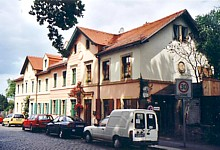Die Gebäude (Nr. 22-24) wurden 1873 nach Plänen von Carl Ludwig Lisske auf den früheren Scheffelschen Feldern errichtet und markieren den Beginn des sozialen Wohnungsbaus in Dresden. Zunächst entstanden vier zweistöckige Langhäuser, die seit 1893 teilweise zur Buchenstraße gehören _(Nr. 24-27 - Foto)_. Hinzu kamen zwei Gebäude an der Hechtstraße (Nr. 75-77a). Von den ursprünglich vorgesehenen sechs weiteren Wohnhäusern wurden nur noch zwei realisiert. Bei den Luftangriffen im Februar 1945 wurden vier der insgesamt acht Arbeiterwohnhäuser zerstört, darunter auch die Gebäude an der Johann-Meyer-Straße.

Weitere Wohngebäude entstanden ab 1902 im Stil des Späthistorismus und Jugendstils. Die Entwürfe für die Wohnhausgruppe an der Einmündung der Gutschmidstraße (Nr. 3/5) stammen von Carl Heinrich Kühne. Von 1913 bis 1914 ließ der Kleinwohnungsbauverein Dresden eGmbH an der Ecke zum Bischofsplatz eine dreiflügelige Wohnanlage nach Plänen des Architekten Theodor Richter erbauen. Da die Finanzierung zum Teil vom Dresdner Verleger Emil Römmler übernommen wurde, erhielten diese Gebäude (Johann-Meyer-Straße 2-6b) den Namen "Römmler-Häuser". Im Haus Nr. 8 gab es vor dem Ersten Weltkrieg das Lokal "Zum Sächsischen Kanonier".

Jüngeren Datums sind die Kindertagesstätten in diesem Gebiet. Seit 2010 gibt es den in Holzbauweise errichteten Bau für die Kinderkrippe "Der kleine Hecht" (Nr. 23). 2017 entstand das Gebäude Nr. 35 für die Kindertagesstätte "Kinderspiel e. V.". Weitere Kitas finden sich auf den Grundstücken Nr. 21 ("Neustädter Entdeckerhaus") und Nr. 38 ("Spatzenburg").

Die Kiefernstraße im nördlichen Teil des Hechtviertels” erhielt ihren Namen 1859 nach dem nahegelegenen Waldgebiet und den hier vorkommenden Kiefernbäumen. Auch benachbarte Straßen tragen bis heute Baumnamen. Zahlreiche der Ende des 19. Jahrhunderts entstandenen Gründerzeitwohnhäuser wurden 1945 zerstört, so dass die Kiefernstraße noch bis 2008 weitgehend brach lag. Im Zuge eines in diesem Jahr verabschiedeten Bebauungsplan wurden hier in der Folge mehrere individuell gestaltete moderne Wohnhäuser errichtet. 2009 entstand zunächst die Wohnanlage Kiefernstraße 3-15a, ein Jahr später an Stelle eines früheren Garagenkomplexes die Wohnhäuser Nr. 20 und 22. 2012/13 folgten die Baulücken Nr. 8, 12 und 14 und als jüngstes Bauvorhaben 2018/19 der Neubau Kiefernstraße 17/19.

Der Königsbrücker Platz entstand Mitte des 19. Jahrhunderts als zentraler Platz des Hechtviertels und wurde 1859 nach der Stadt Königsbrück benannt. 1889/91 entstand an der Westseite die 1945 teilweise zerstörte [St.-Pauli-Kirche](../../../neustadt/leipziger_vorstadt/hechtviertel/st_-pauli-kirche/), die seit 1999 als "TheaterRuine St. Pauli" für verschiedene Veranstaltungen genutzt wird.

Die Kunzstraße verdankt ihren Namen dem Ingenieur Karl Theodor Kunz (1791-1863). Kunz war maßgeblich am Bau der ersten deutschen Ferneisenbahn zwischen Dresden und Leipzig beteiligt. An ihn erinnert auch eine Gedenktafel am Neustädter Bahnhof. Ursprünglich gehörte sie zur Konkordienstraße, die hier ab 1875 mit einer Brücke die Bahnanlagen überquerte. Im Zusammenhang mit der Erweiterung des Neustädter Güterbahnhofs wurde die Concordienbrücke 1886 wieder beseitigt und die Straße damit unterbrochen. Das verbleibende Straßenstück erhielt 1898 den Namen Kunzstraße.

Die Liststraße in der Nähe des ehemaligen Leipziger Bahnhofs trägt ihren Namen seit 1898 in Erinnerung an den Inititator des Bahnbaus, den deutschen Volkswirtschaftler Friedrich List (1789-1846). List gründete 1819 den Deutschen Handels- und Gewerbeverein und erarbeitete ein Konzept für ein landesweites Eisenbahnnetz in Deutschland. Ende des 19. Jahrhunderts entstand an der Liststraße ein Dampfhammerwerk, welches als störend für die Bewohner später jedoch wieder aufgegeben werden musste. Ein kurzer Straßenabschnitt am Bahndamm, der einst zur Kunzstraße gehörte, kam 1929 hinzu.

Die 1842 erstmals benannte Lößnitzstraße wurde um 1860 ausgebaut und trägt ihren Namen nach dem bis heute für den Weinbau genutzten Höhenzug in Radebeul. Die meisten Wohnhäuser an dieser Straße im “Scheunenhofviertel” folgten wenig später. Einige Gebäude weisen interessanten baukünstlerischen Schmuck auf, so dass 1903 bezogene Wohnhaus Lößnitzstraße 16. Im Eckhaus zur Rudolfstraße befand sich viele Jahre die Gaststätte "Goldener Pfeil", die noch bis nach 1990 existierte. Ein weiteres Lokal gab es im Eckhaus zur Hansastraße (Nr. 27), die anfangs "Bruchmanns Gaststätte", später "Lößnitzburg" genannt wurde _(Foto)_. Das ruinöse Gebäude diente 2005 als Kulisse für den zweiteiligen Fernsehfilm "Dresden" über die Zerstörung der Stadt und wurde ein Jahr später abgetragen.

Nr. 6: Das zweistöckige Wohnhaus wurde 1851 als eines der ersten Wohnhäuser des “Scheunenhofviertels” gebaut, wobei der Baumeister wahrscheinlich Carl Friedrich Lohse war. Vor dem Ersten Weltkrieg erwarb der Unternehmer Emil Leinert das Grundstück und richtete hier seine Maschinenfabrik ein. In den Fabrikhallen hinter dem Wohnhaus entstanden vor allem Küchengroßgeräte für Gastronomie und Lebensmittelindustrie. Während die Hallen 1945 dem Luftangriff zum Opfer fielen, blieb das Wohngebäude bis heute erhalten. Eine Sanierung ist geplant.

Gaswerk Dresden-Neustadt (Nr. 14): Das Werk wurde 1864 gegen den ausdrücklichen Willen der Bürger der Antonstadt auf einem Grundstück an der Lößnitzstraße errichtet und nahm am 1. Juli 1865 den Betrieb auf. Mit einer vorgesehenen Leistung von bis zu 35.000 m³ am Tag gehörte diese Gasversorgungsanstalt zu den größten in Dresden und sollte vor allem die Industriebetriebe der Leipziger Vorstadt mit Stadtgas versorgen. Bereits während des Baus kam es zum Einsturz eines der beiden Gasbehälter, woraufhin die Produktion zunächst wieder eingestellt werden musste. Bis 1873 war das Neustädter Werk nur in den verbrauchsstärkeren Wintermonaten am Netz, wurde dann jedoch auf Ganzjahresbetrieb umgestellt und 1876 nochmals erweitert.

Nach dem Ersten Weltkrieg übernahm das Gaswerk Reick die Versorgung der gesamten Stadt, was zur Stillegung der noch bestehenden kleineren Werke führte. 1926 endete auch auf der Lößnitzstraße die Produktion. Im Anschluss übernahm die DREWAG das Gelände und nutzte es u.a. als Standort eines Umformerwerkes und als Sitz des Betriebsamtes der Stadt Dresden. Dafür entstanden 1927 einige neue Gebäude nach Plänen des Stadtbaurates Paul Wolf. Nach 1990 wurde das Gelände unter dem Namen "LÖ 14" von Künstlern und einigen Kleinbetrieben als Kreativzentrum und Gewerbehof genutzt, ist jedoch künftig als Schulstandort bzw. für Wohnbebauung vorgesehen. Aus der Entstehungszeit des Gaswerks blieb das 1865 errichtete, 1936 umgebaute und nach Kriegsschäden in den 1950er Jahren in vereinfachter Form wiederaufgebaute Verwaltungsgebäude an der Friedensstraße erhalten. An der Fassade befinden sich verschiedene Reliefs, welche u.a. einen bärtigen Mann darstellen und über die Geschichte des Gebäudes informieren _(Fotos)_.

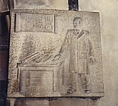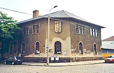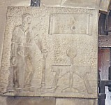

Die Ludwigstraße entstand 1878 in einem kleinen Wohnviertel nordwestlich der Marienbrücke. Über die Namensgebung ist nichts bekannt, möglicherweise erfolgte diese nach einer Privatperson oder dem thüringischen Landgrafen. Um 1880 entstanden hier mehrstöckige Arbeiterwohnhäuser, die bis heute erhalten sind. Im Eckhaus Nr. 1 gab es um 1890 die Gastwirtschaft "Schiffers Ruhe", gegenüber in der Nr. 2 das Lokal "Zum Hafen".

Die Marta-Fraenkel-Straße entstand 2019 auf dem Grundstück des ehemaligen Gaswerks Dresden-Neustadt parallel zur Friedensstraße und dient der Erschließung des umgestalteten Areals. U.a. befindet sich hier die Ende August 2020 eröffnete [148\. Grundschule](../../../neustadt/leipziger_vorstadt/). Benannt ist die Straße nach der jüdischen Ärztin Marta Fraenkel )(1896-1976), die u.a. am Aufbau der II. Internationale Hygiene-Ausstellung 1930/31
beteiligt war und zudem zahlreiche Fachpublikationen verfasste. 1935 flüchtete sie nach Brüssel und emigrierte 1938, wo sie später am Department of Health and Hospitals in New York tätig war.

Der Medinger Weg entstand im Zusammenhang mit der Wohnsiedlung an der Berbisdorfer Straße und wurde gemeinsam mit den benachbarten Straßen am 12. Mai 1927 benannt. Medingen ist ein Ort nördlich von Dresden, der heute als Ortsteil zu Ottendorf-Okrilla gehört.

Der Moritzburger Platz entstand um 1890 am Ende der Moritzburger Straße beim Ausbau der Bahnanlagen und der Unterführung der Bürgerstraße. Die dreieckige Platzanlage wird von mehrgeschossigen Wohnhäusern und dem Damm der Eisenbahn geprägt und erhielt 1898 ihren Namen nach dem Jagdschloss Moritzburg. Im Eckhaus Nr. 5 gab es um 1910 die Gaststätte "Moritzburger Hof". Im etwas abseits des Platzes stehenden Gebäude Nr. 13 befand sich vor dem Zweiten Weltkrieg ein Zweigbetrieb der Berliner Weinessig-, Senf- und Konserven-Fabrik Carl Kühne. 2014 erfolgte im Zusammenhang mit dem Neubau einiger Wohnhäuser eine sackgassenartige Erweiterung der Platzanlage.

Der Naunhofer Weg im Wohnviertel an der Bärwalder Straße erhielt seine Benennung gemeinsam mit den benachbarten Straßen am 12. Mai 1927. Benannt wurde er nach dem Ort Naunhof, einem Ortsteil von Ebersbach in der Nähe von Großenhain.

Der Neudorfer Weg gehört zu den jüngsten Straßen der Leipziger Vorstadt und liegt in einem 2017 erschlossenen neuen Wohnviertel zwischen Moritzburger Straße und Konkordienplatz. Er erhielt seinen Namen nach dem früheren Ort [Neudorf](../../../neustadt/leipziger_vorstadt/neudorf/), dem eigentlichen Kern der Leipziger Vorstadt. Das hier befindliche Wohngebiet wird als "Pieschener Melodien" bezeichnet

Der Niederauer Platz wurde Ende der 1920er Jahre im Zusammenhang mit dem Bau der Wohnsiedlung “Oberer Hecht” angelegt und nach der kleinen Gemeinde Niederau bei Meißen benannt. Die umliegenden Gebäude entstanden zwischen 1926 und 1929 nach Entwürfen von Otto Schubert für den Kleinwohnungs-Bauverein Dresden. Heute befinden sie sich im Besitz der Sächsischen Wohnungsgenossenschaft Dresden und wurden ab 1996 saniert. Die Platzanlage selbst ist mit Ruhebänken und Blumenrabatten gärtnerisch gestaltet.

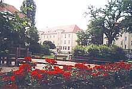

**_Fotos:_** _Der Niederauer Platz um 1930 und 2010_

Die Niederauer Straße im nördlichen Teil der Wohnsiedlung Bärwalder Straße entstand im Zusammenhang mit deren Erschließung Mitte der 1920er Jahre. Sie wurde ab Oktober 1927 zunächst Oberauer Straße genannt. Die an ihrem nördlichen Ende liegende Querstraße erhielt zugleich den Namen Niederauer Straße. Beide Straßennamen nehmen Bezug auf zwei benachbarte Ortschaften in der Nähe von Meißen.
Bereits wenige Monate später entschied man sich jedoch, die Straßennamen zu tauschen. Grund war der an die heutige Niederauer Straße angrenzende Niederauer Platz.

Die Oberauer Straße wurde gemeinsam wie die von ihr abgehende Niederauer Straße nach einem Ort in der Nähe von Meißen benannt. Nachdem sie im Oktober 1927 zunächst den Namen Niederauer Straße erhalten hatte, entschloss man sich im April 1928 zum Austausch der beiden Straßennamen.

Die Ottendorfer Straße entstand Mitte der 1920er Jahre beim Bau des Wohngebietes an der Bärwalder Straße und wurde am 12. Mai 1927 benannt. Der Name nimmt Bezug auf den Ort Ottendorf, einem der beiden Gemeindeteile von Ottendorf-Okrilla.

Die Ende des 19. Jahrhunderts in der Nähe des Inneren Neustädter Friedhofes angelegte Ottostraße verdankt ihren 1874 vergebenen Namen dem Wettiner Otto dem Reichen (1125-1190), welcher 1156 die Herrschaft von seinem Vater Konrad übernahm. Otto begründete den Weinbau im oberen Elbtal, verlieh Leipzig 1165 das Stadt- und Messerecht und gilt als Wegbereiter des Silberbergbaus im Erzgebirge. Unter seiner Herrschaft entwickelte sich Sachsen zu einem der wirtschaftlich führenden Staaten Deutschlands. Im heutigen Kreuzungsbereich zur Rudolfstraße befanden sich einst die Scheunenhöfe, eine wegen Brandgefahr aus der Inneren Neustadt ausgelagerte landwirtschaftliche Gutsanlage. Noch bis Anfang der 1920er Jahre erinnerte die Gastwirtschaft "Zum Milchviehhof" (Ottostraße 1) an dieses Gut.

Der 1910 an Stelle einer früheren Kiesgrube angelegte Platz an der Großenhainer Straße trug ursprünglich den Namen Riesaer Platz, wurde jedoch am 18. Dezember 1945 in Pestalozziplatz umbenannt. Der Name erinnert an den bedeutenden Reformpädagogen Johann Heinrich Pestalozzi (1746-1827), der in seiner 1775 in Birr (Schweiz) gegründeten Erziehungsanstalt neue humanistische Bildungsideale realisierte. Er gilt als Wegbereiter des Volksschulwesens und der modernen Pädagogik.

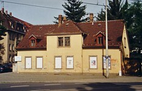

**_Fotos:_** _Der Riesaer Platz um 1935 (links) und die ehemalige Kanonenschänke 2010_

Um den parkartig gestalteten Pestalozziplatz stehen mehrgeschossige Mietshäuser aus der Zeit um 1900. An der Nordwestseite befand sich früher die beliebte volkstümliche Kneipe "Kanonenschänke", die jedoch schon viele Jahre geschlossen ist. Markantestes Gebäude ist der von Hans Erlwein 1910 entworfene Schulbau der XI. Bürgerschule, der seit 1992 vom [Pestalozzi-Gymnasium](../../../neustadt/leipziger_vorstadt/) genutzt wird. Nach 1945 hatte hier zeitweise die sowjetische Stadtkommandantur ihren Sitz.

Die Petrikirchstraße verbindet den Großenhainer Platz mit der Fritz-Reuter- und der Hansatraße und wurde im August 1905 nach der an ihrem Westende befindlichen [St.-Petri-Kirche](../../../neustadt/leipziger_vorstadt/st__petri-kirche/) benannt

Die Röderauer Straße verbindet den Pestalozziplatz mit der Hansastraße und führt unmittelbar am Bahndamm entlang. Am 14. September 1933 wurde die nach dem Ort Röderau bei Riesa, heute ein Ortsteil von Zeithain benannt. Bereits nach der Jahrhundertwende waren hier zwei Kleingartensparten entstanden, 1905 der kleine Verein "Erdkugel e.V. mit 47 Gärten, vier Jahre später der "Kleeblatt e.V." mit ca. 100 Gärten und einem Vereinsheim.

Die Rosa-Steinhart-Straße wurde im Zusammenhang mit dem Wohnviertel "Pieschener Melodien" zwischen Moritzburger Straße und Konkordienplatz angelegt und am 3. Februar 2015 nach der jüdischen Kauffrau Rosa Steinhart (1885-1943) benannt. Gemeinsam mit ihrem Mann Walter betrieb sie ein Spezialgeschäft für Haus- und Küchengeräte auf der Trachenberger Straße 23. 1942 wurde das Paar von den Nazis in das [Judenlager Hellerberge](../../../nord/) deportiert und am 3. März 1943 im KZ Auschwitz ermordet. Seit 2012 erinnern zwei Stolpersteine vor ihrem ehemaligen Geschäft an das Schicksal der Familie.

Die auf dem Gelände der früheren Scheunenhöfe _(Foto)_ gelegene Rudolfstraße wurde ursprünglich ab 1874 Hermannstraße genannt. Vermutlich entstand diese Namensgebung in Bezug auf das im Folgejahr fertiggestellte Hermann-Denkmal in Westfalen. 1893 erhielt sie ihren heutigen Namen, wobei der Namensgeber unbekannt ist. Das Straßenbild prägen mehrstöckige Mietshäuser aus der Zeit um 1905, die im Erdgeschoss meist kleine Läden beherbergen. Im Eckhaus zur Lößnitzstraße (Nr. 2) befand sich viele Jahre die Gaststätte "Goldener Pfeil", deren Räume bis heute von einer Bar gastronomisch genutzt werden. Auch das heute nicht mehr vorhandene Eckhaus Nr. 38 zur Conradstraße war einst Domizil eines Lokals, welches um 1910 als Schankwirtschaft "Zum Mönchshof" firmierte.

Ältestes Gebäude der Rudolfstraße ist das zweistöckige Wohnhaus Nr. 9, welches um 1850 als Teil der Scheunenhöfe entstand. Anfang der 1920er Jahre errichtete eine Baugesellschaft die Wohnanlage Otto-, Friedens- und Rudolfstraße (Nr. 20/22). Deutlich jünger sind die 2018 errichteten "Rudolfterrassen" mit mehreren Eigentumswohnungen.

Die im zweiten Drittel des 19. Jahrhunderts angelegte Schanzenstraße im “Hechtviertel” erinnert an eine 1813 von napoleonischen Soldaten angelegte Schanze in der Dresdner Heide. Die Befestigungsanlage sollte der Verteidigung der von den Franzosen besetzten Stadt dienen, ist heute jedoch nicht mehr vorhanden. 1859 erhielt die Straße offiziell ihren Namen. Das Straßenbild prägen bis heute Wohnhäuser der Gründerzeit. Im Haus Nr. 3 existierte bereits vor dem Ersten Weltkrieg die Gaststätte "Fridericus-Bräu". Ein weiteres Lokal gab es im Eckhaus zur Buchenstraße (Nr. 27) mit dem Namen "Zur Schanzenburg".

Die Seifersdorfer Straße entstand Mitte der 1920er beim Ausbau des Wohngebietes Bärwalder Straße und bildet den südlichen Abschluss der Siedlung. Ihren Namen erhielt sie am 12. Mai 1927 nach dem Ort Seifersdorf, heute ein Ortsteil von Wachau.

Auch die Seitenstraße wurde Mitte des 19. Jahrhunderts beim Ausbau der Oppellvorstadt angelegt und mit Wohnhäusern bebaut. Zunächst trug sie ab 1859 den Namen Windmühlenstraße, da sie in Richtung der 1877 abgebrochenen Pieschener Windmühle führte. Da es mit der Eingemeindung von Niedersedlitz ab 1950 den Straßennamen Windmühlenstraße doppelt gab, beschloss der Dresdner Stadtrat am 30. September 1953 die Umbenennung in Seitenstraße.

Das Straßenbild prägen bis heute Wohnhäuser aus der Entstehungszeit des Hechtviertels sowie einige Gründerzeithäuser. Mehrere Gebäude, u.a. die ehemalige 30. Volksschule, wurden 1945 zerstört und in den 1960er Jahren durch Neubauten ersetzt.

Nr. 3 (Schützenhaus): Ab 1897 existierte in diesem Haus Prüfers Vergnügungs-Local, ab 1900 "Schützenhaus" genannt. Nach dem Ersten Weltkrieg wurde der Gaststättenbetrieb eingestellt und die Räume bis 1945 von der Dresdner Wirk- & Wollwaren-Fabrik GmbH ("Wollwirker") genutzt.

Nr. 4b ("Saite"): In Anlehnung an den Straßennamen erhielt das Ende der 1990er Jahre im Haus Nr. 4b entstandene Café-Restaurant den Namen “Saite”. Regelmäßig finden hier verschiedene kulturelle Veranstaltungen, Konzerte und Ausstellungen statt. Zuvor befand sich in den Räumen das syrische Restaurant “Fata Morgana”.

Volkstheater (Nr. 5): Neben Wohn- und Geschäftshäusern gab es an der Windmühlenstraße bis zum Ersten Weltkrieg auch das “Volks-Theater”. 1920 übernahm mit Bruno Müller ein neuer Betreiber die Räumlichkeiten und richtete das Kino “Paradies-Lichtspiel-Salon” ein. Ab 1921 wurde das mit ca. 220 Plätzen zu den kleineren Dresdner Filmtheatern gehörende Kino in “Metropol-Theater” umbenannt, zeitweise jedoch auch "Volks-Lichtspiele" bzw. "Oppelvorstädter Volkstheater" genannt. Der Spielbetrieb endete jedoch bereits vor dem Zweiten Weltkrieg.

Die Stöckelstraße entstand in den 1920er Jahren und wurde im März 1927 nach dem Juristen und Vorsteher der Dresdner Stadtverordnetenversammlung Johann Georg Stöckel (1855-1923) benannt. Stöckel war zwischen 1899 und 1919 im Amt und erhielt für seine Verdienste 1915 die Ehrenbürgerwürde der Stadt. Neben seiner kommunalpolitischen Tätigkeit engagierte er sich auch als Aufsichtsrats- und Vorstandsmitglied verschiedener Organisationen, u.a. der Siedlungsgesellschaft Dresden Stadt und Land und der Lingner-Stiftung. Heute befinden sich an der Stöckelstraße Kleingärten.

Die Uferstraße, die seit ca. 1840 den früheren Leipziger Bahnhof mit dem Elbufer verband, wurde zunächst An der Elbe genannt. Da es eine gleichnamige Straße jedoch mit dem heutigen Terrassenufer auch in der Altstadt gab, erfolgte 1862 die Umbenennung in Uferstraße. Neben Wohngebäuden siedelten sich auch einige Unternehmen an, u.a. eine Bootsbaufirma, eine Spedition und ein Brennholzgroßhandel. Im Eckhaus zur Hedwigstraße (Nr. 9) gab es vor dem Zweiten Weltkrieg das Hotel "Zu den Bahnhöfen".

1945 wurde die Bebauung der Uferstraße weitgehend zerstört. Erst 2016 entstanden hier einige moderne Wohnhäuser mit Eigentumswohnungen. Dabei wurden die Fassaden der Gebäude mit japanische Katagamis gestaltet und erhielten in einem anderen Haus Deckenmalereien nach Vorbild des Einsteinhauses in Caputh. Das Richtfest fand am 9. November 2017 statt, der Bezug ab 2019.

Die Weimarische Straße sowie der heute weitgehend überbaute Weimarische Platz wurden 1890 angelegt und sollten ursprünglich zentraler Mittelpunkt eines neuen Wohnviertels werden. Obwohl um 1900 die ersten Wohn- und Geschäftshäuser errichtet wurden, blieb die Gesamtplanung unvollendet. Auf dem Gelände des Weimarischen Platzes entstand später die Gartensparte Neudorf e.V., so dass die Straße heute aus zwei Teilen besteht. Die 1899 amtlich eingeführte Namensgebung Weimarischer Platz wurde nach 1945 aufgehoben. Architektonisch bemerkenswert ist das Wohnhaus Weimarische Straße 1 mit einem Deckengemälde im Flur in Jugendstilformen. Die Wohnhäuser an der Gehestraße wurden in den 1930er Jahren errichtet _(Foto rechts)_.

Im Eckhaus zur Eisenberger Straße (Nr. 9) existierte bereits vor dem Ersten Weltkrieg die Gaststätte “Weimarischer Hof”. Seit 2011 befindet sich hier das Vereinscafé des Brix e.V., in dem regelmäßig Lesungen, Clubkonzerte und Ausstellungen von regionalen Künstlerinnen und Künstlern stattfinden. Eröffnet wurde das Café am 8. August 2011. 2020 entstand in den Räumen das erste Diabetesmuseum Sachsens, in dem die medizinische und medizintechnische Entwicklung der Behandlung dieser Krankheit gezeigt wird.

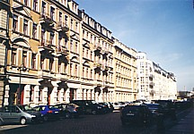

**_Foto:_** _Blick in die Weimarische Straße_

__

Die heutige Weinböhlaer Straße entstand als Verlängerung der Neudorfer Hauptstraße [(Moritzburger Straße)](../../../neustadt/leipziger_vorstadt/neudorf/moritzburger_strasse/) und diente einst den Bauern des Ortes als Viehtriebe und Verbindungsweg zur Dresdner Heide sowie nach Rähnitz und Wilschdorf. Aus diesem Grund wurde sie früher auch als Heide- bzw. Elbweg bezeichnet. Zugleich bildete sie die Westgrenze zu Pieschen, was mehrfach zu Streitigkeiten zwischen beiden Dörfern führte. Durch den Bahnbau unterbrochen, erfolgte Mitte des 19. Jahrhunderts der Ausbau zur Straße, die zunächst Artilleriestraße, ab 1874 als Kanonenstraße bezeichnet wurde. Diese Namensgebung knüpfte an ihre Nutzung als Weg zum Artillerieschießplatz an. Da beide Namen als “militaristisch” galten, wurde sie am 1. Juli 1946 nach der Gemeinde Weinböhla bei Meißen in Weinböhlaer Straße umbenannt.

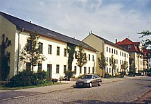Zu den ersten Gebäuden in diesem Teil der Neudorfer Flur gehörte die bereits um 1830 erwähnte Gartenwirtschaft “Zur Goldenen Aue” (Nr. 74), die sich später unter dem Namen "Restaurant zur Zufriedenheit" _(Foto rechts)_ zum beliebten Ausflugslokal entwickelte. 1873 errichtete die Steingutfabrik [Villeroy & Boch](../../../neustadt/leipziger_vorstadt/leipziger_strasse/villeroy___boch/) an der Weinböhlaer Straße fünf Wohnhäuser mit Werkswohnungen, eine der ersten Werkssiedlungen in Dresden. Leider blieben nach Abrissen um 1980 nur zwei dieser Denkmale des frühen sozialen Wohnungsbaus erhalten _(Foto links)_. Weitere Grundstücke wurden früher von Gärtnereien eingenommen. Heute befinden sich hier die Kleingartensparten "Blumenhain" (gegründet 1902), “Eigenheim” (1907), “Erholungsheim” (1913), "Heidegruß" (1915), "Weinböhlaer Straße" (1947) und "Hansadreieck" (1984). 2009 entstand auf der Weinböhlaer Straße 12 die integrative Kindertagesstätte “Sonnenschein”.

Rotax-Werk (Nr. 57): Das Unternehmen wurde 1906 von Friedrich Gottschalk als Fahrradteile-Fabrik gegründet. Hergestellt wurden verschiedene Zubehörteile wie Bremsen, Luftreifen und Sättel sowie Spezialkleidung. Im gleichen Jahr meldete er die "Rotax-Freilaufnabe" zum Patent an, eine Weiterentwicklung nach amerikanischem Vorbild. Zugleich wirkte Gottschalk als Förderer des Radsports und war an der Organisation von Radrennen beteiligt. Die wirtschaftlichen Schwierigkeiten des Ersten Weltkriegs führten 1920 zur Umwandlung in eine Aktiengesellschaft, die 1930 an die bekannte Firma Fichtel & Sachs verkauft wurde, was mit einer Verlegung nach Schweinfurt verbunden war. Heute hat die unter dem Traditionsnamen Rotax weitergeführte Motorenproduktion ihren Sitz in Gunskirchen.

Die Wilschdorfer Straße entstand im Rahmen der Erschließung des Wohngebietes Bärwalder Straße und erhielt ihren Namen gemeinsam mit weiteren Straßen des Viertels am 12. Mai 1927. Benannt ist sie nach dem heute zu Dresden gehörenden Ort Wilschdorf.

Auch der benachbarte Würschnitzer Weg gehört zu den neu entstandenen Straßen des Wohngebietes Bärwalder Straße. Zeitgleich mit den Nachbarstraßen erhielt er am 12. Mai 1927 seinen Namen nach dem Ort Würschnitz, heute ein Ortsteil von Tauscha.

[Leipziger Vorstadt auf OpenStreetMap](https://www.openstreetmap.org/search?query=Dresden+Leipziger+Vorstadt)

* * *

 \[ [Home](../../../index.html)\] \[ [Nord](../../../nord/)\] \[ [Nordwest](../../../nordwest/)\] \[ [Neustadt](../../../neustadt/)\] \[ [Nordost](../../../nordost/)\] \[ [West](../../../west/)\] \[ [Zentrum](../../../zentrum/)\] \[ [Südwest](../../../sudwest/)\] \[ [Süd](../../../sud/)\] \[ [Südost](../../../sudost/)\] \[ [Ost](../../../ost/)\] \[ [Register](../../../Register/register.html)\] \[ [Kontakt](../../../Kontakt/kontakt.html)\] \[ [Impressum](../../../impressum/)\]
