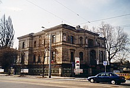

Der heutige Alexander-Puschkin-Platz wurde 1895 angelegt und ab 1898 nach der Thüringer Stadt Erfurt als Erfurter Platz bezeichnet. Markantestes Gebäude ist die frühere Villa des Holzgroßhändlers Ernst Grumbt, die ab 1949 als “Haus der Deutsch-Sowjetischen Freundschaft” genutzt wurde. In diesem Zusammenhang erhielt der Platz am 6. Juni 1949 aus Anlass des 150. Geburtstages des russischen Dichters Alexander Sergejewitsch Puschkin (1799-1837) seinen jetzigen Namen. Puschkin gilt als bedeutendster Vertreter der russischen Literatur und schuf verschiedene Dramen, Erzählungen und Romane. 1953 entstand auf einer Brachfläche der Kleingartenverein “Am Erfurter Platz”, der mit seinen 13 Parzellen zu den kleinsten in Dresden gehört.

Villa Grumbt (Puschkinhaus):

Die Villa wurde 1888 als Wohnhaus des Holzgroßhändlers Carl Ernst Grumbt im Stil der Neorenaissance errichtet. Grumbt hatte 1869 in der Leipziger Vorstadt ein [Dampfsägewerk](../../../../neustadt/leipziger_vorstadt/leipziger_strasse/) erworben und war dadurch zu erheblichem Wohlstand gekommen. Das benötigte Holz kam in der Regel auf dem Wasserweg nach Dresden, wurde hier maschinell verarbeitet und als Baumaterial weiter verkauft. Für seine Verdienste erhielt der Unternehmer den Titel eines Kommerzienrates verliehen und gehörte zeitweise dem sächsischen Landtag, ab 1897 auch dem Deutschen Reichstag an.

Die Entwürfe für die Villa stammen vermutlich von einem Schüler des Architekten Lipsius. Bemerkenswert ist die gut erhaltene Innenausstattung mit Stuckdecken und aufwendigen Holzverkleidungen. Das Haus blieb bis nach 1945 in Familienbesitz, wurde dann jedoch enteignet und zunächst als Offizierskasino der sowjetischen Armee bzw. als Bibliothek genutzt. Am 17. Mai 1949 übergab der damalige Dresdner Oberbürgermeister Walter Weidauer die Villa als “Haus zum Studium der Sowjetkultur” an die Dresdner Ortsgruppe der Gesellschaft für Deutsch-Sowjetische Freundschaft, die die Räume bis 1989 als Kultur- und Begegnungszentrum nutzte. Nach der Wende wurde die Villa an die Erben Grumbts rückübertragen, 1993 verkauft und vom neuen Besitzer umfassend saniert. Im Anschluss beherbergte sie bis zur Insolvenz 2012 unter der Bezeichnung “Villa Sofa” ein exklusives Einrichtungshaus für Wohnmöbel.

* * *

 \[ [Home](../../../../index.html)\] \[ [Nord](../../../../nord/)\] \[ [Nordwest](../../../../nordwest/)\] \[ [Neustadt](../../../../neustadt/)\] \[ [Nordost](../../../../nordost/)\] \[ [West](../../../../west/)\] \[ [Zentrum](../../../../zentrum/)\] \[ [Südwest](../../../../sudwest/)\] \[ [Süd](../../../../sud/)\] \[ [Südost](../../../../sudost/)\] \[ [Ost](../../../../ost/)\] \[ [Register](../../../../Register/register.html)\] \[ [Kontakt](../../../../Kontakt/kontakt.html)\] \[ [Impressum](../../../../impressum/)\]
