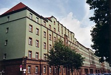

Die Hansastraße wurde 1898 als neue Verbindung zwischen der Inneren Neustadt und dem Dresdner Norden angelegt, blieb zunächst jedoch unbebaut. Ihren Namen erhielt sie nach der Hansa bzw. Hanse, dem mittelalterlichen Bund der norddeutschen Handelsstädte. Nach 1900 entstanden hier ausgedehnte Kleingartenanlagen, die nicht nur der Erholung der Arbeiter der angrenzenden dichtbesiedelten Wohnviertel dienten, sondern auch einen wichtigen Beitrag zur Versorgung mit frischem Obst und Gemüse leisteten. 1927-29 errichtete die Eisenbahner-Wohnungsbau-Genossenschaft den markanten Gebäudekomplex an der Hansastraße / Großenhainer Straße mit ca. 500 Wohnungen _(Fotos)_. Architekt der im expressionistischen Stil mit Klinkerelementen verzierten Häuser war Curt Herfurth. Die aus zwei Wohnanlagen mit über 50 Einzelhäusern bestehende Wohnsiedlung ist eine der größten in Dresden und steht unter Denkmalschutz.

Im Zusammenhang mit dem Bau der Autobahn Dresden - Chemnitz - Hof erfolgte ab 1940 der vierspurige Ausbau der Hansastraße und der anschließenden Radeburger Straße als Autobahnzubringer. Dabei verschwand auch das frühere Gasthaus zum Hecht, ein bereits 1735 erwähntes Lokal des Neudorfer Revierförster August Hecht. Im September 1942 erhielten beide Straßen nach dem Leiter des NS-Autobahnprojektes den Namen Dr.-Todt-Straße. Der Bauingenieur Fritz Todt (1891-1942) war Generalinspektor für das Straßenwesen in Deutschland und kam 1942 bei einem Flugzeugabsturz ums Leben. Am 27. September 1945 wurde diese Namensgebung wieder aufgehoben.

Die Fahrbahnen der Straße waren durch einen Grünstreifen getrennt, der in den ersten Nachkriegsjahren durch die Anwohner sogar für den Anbau von Gemüse genutzt wurde. Markantester Neubau der jüngsten Zeit ist das 1994 fertiggestellte Hansa-Zentrum nach einem Entwurf von A. Bader. Kernstück des Gebäudekomplexes an der Kreuzung Hansa-/ Fritz-Reuter-Straße bildet das im Juni 1994 eröffnete Astron-Hotel (heute nH Hotel Dresden).

Kleingartenanlagen an der Hansastraße:

**Name der Anlage**

**Gründungsjahr**

**Name der Anlage**

**Gründungsjahr**

Eichenkranz e.V.

1900

Erholungsheim e.V.

1913

Rosenhain e.V.

1902

Heidegruß e.V.

1915

Blumenhain e.V.

1902

Kleeblatt e.V.

1919

Erdkugel e.V.

1905

Grüne Hoffnung e.V.

1920

Sommerlust e.V.

1906

Morgensonne e.V.

1920

Eigenheim e.V.

1907

Zum Abendfrieden e.V.

1922

Sommerfrische e.V.

1907

Hansadreieck e.V.

1982
