* * *

* * *

* * *

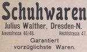

_Schuhwaren Julius Walter_

_(Hechtstraße 47)_

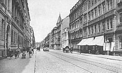Die Hechtstraße bildet die Hauptachse eines seit Mitte des 19. Jahrhunderts planmäßig angelegten Wohnviertels. Bereits 1836 hatte der Dresdner Polizeidirektor Hans Ludwig von Oppell hier Grundstücke für die Bebauung mit Wohnhäusern erworben. Die meisten Gebäude entstanden allerdings erst im letzten Drittel des 19. Jahrhunderts und machten die [Oppellvorstadt](../../../../neustadt/leipziger_vorstadt/hechtviertel/), die im Volksmund bis heute meist als “Hechtviertel” bekannt ist, zu einem der am dichtesten besiedelten Stadtteile Dresdens. 1862 wurde an der Hechtstraße der [St.-Pauli-Friedhof](../../../../neustadt/leipziger_vorstadt/hechtviertel/st_-pauli-friedhof/) angelegt. Unweit davon befindet sich der sogenannte “Hechtpark”, eine grüne Oase am Rande des Hechtviertels.

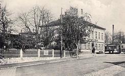Ihren Namen verdankt die Hechtstraße dem früheren Neudorfer Revierförster Johann August Hecht, der 1715 ein Grundstück am Rande der Hellerberge erwarb und hier einen [Weinberg](../../../../neustadt/leipziger_vorstadt/hechtviertel/hechtsches_weingut/) anlegte. Neben ihrem Weingut betrieb die Familie Hecht eine kleine Schankwirtschaft für ihre Angestellten. Aus dieser ging später die Restauration “Zum Blauen Hecht” an der Radeburger Straße hervor, deren Name 1859 auf die hier einmündende Straße übertragen wurde _(Foto rechts)_. Der anschließende, bereits auf Trachenberger Flur liegende Straßenteil wurde ab 1887 Friedhofstraße genannt. 1927 ging auch dieser Abschnitt in der Hechtstraße auf. 1891 fuhr erstmals die Straßenbahn durch die Hechtstraße bis zum Endpunkt Buchenstraße, ab 1926 bis zum St.-Pauli-Friedhof. Nach kriegsbedingter Betriebseinstellung wurde der Verkehr nach 1945 nicht wieder aufgenommen und die Gleisanlagen in den 1950er Jahren demontiert.

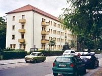Zu DDR-Zeiten verfielen die meisten Altbauten in diesem Gebiet, nachdem es bereits 1945 durch den Luftangriff zu Verlusten an Bausubstanz gekommen war. Dafür entwickelte sich im “Hechtviertel” wie auch in der Äußeren Neustadt eine alternative Szene mit illegalen Treffs und Cafés. Einer der bekanntesten war das im Obergeschoss des Wohnhauses Hechtstraße 26 entstandene “Café Stillos”. Nach 1990 wurden die meisten Gebäude saniert. Trotzdem konnte die Hechtstraße mit ihren zahlreichen kleinen Läden, Bars und Gaststätten ihr Flair bis heute weitgehend bewahren. Im oberen Teil der Hechtstraße prägen hingegen Neubauten aus den 1950er und 60er Jahren das Straßenbild _(Foto)_, da hier zahlreiche Gebäude durch Bomben zerstört worden waren.

Einzelne Gebäude:

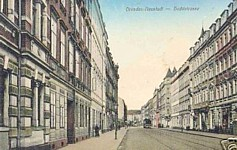Im unteren Teil der Hechtstraße finden sich bis heute hauptsächlich mehrgeschossige Wohn- und Geschäftshäuser aus der Gründerzeit. Die meisten entstanden zwischen 1880 und 1900 und waren an Arbeiterfamilien vermietet. Im Erdgeschoss gab es oft kleine Geschäfte und Schankwirtschaften, während sich in den dichtbebauten Hinterhöfen Handwerker und Kleingewerbetreibende angesiedelt hatten. Im Haus Hechtstraße 9 befand sich ab 1912 die Sparkassenfiliale der Oppellvorstadt, während in der Nr. 39 die Polizeiwache des XIII. Bezirk untergebracht war.

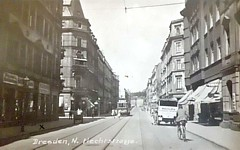Kleine Lokale sind u.a. für die Hausnummern 15 ("Zur Schmiede"), 21 ("Zur Gleichheit", später Felsenkellerquelle), 46 ("Zum deutschen Lied"), 55 ("Zum Rosental", 63 (Schankwirtschaft von Trümper) und 65 (1945 zerstört) und im Eckhaus zur Buchenstraße (Nr. 70 - Restaurant "Sächsische Kavallerie") nachweisbar. Nach 1945 nutzte die SED die frühere "Schmiedeschänke" viele Jahre als Partei- und Jugendheim, bevor nach 1990 wieder eine Gaststätte einzog. Beliebt war auch die Gartenwirtschaft des Restaurateurs Alfred Haufe gegenüber dem St.-Pauli-Friedhof (Friedhofstr. 49, heute Hechtstr. 143), die als "Haufe's Konzertgarten" zum Besuch einlud. Von den zahlreichen Läden soll das 1874 gegründete Kaufhaus Julius Caspar auf der Hechtstraße 14 erwähnt werden. Das 1911 erweiterte Warenhaus befand sich in den beiden untersten Etagen des Gebäudes und wurde 1944 als Wollwarenhaus Hoffmann & Krause genutzt.

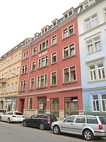Nr. 10: Das ursprünglich als Mietshaus errichtete Gebäude _(Foto links)_ war ab 1997 Domizil eines der ersten Dresdner Hostels. Unter dem Namen "Die Boofe" gab es hier in 32 Zwei- und Vier-Bett-Zimmern eine preiswerte Übernachtungsmöglichkeit, ergänzt um Sanitärräume, eine Küche zum Selbstkochen sowie dem Restaurant "Schwemme". Anfang 2009 gaben die Betreiber das Hostel auf, welches seit 2012 als Übergangswohnheim genutzt wird.

Nr. 21d: In diesem Gebäude befand sich ab 1878 die Klinik des Vereins “Kinderheilstätte für Neu- und Antonstadt Dresden”. Die Einrichtung war 1876 im Erdgeschoss des Wohnhauses Königsbrücker Straße 44 als Kinderpoliklinik mit stationärer Abteilung gegründet worden. Ziel des von privaten Spendern finanzierten Vereins war es, die hohe Säuglingssterblichkeit in der vor allem von Arbeiterfamilien bewohnten Oppellvorstadt zu verringern. Mit Verlegung zur Hechtstraße 21d standen 10 Betten zur Verfügung, wobei hier nur Kinder sehr armer Familien aufgenommen wurden,welche sich eine reguläre medizinische Versorgung nicht leisten konnten. 1883 wechselte die Klinik zunächst zur Hechtstraße 67, bevor 1891 ein Grundstück in Trachenberge erworben werden konnte. 1895 entstand dort als Nachfolgeeinrichtung das [Maria- Anna-Kinderhospital](../../../../nordwest/trachenberge/trachenberge_-_sozialeinrichtu/).

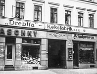Nr. 27: In diesem Haus betrieb Ende des 19. Jahrhunderts der stadtbekannte Fischhändler August Paschky sein Geschäft. Paschky besaß zahlreiche Filialen in verschiedenen Stadtteilen und galt als umtriebiger Kaufmann. Zugleich engagierte er sich in der sozialdemokratischen Partei und war einer der Mitbegründer der Dresdner SPD. Wegen seiner politischen Tätigkeit wurde er 1880 zur Zeit des Sozialistengesetzes zu 1 1/2 Jahren Haft verurteilt. Nach seinem Tod 1891 übernahm Paschkys Ehefrau den Betrieb, der noch bis in die 1930er Jahre existierte. Im Hintergebäude des Grundstücks befindet sich seit 2011 ein kleines Hostel. Vor dem Zweiten Weltkrieg war hier zeitweise die Dresdner Bisquit-Fabrik Schneider & Co. ansässig, die verschiedene Dauerbackwaren unter dem Markennamen "Alpenrausch" anbot.

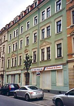Nr. 30: Im Erdgeschoss und im Hinterhaus des Grundstückes Hechtstraße 30 _(Foto)_ befanden sich um 1900 die Lager- und Geschäftsräume des Fleischermeisters Franz Augustin. Augustin war ein Onkel Erich Kästners und wurde von diesem in seinen Kindheitserinnerungen “Als ich ein kleiner Junge war” verewigt. In den Jahren vor dem Ersten Weltkrieg kam er als Pferdehändler zu erheblichem Wohlstand und erwarb die Villa Antonstraße 1 am Albertplatz (heute Erich-Kästner-Museum).

Auch nach Augustins Wegzug blieben die Räumlichkeiten ihrer Verwendung treu. Während im Vorderhaus weiterhin eine Fleischerei existierte, nutzte das Stallgebäude in den 1920er und 1930er Jahren der jüdischer Pferde- und Viehhändler Paul A. Grosch. Sein Sohn Abraham Paul führte den Betrieb noch bis zu seiner Auswanderung in die USA 1936. 1943 wurde das Ehepaar Grosch aus seiner Wohnung an der Erlenstraße deportiert und starb vermutlich im Vernichtungslager Auschwitz. Das Fuhrgeschäft führte nun der frühere Geschäftsführer Hirsch weiter. Nach Aussagen von Zeitzeugen war der Betrieb nach dem Luftangriff vom 13. Februar 1945 mit dem Transport der auf dem Altmarkt gesammelten Toten zum Heidefriedhof beauftragt. Obwohl die Räumlichkeiten an der Hechtstraße heute anderweitig genutzt werden, blieben die ehemaligen Stallgebäude im Hinterhof erhalten.

Nr. 32: Im Erdgeschoss des Gebäudes gab es bereits vor dem Ersten Weltkrieg eine von zahlreichen Gaststätten des Hechtviertels. Zunächst als Schankwirtschaft von Zscheile bzw. von Zieschang bezeichnet, wechselte der Name 1913 in "Restaurant zur Wachtelschänke". Heute dient das Grundstück mit seinem Hintergebäude als soziokulturelles Zentrum des Stadtteils. U.a. haben hier das Stadtteilbüro des Hechtviertels und der "St. Pauli Salon" (bis 1997 "Club Hecht") ihre Räume.

Nr. 55 (Schule):  Das heute von der [30\. Grundschule](../../../../neustadt/leipziger_vorstadt/hechtviertel/) "Am Hechtpark" genutzte Gebäude wurde 1964 auf dem Areal mehrerer zerstörter Wohnhäuser erbaut. Dem Luftangriff war auch die frühere Schule des Hechtviertels an der Windmühlenstraße zum Opfer gefallen, die mit der bis 1990 als 30. Polytechnische Oberschule "Wilhelm Pieck" bezeichneten Einrichtung einen Neubau erhielt.

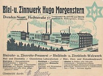Blei- u. Zinnwerk Hugo Morgenstern (Nr. 57): Das Unternehmen wurde 1912 von Hugo Morgenstern gegründet und nutzte bis 1934 die Hintergebäude des Grundstücks Hechtstraße 57 als Produktionsstätte. Hergestellt wurden vor allem Blei- und Zinnrohre, Bleche, Drähte, Lötzinn und verschiedene Rohprodukte für Schriftgießereien und ähnliche Abnehmer. 1935 wurde der Betrieb zur Hamburger Straße auf das Grundstück des ehemaligen Cottaer [Hofbrauhauses](../../../../west/cotta/strassen_cotta/hamburger_strasse/) verlegt und in den 1940er Jahren in "Morgenstern-Werk Hugo Morgenstern - Blei-, Zinn- und Leichtmetallwerk" umbenannt. Während die früheren Gebäude an der Hechtstraße dem Luftangriff zum Opfer fielen, blieb das Werk in Cotta weitgehend unbeschädigt, wurde jedoch im Herbst 1945 demontiert und unter Treuhandverwaltung gestellt. Die Löschung der Firma aus dem Handelsregister erfolgte Ende 1954. Eine Neugründung erfolgte wenig später als VEB Blei- und Zinnwerk Dresden.

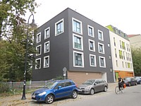Nr. 65/67: Das Doppelhaus _(Foto)_ gehört zu den jüngsten Bauten des Hechtviertels und wurde erst 2015 fertig gestellt. Im zerstörten Vorgängerbau Nr. 67 hatte von 1882 bis 1896 die Kinderheilstätte für Neu- und Antonstadt ihren Sitz. Von 1907 bis 1923 befand sich hier die Poliklinik des Vereins Kinderheilstätte.

Nr. 78a: Das Gebäude wurde ursprünglich als Verwaltungsgebäude des St.-Paul-Friedhofs erbaut. Nach einem Umbau 1994 dient es heute als Gemeindehaus der Evangelisch-Mennonitischen Freikirche.

Nr. 137: Hier lädt seit April 2008 das Lokal “Am Hecht” seine Gäste ein. angeboten werden vorrangig Fisch- und Fischgrillgerichte. Zuvor wurden die Räume von einem Lokal mit dem Namen “Zum Fritz” genutzt.

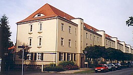Wohnanlage “Oberer Hecht”: Die Siedlung zwischen Hechtstraße, Bärwalder und Bernsdorfer Straße entstand zwischen 1926 und 1929 nach Plänen des Architekten Prof. Dr. Otto Schubert. Bauherr war der Kleinwohnungs-Bauverein Dresden e.V., welcher hier seine größte Wohnanlage mit insgesamt ca. 570 Wohnungen errichtete. Auf den angrenzenden Flächen folgten kurz darauf zweigeschossige Siedlungshäuser des Allgemeinen Sächsischen Siedlerverbandes - Heimstättenverein Dresden Nord-West. Diese befinden sich heute in Privatbesitz, während die Häuser des Bauvereins ab 1954 zur AWG des Transformatoren- und Röntgenwerkes, jetzt zur Sächsischen Wohnungsgenossenschaft Dresden gehören.

* * *

 \[ [Home](../../../../index.html)\] \[ [Nord](../../../../nord/)\] \[ [Nordwest](../../../../nordwest/)\] \[ [Neustadt](../../../../neustadt/)\] \[ [Nordost](../../../../nordost/)\] \[ [West](../../../../west/)\] \[ [Zentrum](../../../../zentrum/)\] \[ [Südwest](../../../../sudwest/)\] \[ [Süd](../../../../sud/)\] \[ [Südost](../../../../sudost/)\] \[ [Ost](../../../../ost/)\] \[ [Register](../../../../Register/register.html)\] \[ [Kontakt](../../../../Kontakt/kontakt.html)\] \[ [Impressum](../../../../impressum/)\]
