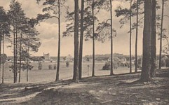
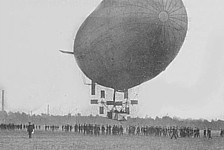
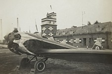
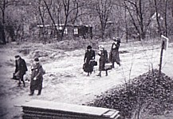

* * *

* * *

* * *

**Private Homepage von Siegmar Baumgärtel**

* * *

Zu den nördlichen Stadtteilen Dresdens gehören die oberhalb der Hellerterrasse
gelegenen Orte Klotzsche, Rähnitz, Hellerau und Wilschdorf sowie die Ortschaften Weixdorf, Langebrück und Schönborn. Bis in jüngste Vergangenheit blieben diese
Gebiete durch den Heller von der Stadt räumlich getrennt. Die weitgehend unbesiedelten Hellerberge wurden früher als militärische Übungsplätze genutzt und
blieben so unbebaut. Wichtigste  Straßenverbindungen zur Stadt sind die [Königsbrücker Landstraße](../nord/klotzsche/strassen_klotzsche/konigsbrucker_landstrasse/)
, die Radeburger Straße und die in den 30er Jahren angelegte Autobahn. Von Bedeutung ist auch der Dresdner Flughafen im Stadtteil Klotzsche.

Wilschdorf und Rähnitz waren früher Bauerndörfer, deren Produkte vor allem auf dem städtischen Markt angeboten wurden. Später wurden sie zu Wohnvororten Dresdens.
1908 entstand auf Rähnitzer Flur die damals deutschlandweit bekannte Gartenstadt Hellerau. Klotzsche hingegen entwickelte sich mit seinem Ortsteil Königswald seit
Ende des 19. Jh. zum beliebten Kur- und Villenvorort. 1935 erhielt der Ort sogar das Stadtrecht, wurde jedoch gemeinsam mit den drei anderen Stadtteilen 1950 nach
Dresden eingemeindet. Vor allem nach dem Zweiten Weltkrieg wurde der Dresdner Norden zum Industriestandort, dessen Tradition durch die Ansiedlung bedeutender High-Tech-Firmen nach 1990 fortgesetzt wird.

Weixdorf mit seinen Ortsteilen Lausa, Friedersdorf, Gomlitz und Marsdorf sowie Langebrück und Schönborn konnten ihre
Selbstständigkeit noch bis 1999 bewahren. Die am Rand der Dresdner Heide gelegenen Orte Langebrück und Schönborn sind  traditionelle Naherholungsziele der Dresdner.

Die Hellerberge

Das sandige, kaum bewachsene Gebiet des Hellers blieb bis ins 19. Jahrhundert weitgehend ungenutzt. Der Name wurde
wahrscheinlich vom slawischen holy = kahl abgeleitet. Ältestes Gebäude war die um 1655 erbaute [Hellerschänke](../nord/hellerau/hellerschanke/). Unweit
davon lag das Hellergut, ein einzeln stehendes bäuerliches Anwesen. Einige Verbindungswege, wie der Klotzscher
Marktweg, erschlossen das Gelände und verbanden die Heideorte mit der Stadt. Verwaltungsmäßig unterstand das Gebiet
dem Amt Dresden und wurde von den Bewohnern der Orte Wilschdorf und Trachenberge zum Teil für den Weinbau genutzt. Offiziell kamen die Hellerberge am 1. Juli 1897 mit der Eingemeindung Trachenberges zu Dresden.

1827 wurden große Teile des Hellers gesperrt und zum Exerzierplatz für
Übungen der sächsischen Armee umgewandelt. Hier fanden bis 1865 auch die großen “Herrenmanöver” der sächsischen Hofes statt. Die für die militärische Nutzung notwendigen Vermessungsarbeiten übernahm der Oberst des
Ingenieurcorps Ullrich, nach seinem Tod 1834 der Ingenieur-Oberstleutnant Oberreit. Ab 1837 existierte auf dem Areal ein Artillerieschießplatz, welchen
man 1861 den Anforderungen der modernen Waffentechnik anpasste und zu einer fast drei Kilometer langen Schussbahn erweiterte. 1866 entstanden dafür
zahlreiche Wirtschafts- und Kasernenbauten. Auch das einstige Hellergut wurde zur Kaserne umgebaut. Zum Schutz der Eisenbahnstrecke legten die Preußen 1866 eine Schanze auf dem Heller an. Reste
dieser “Schanze VIII”, die zu einem ganzen System ähnlicher Anlagen rund um Dresden gehörte, sind noch erhalten.
Obwohl der Schießplatz 1874 nach Zeithain verlegt wurde, blieb der Heller auch später militärisches Übungsgebiet.

Ab 1909 war der Heller Schauplatz von ersten Flugversuchen und Luftschiff- Landungen _(Foto links: Luftschiff “Parsifal” im Jahr 1909)_. Obwohl der Dresdner Flugplatz später zunächst in [Kaditz](../nordwest/kaditz/flugplatz_kaditz/) entstand, kehrten die Flieger 1926 in die Hellerberge zurück, als hier ein neuer Landeplatz angelegt wurde _(Foto rechts)_. Betreiber war die “Sächsische Flughäfen-Betriebsgemeinschaft m.b.H.”, welche 1924 mit dem Bau begann. Neben Abfertigungs- und Verwaltungsgebäuden entstand ein Hangar sowie eine mit Schlacke befestigte Start- und Landebahn. Am 12. April 1926 eröffnete man den neuen Flugplatz mit Linien nach Hamburg und Nürnberg. Ungünstige Windverhältnisse und mehrere schwere Flugzeugunglücke führten 1934 zur Verlegung des Flugbetriebs nach Klotzsche. Fortan fanden am Heller lediglich noch Schauveranstaltungen statt. So besuchten am 7. Juli 1935 bekannte Kunstflieger wie Ernst Udet, Willi Stöhr und Hans Grade den “Dresdner Flugtag” und begeisterten mit waghalsigen Manövern die Zuschauer. Auf dem einstigen Flugplatzgelände wurde 1947 eine Gartenhaussiedlung angelegt, die heute größte Kleingartenkolonie Deutschlands ist.

Während des Zweiten Weltkrieges entstand auf dem Heller ein Barackenlager der Wehrmacht für eine hier befindliche Radarstation der Luftwaffe (Radeburger Straße 211). Die unter dem Codenamen “Pinscher” betriebene Flugmeldestation bestand aus mehreren Funkmasten und entsprechenden Messgeräten und wurde gemeinsam von Soldaten und Luftwaffenhelferinnen betrieben. Im November 1942 wurde in dessen Nachbarschaft ein Arbeitslager der Firma Zeiss-Ikon eingerichtet, in dem in nur sieben Baracken hunderte Dresdner Juden unter unmenschlichen Bedingungen leben mussten. Die Bewohner waren zuvor zum Verlassen ihrer Unterkünfte in den “Judenhäusern” gezwungen worden und arbeiteten in der Rüstungsproduktion der Goehle-Werke der Zeiss Ikon AG auf der Heidestraße. Später verbrachte man auch Juden aus anderen sächsischen Städten in diese Unterkünfte. Am 2. März 1943 erfolgte die Auflösung des Lagers und die Deportation der Bewohner nach Auschwitz und Theresienstadt. Von den nachweisbar hier untergebrachten 293 Dresdnern überlebten nur 10 die Zeit des Nationalsozialismus. Erst 1995 wurde ein Dokumentarfilm über dieses Lager entdeckt. _( **Foto:** Stiftung Sächsische Gedenkstätten)_

Video: Deportation von Dresdner Juden in das Lager Hellerberge im November 1942

Nach der Räumung wurde in den Baracken des ehemaligen Judenlagers eine sogenannte Ausländerkinder-Pflegestätte eingerichtet. Hier wurden schwangere Zwangsarbeiterinnen, welche in Dresdner Unternehmen tätig waren, untergebracht und brachten ihre Kinder zur Welt. Nach der Geburt mussten die Frauen an ihre Arbeitsstellen zurückkehren, während ihre Kinder bewusst vernachlässigt und nur mangelhaft versorgt wurden. Von den im Lager geborenen 497 Säuglingen starben 225, meist noch vor ihrem ersten Geburtstag. Die verstorbenen Kleinkinder wurden in Pappschachteln auf dem nahen [St.-Pauli-Friedhof](../neustadt/leipziger_vorstadt/hechtviertel/st_-pauli-friedhof/) beerdigt. An diese erinnert dort ein in der Nachkriegszeit aufgestellter Gedenkstein. Weitere Kinder kamen in deutschen Pflegefamilien unter und konnten nach Kriegsende zu ihren Eltern zurückkehren. Das Barackenlager wurde in der Nachkriegszeit abgerissen.

Auch nach 1945 blieb der Heller zum Teil militärisches Übungsgebiet der Sowjetarmee und der NVA. Bis 1990 nutzte die
Sowjetarmee das Areal u.a. als Landeplatz für ihre Hubschrauber. Außerdem siedelten sich hier verschiedene Baufirmen
an. Ende der 60er Jahre war der Bau eines Neubaugebietes mit bis zu 20.000 Wohnungen geplant, welcher jedoch nicht
realisiert wurde. Stattdessen entschied man sich für einen Standort am Gorbitzer Hang. Bis in die Gegenwart wird das
Areal im Dresdner Norden vor allem gewerblich genutzt. Wo nach 1990 zeitweise die Großdiskothek “Disco-Circus” ihren Standort hatte, entstand 1995 die neue Druckerei der “Sächsischen Zeitung”.

Denkmale auf dem Heller:

Hauptmann-Hirsch-Denkmal: Das Denkmal befindet sich an der Ecke Radeburger/Hellerhofstraße und erinnert an den
Hauptmann der sächsischen Armee, Johann Baptista Josef Hirsch, der am 7. Oktober 1822 an dieser Stelle bei einem
Reitunfall schwer verletzt wurde. Hirsch war zuvor in Moritzburg gewesen, um dort Pferde für die sächsische Armee
auszusuchen. Drei Tage nach seinem Unfall erlag er seinen schweren Verletzungen. Ein Jahr später errichteten Offiziere des
Artillericorps den schlichten Granitwürfel zu seinem Andenken. Schöpfer war der Bildhauer Franz Pettrich. Ursprünglich befand sich das Denkmal an der heutigen Autobahnauffahrt, wurde nach 1945 jedoch umgesetzt.

Welck-Gedenkstein: Der Gedenkstein wurde 1909 am Nordwestrand des Hellers aufgestellt und erinnerte an den
Freiherrn Ernst von Welck, der hier bei einem Reitunfall ums Leben gekommen war. Der Stein war auch nach 1945 noch erhalten, ist jedoch heute verschollen.

Steinkreuz:
Das Kreuz am Pillnitz-Moritzburger Weg erinnert an den tragischen Tod von Jonas Daniel, der während der
Dohnaischen Fehde 1402 hier erschlagen wurde, als er zwei ihm anvertrauten Kindern das Leben retten wollte. Burggraf
Jeschke von Dohna hatte seinen treuen Kriegsknecht zuvor damit beauftragt, seine beiden Kinder zu einer befreundeten
Adelsfamilie nach Königsbrück zu bringen. Am Pillnitz-Moritzburger Weg lauerten ihm jedoch feindliche Reiter auf, denen
er sich entgegenstellte und dabei ums Leben kam. Den Kindern gelang gemeinsam mit einem Begleiter die Flucht. In Erinnerung an diese Begebenheit wurde bereits kurze Zeit später ein steinernes Kreuz mit der Inschrift _“Fin(is) Milit(is) Jhonas Dan(iel)”_  (Hier starb der Krieger Jonas Daniel) aufgestellt. 1560 wurde das Gedenkkreuz erstmals erwähnt. Im Jahr 2002 wurde neben dem Kreuz eine erläuternde Gedenktafel angebracht.

**Wer kennt Dresden? - Das Stadtquiz**

500 Fragen zur Geschichte und Gegenwart Dresdens finden sich in diesem neuen Quizspiel für 2 bis 6 Mitspieler ab 14 Jahren. Ziel ist es, durch die richtige Beantwortung der Fragen seinen Spielplan mit Straßen, Gebäuden und Sehenswürdigkeiten zu komplettieren. Dafür stehen jeweils vier Antwortmöglichkeiten und ein Joker je Spielrunde zur Verfügung.

**Erhältlich u.a. bei Hugendubelund Spielaxie (Altmarkt-Galerie), Buch Habel (Gorbitz/Merianplatz), Karstadt, Haus des Buches (Dr.-Külz-Ring),**

**Buch & Kunst und bei Capito - Der Spieleladen (Rothenburger Straße)**

* * *

 \[ [Nord](../nord/)\] \[ [Nordwest](../nordwest/)\] \[ [Neustadt](../neustadt/)\] \[ [Nordost](../nordost/)\] \[ [West](../west/)\] \[ [Zentrum](../zentrum/)\] \[ [Südwest](../sudwest/)\] \[ [Süd](../sud/)\] \[ [Südost](../sudost/)\] \[ [Ost](../ost/)\] \[ [Register](../register/)\] \[ [Kontakt](../kontakt/)\] \[ [Impressum](../impressum/)\]
