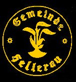
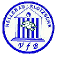
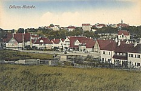
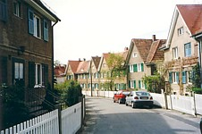
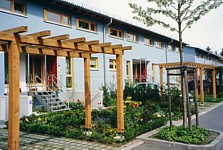
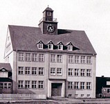
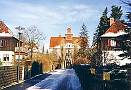
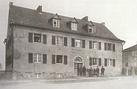

* * *

**Gemeindesiegel von Hellerau**

* * *

* * *

**Hellerauer Vereine:**

**VfB Hellerau-Klotzsche Verein für Breitensport**

**Karl-Liebknecht-Str. 4901109 Dresden**

[**zur Homepage**](http://www.vfb-hellerau-klotzsche.de)

* * *

**Schulen in Hellerau:**

Hellerau wurde auf Initiative des Besitzers der Deutschen Werkstätten, Karl
Schmidt, als erste deutsche Gartenstadt gegründet und erhielt als “Au am Heller” seinen Namen. Ziel der um 1900 in England entstandenen Gartenstadtbewegung
war es, neue Formen des gesellschaftlichen Zusammenlebens zu propagieren, die sich auch auf künstlerischem und architektonischen Gebiet ausdrücken sollten. Für den Bau Helleraus erwarb Schmidt ca. 140 Hektar Land von
Rähnitzer und Klotzscher Bauern und gründete 1908 die gemeinnützige “Gartenstadt Hellerau  G.m.b.H.” , die den künftigen Bewohnern zu günstigen Konditionen den Erwerb von Wohnhäusern ermöglichen und jegliche
Bodenspekulation verhindern sollte. Für die Planung der Reihenhaussiedlung wurde der Münchner Architekt Richard Riemerschmid gewonnen, der Schmidts Ideen in die Tat umsetzen sollte.

Am 9. Juni 1909 erfolgte an der Straße Am grünen Zipfel die Grundsteinlegung für die ersten Häuser. Im Anschluss
entstanden in mehreren Bauabschnitten das Kleinhaus- und Villenviertel, ein Stadtzentrum um den Markt mit den erforderlichen öffentlichen Einrichtungen sowie das Betriebsgelände der [Deutschen Werkstätten](../../nord/hellerau/deutsche_werkstatten/), für deren Arbeiter die
Siedlung hauptsächlich gedacht war. Einbezogen wurde die als einziges Gebäude bereits vorhandene Ausflugsgaststätte [“Waldschänke”](../../nord/hellerau/strassen_und_plaetze/waldschanke/). Diese gehörte neben der [“Hellerschänke”](../../nord/hellerau/hellerschanke/) in den nahe gelegenen Hellerbergen zu den beliebten Zielen für
Heidewanderer. Um die künstlerische Konzeption und den Gartenstadtcharakter durchzusetzen, gab es bis 1913 eine Bau- und Kunstkommission für den Ort.

Geschickt wurde von Riemerschmid das hüglige Gelände für die Gestaltung
genutzt. Die Straßen verliefen meist bogenförmig, um so einen Einklang zwischen Natur und Architektur herzustellen **_(Foto:_** _Am Dorffrieden)_. Neben
Riemerschmid wirkten die Architekten Hermann Muthesius und Heinrich Tessenow am Bau der Gebäude mit. Tessenow war auch Architekt des [Festspielhauses](../../nord/hellerau/festspielhaus/), welches einige Jahre künstlerischer Mittelpunkt Helleraus war.
Der Ruf des Ortes als fortschrittliche Kulturstätte europäischen Ranges führte zum Besuch bekannter Künstler der damaligen Zeit. 1913 erhielt Hellerau Straßenbahnanschluss (1938 bis Rähnitz verlängert).

Durch den Ersten Weltkrieg wurde die Entwicklung Helleraus abgebrochen. Bereits zuvor hatte Riemerschmid den Ort
1913 verlassen. 1919 wurde Hellerau mit der Nachbargemeinde Rähnitz vereinigt. In den 1920er und 30er Jahren erfolgten lediglich noch einige Ergänzungen, darunter eine Holzhaus-Mustersiedlung nach Entwürfen bekannter
Architekten. Finanzielle Schwierigkeiten der Gartenstadtgesellschaft zwangen 1923 zum Verkauf eines Teils der
Kleinhäuser an Privatbesitzer. Trotzdem konnte bis 1932 der unvollendete Markt durch Rudolf Kolbe fertiggestellt werden. Außerdem wurden 1937 weitere Wohnhäuser Am Pfarrlehn errichtet.

1938 erhielt der bisherige Doppelort Rähnitz-Hellerau offiziell den Namen
Hellerau und kam am 1. Juli 1950 als Stadtteil zu Dresden. In den 1950er Jahren wurden unter Beachtung des Gesamtkonzepts der Gartenstadt einige Häuser für
die Angestellten der Klotzscher Flugzeugwerke errichtet, die im Volksmund “Klein-Dessau” genannt wurden. Die gesamte Anlage steht als Zeugnis des modernen Städtebaus vom Anfang des 20. Jahrhunderts unter Denkmalschutz.
Neben der denkmalgerechten Sanierung der vorhandenen Gebäude wurde 1993 mit der Planung eines Erweiterungsgebietes begonnen. Hier entstanden in
Anlehnung an Hellerauer Bautraditionen gestaltete Ein- und Mehrfamilienhäuser für Familien zwischen den Straßen Kirchsteig und Am Pfarrlehn _(Foto)_. Ein Ideenwettbewerb zur weiteren Entwicklung
des Ortsteils wurde 1998 durchgeführt. 2012 erfolgte die Nominierung der Gartenstadt als “Laboratorium einer neuen Menschheit” für die UNESCO-Kulturerbeliste.

Schulen in Hellerau:

Das Hellerauer Schulwesen war vor allem in den Anfangsjahren stark von reformpädagogischen Ansätzen geprägt. Ausgehend von der 1910 gegründeten [Bildungsanstalt für rhythmische Gymnastik](../../nord/hellerau/festspielhaus/) entstanden auch nach deren Schließung
verschiedene Nachfolgeeinrichtungen ähnlichen Konzepts, die gesellschaftliche und künstlerische Reformvorstellungen
miteinander verbinden wollten. Letztlich scheiterten diese Konzepte an fehlenden finanziellen Mitteln bzw. wurden spätestens mit Machtantritt Hitlers unterbunden.

Volksschule:
Die Schule wurde für die Kinder der Hellerauer Einwohner 1914 nach einem Entwurf von Curt Frick erbaut. Obwohl sie dem üblichen Volksschulkonzept folgte, wurden auch hier neue Pädagogikansätze ausprobiert, so der
gemeinsame Unterricht von Jungen und Mädchen sowie eine erweiterte körperliche Erziehung durch Sport und Tanz. Ziel
war es, den verbreiteten strengen Frontalunterricht mit praktischen Arbeiten und kreativer Betätigung zu ergänzen. Die
Schule war Initiator der bis 1933 regelmäßig durchgeführten Festumzüge und besaß ab 1927 ein kleines Museum. Nach
1945 wurde sie als 84. POS “Carl Bobach” weitergeführt. Heute dient das Gebäude auf dem Heinrich- Tessenow-Weg als 84. Grundschule “In der Gartenstadt”.

**_Fotos:_** _Blick zur Hellerauer Schule am Heinrich-Tessenow-Weg 1915 und 2003_

Schulheim:
Das “Schulheim für eine private Höhere Schule” wurde 1912 in einem privaten Wohnhaus gegründet und ein Jahr später in das Haus Am Grünen Zipfel 1 verlegt. Die Privatschule besuchten u. a. die Kinder von Tessenow und
Dalcroze. Der Unterricht erfolgte fächerübergreifend und sollte so besondere Interessen und Fähigkeiten der Kinder entwickeln. Nach Beginn des Ersten Weltkrieges wurde die Schule geschlossen.

Neue Schule Hellerau: Die Schule entstand 1920 auf dem Gelände der ehemaligen Bildungsanstalt auf Initiative Carl
Theils. Theil war zuvor Lehrer an der reformorientierten Odenwaldschule und wollte deren Konzept nun auch in Hellerau
umsetzen. Unterrichtet wurden natur- und gesellschaftswissenschaftliche Fächer, kombiniert mit einer handwerklichen und
Eurythmieausbildung. Nach Theils Weggang nach Jena geriet die Privatschule in wirtschaftliche Schwierigkeiten und wurde 1925 geschlossen.

Verbandsberufsschule:
Die Schule wurde als “Verbandsberufsschule Heiderand-Nord” 1924 gegründet und nutzte die Räume der Hellerauer Volksschule sowie des benachbarten Feuerwehrdepots. Sie diente der Aus- und Weiterbildung
von Jugendlichen in verschiedenen Handwerksberufen und erhielt 1934 Außenstellen in Weixdorf und Ottendorf-Okrilla.
Nach kurzzeitiger kriegsbedingter Unterbrechung nahm die Berufsschule bereits im Juni 1945 den Lehrbetrieb wieder auf und bestand noch bis Mitte der 1950er Jahre. Zuletzt wurden hier vor allem Werkzeugmacher ausgebildet.

Postamt:

Das Hellerauer Postamt wurde im Zusammenhang mit der Bebauung des Marktes 1910/12 errichtet. Schöpfer war der
Architekt Riemerschmid, der am Markt alle öffentlichen Einrichtungen der Gartenstadt konzentrieren wollte. Heute gehört Hellerau postalisch zum Postamt Klotzsche.

Rathaus:

Das Hellerauer Rathaus wurde 1923/24 nach Plänen des Architekten Gustav Lüdecke am Pillnitz-Moritzburger Weg (heute Ludwig-Kossuth-Straße 61) erbaut. Lüdecke war auch Schöpfer des “D-Zuges”, einer originellen Reihenhaussiedlung am Urnenfeldweg. Für den Bau des Verwaltungsgebäudes fanden Ziegel eines abgerissenen Schornsteins Verwendung. Bis 1950 befand sich hier die Gemeindeverwaltung des 1919 vereinigten Doppelortes Rähnitz-Hellerau. Außerdem gab es Räume für die Gemeinde- und Steuerkasse, die Giro- und die Gemeindeverbandssparkasse des Ortes, eine Polizeidienststelle und weitere Büros. Da ein größerer Versammlungssaal fehlte, diente es vorrangig als Gemeindeamt. Im Obergeschoss gab es einige Wohnungen. Nach der Eingemeindung diente das Haus nur noch Wohnzwecken und wurde Mitte der 1990er Jahre zugunsten eines Sparkassen-Neubaus abgerissen.

[_Weiterführende Literatur und Quellen_](../../impressum/quellenverzeichnis/)

**Führungen durch die Gartenstadt Hellerau:**

**architektour\_dd - Claudia Beger - Architekturführungen:**

Prießnitzstraße 25,01099 Dresden, Tel.:  0351 / 329 61 46, Mail: [info@architektour-dd.de](mailto:info@architektour-dd.de)

 \[ [Home](../../index.html)\] \[ [Nord](../../nord/)\] \[ [Nordwest](../../nordwest/)\] \[ [Neustadt](../../neustadt/)\] \[ [Nordost](../../nordost/)\] \[ [West](../../west/)\] \[ [Zentrum](../../zentrum/)\] \[ [Südwest](../../sudwest/)\] \[ [Süd](../../sud/)\]
 \[ [Südost](../../sudost/)\] \[ [Ost](../../ost/)\] \[ [Register](../../Register/register.html)\] \[ [Kontakt](../../Kontakt/kontakt.html)\] \[ [Impressum](../../impressum/)\]
