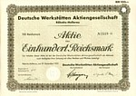
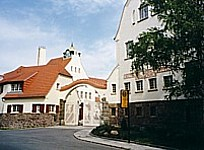
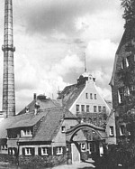
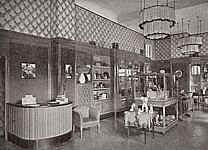
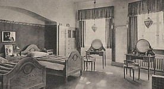
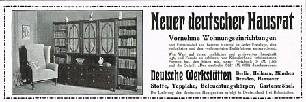
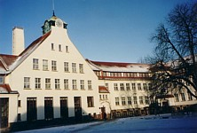
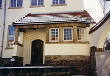
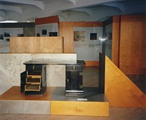

* * *

* * *

* * *

* * *

* * *

* * *

Die Deutschen Werkstätten entstanden 1907 durch die Fusion zweier Werkstätten für Handwerkskunst. Das Unternehmen wurde durch seine modernen Reformmöbel in schlichter handwerklicher Fertigung bekannt und gehörte zu den Wegbereitern moderner Handwerkskunst zu Beginn des 20. Jahrhunderts.

Ausgangspunkt der Firma war die 1898 in Laubegast gegründete Tischlerwerkstatt Karl Schmidts, die er selbst als “Bau-Möbelfabrik und Fabrik kunstgewerblicher Gegenstände” bezeichnete. Schmidt wandte sich gezielt der Fertigung von Reformmöbeln zu und präsentierte die Entwürfe seiner Firma um 1900 auf verschiedenen Ausstellungen. Die Gestaltung überließ er bekannten Künstlern und versuchte, mit seiner Werkstatt einen Kompromiss zwischen preisgünstiger
maschineller Herstellung und geschmackvollem Design zu finden. 1907 vereinigte er seine Werkstatt mit den Münchner Werkstätten für Wohnungseinrichtung und verlegte sein Unternehmen 1910 nach Hellerau.

Bereits 1908 trat Karl Schmidt als Initiator der Gartenstadt Hellerau auf, die er als Wohnsiedlung für seine Arbeiter vorsah. Die Idee der Gartenstadt hatte er bereits während seiner Wanderjahre in England kennengelernt und versuchte nun, dieses sozialreformerische Werk vor den Toren Dresdens umzusetzen. Neben den verschiedenen Wohnkomplexen ließ er nach Entwürfen von Richard Riemerschmid ein Fabrikgelände anlegen. Am 9. Juni 1909 erfolgte die Grundsteinlegung für die neuen Verwaltungs- und Produktionsgebäude am Moritzburger Weg 67 am Rand der Siedlung. Als Grundriss der Anlage wurde die Form einer Schraubzwinge gewählt, die nicht nur an das für die Möbelherstellung unentbehrliche Utensil erinnern sollte, sondern zugleich eine optimale Aufteilung der benötigten Betriebsteile ermöglichte _(Fotos)_.

Das Unternehmen, welches 1913 in eine Aktiengesellschaft umgewandelt wurde,
wurde schnell zu einem der bedeutendsten deutschen Hersteller formschöner Möbel, die sich bewusst von der Massenware anderer Möbelproduzenten abhoben. 1921 wurde zusätzlich mit dem Bau von Holzhäusern begonnen, wofür in Hellerau eine Musterhaussiedlung angelegt wurde. Außerdem widmete sich die Firma verstärkt der Anfertigung von kompletten Inneneinrichtungen für Bürohäuser und Fabriken. Die Fotos zeigen Musterräume des Unternehmens aus der Zeit zwischen 1912 und 1920.

1927 begann die Fertigung von Typenmöbeln, 1935 die Herstellung von Anbaumöbeln nach dem Baukastensystem. Bekannt wurden die Möbel Bruno Pauls, der einer der bekanntesten Gestalter von Inneneinrichtungen dieser Zeit war und auch das Wohnhaus Auf dem Sand 26 entwarf. In den 1920er Jahren war der KPD-Funktionär Kurt Schlosser, der später als Leiter einer Widerstandsgruppe bekannt wurde, in den Deutschen Werkstätten beschäftigt. Zur Erinnerung an Schlosser wurde nach 1945 eine Gedenktafel am Werkseingang angebracht. Trotz aller Bemühungen gerieten die Deutschen Werkstätten durch die Weltwirtschaftskrise in Schwierigkeiten und konnten 1930 nur mit Mühe vor dem Konkurs gerettet werden.

Während des Zweiten Weltkrieges war das Unternehmen an der Herstellung von Zubehörteilen für die Rüstung beteiligt. Unter Leitung des damaligen Direktors der Deutschen Werkstätten, des Innenarchitekten Walter Heyn, wurde 1944 die “Organisation Heyn” ins Leben gerufen, in der der Einsatz von Holzteilen im Flugzeugbau untersucht und vorbereitet wurde. Die Herstellung der Teile erfolgte in verschiedenen Betrieben in Mitteldeutschland, die Endmontage der Rümpfe durch die Zentralwerkstatt des NS-Fliegerkorps in Dresden-Johannstadt. Das zweisitzige Segelflugzeug vom Typ Heinkel 162 S sollte dabei der Ausbildung der Piloten für den Jagdflieger “Heinkel 162” mit Strahltriebwerk dienen und wurde erstmals im April 1945 auf dem Flugplatz Trebbin erprobt. Da sich konstruktive Mängel zeigten, kamen die Flugzeuge jedoch nicht über ein Teststadium hinaus.

1946 wurden die Deutschen Werkstätten Hellerau wegen ihrer Beteiligung an der Kriegswirtschaft enteignet. Karl Schmidt, der sich seit 1938 Schmidt-Hellerau nannte, musste aus dem Unternehmen ausscheiden und verstarb 1948 in seinem Hellerauer Wohnhaus. Der Betrieb produzierte auch als VEB weiter Serienmöbel und Holzteile für andere Hersteller. Zu den Entwicklungen der Nachkriegszeit gehörten die vom ehemaligen Bauhaus-Mitglied Franz Ehrlich entworfene Typserie 602 sowie die auf Selbstmontage ausgerichteten ersten Schrankwände, die vom Hallenser Designer Rudolph Horn 1966 entworfen wurden. Ab 1970 firmierte das Werk als VEB Möbelkombinat Hellerau, dem mehrere Unternehmen in der DDR angehörten.

1992 wurde die Firma privatisiert und modernisiert, geriet jedoch wenig später in wirtschaftliche Schwierigkeiten. Die Möbelproduktion wurde daraufhin eingeschränkt und spielt heute nur noch eine untergeordnete Rolle. Seit 1996 konzentriert sich das Unternehmen auf die Anfertigung hochwertiger Inneneinrichtungen für öffentliche Gebäude und private Auftraggeber. Das denkmalgeschützte Haupthaus am Moritzburger Weg dient heute als Sitz verschiedener Firmen und Einrichtungen sowie als Domizil des 1995 eröffneten Werksmuseums. Außerdem gibt es hier das nach dem Firmengründer benannte Restaurant “Schmidt\`s”.

Ein in Anlehnung an Hellerauer Traditionen entstandener moderner Neubau auf dem Betriebsgelände wurde 2003 fertig gestellt und beherbergt Büros und Ateliers. Der Entwurf stammt von Albrecht Quincke und wurde in Zusammenarbeit mit dem Institut für Baukonstruktion und Holzbau der TU realisiert. Auf dem Areal des ehemaligen Spänebunkers entstand bis 2010 das nach einem Hellerauer Möbeldesigner benannte Bruno-Paul-Haus. Die Pläne für diesen modernen Neubau, in welchem Räume an Gewerbetreibende vermietet werden, stammen vom Münchner Architekten Joseph Meier-Scupin. Eine moderne Plastik mit dem Titel “Genius Loci” des schottischen Künstlers Colin Ardley ergänzt das Ensemble.

**Fachschule der Deutschen Werkstätten:**

Die Lehrwerkstätten entstanden bereits 1907 zur Ausbildung der zukünftigen Angestellten des Unternehmens. Gelehrt wurden nicht nur fachbezogene handwerkliche
Tätigkeiten, sondern auch Fächer wie Zeichnen, Turnen, Literatur und Technik. Unter dem Einfluß der Ideen Wolf Dohrns sollten die Schüler zu selbstbewussten, allseitig gebildeten Persönlichkeiten erzogen werden. 1914 wurde der theoretische Unterricht aus finanziellen und praktischen Gründen eingeschränkt, bevor die Schule 1919 ganz geschlossen wurde.

Neben dieser Schule gab es in den Jahren nach dem Ersten Weltkrieg die sogenannte Handwerksgemeinde, die bis 1926 von Heinrich Tessenow geleitet wurde. Dabei wurden Handwerker verschiedener Branchen unter kunstgewerblich - handwerklichen Aspekten ausgebildet. Die Werkstätten der Handwerksgemeinde befanden sich in den Fabrikgebäuden der Deutschen Werkstätten. Nach dem Weggang Tessenows löste sich die Handwerksgemeinde auf.

* * *

 \[ [Home](../../../index.html)\] \[ [Nord](../../../nord/)\] \[ [Nordwest](../../../nordwest/)\] \[ [Neustadt](../../../neustadt/)\] \[ [Nordost](../../../nordost/)\] \[ [West](../../../west/)\] \[ [Zentrum](../../../zentrum/)\] \[ [Südwest](../../../sudwest/)\] \[ [Süd](../../../sud/)\] \[ [Südost](../../../sudost/)\] \[ [Ost](../../../ost/)\] \[ [Register](../../../Register/register.html)\] \[ [Kontakt](../../../Kontakt/kontakt.html)\] \[ [Impressum](../../../impressum/)\]
