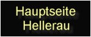
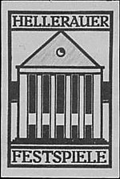
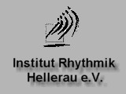
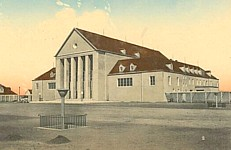
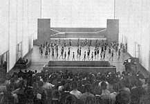
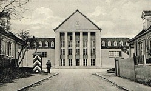
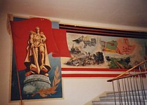
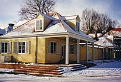

* * *

* * *

**Werbeplakat um 1912**

* * *

Das Festspielhaus entstand 1911/12 am Nordwestrand der Gartenstadt Hellerau nach Entwürfen von Heinrich Tessenow. Der Mehrzweckbau sollte für den Unterricht der Tanzschule von Emilie Jaques-Dalcroze sowie für regelmäßige Festspiele dienen und so kultureller Mittelpunkt der Gartenstadt sein. Das Festspielhaus bildet einen streng symmetrischen Baukomplex mit Zentralbau und seitlichen Flügeln, die als Wohnhäuser für Lehrer und Studierende gedacht waren. Im Inneren befand sich ein Festsaal, der wegen seiner variablen Bühne und der raffinierten Lichtanlage und Akustik für Aufsehen sorgte. Gemäß dem Konzept der 1910 von Wolf Dohrn und
Jaques-Dalcroze gegründeten Bildungsanstalt für rhythmische Gymnastik wurde hier vorrangig moderner Ausdruckstanz gelehrt, wobei das Publikum während der Vorstellungen mit in das Bühnengeschehen einbezogen wurde. Zu den bekanntesten Schülern der Bildungsanstalt gehörte Mary Wigman.

**_Foto:_** _Das Hellerauer Festspielhaus in den 20er Jahren_

In den Anfangsjahren war das Festspielhaus Anziehungspunkt für kulturell interessierte Persönlichkeiten aus ganz Europa. So besuchten Henry van de Velde, Emil Nolde, Oskar Kokoschka, Rainer Maria Rilke, Stefan Zweig und Franz Kafka die Vorstellungen. Neben dem laufenden Ausbildungsbetrieb gab es auch Schulfeste, Sommerkurse sowie kostenlose Übungsstunden für Hellerauer Kinder. Zu den Höhepunkten gehörte 1913 die Aufführung der Oper “Orpheus und Eurydike” im Rahmen eines Sommerfestes (18. bis 28. Juni), welche weit über Dresden hinaus für Aufsehen sorgte. Unter Leitung von Jaques-Dalcroze musizierte die Hofkapelle, die Rolle des Orpheus wurde von Emmi Leisner gesungen. Begleitet wurde die Aufführung von Bewegungschören mit einer ausdrucksvollen Gebärdensprache sowie einer speziellen Lichtregie des Schweizer Bühnenbildners Adolphe Appia.

Nach dem Tod Wolf Dohrns und dem Weggang Emilie Jaques-Dalcroze\` wurde die Bildungsanstalt 1914 geschlossen. Als Nachfolgeeinrichtung bezog die Neue Schule für angewandten Rhythmus ab 1915 die Räumlichkeiten. Ehemalige Schüler von Dalcroze hatten diese gegründet. Die Schule bestand bis 1925 und wurde dann nach Wien verlegt. Danach zogen Alexander Neills internationale Schule, ein Kindergärtnerinnenseminar und weitere Einrichtungen ein. Ab 1931 nutzte Dora Menzlers Gymnastikschule das Haus und versuchte, an die Traditionen der Gründungszeit anzuknüpfen. Zu den letzten Großereignissen im Festspielhaus gehörte 1932 die Aufführung der Oper “Iphigenie in Aulis” unter Leitung von Fritz Busch.

Mit dem Machtantritt Hitlers hatten moderne künstlerische Projekte nach Hellerauer Traditionen keine Chance mehr. Der Staat übernahm 1935 das Festspielhaus und richtete 1937 eine Kaserne der Reichspolizei ein _(Foto links)_. Für diesen Zweck wurden an Stelle der früheren seitlichen Pensionshäuser zwei geschlossene Kasernenflügel errichtet. Spätere Nutzer waren bis 1945 die SA und die SS. Danach
beschlagnahmte die Rote Armee den Gebäudekomplex und nutzte ihn bis zum Abzug 1992 als Lazarett. Bereits während der Nazizeit wurde die Architektur im Inneren verändert, was von den sowjetischen Streitkräften fortgesetzt wurde _(Foto rechts)_.

Das Festspielhaus wurde 1992 stark sanierungsbedürftig geräumt. Verschiedene Initiativen bemühen sich seitdem um eine denkmalgerechte Rekonstruktion und eine künftige kulturelle Nutzung. Als Auftakt für die geplante Wiederherstellung konnten bereits die vier Pensionshäuser saniert werden und werden heute u. a. von der Kulturstiftung Sachsen, vom Deutschen Werkbund und vom Tessenow-Institut genutzt _(Foto)_. 2004 entstand das Europäische Zentrum der Künste, welches an die Tradition Helleraus als Hort der modernen Künste anknüpfen will. Für die künstlerische Arbeit konnte der amerikanische Choreograph William Forsythe mit seiner Company gewonnen werden. Die ersten Aufführungen fanden im September 2006 statt. Bereits ein Jahr zuvor war 2005 das Deutsche Komponistenarchiv gegründet worden. Das Archiv sammelt die kompletten Nachlässe zeitgenössischer Komponisten aller Genres mit Korrespondenzen, Tonträgern, Notenblätter und Fotos. Finanziert wird das Archiv durch die GEMA-Stiftung und die Stadt Dresden. Seit 2011 gibt es auch eine von der Dresdner “Pastamanufaktur” betriebene Gaststätte auf dem Gelände.

Video: Performance beim internationalen Festival für computergestützte Kunst CYNET 2003

Johann-Trollmann-Denkmal:

Seit 2012 erinnert im Außenbereich des Festspielhauses ein Denkmal in Form eines an den Ecken abgesenkten Boxrings an den Boxer Johann "Rukeli" Trollmann. Das Denkmal entstand ursprünglich als temporäre Kunstinstallation der Künstlergruppe "Bewegung Nurr" und war zuvor 2010 in Berlin, danach in Hannover zu sehen, bevor es am 19. Oktober 2012 in Hellerau Aufstellung fand.

Die Stahlplastik erinnert an Johann Trollmann, einen Sinti, der in den 1930er Jahren zu den Stars der deutschen Boxszene gehörte und 1932 auch in Dresden zwei seiner Kämpfe gewann. 1933 wurde er deutscher Meister im Halbschwergewicht, bekam den Titel jedoch auf Druck der Nazis wieder aberkannt. In seinem letzten Kampf trat er weißgeschminkt und als Parodie eines "Ariers" auf, um so ein Zeichen gegen den Rassismus des NS-Regimes zu setzen. Danach durfte er nur noch bei Schaukämpfen auftreten, wurde 1939 in die Wehrmacht einberufen und 1942 als "Zigeuner" entlassen. Im Juni 1942 kam er ins Konzentrationslager Neuengamme, wo er 1944 von einem SS-Mann nach einem verlorenen Schaukampf erschlagen wurde. Nach seiner Häftlingsnummer trägt das Denkmal offiziell die Bezeichnung "9841". Künftig ist eine Umsetzung an einen zentraleren Ort, evtl. in den Sportpark Ostragehege vorgesehen.
