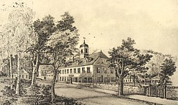
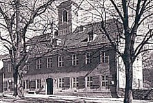
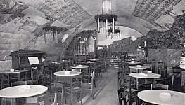

* * *

Die Hellerschänke wurde 1688 unter dem Namen “Zum grünen Baum” in
den Hellerbergen eröffnet. Neben dem Hellergut blieb sie lange Zeit einziges Gebäude in den Hellerbergen. Die Schänke ging auf ein 1673 vom Kammerjunker Hans Caspar Knoch gegründetes Weingut zurück,
welches später mehrfach erweitert wurde und als Freigut von Abgaben befreit blieb.

1704 kam sie in den Besitz des Oberjägermeisters Wolf Dietrich von Erdmannsdorf, der die Gebäude umbauen und erweitern ließ.
Nach 1716 wurde der Gasthof  “Hellerschänke” bzw. “Zum letzten Heller” genannt. Der Legende nach soll diese Bezeichnung auf August den Starken zurückgehen, der bei
einem Besuch des Weingutes nur noch einen Heller in der Tasche hatte, um damit seine Zeche zu bezahlen. Da der
Kurfürst incognito erschien und vom Wirt auch nicht erkannt wurde, soll er während seines Besuches die Zeilen:

_Wenn mancher Mann wüßte, wer mancher Mann wär´,  gäb mancher Mann manchem Mann manchmal mehr Ehr\`,_

_da mancher Mann nicht weiß, wer mancher Mann ist,  darum mancher_
_Mann manchen Mann manchmal vergißt._

auf den Tisch gekritzelt haben. Eine andere Sage berichtet von einem Handwerksburschen, der seine Schulden mit
der Krone des Schlangenkönigs aus dem nahen Olterteich bezahlte und von der verschiedene Varianten existieren.

[_Die Sage vom Schlangenkönig_](../../../nord/hellerau/hellerschanke/olterteichsage/)

Im 19. Jahrhundert diente das Haus zeitweise militärischen Zwecken und wurde erst 1872 wieder als Gaststätte
eröffnet. Die Hellerschänke war vor 1945 eines der beliebtesten Ausflugsziele im Dresdner Norden. Anziehungspunkt
war nicht nur der große schattige Gästegarten für bis zu 5000 Gäste, sondern auch der angeschlossene Weinkeller.
Zu den häufigen Besuchern gehörte der Maler Otto Altenkirch, der viele Darstellungen der Hellerberge schuf.

**_Fotos:_** _Die Hellerschänke in den 1930er Jahren mit historischem Weinkeller_

1956 wurde das Gasthaus wegen Baufälligkeit geschlossen und 1969 abgerissen. Zuletzt nutzte die Hellerauer LPG “Kurt Schlosser” noch einige der Nebengebäude als Lagerraum. Erhalten blieb das vermutlich aus der Permoser-
Werkstatt stammende, farblich gestaltete Eingangsportal, welches sich seit 1973  an der Rückseite der Sekundogenitur befindet.

* * *

 \[ [Home](../../../index.html)\] \[ [Nord](../../../nord/)\] \[ [Nordwest](../../../nordwest/)\] \[ [Neustadt](../../../neustadt/)\] \[ [Nordost](../../../nordost/)\] \[ [West](../../../west/)\] \[ [Zentrum](../../../zentrum/)\] \[ [Südwest](../../../sudwest/)\] \[ [Süd](../../../sud/)\] \[ [Südost](../../../sudost/)\] \[ [Ost](../../../ost/)\] \[ [Register](../../../Register/register.html)\] \[ [Kontakt](../../../Kontakt/kontakt.html)\] \[ [Impressum](../../../impressum/)\]
