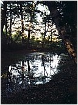

* * *

* * *

**_Foto:_** _Der sagenumwobene Olterteich in der_

_Jungen Heide_

**_Die Sage vom Schlangenkönig_**

_Einst wanderte ein junger Geselle die Radeburger Straße_
_hinaus, um zu versuchen, in der Ferne sein Glück zu finden. Seine einzige Barschaft bestand in einem einzigen Heller. So schlenderte er, in trübe Gedanken versunken, die einsame Straße entlang und bog schließlich auf_
_einen schmalen Waldweg ein. Nach kurzem Hin- und Herirren gelangte er an den berüchtigten Olterteich, von dem er schon allerhand Wunderdinge gehört hatte. Wilde Schlingpflanzen und Schilfrohr wuchsen am Rande des_
_grünlich-gold schillernden Teiches. Hier sollte der Schlangenkönig wohnen. Wem es gelang, ihm die Krone von seinem Schlangenhaupt zu reißen, der solle reich und glücklich werden. So erzählten es die Alten und der junge_
_Bursche beschloss, sein Glück zu versuchen._

_Lachend warf er sein glitzerndes Hellerstück auf ein schmutziges Tuch, welches er zuvor am Ufer ausgebreitet hatte und bot es mit lauten Worten dem_
_Schlangenkönig zum Kauf an. Dann versteckte er sich im Schilf und erwartete dort gespannt dessen Erscheinen. So mochte er wohl eine halbe Stunde gewartet haben, als plötzlich ein mächtiger Schlangenkopf mit einer_
_funkelnden Krone aus Gold und Edelsteinen aus dem Wasser auftauchte. Mühsam schleppte sich der riesige Körper allmählich zum Tuch mit dem in der Sonne blinkenden Hellerstück. Hier legte der Schlangenkönig vorsichtig_
_seine Krone nieder und begann sich zusammenzuringeln, um sich in der wärmenden Sonne auszuruhen._

_Der Wanderbursche war hocherfreut und wartete auf eine günstige Gelegenheit, dem Schlangenkönig seine Krone_
_abzunehmen. Doch noch wachte die Schlange mit gierigen Augen über ihren Besitz. Doch plötzlich bemerkte er, das sich die Sonnenstrahlen mit dem Lauf der Sonne vom Tuche wegbewegten und die Schlange mit ihrem Blick den_
_Strahlen folgte. Schließlich fasste er Mut, schlich sich behutsam an den Schatz heran, ergriff das Tuch mit der Krone und seinem Heller und rannte schnellen Schrittes davon._

_In Dresden verkaufte er die_
_wertvolle Krone an einen Goldschmied, der ihm eine hohe Summe für den Schatz überließ. Von dem erhaltenen Geld erwarb der Handwerkbursche ein Stück Land ganz in der Nähe der Stelle, wo er sein Glück gesucht und gefunden_
_hatte. Hier errichtete er ein ansehnliches Gasthaus. In Erinnerung an seine einstige Armut ließ er über dem Eingang ein Schild mit der Aufschrift “Zum letzten Heller” anbringen._

_\\*\\*\\*_

* * *

 \[ [Home](../../../../index.html)\] \[ [Nord](../../../../nord/)\] \[ [Nordwest](../../../../nordwest/)\] \[ [Neustadt](../../../../neustadt/)\] \[ [Nordost](../../../../nordost/)\] \[ [West](../../../../west/)\] \[ [Zentrum](../../../../zentrum/)\] \[ [Südwest](../../../../sudwest/)\] \[ [Süd](../../../../sud/)\] \[ [Südost](../../../../sudost/)\] \[ [Ost](../../../../ost/)\] \[ [Register](../../../../Register/register.html)\] \[ [Kontakt](../../../../Kontakt/kontakt.html)\] \[ [Impressum](../../../../impressum/)\]
