* * *

Die Straße Am Biedersberg wurde 1927 nach einem alten Flurnamen, dem "Biedersberg", benannt. Die Anlage erfolgte im
Zusammenhang mit dem Bau einer Einfamilienhaussiedlung südlich des Moritzburger Wegs.

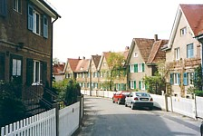Als sogenannter “Dorffrieden” wurde früher der am Rande des Klotzscher Dorfkerns
verlaufende Fahrweg bezeichnet, dessen Breite auf acht Ellen festgelegt war, damit sich hier zwei Wagen begegnen konnten. 1911 erhielt die Straße offiziell ihren Namen.

Die Gebäude der Straße Am Dorffrieden im Hellerauer “Kleinhausviertel” wurden 1910 von Hermann Muthesius entworfen. Typisch für diese Häuser aus der Anfangsphase Helleraus sind die Wechsel zwischen Traufe und Giebel, die der
Reihenhauszeile einen abwechslungsreichen Charakter verleihen.

Der westlich des Festpielhauses gelegene Fußweg zur Boltenhagener Straße wurde Mitte der 1920er Jahre als Planstraße 23
angelegt und 1927 zunächst mit Am Sorbenlager bezeichnet. Vermutlich sollte mit dieser Namensgebung an die slawische
Besiedlung der Region erinnert werden. Mit der Begründung, dass hier ein konkreter historischer Bezug fehlt, beschloss der Hellerauer Gemeinderat 1938 die Umbenennung in Am Festspielhaus.

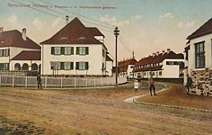Am 9. Juni 1909 erfolgte an dieser Straße der Baustart für die Gartenstadt. Ursprünglich befand sich auf dem Areal eine vom Klotzscher Dorfbach bewässerte Wiese, aufgeteilt in kleine, zipfelartige Flurstücke. Die Kleinhäuser entstanden nach Plänen von Richard Riemerschmid und stehen unter Denkmalschutz. Unter Einbeziehung der bereits vorhandenen [Waldschänke](../../../../Nord/Hellerau/Page11228/Waldschanke/waldschanke.html) (Nr. 2) wurde hier das Konzept der Gartenstadt mit Fabrikanlage und modernen Arbeiterwohnhäusern erstmals in Dresden umgesetzt.

Zu den Bewohnern der Häuser gehörten u.a. der Schriftsteller Max Adler (Nr. 23), der Architekt Karl Hübner (Nr. 103) und der Direktor der Heimstättengesellschaft Sachsen Hans Brader (Nr. 109). Im Wohnhaus Nr. 8 lebte zeitweise die Textilgestalterin Charlotte Krause (1879-1968). Sie war eng mit den Deutschen Werkstätten verbunden und gehörte dem Deutschen Werkbund an. Später verzog sie in die Nr. 52, 1927 zum Ruscheweg 7. Im Haus Am grünen Zipfel 1 befand sich 1913 das private Schulheim für eine Höhere Schule.

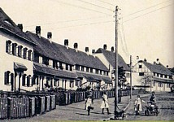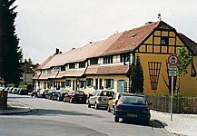

**_Fotos:_** _Die Hellerauer Wohnzeile Am Grünen Zipfelum 1909 und 2010_

Die Straße Am Pfarrlehn erinnert an die Gründung der Klotzscher Kirche, als die Bauern zur Finanzierung des Baus einen Teil ihrer hier gelegenen Felder an die Kirche abgeben mußten. Die ersten Gebäude entstanden ab 1913 nach Entwürfen von Heinrich Tessenow (Nr. 2-16). 1937 wurden für die Baugenossenschaft Hellerau Reihenhäuser gebaut (Nr. 28-40), mit deren Fertigstellung der Aufbau der Gartenstadt vorerst abgeschlossen wurde. Zwischen 1997 und 1999 entstanden weitere Ein- und Zweifamilienhäuser nach Entwürfen des Radeberger Büros Baltin & Partner.

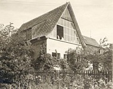Die Straße Am Pilz wurde um 1910 angelegt und nach einem hier befindlichen Aussichtspunkt benannt. Der kleine Bau mit Rundbank und einem pilzartigen Schutzdach entstand nach einer Idee des Architekten Richard Riemerschmid und wurde im Volksmund "Pilz" genannt. Später musste er der weiteren Bebauung in diesem Gebiet weichen. Architektonisch interessant sind die Einzelhäuser Nr. 2 (Atelierhaus Gebhardt - _Foto_), welches 1921 durch Karl Bertsch entworfen wurde sowie das 1939 fertiggestellte Haus Asta Stargard (Nr. 5) von Adelbert Niemeyer. Rudolph Gebhardt (1894-1985) hatte sich nach einem Studium an der Zeichenschule in Dresden 1921 in Hellerau niedergelassen und schuf vor allem Natur- und Landschaftsbilder im Stil der Neuen Sachlichkeit.

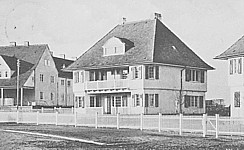Die Straße Am Schänkenberg entstand in der ersten Bauphase der Gartenstadt und wurde 1910/11 mit Reihen-, Doppel- und Einzelhäusern bebaut. Architekt der Wohnhäuser Nr. 1-15, 4-16 und 17-23 war Heinrich Tessenow, der hier am konsequentesten moderne städetbauliche und architektonische Reformkonzepte umsetzte. Die Wohnhäuser entstanden in einer besonderen Holzständerbauweise mit Ziegelausfachung und stellen deshalb auch technologisch eine Novität dar. Weitere Gebäude stammen von Hermann Muthesius (Nr. 2 - _Foto_ \- und 12) und Richard Riemerschmid (Nr. 25, 46-50).

Im Wohnhaus Am Schänkenberg 24 lebte in den Zwanziger Jahren die Übersetzerin Grete Fantl. Sie war in erster Ehe mit dem Musikkritiker der "Dresdner Neuesten Nachrichten" Dr. Leo Fantl verheiratet und unterhielt in ihrem Wohnhaus einen literarischen Salon. 1924 gründete sie gemeinsam mit Alice Rühle-Gerstel die Dresdner Ortsgruppe des Internationalen Vereins für Individualpsychologie. Wegen ihrer jüdischen Herkunft musste sie nach 1933 emigrieren und lebte später in der USA.

Die Straße Am Schulfeld entstand nach 1990 im Zusammenhang mit dem Bau einer neuen Wohnsiedlung. Im März 1997 erhielt sie ihren in Bezug auf das am nördlichen Ende der Straße gelegene alte [Schulhaus](../../../../nord/klotzsche/) von Klotzsche.

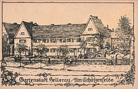Die Straße Am Schützenfelde wurde 1913 im Zusammenhang mit dem Bau der Gartenstadt angelegt. Die Häuser wurden vom jüngsten der Hellerauer Architekten, dem Muthesius-Schüler Kurt Frick entworfen und waren letztes geschlossenes Wohnviertel der Gründungszeit. Die architektonische Gestaltung vereint Elemente der Riemerschmid-Bauten am Markt mit den sachlichen Gebäuden Heinrich Tessenows. Entgegen dem ursprünglichen Konzept durften hier auch individuelle Grundriss- und Fassadengestaltungen aus einem Musterkatalog gewählt werden.

Die unmittelbar in der Nähe der Autobahn verlaufende Straße Am Seehügel entstand um 1935 und wurde zunächst Siedlerstraße genannt. Ihr Bau war durch die Anlage der Autobahn notwendig geworden, um drei hier gelegene Grundstücke erreichen zu können. 1940 wurde sie in Am Seehügel umbenannt. Namensgeber war ein kleiner Teich unmittelbar an der Straße.

An der Straße Am Sonnenhang entstand das erste Haus 1910 nach einem Entwurf von Mackay Hugh Baillie Scott. In den 1930er Jahren wurde die Bebauung durch eine Holzhaus-Mustersiedlung der Deutschen Werkstätten vervollständigt. Die 15 Typenbauten wurden z. T. von bekannten Architekten wie Wilhelm Kreis (Nr. 1 - "Flitterwochenhaus", Nr. 6 und Nr. 19), Oswin Hempel (Nr. 9, 11, 13 und 15), Eugen Schwemmle (Nr. 3, 4, 5 und 7) und Wilhelm Jost (Nr. 8) gestaltet und waren Beginn der Serienfertigung von Wohnhäusern in den Hellerauer Werkstätten. 1934 erfolgte die offizielle Benennung der Straße “Am Sonnenhang”. 2001 entstand ein moderner Ergänzungsbau des Architekten Peter Zirkel, der die Tradition der Holzhaussiedlung in zeitgenössischer Gestaltung fortsetzt.

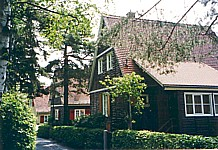

**_Foto:_** _Musterhäuser Am Sonnenhang_

Die Flurbezeichnung “Talckenberg” ist bereits auf alten Karten eingetragen und findet sich auch in den Klotzscher Dorfrügen, da sich hier eine der Viehtreiben des Dorfes befand. 1910 erhielt die Straße offiziell ihren Namen. Gleichzeitig errichtete Richard Riemerschmid die in einer leichten Biegung verlaufende Häuserzeile Nr. 2-14.

Die meisten Gebäude Am Talkenberg wurden jedoch erst in der zweiten Phase des Ausbaus der Gartenstadt nach dem Ersten Weltkrieg errichtet. Unter Wahrung der ursprünglichen Konzeption der Gartenstadt entstanden hier 1921/22 einige Lehr- und Musterhäuser in
Holzbauweise, die von Paul Naumann entworfen wurden. Das erste Holzmusterhaus Helleraus befindet sich in unmittelbarer Nähe auf dem Werksgelände und war Auftakt zur industriellen Fertigung solcher Gebäude in den Deutschen Werkstätten. Weitere Holzhäuser stammen aus den Jahren 1934 und 1935 und wurden von Wilhelm Jost (Nr. 3, 5 und 7), Oswin Hempel (Nr. 9), Adelbert Niemeyer (Nr. 11 und 13) und Erich Loebell (Nr. 15) entworfen.

Im Wohnhaus Am Talkenberg 20, 1920 von Rudolf Stegemann entworfen, lebte in den Zwanziger Jahren Johannes Schomerus. Er war Geschäftsführer des sächsischen Landesverbandes für Obst- und Weinbau und legte 1920 eine Lehr- und Mustergartenanlage an, in der interessierten Siedlern Obst- und Gemüseanbau sowie Kleintierhaltung zur Selbstversorgung vorgeführt wurde.

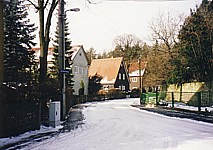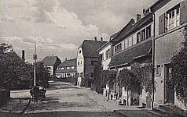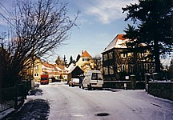

_Fotos: Siedlungshäuser Am Talkenberg_

__

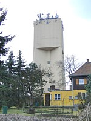Die Straße Am Wasserturm wurde 1928 benannt. Kurz zuvor war nördlich davon ein Wasserturm gebaut worden, der Hellerau bis in die 1950er Jahre mit Wasser versorgte. Das von Hans Richter entworfene Bauwerk steht heute unter Denkmalschutz. Seit einigen Jahren wird es als Netzstation eines Mobilfunkanbieters genutzt. Bis 1933 war der Turm auch Namensgeber der von der KPD-Ortsgruppe herausgegebenen Ortszeitung „Rund um den Wasserturm".

**_Foto:_** _Wasserturm Hellerau (Wikipedia/Paulae)_

Die Straße An den Teichwiesen verbindet den Brunnenweg mit dem Hohen Weg und wurde 1927 benannt. Der Straßenname erinnert an die einst hier gelegenen Fischteiche.

Die Straße An der Höhe entstand um 1930 und wurde zunächst An der Berglehne genannt. Da es am Weißen Hirsch bereits eine gleichnamige Straße gab, erfolgte im September 1953 die Umbenennung in An der Höhe.

Die Straße An der Lehmkuhle in der Nähe des Festspielhauses ist erstmals 1935 im Adressbuch verzeichnet. Die Namensgebung bezieht sich vermutlich auf einen Flurnamen.

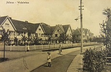Die heutige Straße An der Winkelwiese geht auf einen alten Fußweg zurück, der beim Bau der Gartenstadt Hellerau 1910 zur Straße ausgebaut wurde. 1911 erhielt sie nach einer alten Flurbezeichnung ihren Namen. Die Reihenhäuser entstanden nach einem Entwurf von Hermann Muthesius und stehen unter Denkmalschutz.

Im Wohnhaus Nr. 4 lebte bis zu seinem Tod 1962 der Grafiker Wilhelm Schubert (\* 1889). Der gelernte Lithograph arbeitete als Zeichner in den Dresdner Druckwerkstätten und gehörte der Agitprop-Landesleitung der KPD in Sachsen an. Nach dem Zweiten Weltkrieg schuf er zahlreiche politische Plakate und erhielt für seinen Entwurf zu den 3. Weltfestspielen der Jugend und Studenten 1951 den Nationalpreis der DDR. Nach seinem langjährigen Wohnort nannte er sich Wilhelm Schubert-Hellerau.

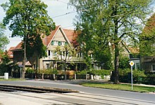

**_Foto:_** _Doppelhäuser von Hermann Muthesius An der Winkelwiese_

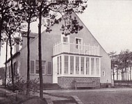 Die meisten Gebäude der 1910 angelegten Straße Auf dem Sand im „Landhausviertel“ von Hellerau wurden von Hermann Muthesius entworfen. Außerdem wirkten die Architekten German Bestelmeyer (Nr. 1), Karl Bertsch (Nr. 3), Heinrich Tscharmann (Nr. 4), Kurt Frick (Nr. 5), Oswin Hempel (Nr. 6), Alexander Horath (Nr. 8), Heinrich Tessenow (Nr. 12 - _Foto rechts_ \- und 14), Theodor Fischer (Nr. 17) und Richard Riemerschmid (Nr. 19 und 21) mit. Im Gegensatz zum “Kleinhausviertel” entstanden hier individuell gestaltete Landhäuser für bürgerliche Besitzer, welche jedoch typische Hellerauer Architekturelemente aufnahmen.

Zu den ältesten Wohngebäuden gehört das Haus Denso (Nr. 1), 1910 von German Bestelmeyer entworfen. Bauherr und erster Bewohner war der Schmetterlingsforscher
Oskar Max Friedrich Paul Denso (1873-1944), der mit einer Adoptivtochter von Eduard Schnorr von Carolsfeld verheiratet war. Denso studierte zunächst Technik und war als Privatdozent in der Schweiz tätig. Autodidaktisch widmete er sich der Erforschung und fotografischen Dokumentation von Schmetterlingen. Ab 1910 war er an der Bildungsanstalt Hellerau angestellt und verfasste zahlreiche Artikel für wissenschaftliche Publikationen. Seine Hybriden- und Faltersammlung befindet sich heute im Museum für Tierkunde.

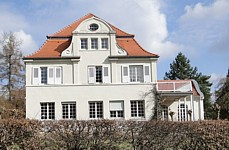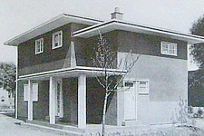Architektonisch bemerkenswert sind die von Richard Riemerschmid projektierte Villa Auf dem Sand 10 (Bj. 1910 - _Foto links_), in der einst der Musikpädagoge Emil Jaques-Dalcroze lebte, sowie das 1927 entstandene “De-We-Plattenhaus” des Architekten und Möbeldesigners Bruno Paul (Nr. 26). Das aus über 100 Holzplatten zusammengefügte Musterhaus wurde erstmals auf der Dresdner Siedlungsausstellung 1925 vorgestellt _(Foto rechts)_. Ein weiteres Holzhaus vom Typ H 3 b befindet sich mit dem "Haus Mühlberg" Auf dem Sand 3.

Auf dem Sand Nr. 11, 1910 von Hermann Muthesius entworfen, wohnte in den Anfangsjahren die am Festspielhaus tätige Rhythmik-Pädagogin und stellvertretende Direktorin der Bildungsanstalt Nina Gorter (1866-1922). Später bezog der Verleger Jakob Hegner die Villa. Nach verlegerischer Tätigkeit in Leipzig und Berlin gründete er 1912 in Hellerau die “Neuen Blätter”, in denen die Werke zeitgenössischer Autoren wie Paul Claudel, William Butler und Theodor Däubler herausgegeben wurden. 1930 musste Hegner Hellerau aus wirtschaftlichen Gründen verlassen.

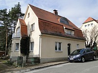Im Nachbarhaus Nr. 13/15 lebte zwischen 1931 und 1943 der aus der bekannten Plauener Mühlenbesitzerfamilie stammende Friedrich Bienert, welcher mit Gret Palucca verheiratet war. Zu den Gästen des Paares in ihrem Hellerauer Haus gehörte u.a. der Maler Otto Dix. Weitere Bewohner der Straße waren der Komponist und Lehrer der Bildungsanstalt Hans Gebhardt (Nr. 5), die Schauspielerin Gertrud Strzelewicz (Nr. 16), der DNN-Redakteur Camillo Hoffmann (Nr. 21) und der Kunstmaler Rudolph Gebhardt (Nr. 25). Im Wohnhaus der Familie Zollmann (Auf dem Sand Nr. 17 - _Foto rechts_), wurde 1912 die private Höhere Schule Hellerau gegründet, die 1913 zum Grünen Zipfel verlegt wurde. Die Schule war eine von mehreren Reformschulversuchen in der Gründungsphase Helleraus. Bauherr des Gebäudes war der Gründer des Bürgervereins Hellerau Martin Zollmann.

_Fotos: Auf dem Sand 10 und 17 (Wikipedia / Paulae)_

Die Straße Beim Gräbchen (bis 1912 Am Gräbchen) wurde 1910 im sogenannten “Kleinhausviertel” angelegt, in dem neben Reihen- auch Einzelhäuser vorgesehen waren. Die Entwürfe für diese Siedlung stammen von Hermann Muthesius. Auffallend sind die beiden Wohnhäuser Beim Gräbchen Nr. 2 und 4, die mit ihrer aufwendigen Gestaltung und den in die Fassade integrierten Balkons den Werksmeistern der Deutschen Werkstätten vorbehalten waren.

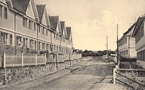

_**Fotos:** Blick in die Straße Beim Gräbchen um 1915_

Der ab 1940 benannte ehemalige Gartenweg in Hellerau erhielt 1953 seinen heutigen Namen Blumenweg. Grund der Umbenennung war die Doppelung dieses Namens nach der Eingemeindung des Ortes nach Dresden.

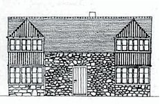Der Brunnenweg entstand Mitte der 1920er Jahre und erhielt 1927 seinen Namen nach einem hier gelegenen Brunnen, der damals der Wasserversorgung von Rähnitz und Hellerau diente. Teile des Brunnenweges wurden 1993 in die Boltenhagener Straße einbezogen. Der daran anschließende Abschnitt wird seitdem Lausaer Weg genannt. Im Haus Nr. 18/20 _(Bauzeichnung)_ hatte ab 1921 der Architekt Gustav Lüdecke (1890-1976) seine Wohnung und sein Büro. Neben seinem eigenen Wohnhaus entwarf Lüdecke 1923/24 auch die Gebäude Brunnenweg 2, 6 und 32, das Wohnhaus Heideweg 28 sowie weitere Gebäude in der Umgebung Helleraus. Die Entwürfe für die Häuser Brunnenweg 1 und 3 von 1934 stammen von Edgar Alfons Anders, der seine Wohnung im Haus Auf dem Sand 3 hatte. Architektonisch interessant ist das sogenannte "Schwartenhaus" (Nr. 4), eines der ersten Holzhäuser der Deutschen Werkstätten.

Der Finkensteig geht auf einen alten Verbindungsweg oberhalb des Klotzscher Dorfkerns zurück. Dieser blieb zunächst
namenlos und wurde erst Ende der 1930er Jahre mit der Errichtung der ersten Häuser Langer Weg genannt. Da es mit der Eingemeindung Helleraus diesen Straßennamen zweimal in Dresden gab, erfolgte im September 1953 die Umbenennung in
Finkensteig. In den 1990er Jahren erfolgte eine Verlängerung des Weges zur Erschließung des Neubaugebietes Am Pfarrlehn.

Der Friedersdorfer Weg entstand in den 1920er Jahren als Verbindung zwischen den Straßen An den Teichwiesen und Am
Torfmoor. Wegen seiner Lage wurde er anfangs Im Grunde benannt. Im September 1953 erfolgte die Umbenennung nach dem kleinen Ort Friedersdorf, einem Ortsteil von Weixdorf.

Die am westlichen Ortsrand von Hellerau gelegene Straße Grüne Aue entstand Mitte der 1930er Jahre im Zusammenhang mit dem Bau einiger Doppelhäuser. Nach 1990 wurde der in südlicher Richtung zur Radeburger Straße führende Fußweg in die Straße einbezogen.

Die Straße Grüne Telle zweigt vom Moritzburger Weg ab und wurde 1927 angelegt. Der Name stammt von einer alten Flurbezeichnung. Als Fortsetzung des bebauten Abschnitts führt sie durch die Dresdner Heide bis zum Augustusweg.

Architektonisch interessant sind die Wohnhäuser Nr. 4 und Nr. 6. Das ältere (Nr. 6) wurde 1931 vom Tessenow-Schüler Fritz Steudtner (1896-1986) entworfen. Erster Bewohner war der Maler und Grafiker Paul Sinkwitz (1899-1981), der zu den bedeutendsten Vertretern der Werkkunst gehörte und ab 1947 Mitglied der Künstlergruppe "Das Ufer" war. Nach Sinkwitz´ Übersiedlung in die Bundesrepublik 1955 übernahm die Malerin Dore Mönkemeyer-Corty (1890-1970) das Haus. Bekannt wurde sie vor allem als Plakatgestalterin, u.a. für die 2. Deutsche Kunstausstellung 1949. Außerdem schuf sie gemeinsam mit ihrem Mann Fritz einige Reliefs beim Wiederaufbau des Dresdner Rathauses und malte die Dorfkirche von Schellerhau aus.

Auf dem Nachbargrundstück befindet sich eines der für Hellerau typischen Holzhäuser. Das Gebäude (Nr. 4) wurde 1935 von der Firma Isartaler Holzhausbau aus München errichtet.

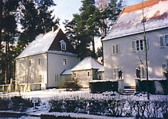Der Heideweg verbindet die heutige Karl-Liebknecht-Straße mit dem Moritzburger Weg und erhielt wegen seiner Lage 1909 diesen Namen. Die Wohnhäuser wurden zum Großteil von Heinrich Tessenow entworfen. Für die Gestaltung der beiden Einfamilienhäuser Nr. 24 und 26 _(Foto links)_ stand Goethes Weimarer Gartenhaus Pate; die Figuren am Eingang stammen von der Bildhauerin Johanna Sattler-Dohrn. Tessenow wohnte selbst von 1919 bis 1924 im Haus Nr. 24.

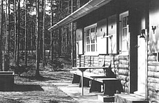Im Haus Heideweg 12, 1910 als “Haus Kuntze” von Richard Riemerschmid erbaut, lebte zwischen 1912 bis 1933 der Journalist und Schriftsteller Paul Adler. Nach Machtantritt der Nazis mußte er in die Tschechoslowakei emigrieren, wo er 1946 verstarb. Ortsgeschichtlich interessant ist auch das Haus Nr. 15, welches 1921 von Karl Bertsch als erstes Musterholzhaus der Deutschen Werkstätten entworfen wurde. Eine Sanierung des unter Denkmalschutz stehenden Gebäudes ist geplant _(Foto rechts)_.

In der Nachkriegszeit entstanden am Heideweg weitere Einfamilienhäuser, die vorrangig für Angehörige der aus Dessau nach Klotzsche verlegten Flugzeugwerft gedacht waren. Im Volksmund wurde diese Siedlung deshalb auch als “Klein Dessau” bzw. Dessauer Siedlung bezeichnet.

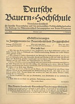Nr. 6: Zu den ersten Hellerauer Einwohnern gehörten die Brüder Bruno und Edwin Tanzmann, die hier 1910 eine Buchhandlung mit angeschlossener Wanderschriften-Zentrale gründeten. Beide engagierten sich in der deutschen Volkshochschulen-Bewegung, die sich lebensreformerischen und völkisch-nationalistischen Ideen widmete. Nach dem Ersten Weltkrieg bezog Bruno Tanzmann ein Landhaus am Heideweg (Nr. 6) und gründete hier 1919 den Hakenkreuz-Verlag, der u.a. die Schriften des Lebensreformers Heinrich Pudor und des Schriftstellers Heinar Schilling vertrieb. 1920 richtete Bruno Tanzmann die erste Deutsche Bauernhochschule ein und gehörte 1923 zu den Mitbegründern der Artamanen-Bewegung. Diese völkische Bewegung vertrat eine radikale Blut-und-Boden-Ideologie und gilt als Wegbereiterin der von den Nazis propagierten Expansionsbestrebungen nach Osten. In den Zwanziger Jahren war Tanzmanns Hellerauer Haus ein Zentrum der völkischen Szene in Deutschland. Trotz seiner geistigen Nähe zum Nationalsozialismus gelang es ihm jedoch nicht, nach 1933 eine breite Anerkennung seiner völkisch-esoterischen Ideen zu erreichen. Das Scheitern seiner ab 1933 herausgegebenen Zeitung „Weltwacht der Deutschen“ führte zum wirtschaftlichen Ruin, die ihn 1939 zum Suizid trieb.

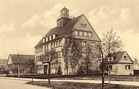Der Heinrich-Tessenow-Weg wurde 1914 im Zusammenhang mit dem Bau der Hellerauer Volksschule _(Foto)_ angelegt und ab 1926 Schulweg genannt. 1948 erhielt er nach dem Juristen John Ulrich Schroeder (1876-1947) den Namen Schroederstraße. Schroeder war während des Ersten Weltkrieges Marinerichter in Hamburg und vermittelte beim Kieler Matrosenaufstandes zwischen den Streitparteien. Ab 1922 arbeitete er im sächsischen Justizministerium, wurde wegen seiner SPD-nahen Haltung jedoch 1933 abberufen. Nach dem Zweiten Weltkrieg war Schroeder erster Generalstaatsanwalt von Sachsen und wohnte im Haus Schulweg 27. Er verstarb 1947. Sein Grab befindet sich auf dem Rähnitzer Friedhof.

1993 wurde die Schroederstraße nach dem Architekten Heinrich Tessenow benannt. Tessenow (1876-1950) war maßgeblich am Aufbau der Gartenstadt beteiligt und entwarf auch das [Festspielhaus](../../../../nord/hellerau/festspielhaus/). Zwischen 1920 und 1926 gehörte er als Professor der Dresdner Kunstakademie an.

Auf dem Grundstück Schulweg 20 hatte früher das Feuerlöschgerätewerk Kurt Schöne seinen Sitz. Die Entwürfe für den Gebäudekomplex stammten von Kurt Frick.
Das Unternehmen stellte in den 1920er Jahren Feuerspritzen und ähnlichen Feuerwehrbedarf her und wurde am 1. März 1937 von der Maschinen- und Feuerwehrgerätefabrik v. Sachsen-Coburg übernommen. Besitzer war Prinz Ernst von Sachsen-Coburg-Gotha. 1946 wurde das Unternehmen demontiert. Unweit davon befand sich ab 1928 die im Auftrag der Baugenossenschaft Hellerau errichtete Feuerwache des Ortes.

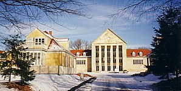

**_Foto:_** _Blick zum von Heinrich Tessenow entworfenen Festspielhaus_

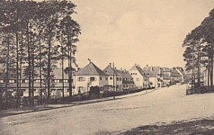Der Hirtenweg war ursprünglich ein Teil des Ruscheweges. Ab 1940 wurde der Abschnitt zwischen Hellerauer Markt und Klotzscher Weg Marktweg genannt. Da es jedoch in Briesnitz bereits eine gleichnamige Straße gab, erfolgte nach der Eingemeindung im September 1953 die Umbenennung in Hirtenweg. Die meisten Gebäude entstanden bereits in der ersten Bauphase der Gartenstadt ab 1910 und wurden von Richard Riemerschmid entworfen.

Der Hohe Weg verbindet den Moritzburger mit dem Friedersdorfer Weg und wurde im November 1927 benannt. Die Namensgebung erfolgte wegen seiner Lage. Zu den Bewohnern gehörte der Lehrer und Ortschronist Kurt Gerlach, Vater der Schriftstellerin Tine Schulze-Gerlach und Großvater des unter dem Namen "Muck" bekannten Schlagersängers Hartmut Schulze-Gerlach (Nr. 10).

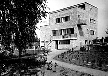Haus Chrambach (Nr. 11): Das architektonisch interessante Wohngebäude entstand 1928 im Bauhausstil und wurde vom Architekten H. Walter Reitz entworfen. Besitzer war der Rechtsanwalt Dr. Walter Hermann Chrambach (1887-1944), der zeitweise stellvertretender Amtshauptmann von Dresden und Regierungsrat war. Chrambach war künstlerisch interessiert und machte sein Haus Ende der 1920er Jahre zu einem Treffpunkt verschiedener Künstler. Wegen seiner jüdischen Herkunft und der Gegnerschaft zum NS-Staat wurde Chrambach am 15. September 1944 von der Gestapo verhaftet und kam wenige Wochen später in das Konzentrationslager Buchenwald, wo er 1944 verstarb.

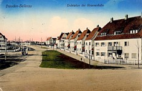Die Karl-Liebknecht-Straße bildet die Hauptstraße Helleraus und verbindet den Ort mit dem benachbarten Rähnitz. Ihr Ausbau erfolgte im Zusammenhang mit der Anlage der Straßenbahntrasse 1913. Zunächst erhielt sie den Namen Breiter Weg. Ende 1945 erfolgte die Umbenennung nach dem deutschen Politiker Karl Liebknecht (1871-1919), der zu den wichtigsten Köpfen der Novemberrevolution 1918 gehörte. Liebknecht war ab 1912 Reichstagsabgeordneter und gemeinsam mit Rosa Luxemburg Führer der revolutionären Linken in der SPD. 1919 gehörte er zu den Mitbegründern der KPD. Bereits 1913 verkehrte erstmals eine Straßenbahn vom Abzweig Hellerau bis zur Hellerauer Post. Im Zusammenhang mit der Erweiterung der Gartenstadt wurde die Strecke 1935 bis zum Rathaus verlängert, 1938 bis zur heutigen Endhaltestelle in Rähnitz.

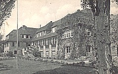Von den Wohnhäusern der Karl-Liebknecht-Straße stehen die Gebäude Nr. 1 bis 17, die Nr. 79 und 81 sowie das ehemalige Schülerheim der Bildungsanstalt, später Heimfrauenschule der Mathilde-Zimmer-Stiftung _(Nr. 58 - Foto)_, unter Denkmalschutz. Architekt der Wohnhausgruppe 1-13 und 2-15 war Richard Riemerschmid. Das Eckhaus Nr. 16 / An der Winkelwiese stammt von Hermann Muthesius. Im Wohnhaus Nr. 14 wohnte viele Jahre Paul Rudolf Gärtner, der neben seiner Tätigkeit als Beamter im sächsischen Kriegsarchiv zahlreiche Erzählungen und Gedichte in Oberlausitzer Mundart verfasste. Weitere Wohnhäuser (Nr. 21-27) entstanden 1925 bei der Erweiterung der Gartenstadt durch die Baugenossenschaft Hellerau nach Plänen von Karl Baer.

Der Kiefernweg im Westen des Ortsteils an der Grenze zu Rähnitz wurde Anfang der 1930er Jahre angelegt und trägt seinen Namen seit 1935. Zunächst nur eine kurze Sackgasse bis zur Einmündung des Birkenweges wurde er später bis zur Straße Am Torfmoor verlängert. Ab 1935 befand sich hier die Endstelle der Straßenbahn, die 1938 schließlich die noch heute vorhandene Gleisschleife weiter westlich erhielt.

Der Kirchsteig ist Teil einer alten Wegeverbindung, die einst von Klotzsche über Trachenberge bis nach Dresden führte und von den Einwohnern bei ihrem langen Gang zur Frauenkirche genutzt wurde. Nach der Bildung einer eigenen Kirchgemeinde verlor er seine Bedeutung. Der verbliebene Abschnitt auf Hellerauer Flur erhielt 1914 den Namen Am Kirchsteig und wurde später auch als Kirchweg bzw. Kirchsteig bezeichnet, wobei letztere Namensgebung heute die amtliche ist. Nach 1990 entstand am Kirchsteig und den angrenzenden Straßen eine kleine Wohnanlage.

Der Klotzscher Weg bildet die östliche Flurgrenze von Hellerau zum Nachbarort Klotzsche und wurde früher als Dresden-Klotzscher Weg bezeichnet. Seinen heutigen Namen erhielt er erst um 1950.

Der Kurze Weg ist eine kleine Verbindungsstraße, die vom Hellerauer Markt zur Straße Am Hellerrand fahrt. Seinen Namen erhielt er 1910 beim Bau der Gartenstadt. Die meisten Wohnhäuser an der Straße entstanden nach Entwürfen von Richard Riemerschmid. 1931 folgte im Zusammenhang mit der Komplettierung des Marktes Haus Nr. 2 durch den Architekten Rudolf Kolbe.

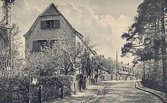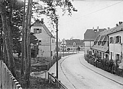

_**Fotos:** Wohnhausgruppe von Richard Riemerschmid (links)_

_und ein Blick zum Hellerauer Markt um 1915 (SLUB / Fotothek)_

Der Lausaer Weg bekam seinen Namen erst im Februar 1993, wobei der seit 1999 ebenfalls zu Dresden gehörende Weixdorfer Ortsteil Lausa Namenspate war. Mit dem Ausbau der Autobahn wurden einige alte Verbindungen, so auch die Mühlenstraße (Lausaer Straße) in Rähnitz unterbrochen, und die Straßen deshalb neu geordnet. Ein Abschnitt des Brunnenweges wurde dabei der Boltenhagener Straße zugeordnet, seine Verlängerung sowie der abgetrennte Abschnitt der früheren Mühlenstraße erhielten den Namen Lausaer Weg.

Der Markt wurde als künftiges Zentrum der Gartenstadt Hellerau bereits von Richard Riemerschmid geplant. 1910/11
entstanden an der Südwestseite des Platzes  nach seinem Entwurf die ersten Gebäude mit Läden und Postamt. Infolge des Ersten Weltkrieges konnte das Ensemble jedoch nicht vollendet werden. Erst 1929/30 wurde der Markt durch den
Architekten Rudolf Kolbe verändert fertig gestellt. Die unter Denkmalschutz stehenden Gebäude wurden 1996-98 saniert. Im Eckhaus zum Hirtenweg befindet sich seit 1930 das heute als Speisegaststätte geführte Kaffee Hellerau.

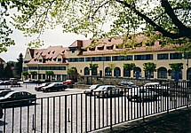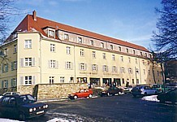

**_Fotos:_** _Der Hellerauer Markt mit den Bauten Richard Riemerschmids (links) und Rudolf Kolbes (rechts)_

Der Moritzburger Weg ist Teil eines alten Verbindungsweges zwischen Schloss Pillnitz und dem Jagdschloss in Moritzburg, welcher vor allem im 17./18. Jahrhundert gern von den Jagdgesellschaften der Wettiner genutzt wurde. In der Nähe der Kreuzung des Weges mit der Königsbrücker Straße erinnert ein mittelalterliches Steinkreuz an den Tod des Reitknechtes Jonas Daniel, der hier 1402 während einer Fehde ums Leben kam. 2002 wurde ein erläuternde Gedenktafel aufgestellt.

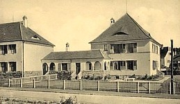Ältestes Gebäude auf Hellerauer Flur ist die ehemalige Ausflugsgaststätte [Waldschänke](../../../../Nord/Hellerau/Page11228/Waldschanke/waldschanke.html), die als einziges Bauwerk bereits vor Gründung der Gartenstadt 1909 existierte. Unweit davon liegen die Hauptgebäude der [“Deutschen Werkstätten”](../../../../nord/hellerau/deutsche_werkstatten/), deren Besitzer Karl Schmidt als eigentlicher Gründervater Helleraus gilt. Schmidt ließ sich in der Nähe seines Betriebes von Richard Riemerschmid ein Wohnhaus erbauen (Moritzburger Weg 69), in welchem er ab 1910 bis zu seinem Tod 1948 lebte. Auch das kunstvoll geschmiedete Gartentor, welches erstmals 1903 auf einer Kunstgewerbeschau gezeigt wurde, stammt von Riemerschmid. Dieser entwarf auch die Nachbarhäuser Nr. 71 und 73. Einige moderne Gebäude entstanden 2001/02 auf dem Grundstück der Deutschen Werkstätten nach einem Entwurf von Albrecht Quincke.

Die Bezeichnung Ruscheweg geht auf einen früheren Flurnamen zurück. Wie auch bei der Klotzscher Straße An den Ruschewiesen erinnert dieser Name vermutlich an eine frühere Signalanlage, bei der in Kriegszeiten mit Hilfe einfacher Klöppel und Schlagbretter die Bevölkerung gewarnt wurde. Die Wohnhäuser Ruscheweg 1-13 entstanden um 1910 und stammen von Richard Riemerschmid.

Im Wohnhaus Ruscheweg 15 lebte vor dem Ersten Weltkrieg der Architekt Kurt Frick (1884-1963). Gemeinsam mit Richard Riemerschmid, Heinrich Tessenow und Hermann Muthesius war Frick maßgeblich am Aufbau der Gartenstadt beteiligt und entwarf neben mehreren Wohngebäuden die Hellerauer Volksschule. Auch in Seidnitz sind noch einige von ihm geplante Wohnhäuser erhalten.

1953 entstand durch freiwillige Arbeitseinsätze der Anwohner am Ruscheweg eine kleine Grünanlage. Die nach Plänen des Gärtnermeisters Erwin Fritzsche gestaltete Anlage ist ein typisches Zeugnis der Gartengestaltung der 1950er Jahre. 2016 wurde die Fläche in einen Volkspark umgestaltet. Neben der Einbeziehung bereits vorhandener Elemente wurde dabei eine Pergola geschaffen und neue Sitzgelegenheiten aufgestellt. Für die Gestaltung erhielt die Anlage beim Wettbewerb "Gärten in der Stadt" 2017 einen Sonderpreis des sächsischen Umweltministeriums.

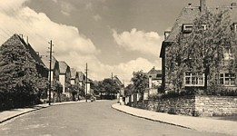

**_Foto:_** _Blick in den Ruscheweg um 1920_

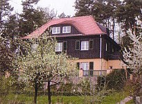Auf dem Tännichtweg hatten einst zwei der “Gründerväter” der Gartenstadt ihren Wohnsitz. 1911 bezog Heinrich Tessenow das von ihm selbst entworfene schlichte Wohnhaus Tännichtweg 2. Unweit davon steht das Haus Dohrn _(Nr. 9a - Foto)_, welches 1909 von Theodor Fischer für den Gründer der Hellerauer Bildungsanstalt und Förderer der Gartenstadt Wolf Dohrn (1878-1914) erbaut wurde. Als erster Sekretär des Deutschen Werkbundes widmete er sich gemeinsam mit Karl Schmidt dem Ausbau Helleraus und gründete 1911 die Bildungsanstalt, für welche er den Schweizer Musikpädagogen Jaques-Dalcroze engagierte. In unmittelbarer Nähe befand sich ab 1925 das Tanzatelier von Mary Wigman (Nr. 5).

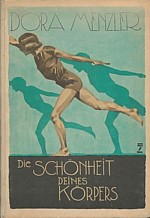Bemerkenswert sind auch die im Landhausstil gestalteten Wohngebäude Nr. 4, 9 und 11. Das Holzhaus Tännichtweg 4 entstand als erstes Gebäude des “Landhausviertels” 1909 und wurde von Hugh Mackay-Baillie Scott entworfen. Auf dem Tännichtweg 9 besaß der Arzt Dr. Günther Wohnsitz und Praxis. Die Planungen für dieses Gebäude stammen von Rudolph Lewicki, welcher ursprünglich weitere Wohngebäude gestalten sollte, welche jedoch nicht mehr zur Ausführung kamen. Ab 1933 hatte in diesem Haus die private Schule für Gymnastik, gestaltete Bewegung und Musikerziehung ihr Domizil. Die Einrichtung war 1908 von Dora Menzler in Leipzig gegründet worden und hatte ihren Sitz ab 1931 im Hellerauer Festspielhaus. Da Dora Menzler wegen ihrer jüdischer Vorfahren eine Enteignung befürchtete, übergab sie die Schule 1933 ihrer Schülerin Hildegard Marsmann, die sie noch bis 1951 am Tännichtweg weiterführte.

Die Wohnhäuser am Urnenfeldweg wurden 1922/24 nach einem Entwurf E. Lüdeckes gebaut. Der Architekt koppelte elf
Reihenhäuser mit schmalen Zwischenbauten zu einer Wohnzeile zusammen, was dem Block den Namen “D-Zug” einbrachte.

Der Valeria-Kratina-Weg wurde 2005 in der Nähe des Festspielhauses zur Erschließung eines neuen Wohngebietes angelegt.
Mit der Namensgebung wird an die Tänzerin, Regisseurin und Choreografin Valeria Kratina-Köhler (1892-1983) erinnert, welche zu den Wegbereiterinnen des modernen Ausdruckstanzes gehörte. Zeitweise arbeitete sie als Ausbilderin für
“Ästhetische Körperbildung” an der Neuen Schule Hellerau.

Die Wilhelm-Külz-Straße, an der Ortsgrenze zu Rähnitz gelegen, erhielt ihren Namen Anfang der 50er Jahre nach dem
liberalen Politiker Dr. Wilhelm Külz (1875-1948), der in den Zwanziger Jahren in verschiedenen Funktionen auf kommunaler und Landesebene tätig war. 1931 wurde er zum Dresdner Oberbürgermeister gewählt, musste sein Amt jedoch nach
Machtübernahme der Nazis aufgeben. 1945 gehörte er zu den Mitbegründern der LDPD. Zuvor wurde diese Straße Klotzscher Straße genannt. Seit 1993 trägt nur noch der kurze Abschnitt zwischen Boltenhagener Straße und Autobahn den
Namen Wilhelm-Külz-Straße.

* * *

 \[ [Home](../../../../index.html)\] \[ [Nord](../../../../nord/)\] \[ [Nordwest](../../../../nordwest/)\] \[ [Neustadt](../../../../neustadt/)\] \[ [Nordost](../../../../nordost/)\] \[ [West](../../../../west/)\] \[ [Zentrum](../../../../zentrum/)\] \[ [Südwest](../../../../sudwest/)\] \[ [Süd](../../../../sud/)\] \[ [Südost](../../../../sudost/)\] \[ [Ost](../../../../ost/)\] \[ [Register](../../../../Register/register.html)\] \[ [Kontakt](../../../../Kontakt/kontakt.html)\] \[ [Impressum](../../../../impressum/)\]
