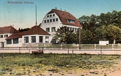
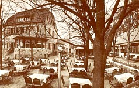
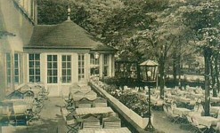
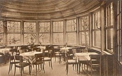

Die 1898 eröffnete Ausflugsgaststätte “Waldschänke” ist ältestes Gebäude im Stadtteil Hellerau und bestand bereits vor Gründung der Gartenstadt. 1908 fanden in den Räumen die ersten Verhandlungen zur Gründung Helleraus statt. Im Zusammenhang mit dem Bau der ersten Häuser Am grünen Zipfel wurde das Gebäude 1910 von Richard Riemerschmid, dem Stil der neuen Siedlung entsprechend, umgebaut.

In den Zwanziger Jahren war die Waldschänke für ihr Angebot von Gesundheitskost nach den Reformbestrebungen der Gartenstadtbewegung bekannt und nicht zuletzt durch den Gästegarten und die angeschlossene Kegelbahn beliebtes Ausflugsziel. Zu den Besuchern gehörten u.a. Gerhart Hauptmann, Stephan Zweig, Ernst Rowohlt, Else Lasker-Schüler, Oskar Kokoschka, Bernhard Shaw und Franz Kafka.

1910 entstand für den Garten in den Deutschen Werkstätten eine originelle Rundbank. 1987 fertigten Hellerauer Schüler eine Kopie dieser Bank an, die nach ihrer Fertigstellung an der Stelle des von Tessenow geplanten, aber nie realisierten “Lindencafés” aufgestellt wurde. Das nach 1945 geschlossene Lokal stand nach 1990 viele Jahre leer. Zuletzt befand sich in den Räumen eine Lehrwerkstatt des VEB Fernmeldeanlagenbau. 2008 begann ein Förderverein die Rekonstruktion des unter Denkmalschutz stehenden Gebäudes. Heute werden die Räume von verschiedenen Vereinen und Bürgerinitiativen sowie für kulturelle Veranstaltungen genutzt.

**_Fotos:_** _Die Hellerauer Waldschänke in den Zwanziger Jahren_
