* * *

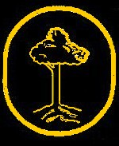

**Gemeindesiegel von Klotzsche**

* * *

* * *

**Klotzscher Stadtteilseiten:**

[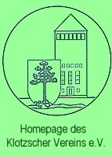](http://www.klotzscherverein.de)

* * *

**Kultureinrichtungen in Klotzsche:**

[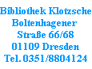](http://www.bibo-dresden.de)

[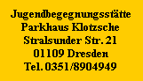](http://www.parkhaus-klotzsche.de)

* * *

**Schulen in Klotzsche:**

[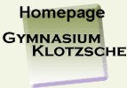](http://www.gymnasium-klotzsche.de)

[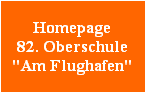](https://cms.sachsen.schule/os82dd/startseite-82-oberschule-dresden/)

* * *

**Klotzscher Vereine:**

* * *

* * *

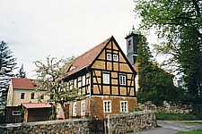Die Fluren rund um Klotzsche waren bereits in der Steinzeit besiedelt, wie die
Entdeckung einer Grabanlage auf dem Gelände des heutigen Bahnhofes 1890 beweist. Auch aus der Bronzezeit konnten an verschiedenen Stellen der Ortsflur
Grabbeigaben und Gefäße freigelegt werden. Klotzsche selbst entstand aus einer slawischen Siedlung und wurde in einer Urkunde vom 9. Oktober 1309 erstmals als Kloiczowe (slawisch = Rodung) erwähnt. Darin überließ der
Burggraf von Dohna anlässlich der Hochzeit seiner Tochter mit Bernhard von Pulsnitz den Ort gemeinsam mit fünf weiteren Dörfern zum Lehen. Mehrfach
wechselte die Schreibweise, bevor am 14. April 1883 der Name “Klotzsche” offiziell durch die Amtshauptmannschaft Dresden- Neustadt eingeführt wurde. Der Ort blieb bis ins 19. Jahrhundert ein
Bauerndorf. Außerdem waren die Imkerei und die Vogelstellerei von Bedeutung. Nebenher musste die Einwohner verschiedene Frondienste leisten, vor allem im Zusammenhang mit der Nutzung des Heidewaldes und zur Durchführung
der kurfürstlichen Jagden. Ursprünglich gehörte das Dorf zur Dresdner Frauenkirche, erhielt aber um 1320 eine eigene [Kirche](../../nord/klotzsche/klotzscher_kirchen/). Nach mehrfachem Besitzerwechsel kam Klotzsche 1440 an das Amt Dresden.

Stark betroffen wurde der unweit der wichtigen Straße nach Osten gelegene Ort durch kriegerische Handlungen und Truppendurchzüge. So plünderten 1428 die Hussiten, 1637 schwedische Soldaten das Dorf und brannten das
Schänkgut nieder. Die Schäden in Klotzsche und anderen Orten der Umgebung waren so schwer, das Kurfürst Johann Georg das Dorf zur Finanzierung des Wiederaufbaus sogar verpfänden musste. Auch 1813 gab es Gefechte auf den
Klotzscher Feldern, wobei ein Soldat ums Leben kam. Bis zum Eisenbahnbau erinnerte das “Kosakengrab” an der Langebrücker Straße an dieses Ereignis.

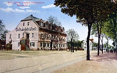Schwer beschädigt wurde das Dorf bei mehreren verheerenden
Feuersbrünsten, so 1637, 1729 und 1746. Ein Großbrand am 30. Oktober 1802 vernichtete fast den gesamten Ort mit seiner Kirche. Lediglich sieben Häuser blieben von den Flammen verschont. Die heute erhaltenen
Fachwerkgehöfte und die neue Kirche entstanden beim Wiederaufbau, wurden jedoch 1868 erneut durch ein Großfeuer beschädigt. Zu Klotzsche gehörte auch der [Schänkhübel](../../nord/klotzsche/strassen_klotzsche/konigsbrucker_landstrasse/), eine 1835 durch ein festes Gebäude ersetzte Raststätte an der Königsbrücker Landstraße _(Foto)_.

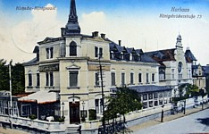Im 19. Jahrhundert wurde Klotzsche zum Kur- und Villenort. Aufschwung brachte vor allem die 1845 eröffnete [Eisenbahnstrecke](../../nord/klotzsche/dresden_-_gorlitz/), der 1884 die [Schmalspurbahn](../../nord/klotzsche/dresden_-_gorlitz/schmalspurbahn/) nach Königsbrück folgte. Als neue Stadtteile entstanden ab 1875 die Alberthöhe und der Ortsteil Königswald. Neben den Villen wohlhabender Zuzügler wurden Kur- und Erholungseinrichtungen erbaut und Teile der Dresdner Heide als [Waldpark](../../nord/klotzsche/waldpark_klotzsche/) gestaltet. Als Verbindung nach Dresden verkehrte zwischen 1903 und 1904 die [“Haidebahn”](../../nord/klotzsche/haidebahn/), einer der ersten O-Busse der Welt. Anfang 1911 wurde die Straßenbahnlinie bis zum Schänkhübel eröffnet, die 1925 bis zum Kurhaus und 1929 bis nach Weixdorf verlängert wurde. Gesellschaftlicher Mittelpunkt der Gemeinde war das [Kurhaus](../../nord/klotzsche/strassen_klotzsche/konigsbrucker_landstrasse/) an der Königsbrücker Landstraße _(Foto)_ sowie die 1888 gegründete Gaststätte [“Alberthöhe”](../../nord/klotzsche/strassen_klotzsche/).

Der Gemeinderat des Ortes förderte diese Entwicklung durch die Schaffung neuer kommunaler Versorgungseinrichtungen. Klotzsche erhielt ein eigenes Gas- und Wasserwerk, neue Schulbauten und 1907 ein Rathaus an der Kieler Straße sowie die [Christuskirche](../../nord/klotzsche/klotzscher_kirchen/) am Boltenhagener Platz. 1902 wurde das [Waldbad Klotzsche](../../nord/klotzsche/strassen_klotzsche/waldbad_klotzsche/) als erstes Freibad in der Dresdner Heide eröffnet. Der Ort war bis zum Ersten Weltkrieg nicht nur das Ziel zahlreicher Kurgäste, sondern zog auch bedeutende Dresdner Künstler an, die Klotzsche zu ihrem Wohnsitz machten. Zu ihnen
gehörten der Bildhauer Johannes Schilling, der Maler Conrad Felixmüller und der Literatur-Nobelpreisträger Karl Gjellerup.

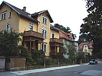Nach dem Ersten Weltkrieg verlor Klotzsche als Kurort an Bedeutung, blieb jedoch beliebter Wohnort. Neue Siedlungen wurden in den Zwanziger Jahren u. a. am Dörnichtweg und am Trobischberg angelegt. 1926 entstand an der Goethestraße _(Foto)_ das Institut für Wirbeltuberkulose des Arztes Julius von Finck. Als humanistisches Reformgymnasium wurde 1927 die Landesschule eröffnet, welche nach 1933 die Nazis als Nationalsozialistische Erziehungsanstalt missbrauchten.

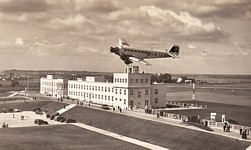Ein neues Kapitel in der Ortsgeschichte brachte das Jahr 1935, als in Klotzsche der vom Heller verlegte Dresdner [Flughafen](../../nord/klotzsche/flughafen/) eröffnet wurde. Gleichzeitig wurde Klotzsche Garnison mit einer Luftkriegsschule und einigen Kasernenbauten. Infolge dieser Einrichtungen und den Bau zahlreicher neuer Wohnsiedlungen stieg die Einwohnerzahl von 7.200 (1930) auf ca. 14.000 (1945) an. 1935 erhielt der Ort am 18. November von Gauleiter Martin Mutschmann das Stadtrecht verliehen. Der Festakt fand zehn Tage später am 28. November in der "Alberthöhe" statt. Großzügige Planungen, wie der Bau eines Stadions und einer Stadthalle, blieben jedoch unrealisiert. Noch am 7. Mai 1945 fielen Bomben auf Klotzsche, die 16 Einwohnern den Tod brachten. Am 1. Juli 1950 wurde der kurz zuvor noch zur Rayonstadt (Bezirksstadt) erhobene Ort als bislang einzige Stadt nach Dresden eingemeindet.

In den 1950er Jahren erhielt der Stadtteil als Standort zahlreicher Industriebetriebe Bedeutung. 1955 wurden auf dem Gelände der früheren Luftkriegsschule die [Flugzeugwerke](../../nord/klotzsche/flughafen/flugzeugwerft/) gegründet, die Ausgangspunkt des zivilen Flugzeugbaus in der DDR werden sollten. 1959 entstand hier das einzige DDR-Verkehrsflugzeug. Nach einem Absturz des Prototyps am 4. März 1959 musste der Flugzeugbau auf Weisung der DDR-Führung 1961 eingestellt werden. Auf dem Gelände siedelten sich neue Unternehmen an, die zum Teil bis heute als Wartungs- und Zulieferfirmen der Luftfahrtindustrie tätig sind. Für diese wurden 1973-75 eine Reihe neuer Wohnblöcke am Dörnichtweg und der Karl-Marx-Straße errichtet. 1986/87 folgte ein weiteres Neubaugebiet an der Grenzstraße, 1989/90 als letztes Dresdner Plattenbauviertel das Wohngebiet Selliner Straße.

Nach 1990 entstanden in Klotzsche weitere neue Wohnsiedlungen und Gewerbegebiete. Der Dresdner Flughafen wurde erweitert und modernisiert und 2001 mit neuem Terminal eröffnet. Mit dem Bau einer Siemens-Chipfabrik auf Klotzscher Flur, dem 2009 in Insolvenz gegangenen Chiphersteller Qimonda und weiteren Unternehmen der Forschung und Hochtechnologie entwickelte sich der Stadtteil zum wichtigen Wirtschaftsstandort der Landeshauptstadt.

Ortsteil Königswald:

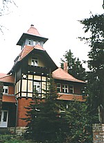Der Klotzscher Ortsteil Königswald entstand 1875 als Kur- und Villenort am Rande der
Dresdner Heide. Gründer war Friedrich August Quosdorf, der am kurz zuvor neu eröffneten Eisenbahnhaltepunkt Klotzsche einige Grundstücke aus königlichem Besitz
erwarb und diese zur Bebauung mit Villen weiterverkaufte. 1884 ließ er sich am Bahnhof ein Haus im Schweizerstil errichten, welches er als “Sommerfrische Quosdorf” mit Kursaal
und Bad einrichtete. Dieses Gebäude war Ausgangspunkt des Kurbetriebes. Später diente es als [“Hotel zum Bahnhof”](../../nord/klotzsche/strassen_klotzsche/bahnhofshotel/), nach 1945 als Lager der Konsumgenossenschaft. An
Quosdorf erinnert seit 1896 ein vom Klotzscher Verschönerungsverein gestifteter Gedenkstein gegenüber vom Bahnhof. Die neu angelegten Straßen wurden unter
weitgehender Bewahrung des vorhandenen Waldbestandes mit repräsentativen Villen bebaut **_(Foto:_** _Darwinstraße 4)._

Schulen in Klotzsche:

Alte Schule: Bereits 1688 wurde erstmals eine Dorfschule in Klotzsche erwähnt. Zuvor fand der Unterricht derDorfjugend im Wohnhaus des Küsters statt. 1791 wurde dieses Gebäude abgerissen und durch einen Neubau ersetzt. Die heute noch erhaltene Alte Schule entstand 1840 in der Nähe der Kirche im alten Dorfkern an der Klotzscher Hauptstraße (heute Altklotzsche 30) und wurde am 27. November 1840 eingeweiht. Das Gebäude dient heute als Wohnhaus. Die Inschrift “Gott schirme dieses Haus und segne unsre Kinder” über dem Eingang erinnert noch an die ursprüngliche Nutzung. 1840 erwarb die Gemeinde Teile des Pfarrgartens neben der Kirche und errichtete hier ein weiteres Schulgebäude (Altklotzsche 63).

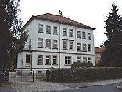82\. Grundschule: Nachdem der Schulunterricht der Kinder des Ortsteils Königswald zunächst im “Carolaschlösschen” (später Kurhaus Klotzsche) stattfand, richtete man 1892 eine dreiklassige höhere Knaben- und Mädchenschule in der Villa Auenstraße (Gertrud-Caspari-Straße) 1 ein. 1896 entstand auf Anregung des vier Jahre zuvor gegründeten Schulbauvereins Königswald ein eigenes Schulhaus des Villenortes an der Auenstraße Nr. 9. 1906 kam noch eine Turnhalle hinzu. Bereits 1901 hatte die Gemeinde den Betrieb dieser Schule übernommen. Heute befindet sich hier die 82. Grundschule "Am Königswald", die 1993/94 noch einen modernen Erweiterungsbau erhielt. Zu DDR-Zeiten hieß diese nach dem kommunistischen Widerstandskämpfer und KPD-Reichstagsabgeordneten Siegfried Rädel (1893-1943) 82. POS "Siegfried Rädel".

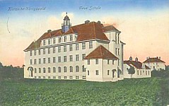82\. Oberschule: 1914 entstand an der damaligen Florastraße (heute Korolenkostraße 6) ein weiterer Schulbau. Das meist als “Neue Schule” bezeichnete Gebäude wurde von den Gebrüdern Kießling aus Kötzschenbroda entworfen und seit seiner Eröffnung am 20. April 1914 zunächst als Volksschule genutzt. Später wurden hier die Kinder der “Höheren Knaben-und Mädchenschule” Klotzsche-Königswald unterrichtet. Bis 1989 war dieses Haus als “Siegfried-Rädel-Schule” bekannt und beherbergt jetzt die 82. Oberschule “Am Flughafen”. 2016/17 wurden die Gebäude saniert und um einen Erweiterungsbau mit Speise- und Mehrzweckraum und einer Einfeld-Sporthalle ergänzt.

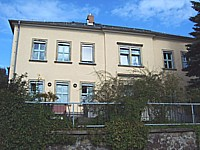
83\. Grundschule: Diese Schule wurde, um dem Einwohnerzuwachs Rechnung zu tragen, 1875 auf einem ehemaligen Weinbergsgrundstück an der Hauptstraße errichtet und am 30. November eröffnet. 1888 entstand daneben noch ein Erweiterungsbau. An dieser “Höheren Knaben- und Mädchenschule” gab es von Beginn an Gemeinschaftsunterricht, ein Novum für diese Zeit. Der ursprünglich über dem Eingang befindliche Bibelspruch sowie das Uhrtürmchen sind nicht mehr erhalten. Die Gebäude an der Klotzscher Hauptstraße 26, zu DDR-Zeiten 83. POS “Siegfried Krebs” genannt, wurden zuletzt als 83. Grundschule genutzt und im Sommer 2001 geschlossen. Heute befindet sich im Haus ein Kindergarten. Neben dem Gebäude steht eine am 11. November 1883 aus Anlass von Luthers 400. Geburtstag gepflanzte Lutherlinde.

Weitere Schulen entstanden in den 1970er und 80er Jahren im Zusammenhang mit dem Bau einiger Neubaugebiete. Die ehemalige 105. POS an der Karl-Marx-Straße 44 dient heute als Gymnasium Klotzsche, die 86. POS an der Alexander-Herzen-Straße als 86. Mittelschule (2004 geschlossen - heute Kindertagesstätte) und die 50. POS am Dörnichtweg 54 als Grundschule “Gertrud Caspari”.

Gymnasium Klotzsche: Das Gebäude an der Karl-Marx-Straße 44 entstand 1975 als Neubau für die 105. POS. 1983 erhielt diese den Namen des sowjetischen Flugzeugkonstrukteurs Andrej Nikolajewitsch Tupolew, welcher u.a. das erste zivile Überschallflugzeug der Welt TU 144 entwickelt hatte. Im Zuge der Umstrukturierung der Schullandschaft nach 1990 wurde das Schulhaus als Domizil des neugegründeten Gymnasiums ausgewählt, welches den Plattenbau bis heute nutzt. Eine Außenstelle befindet sich im Gebäude des ehemaligen Fliegerlazaretts.

Pollatzschule: Die Einrichtung entstand 1916 als Privatschule des Studienrates Manfred Pollatz und seiner Frau Lili und nutzte die Villa “Silvana” auf der Königsbrücker Landstraße 82. Das pädagogische Konzept sah neben Freiluftunterricht auch Kurse in Sport, Fremdsprachen, Naturkunde und Handarbeit vor und verzichtete auf die Vergabe von Zensuren. Für sozial benachteiligte Kinder wurden zudem preiswerte Mittagsmahlzeiten angeboten. Mit dem Wechsel von Manfred Pollatz an die Landesschule wurde die “Pollatzschule” 1920 geschlossen. 1934 verließ er mit seiner Familie Deutschland und emigrierte zunächst in die Niederlande, später in die USA.

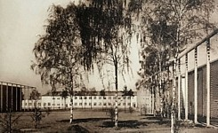Landesschule: Die bereits kurz nach dem Ersten Weltkrieg gegründete Schule wurde 1927 aus der Albertstadt in die neu entstandene Schulstadt in Klotzsche verlegt. Als größte Internatsschule Sachsens mit ca. 250 Plätzen sollte sie als Nachfolgerin der aufgelösten Kadettenschule ihre Schüler im Sinne eines humanistisch-bürgerlichen Bildungsideals erziehen. Der aus mehreren Gebäuden bestehende Komplex wurde zwischen 1925 und 1927 von den Architekten Heinrich Tessenow und Oskar Kramer entworfen und bis 1934 als Internatsschule genutzt. Neben dem Schulgebäude entstanden sechs Internatsbauten, ein Festsaal, Turnhalle, Sportstadion und Verwaltungsgebäude. Vor dem Haupteingang des Schulhauses fand die Bronzestatue “Liegender Fechter, der seine Waffe prüft” des Bildhauers August Streitmüller Aufstellung. Die Plastik verschwand nach 1945 als “Beutekunst” in der Sowjetunion, der Sockel ist jedoch noch vorhanden.

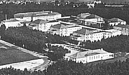

**_Foto:_** _Luftaufnahme der früheren Landesschule aus den Dreißiger Jahren_

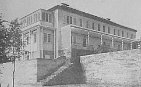Nach Schließung der Landesschule richteten die Nazis hier am 1. April 1934 eine Nationalpolitische Erziehungsanstalt (NAPOLA) ein und benannten die Einrichtung in “Rudolf-Schröter-Schule” um. Im Geiste des am 12. Februar 1931 in Leipzig bei Auseinandersetzungen zwischen Nazis und Kommunisten erschossenen Dresdner Hitlerjungen Rudolf Schröter sollten hier junge deutsche Männer zu Führungsnachwuchs des NS-Staates erzogen werden. Auf dem Lehrplan der einzigen “Eliteschule” ihrer Art in Sachsen standen deshalb neben den klassischen Unterrichtsfächern die politische Erziehung und eine straffe vormilitärische Ausbildung. Aufnahme fanden ausschließlich Knaben im Alter von 13 Jahren, die nach bestandener Aufnahmeprüfung in einem Reformrealgymnasium bzw. einer Oberrealschule unterrichtet wurden. Insgesamt besuchten bis zu 250 Schüler die Einrichtung. Leiter der Schule waren Herbert Barth, Otto Walter Kleint und zuletzt der SS-Untersturmführer Eugen Wittmann.

Von 1945 bis 1992 dienten die Gebäude der Sowjetarmee. U.a. befand sich in den Gebäuden der Stab der 11. Gardepanzerdivision bzw. eine sowjetische Grundschule für Offizierskinder. Nach deren Abzug wurde die ehemalige Landesschule rekonstruiert und 2001 als Berufsgenossenschaftliche Akademie für Arbeitssicherheit und Gesundheitsschutz eröffnet (seit 2010 Institut für Arbeit und Gesundheit der DGUV).

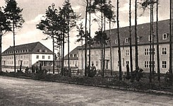Luftkriegsschule: Die Grundsteinlegung für diese Schule erfolgte am 1. Mai 1935 an der Königsbrücker Landstraße 159. Bis zur Eröffnung der Einrichtung am 16. April 1936 entstanden nach Plänen von Johannes und Walter Krüger sowie Ernst Sagebiel verschiedene Schul- und Wohngebäude sowie technische Anlagen, die in dem großzügig konzipierten parkähnlichen Gelände Platz fanden. Zum Komplex gehörten neben dem Zentralbau mit Lehrtrakt _(Foto rechts)_ mehrere Nebengebäude für den Schulbetrieb, Unterkünfte für die Kompanie, Flugzeughallen und Werftgebäude sowie Wohnhäuser für Offiziere und Unteroffiziere. Hinzu kam das Wachgebäude am Eingang Königsbrücker Landstraße, eine Turn- und Schwimmhalle, ein Kasino sowie ein Krankenrevier mit eigenen Operationssälen. Zu den wenigen Schmuckelementen gehörte im Giebelfeld des Hauptgebäudes das Relief “Der Flieger” von Arno Breker, welches jedoch nach Kriegsende entfernt wurde. Bis 1945 wurden an der Luftkriegsschule Offiziere der Luftwaffe, Jagd- und Bomberpiloten, Bordschützen und Flakartilleristen ausgebildet. Während des Zweiten Weltkriegs gab es im Auftrag der Erla-Werke zudem Anlagen für die Produktion von Flugzeugteilen für den Jagdflieger Me 109.

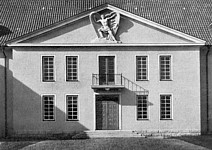Obwohl die Luftkriegsschule von den schweren Luftangriffen im Februar 1945 verschont blieb, wurde sie im März nach Straubing evakuiert. Die zu Kriegsende geplante Sprengung des Gebäudekomplexes konnte verhindert werden.
Das Gelände wurde jedoch von sowjetischen Einheiten belegt und war ab 1955 Sitz der [Flugzeugwerke](../../nord/klotzsche/flughafen/flugzeugwerft/). Mit Aufgabe der DDR-Flugzeugproduktion wurden die Gebäude von verschiedenen ingenieurtechnischen Unternehmen genutzt. Haus 137 war Sitz der 1961 von Werner Hartmann gegründeten Arbeitsstelle für Molekularelektronik und Keimzelle der Mikroelektronik in der DDR. Heute ist das Areal als Gewerbepark “Micropolis” Sitz verschiedener Firmen. Außerdem nutzen die Staatlichen Kunstsammlungen einige Gebäude als Depot und Restaurierungswerkstätten. Zudem befindet sich hier der Sitz des Sächsischen Landesamtes für Archäologie.

Kinderbewahranstalt:
Der erste Kindergarten Klotzsches entstand Ende des 19.Jahrhunderts auf Initiative des Kantors Heinrich Gottlob Fischer. Die Einrichtung, von Fischer als “Kleinkinderschule” bezeichnet, nahm Kinder zwischen zwei
und sieben Jahren auf und wurde vom “Verein der Kinderfreunde Klotzsche” finanziert. Die Eröffnung erfolgte am 5.
November 1893 in einigen Räumen des Gemeindehauses Kurze Straße 2 (heute Silcherstraße). Unterstützt wurde der
Verein durch die gräfliche Familie von Brühl aus Ottendorf, die auch zahlreiche Lehrmittel zur Verfügung stellten. Die
Kinderschule existierte bis 1929 und wurde dann vom neu errichteten Kindergarten An denRuschewiesen 4 abgelöst. Diese Kita öffnete am 3. März 1929. Das Gebäude der Kinderbewahranstalt wurde später als Freibank-
Fleischverkaufsstelle genutzt und dient heute Wohnzwecken.

Postwesen in Klotzsche:

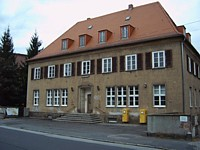Die erste Poststelle in Klotzsche wurde 1873 im Haus Hauptstraße 1 eingerichtet. 1883 wurde diese zur Postagentur, 1890 zum Kaiserlichen Postamt erhoben. Im Jahr 1899 entstand ein Neubau an der Königsbrücker Straße 79. 1936 wurde das Klotzscher Postamt zur Gertrud-Caspari-Straße 10 verlegt (Eröffnung am 16. September) _(Foto)_. Grund war vor allem die spürbare Zunahme des Briefverkehrs nach Eröffnung des Flughafens, der 1937 ein eigenes Luftpostamt erhielt. Das neue Postamt besaß neben den Diensträumen auch ein modernes Telegrafenamt, eine Rentenstelle, zwei Beamtenwohnungen sowie einen Betriebshof mit Tankstelle für die hier stationierten Kraftwagen.

In den letzten Kriegsmonaten hatte Klotzsche eine besondere postalische Bedeutung, da sich hier in einem Bahnpostwagen der Ersatz für das zerstörte Dresdner Bahnpostamt befand. Dieses war zeitweise für die gesamte Briefpost in Sachsen zuständig und übernahm auch die Verteilung von Paketen für die Stadt Dresden. Dieses ungewöhnliche Postamt bestand noch bis zum 12. Juli 1945.

Nach der Eingemeindung kam Klotzsche 1950 auch postalisch zu Dresden. Das Postamt Klotzsche blieb jedoch weiterhin bestehen. 1993 wurde zudem eine Außenstelle am Flughafen eingerichtet. Im Jahr 2000 eröffnete im Fontane-Center am Sagarder Weg eine neue Postfiliale, woraufhin das bisherige Postamt Gertrud-Caspari-Straße am 28. Dezember 2000 geschlossen wurde und bis Anfang 2014 nur noch als Briefverteilzentrum diente. Im Anschluss übernahm die Evangelische Kirchgemeinde Klotzsche-Hellerau das Haus, um hier ihr Gemeindezentrum einzurichten.

Rathaus Klotzsche:

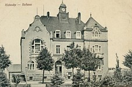Das Rathaus wurde 1906/07 an der Kieler Straße errichtet und war bis 1950 Sitz der Gemeinde- bzw. Stadtverwaltung. Architekt des Gebäudes an der damaligen Gartenstraße 52 war C. Rudolph. Für den Ratssaal schuf der Maler Friedrich Alfred Oehme 1934/35 ein Gemälde, welches einen Blick über den Ort zeigt. Das Bild wurde nach 1950 entfernt und kehrte erst 2000 wieder an seinen Ursprungsort zurück. Das Rathaus dient heute als Sitz des Ortsamtes Klotzsche _(Foto)_. Der frühere Ratsaal ist seit 1998 als Bürgersaal wieder öffentlich zugänglich.

1916 wurde vor dem Gebäude ein Gedenkstein für Theodor Körner aufgestellt. Schöpfer war der Bildhauer Gröne, Mitglied des Königlich-Sächsischen Militärvereins Klotzsche.

Bibliothek Klotzsche:

Die erste öffentliche Schul- und Volksbibliothek entstand 1887 und befand sich im Gebäude der Volksschule auf der
Hauptstraße 26. Als Bibliothekare fungierten an der Schule unterrichtende Lehrer, welche auch die Erhebung des
“Lesegeldes” von anfangs drei Pfennigen je Woche vornahmen. 1891 richtete der Ortsverein Königswald eine weitere
Bibliothek im “Goldenen Apfel” auf der Bahnhofstraße (Wolgaster Straße) 7 ein. Hinzu kam die im gleichen Jahr
gegründete private Leihbibliothek des Buchbindermeisters Clemens Behr auf der Königsbrücker Straße 52. Mehrfach
wechselten die genannten Einrichtungen ihren Standort, wurden durch private Neugründungen ergänzt bzw. erweitert.
So gab es ab 1927 eine Internatsbücherei in der Landesschule, 1928 eine Volksbücherei in einem Nebenraum der Turnhalle Auenstraße (Gertrud-Caspari-Straße) 9. Nach 1945 bezog die Städtische Bücherei, welche heute zur
Dresdner Stadtbibliothek gehört,  zwei ehemalige Wohnungen im Erdgeschoss des Hauses Göhrener Weg 2. Seit 25. Mai 2011 hat sie ihren Sitz auf der Boltenhagener Straße 66/68.

Wasserwerk Klotzsche:

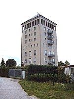Das Klotzscher Wasserwerk wurde 1899 an der Königsbrücker Landstraße 100 durch den Ingenieur und Architekten Bernhard Salbach errichtet. Die Wasserförderung erfolgte über mehrere Tiefbrunnen und den Flossertgraben. Im Werksgelände befand sich ein unterirdischer Wasserbehälter, aus welchem das Trinkwasser zu einem zweiten Hochbehälter auf die Rähnitzer Höhe gepumpt und anschließend in die Haushalte geleitet wurde. 1909 erfolgte die verwaltungstechnische Vereinigung mit dem Klotzscher Gaswerk (ab 1942 Stadtwerke Klotzsche). Wegen des Flughafenbaus musste 1935 dieser Behälter abgetragen und als Ersatz ein neuer Wasserturm errichtet werden, der bis heute den Ort überragt und Wahrzeichen Klotzsches ist _(Foto 2011)_. Der 35 Meter hohe Turm mit seinen 10.000 Hektolitern Fassungsvermögen wurde am 20. Juli 1935 offiziell in Betrieb genommen und war zeitweise auch Bestandteil des früheren Stadtwappens.

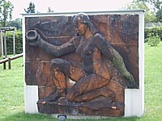Nach 1945 wurde das Wasserwerk, dessen technische Einrichtung noch erhalten ist, stillgelegt. Der architektonisch interessante Turm mit einer Relieftafel an der Fassade blieb noch bis in die 1960er Jahre in Betrieb und wurde zugleich als Feuerwachturm genutzt. Später diente er bis 1987 für Weiterbildungsveranstaltungen der Stadtverwaltung. Pläne für einen Umbau zum Jugendclub scheiterten an den hohen Kosten. Nach dem Verkauf des denkmalgeschützten Gebäudes entstanden 2003/04 nach Entwürfen des Architekturbüros Gast mehrere Eigentumswohnungen. Dabei erhielt der Turm einige zusätzliche Fenster, Balkons und eine verglaste Veranda im obersten Geschoss. Das Relief von der Fassade mit Darstellung einer nackten Frau mit Wassergefäß ist heute im Garten aufgestellt _(Foto)_.

Gaswerk Klotzsche:

Das Klotzscher Gaswerk entstand 1904 aufBeschluss des Gemeinderates am Ortsausgang in Richtung Weixdorf in unmittelbarer Nachbarschaft des Wasserwerkes und wurde am 13. April 1905 in Betrieb genommen. Zunächst besaß dieses Werk drei Öfen, Geräte- und Personalräume sowie ein Gasometer mit 800 Kubikmetern Inhalt. Zwischen 1908 und 1911 erfolgten Erweiterungen des Betriebes, u. a. der Neubau eines zweiten Gasometers. Weitere Verbesserungen und Modernisierungen wurden nach dem Ersten Weltkrieg vorgenommen. Hauptaufgabe des Werkes war die Versorgung der örtlichen Bevölkerung und Industrie mit Stadtgas sowie die Sicherung der Straßenbeleuchtung. Das Gaswerk überstand den Zweiten Weltkrieg unbeschädigt und wurde 1950 stillgelegt. Später dienten die Bauten an der Königsbrücker Straße 100 als Lager- und Produktionsgebäude.

[_Weiterführende Literatur und Quellen_](../../impressum/quellenverzeichnis/)

* * *

 \[ [Home](../../index.html)\] \[ [Nord](../../nord/)\] \[ [Nordwest](../../nordwest/)\] \[ [Neustadt](../../neustadt/)\] \[ [Nordost](../../nordost/)\] \[ [West](../../west/)\] \[ [Zentrum](../../zentrum/)\] \[ [Südwest](../../sudwest/)\] \[ [Süd](../../sud/)\]
 \[ [Südost](../../sudost/)\] \[ [Ost](../../ost/)\] \[ [Register](../../Register/register.html)\] \[ [Kontakt](../../Kontakt/kontakt.html)\] \[ [Impressum](../../impressum/)\]
