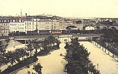
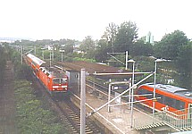
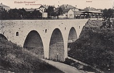
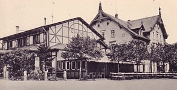
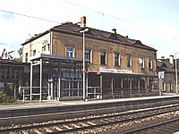
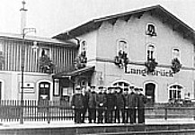

* * *

Die Eisenbahnstrecke zwischen Dresden und Görlitz entstand Mitte des 19. Jahrhunderts und war Teil der bereits 1836 geplanten Bahnverbindung von Dresden nach Breslau. Auf Initiative des Baurates Friedrich
Theodor Krause schlossen sich interessierte Unternehmer zum Oberlausitzer Eisenbahn-Komitee zusammen. 1837 bildete sich in Breslau ein ähnlicher Interessenverband aus schlesischen Fabrikanten, Kaufleuten und
Großgrundbesitzern, die sich von der geplanten Verkehrsverbindung bessere Absatzmöglichkeiten für ihre Produkte erhofften. Aus diesen beiden Gruppierungen ging die Sächsisch-Schlesische Eisenbahngesellschaft hervor, die
entsprechende Anträge an die preußische und die sächsische Regierung stellte.

Obwohl bereits 1841 eine erste Konzession erteilt worden war, scheiterte der Baubeginn zunächst an finanziellen Fragen, da die Ausgabe von
Aktien nicht den gewünschten Erfolg brachte. Nach Plankorrekturen und komplizierten Verhandlungen wurde am 24. Juli 1843 ein Staatsvertrag zwischen Sachsen und Preußen geschlossen, der eine Trassenführung von Dresden
über Bautzen - Görlitz - Kohlfurt nach Breslau vorsah. Bei Vertragsabschluss hatte Sachsen gefordert, die gesamte Strecke zwischen Dresden und dem damals noch auf preußischem Gebiet gelegenen Görlitz in eigener
Verantwortung bauen zu dürfen. Die preußische Regierung stimmte diesem Ansinnen unter der Bedingung zu, den Streckenabschnitt zwischen Görlitz und der Landesgrenze bei Reichenbach nach 30 Jahren käuflich erwerben zu
können. Damit stand dem Baubeginn am 10. Juni 1844 nichts mehr im Wege. Bereits ein Jahr später konnte am 17. November 1845 der Abschnitt zwischen Dresden-Neustadt (Schlesischer Bahnhof) und Radeberg eröffnet werden.
Die übrigen Streckenteile folgten am 22. Dezember 1845 (Radeberg - Bischofswerda), 23. Juni 1846 (Bischofswerda - Bautzen), 23. Dezember 1846 (Bautzen - Löbau), bevor am 1. September 1847 erstmals Züge durchgängig
zwischen Dresden, Görlitz und Breslau verkehrten.

Ihren Ausgangspunkt hatte die Bahn am Schlesischen Bahnhof in Dresden, der seit seinem Umbau 1901 heute den Namen Bahnhof Dresden-Neustadt trägt. Von hier führte die
Trasse fast ausschließlich durch Waldgebiet bis nach Radeberg, wobei zunächst lediglich in Langebrück ein Haltepunkt eingerichtet wurde. Für diesen Verlauf hatte man sich entschieden, da sich für Radeberg dadurch ein
günstigerer Standort des Bahnhofes ergab. Erste Pläne hatten eine Linienführung über Klotzsche - Weixdorf - Lausa - Ottendorf und Seifersdorf vorgesehen. 1875 erhielt auch der aufstrebende Villenvorort
Klotzsche-Königswald eine eigene Haltestelle. Die Sächsisch- Schlesische Eisenbahn wurde zunächst als private Aktiengesellschaft betrieben, bevor 1851 die Königlich-Sächsische Staatseisenbahn Anlagen und Betriebsmittel
übernahm.

**Streckenverlauf und Stationen im Dresdner Stadtgebiet:**

Bahnhof Dresden-Neustadt:
Die Station entstand als Ausgangspunkt der Sächsisch-Schlesischen Bahn und wurde mit deren Inbetriebnahme 1845 als Schlesischer Bahnhof eröffnet. Das Empfangsgebäude befand sich an der Anton-/ Großenhainer Straße und besaß zwei separate, symmetrisch angeordnete Ankunfts- und Abfahrtshallen, Drehscheiben zum Umsetzen der Lokomotiven, Maschinenhof, Frachtschuppen sowie ein Verbindungsgleis zum benachbarten Leipziger Bahnhof. Im Zuge des Umbaus der Dresdner Bahnanlagen wurde der alte Schlesische Bahnhof 1898 abgetragen und durch den noch heute genutzten
Bahnhof Dresden-Neustadt ersetzt.

Von hier verläuft die Strecke zunächst durch die nördliche Dresdner
Neustadt. Kurz hinter dem Bahnhofsausgang zweigt links die Bahnlinie nach Leipzig ab. Nach Überquerung des Bischofsweges _(Foto)_ und der Stauffenbergallee wird das [Industriegelände](../../../neustadt/albertstadt/industriegelande/) erreicht. Dieser Stadtteil wurde 1873 als Albertstadt gegründet und bis zum Ende des Ersten
Weltkrieges vorrangig für militärische Zwecke genutzt. Noch heute erinnern die großen Kasernenbauten und die an der Bahnlinie gelegenen Wirtschaftseinrichtungen wie die ehemalige Garnisonsverpflegungsanstalt
mit der Heeresbäckerei an diese Nutzung. Hier zweigt auch die zur Erschließung der verschiedenen Unternehmen 1901 angelegte [Industriebahn Albertstadt](../../../neustadt/albertstadt/industriegelande/industriebahn_albertstadt/) ab, die heute jedoch kaum noch genutzt wird.

Haltepunkt Industriegelände:
Der Haltepunkt wurde erst 1971 angelegt, um den Angestellten der zahlreichen Betriebe eine günstige Verkehrsverbindung zu verschaffen. Bis heute halten hier die S-Bahn-Züge auf ihrem Weg nach
Arnsdorf bzw. Königsbrück. Im Zusammenhang mit dem Bau dieser Station entstand auch eine Fußgängerbrücke über die stark befahrene Königsbrücker
Straße. Bereits während des Ersten Weltkrieges gab es an gleicher Stelle den Haltepunkt Dresden-Arsenal, der für den Werksverkehr als Bedarfshalt genutzt wurde.

Nach Verlassen des Haltepunktes unterquert die Strecke die Königsbrücker Straße und berührt das Waldgebiet der Dresdner Heide. Hier verläuft die Strecke oberhalb des Prießnitzgrundes bis zum Bahnhof Klotzsche. Kurz vor dessen Erreichen wird der Nesselgrund auf einer Brücke überquert _(Foto)_.

Dieses Viadukt entstand beim Bau der Strecke 1848 und wurde in den letzten Kriegstagen 1945 gesprengt. Zunächst gab es hier ab November 1945 nur einen provisorischen Neubau. Ab 1948 verlief dann der gesamte Bahnverkehr jahrzehntelang über einen wiederaufgebauten Brückenbogen. Erst 1999 konnte auch der zweite Brückenteil in modernen Formen vervollständigt werden. Ein Ersatzneubau der zweiten Brückenhälfte folgte 2016. Die Einweihung der neuen Nesselgrundbrücke fand im März 2018 statt.

Bahnhof Klotzsche: Die Station wurde am 1. September 1875 als Haltepunkt Klotzscha eröffnet, vor allem, um dem zunehmenden Ausflugsverkehr Rechung zu tragen. Zuvor hatten sich der Lausaer Pfarrer Rühle und einige Gewerbetreibende der umliegenden Orte mit einer Petition an die Behörden gewandt und so für eine Verbesserung der Verkehrsbedingungen geworben. Die Haltestelle bestand zunächst nur aus einem einfachen Stationsgebäude mit Bahnwärterhaus und Wirtschaftsschuppen und war lediglich über eine schmale Straße (heute “Zur neuen Brücke”) erreichbar. Wanderwege verbanden den Bahnhof mit den Siedlungen an der Alberthöhe und am Schänkhübel.

Zeitgleich mit dem Bahnhofsbau entstand gegenüber dem Bahnhof das spätere [Bahnhofshotel](../../../nord/klotzsche/strassen_klotzsche/bahnhofshotel/) _(Foto)_, welches zunächst “Sommerfrische Quosdorf” hieß und Ausgangspunkt des Kurortes Königswald war. Ab 1884 war die Station zugleich Beginn einer schmalspurigen [Eisenbahnstrecke nach Königsbrück](../../../nord/klotzsche/dresden_-_gorlitz/schmalspurbahn/), die 1897 in Normalspur umgebaut wurde. Zu den Besonderheiten gehörten die in den ersten Betriebsjahren hier auf die Schmalspurfahrzeuge aufgesetzten Wagenkästen normalspuriger Güterwagen, die Klotzsche zum ersten “Containerbahnhof” Europas machten.

1907/08 entstanden die heutigen Bahnhofsanlagen mit dem neuen Empfangsgebäude _(Foto)_, als die Bahnstrecke zwischen dem Bahnhof Dresden-Neustadt und Klotzsche dreigleisig ausgebaut wurde. Nicht realisiert wurde der geplante Bau einer Nebenstrecke nach Bühlau - Weißig. Nördlich des Personenbahnhofes wurde ein von den in Klotzsche beheimateten Betrieben genutzter Güterbahnhof angelegt. Nach 1990 verfiel das unter Denkmalschutz stehende Empfangsgebäude. Ein 1993 geplanter Umbau zum “Kunstbahnhof” mit Galerie- und Ausstellungsräumen scheiterte an den erforderlichen finanziellen Aufwendungen. Die für den Regional- und S-Bahn-Betrieb erforderlichen Anlagen wurden jedoch 1999/2000 modernisiert. Außerdem entstanden ein P+R-Platz für Pendler und Umsteigepunkte zu den Bussen des Stadt- und Regionalverkehrs. 2015/16 folgte der Umbau des ehemaligen Bahnhofsgebäudes zum Supermarkt für Bioprodukte. Im älteren Empfangsgebäude haben sich verschiedene Anbieter von Öko-Waren eingemietet.

Video: Ein Sonderzug des Sächsischen Eisenbahnmuseums

mit der Dampflokomotive 50 3648 am 19.1.2008 bei Dresden-Klotzsche

Abschnitt Klotzsche - Grenzstraße - Flughafen:

Kurz hinter dem Güterbahnhof zweigt nach Überquerung der Langebrücker Straße eine 1933 angelegte
Anschlussbahn in Richtung Flughafen ab. Ursprünglich diente diese dem Transport von Material zur Luftkriegsschule, nach 1945 auch zur Belieferung der auf dem Gelände entstandenen Flugzeugwerft. 1966 erfolgte
die Freigabe der 4,5 km langen Nebenstrecke für den Personenverkehr, wofür der neue Haltepunkt Grenzstraße eingerichtet wurde. Diese Station war später Teil des Dresdner S-Bahn-Netzes. Eine geplante Verlängerung bis in
die [Hellerberge](../../../nord/), wo in den 1960er Jahren ein großes Neubaugebiet geplant war, km nicht zustande

Im Zusammenhang mit dem Ausbau des Flughafens wurde die Zweigstrecke 1998 komplett erneuert und bis zum neuen Flughafen-Terminal um 1,3 km verlängert. Der letzte Abschnitt verläuft dabei unterirdisch, so dass im
Terminal bessere Umsteigemöglichkeiten bestehen. Am 25. März 2001 nahm die Bahn die neue Linie zwischen Bahnhof Neustadt und Flughafen in Betrieb. Um einen reibungslosen und kreuzungsfreien Verkehr zu gewährleisten,
entstand eine Brücke über die Eisenbahnstrecke Dresden - Görlitz. Seit Dezember 2004 verkehren die Züge durchgängig bis Heidenau.

Hauptstrecke Klotzsche - Langebrück

Die eigentliche Hauptstrecke teilt sich wenig später in die Zweigstrecken nach Königsbrück und Bautzen - Görlitz.
Letztere erreicht dann schon bald den Langebrücker Ortsteil Heidehof, der nördlich umgangen wird und erst nach
Eröffnung der Bahnlinie entstand. Der eigentliche Ort wurde durch den Eisenbahnbau in zwei Teile zerschnitten, was
zu Protesten der ortsansässigen Bauern führte, die zudem ca. 60 Hektar ihres Landes an die Bahngesellschaft verkaufen mussten. Zudem erschwerten die Geländeverhältnisse den Bau, der hier
bergmännisch durch den Fels getrieben wurde. Die schlechten Arbeitsbedingungen für die über 5000 eingesetzten Arbeiter führten sogar zu einem Streik, der eine kurzzeitige Unterbrechung des Bahnbaues mit sich brachte.

Bahnhof Langebrück:
Die Station wurde am 17. November 1845 mit Eröffnung des ersten Streckenabschnittes bis Radeberg in Betrieb genommen und blieb bis zur Einweihung des Haltepunktes in Klotzsche fast 30 Jahre lang
erster Unterwegshalt auf dem Weg nach Görlitz _(Foto)_. 1886 baute man den Bahnhof um, wobei auch ein Fußgängertunnel zur Unterquerung der Gleise
entstand. 1898 folgte schließlich der Langebrücker Güterbahnhof, der ein Jahr später am 16. August 1899 eröffnet wurde).

Am 23. August 1869 ereignete sich bei Langebrück ein schweres
Eisenbahnunglück, bei dem der Lokführer und der Schaffner des Zuges ums Leben kamen. Zahlreiche Fahrgäste wurden beim Entgleisen des Personenzuges verletzt. In Folge dieses Unglücks wurde in Sachsen die Staatshaftung
für alle Bahnunfälle eingeführt und die Sicherheitsbestimmungen verschärft. Zuvor hatte sich bereits kurz nach Inbetriebnahme der Strecke am 17. Januar 1851 ein Unfall zwischen Langebrück und Klotzsche ereignet, bei dem
vier Bahnangestellte den Tod fanden.

* * *

 \[ [Home](../../../index.html)\] \[ [Nord](../../../nord/)\] \[ [Nordwest](../../../nordwest/)\] \[ [Neustadt](../../../neustadt/)\] \[ [Nordost](../../../nordost/)\] \[ [West](../../../west/)\] \[ [Zentrum](../../../zentrum/)\] \[ [Südwest](../../../sudwest/)\] \[ [Süd](../../../sud/)\] \[ [Südost](../../../sudost/)\] \[ [Ost](../../../ost/)\] \[ [Register](../../../Register/register.html)\] \[ [Kontakt](../../../Kontakt/kontakt.html)\] \[ [Impressum](../../../impressum/)\]
