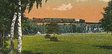
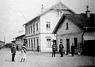
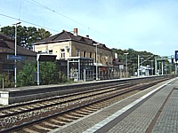
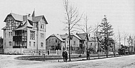
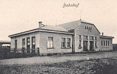

* * *

Die Eisenbahnstrecke von Klotzsche nach Königsbrück entstand ab 1883 zunächst in Schmalspur mit 750 mm Spurweite. Mit dem Bau der Nebenbahn sollte der Transport von Gütern im Gebiet nördlich von Dresden
erleichtert werden, nachdem sich in Ottendorf und Königsbrück einige Fabriken angesiedelt hatten. Bereits 1873 hatte die sächsische Regierung das Gebiet als “bahnbedürftigen Industriebezirk” eingestuft. Doch erst 1877
ergriffen private Interessenten die Initiative und setzten das Vorhaben durch. Vor allem die Königsbrücker Töpfereibesitzer forderten verbesserte Verkehrsbedingungen zum Transport ihre Ware und gründeten 1879 sogar eine
Unterstützungskasse für die erforderlichen Vorarbeiten, in die jeder 100 Taler einzahlte.

Am 17. Januar 1882 beschloss die Ständekammer einstimmig den Bau einer Schmalspurbahn von Klotzsche über Lausa - Ottendorf
nach Königsbrück. Nach Abschluss der erforderlichen Landkäufe und Vermessungsarbeiten konnte am 23. Oktober 1883 in der Nähe der Okrillaer Mühle der erste Spatenstich erfolgen. Um Kosten zu sparen, folgte die Trasse
weitgehend bereits vorhandenen Wegen. Auch die Stationsgebäude entstanden in einfachster Bauausführung. Lediglich Klotzsche und Königsbrück erhielten größere Empfangsgebäude. Am 17. Oktober 1884 wurde die 19,5 km lange
Strecke eröffnet. Die Baukosten beliefen sich auf 884.727 Mark.

**_Foto:_** _Die Pulsnitzbrücke in der Nähe von Königsbrück - wichtigstes Kunstbauwerk der Strecke_

Um den Gütertransport zu erleichtern, entstand in Klotzsche eine für die damalige Zeit hochmoderne Umsetzanlage, in der die Wagenkästen der normalspurigen Güterwagen auf Schmalspur-Fahrgestelle aufgesetzt
und so ohne Umladen weiter befördert werden konnten. Die Klotzscher Anlage gilt als einer der ersten Container-Bahnhöfe überhaupt, bevor sich die Technologie in leicht abgewandelter Form allgemein durchsetzte.
Nicht zuletzt durch diese Methode übertraf die Wirtschaftlichkeit der Schmalspurbahn schon bald alle Erwartungen. In Weixdorf, Lausa, Ottendorf-Okrilla und Königsbrück siedelten sich weitere Unternehmen an, die
die Orte an der Bahnstrecke zu Industriegemeinden machten. Hinzu kam der Wunsch des königlich-sächsischen Kriegsministeriums nach einer leistungsfähigen Bahnverbindung zu den Truppenübungsplätzen bei Königsbrück und
Schwepnitz. So entschloss man sich 1896 zum Umbau der Strecke in Regelspur.

Innerhalb weniger Monate begann nun auf dem Bahnkörper der Schmalspurbahn die Verlegung von neuen Gleisen, wobei deren Betrieb voll aufrecht erhalten wurde. Die
Bauleitung, die ihren Sitz in Klotzsche hatte, oblag dem Bauinspekteur Pietsch, der das bereits beim Bau des Friedrichstädter Rangierbahnhofes beteiligte
Bauunternehmen Robert Berndt mit den praktischen Arbeiten beauftragte. Zeitweise waren bis zu 500 Arbeiter tätig, die am Tag ca. 300 m Gleise verlegten. Am 25.
November 1896 waren die Arbeiten im Wesentlichen beendet. Nach Fertigstellung der Brücken und weiterer Kunstbauten, konnte die Bahn am 1. April 1897 zum zweiten Mal eröffnet werden. Die
Schmalspurgleise wurden im Anschluss entfernt. 1899 erfolgte eine Verlängerung der Strecke bis Schwepnitz (Eröffnung am 30. September), 1933/34 bis zum Bahnhof Straßgräbchen-Bernsdorf. Heute fahren die Züge im
Auftrag des Verkehrsverbundes Oberelbe zwischen Hauptbahnhof und Königsbrück, während die Reststrecke ab 1998 nur noch für den Güterverkehr genutzt und 2001 stillgelegt wurde. Das Foto zeigt das alte Klotzscher
Bahnhofsgebäude kurz nach 1900.

**Streckenverlauf und Stationen im Dresdner Stadtgebiet:**

Bahnhof Klotzsche:
Mit dem Bau der Schmalspurbahn entstand in unmittelbarer Nachbarschaft des 1875 eröffneten Haltepunktes Klotzsche-Königswald ein neues Empfangsgebäude, welches mit den bereits vorhandenen
Bauten verbunden wurde. Hinzu kamen Wirtschaftsgebäude, Güterschuppen, Lade- und Abstellgleise sowie die zur Wartung der Schmalspurfahrzeuge erforderlichen Einrichtungen. Mit dem Umbau in Normalspur wurden diese
Anlagen überflüssig und demontiert.

Um das Umsteigen der Fahrgäste zu erleichtern und dem gewachsenen Verkehrsaufkommen Rechnung zu tragen,
erfolgten ab 1899 größere Umbauarbeiten an Gleisen und Bahnsteigen. In diesem Zusammenhang wurde 1907/07 auch das noch heute erhaltene Empfangsgebäude errichtet. Auch in den Folgejahren machten sich immer wieder
Modernisierungen und Erweiterungen des Klotzscher Bahnhofs erforderlich, vor allem durch den zweigleisigen Streckenausbau zwischen Klotzsche und Weixdorf 1921.

Den zweiten Weltkrieg überstand das Bahnhofsgelände ohne nennenswerte
Schäden. Allerdings wurde die Eisenbahnbrücke über den Nesselgrund am 8. Mai 1945 von der SS gesprengt, so das Klotzsche bis zu deren provisorischer
Widerherstellung Ende 1945 zum Kopfbahnhof wurde. Bis zur Wende blieb die Station nicht nur wichtiger Umsteigepunkt, sondern auch Güterumschlagstation
und “Vorrangierstation” für Dresden-Friedrichstadt. Erst mit dem allgemeinen Rückgang des Eisenbahntransportes nach 1990 verlor der Bahnhof seine
Bedeutung, was zum Abbau vieler Nebengleise führte. Heute halten hier nicht nur die Regionalbahnen nach Görlitz und Königsbrück, sondern auch alle S-Bahnen.

Nach Verlassen des Bahnhofes Dresden-Klotzsche verläuft die Königsbrücker Strecke parallel zur [Bahnlinie nach Görlitz](../../../../nord/klotzsche/dresden_-_gorlitz/), zweigt dann jedoch in der Nähe des Hakenweges in nordwestlicher Richtung ab. In diesem Teil durchquert
die Bahn einen kleinen Teil der Dresdner Heide, bevor sie den Haltepunkt Weixdorf-Bad erreicht. Dieser Streckenabschnitt entstand erst 1921 im Zusammenhang mit dem zweigleisigen Ausbau der Strecke. Zuvor verlief
die Bahntrasse unmittelbar neben der Königsbrücker Landstraße. Den früheren Bahndamm nutzt heute die Straßenbahnlinie 7 der Dresdner Verkehrsbetriebe. Das zweite Streckengleis wurde nach 1945 als
Reparationsleistung demontiert.

**_Foto:_** _die ehemalige Bahntrasse an der Königsbrücker Landstraße in Weixdorf_

Haltepunkt Weixdorf-Bad: Die erste Station der Schmalspurbahn trug zum Zeitpunkt ihrer Eröffnung den Namen Haltestelle Weixdorf und wurde von den Einwohnern des damals noch selbstständigen Dorfes genutzt. Sie befand sich ungefähr 150 Meter vom heutigen Standort entfernt und bestand zunächst nur aus einer einfachen Wartehalle. Später kamen einige Nebengebäude für den Fahrkartenverkauf und die Gepäckaufbewahrung hinzu.

1917 enstand das noch heute vorhandene Empfangsgebäude am neuen Standort. Vier Jahre später wurde der bisherige Haltepunkt zum Bahnhof erhoben, der 1939 den Namen Weixdorf-Bad erhielt. Mit dem Abbau des zweiten Streckengleises zu Reparationszwecken wurde Weixdorf-Bad wieder zum Haltepunkt. Das heute nicht mehr benötigte Bahnhofsgebäude übernahm der Verein “Dixiebahnhof e.V., der es zu einem Treffpunkt für Freunde der Dixieland-Musik ausbaute. Seit November 2003 finden hier regelmäßig verschiedene kulturelle Veranstaltungen wie Konzerte, Lesungen und Filmvorführungen statt.

In der Folge verläuft die Bahnlinie direkt durch den Ort. Auf der rechten Seite sind neben dem Großteich weitere Teiche sowie der Dorfkern des Ortsteils Friedersdorf zu erkennen. In der Nähe der Lausaer Kirche befindet sich die zweite Haltestelle von Weixdorf.

Haltepunkt Weixdorf:
Die heute nur noch als Haltepunkt geführte Station hieß ursprünglich Lausa und hatte den Rang eines Bahnhofes mit den erforderlichen Einrichtungen. Neben einem enfachen Güterschuppen gab es ab 1891
auch eine Wartehalle für die Fahrgäste, die sich zuvor nur im benachbarten Gasthof unterstellen konnten. Dessen
Besitzer war zugleich als Güteragent und Fahrkartenverkäufer tätig. Erst in den Zwanziger Jahren konnten die lange geforderten Erweiterungen der Bahnhofsanlagen vorgenommen werden.

Lausa und Weixdorf schlossen sich 1914 zur Doppelgemeinde Lausa-Weixdorf zusammen, die seit 1938 den heutigen Namen Weixdorf trägt. Diese Bezeichnung übernahm auch die Deutsche Reichsbahn für ihre Station, die
seit 1972 nur noch den Status eines Haltepunktes besitzt. Das früher vorhandene Ladegleis verschwand nach 1978. Hinter dem Haltepunkt Weixdorf überquert die Bahnstrecke die Königsbrücker Landstraße und verlässt am
Ortsausgang das Dresdner Stadtgebiet.

Video: Triebwagen der Städtebahn Sachsen am Bahnübergang Königsbrücker Landstraße

* * *

 \[ [Home](../../../../index.html)\] \[ [Nord](../../../../nord/)\] \[ [Nordwest](../../../../nordwest/)\] \[ [Neustadt](../../../../neustadt/)\] \[ [Nordost](../../../../nordost/)\] \[ [West](../../../../west/)\] \[ [Zentrum](../../../../zentrum/)\] \[ [Südwest](../../../../sudwest/)\] \[ [Süd](../../../../sud/)\] \[ [Südost](../../../../sudost/)\] \[ [Ost](../../../../ost/)\] \[ [Register](../../../../Register/register.html)\] \[ [Kontakt](../../../../Kontakt/kontakt.html)\] \[ [Impressum](../../../../impressum/)\]
